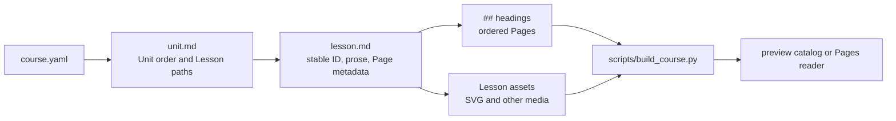

# Content structure

The source repository uses the learner-visible hierarchy **Unit → Lesson → Page**. URL position numbers are navigation only; they are not content IDs.

```text
units/
  01-unit-name/
    unit.md
    lessons/
      01-lesson-name/
        lesson.md
        assets/
          diagrams/
          animations/
```

- `course.yaml` orders Units. Each Unit's `unit.md` front matter lists its Lesson Markdown paths in learner order.
- Each Lesson's `lesson.md` front matter stores its existing stable ID, title, source reference, concepts, and media metadata. Each `##` heading begins a Page; the ordered `pages` list must match those headings one for one.
- Page metadata names its concepts, illustration positions, and any additional illustrations. Concept terms and authored animation descriptions stay with their concepts.
- Store authored assets beside their Lesson and reference them with paths relative to `lesson.md`. The builder selects same-named shared runtime SVGs when available; Lesson-local playback copies live under `assets/animations/`. Keep imported Wiki snapshots under `sources/wiki/` and record their provenance.
- New Unit 1 Lessons keep page prose and page metadata together in Markdown. Existing Lessons that still use `source_wiki` or `page_metadata` remain supported while they are migrated.
- `scripts/build_course.py` reads these sources and builds the preview catalog. Do not hand-edit the generated preview catalog.



Public Network routes use `/m2-network/unit/{unit}/lesson/{lesson}/page/{page}`. The page number is one-based and follows the order of `##` headings. Page IDs do not exist in the current progress contract; do not invent them.

Before introducing a new teaching pattern, inspect a real publisher-provided textbook sample and record its exact source and observed sequence in `docs/PEDAGOGY.md`. Describe our adaptation as an authoring decision, not as measured learning evidence.
