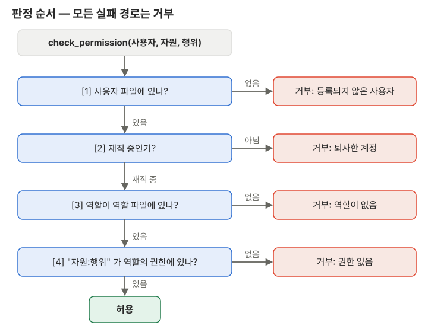

# 실습 1-2 · 권한 판정 함수 만들기

## 목표: 권한 판정 함수

> **오늘 들어온 일**
> A사 보안 담당이 보낸 메시지: 「표는 좋습니다. 이제 요청이 들어오면 이 표대로 허용 · 거부를 정하는 프로그램을 만들어 주세요. 거부할 때는 왜 거부했는지도 남겨야 감사 때 설명할 수 있습니다.」
> - 이 실습에서 하는 일: 실습 1-1에서 만든 사용자 파일과 역할 파일을 읽습니다. 그리고 사용자 · 자원 · 행위를 받아 **(허용 여부, 이유)** 를 리턴하는 함수 `check_permission` 을 `rbac.py` 에 직접 씁니다.
> - 끝나면 쓰는 것: 보고서 (가)~(다) 답

> **읽을거리 — 문제가 아닙니다.** 이 아래부터 첫 「실습」 전까지는 이 실습의 배경지식입니다. 답할 질문도 따라 칠 명령도 없으니 읽고 이해만 합니다.

## 왜 모든 실패를 거부해야 하는가

> **읽을거리 — 읽기만 합니다.** 문제가 아닙니다. 답할 질문도, 따라 칠 명령도 없습니다.

1. 표만 있고 막는 코드가 없으면 seoyeon 사건이 그대로 다시 일어납니다. 판단(PDP)을 코드로 만들어야 집행하는 곳(PEP)이 따를 수 있습니다.
2. 실패하는 경우는 여러 가지입니다. 없는 사용자, 퇴사자, 역할이 없는 사용자, 권한이 없는 요청. **어느 경우든 거부**해야 하고, 하나라도 빠지면 그 경우의 요청이 그대로 통과합니다.
3. 거부 이유를 구분해 남기면, 감사 때 「왜 막았나」를 설명하고 오탐(정상인데 막은 것)을 찾을 수 있습니다.

## 2.1 판정 순서 — 모든 실패 경로는 거부

> **읽을거리 — 읽기만 합니다.** 문제가 아닙니다. 답할 질문도, 따라 칠 명령도 없습니다.

<figure class="page-figure"></figure>

- 위에서부터 검사하다가 하나라도 걸리면 그 자리에서 거부를 리턴하고 끝납니다.
- 네 검사를 모두 지나야만 허용입니다. 검사 하나를 빼먹으면 그 경우는 **잘못 허용됩니다.** 이것이 열림 기본 값(fail-open), 즉 검사가 빠지면 기본이 허용이 되는 위험입니다.

#### 걸리면 바로 끝내는 이유

뒤 검사는 앞 검사를 통과한 요청에만 할 수 있습니다. 앞에서 걸러 주지 않으면 코드가 멈춥니다.

| 검사 | 앞에서 걸러 주지 않으면 |
|---|---|
| [2] 재직 | 사용자 파일에 없는 사용자의 `employed` 를 꺼내려다 `KeyError` 로 멈춤. 예: `USERS["minsu"]["employed"]` → `KeyError: 'minsu'` |
| [4] 권한 | 역할 파일에 없는 역할의 리스트를 꺼내려다 `KeyError` 로 멈춤. 예: `ROLES["intern"]` → `KeyError: 'intern'` |

- 하나만 걸려도 결론은 거부라서 남은 검사를 더 볼 필요가 없습니다. 끝까지 다 지난 요청만 허용하는 것이 기본 거부입니다.

#### 거부 이유 네 가지 — 감사 때 하는 말

| 거부 이유 | 어디서 막혔나 | 감사 때 하는 말 · 고칠 곳 |
|---|---|---|
| 등록되지 않은 사용자 | `users.json` 에 없음 | 등록 누락인지, 없는 계정의 접속 시도인지 |
| 퇴사한 계정 | `"employed": false` | 막는 게 맞음. 남은 계정은 회수 |
| 역할이 없음 | `roles.json` 에 없음 | 설정 누락 → `roles.json` 에 역할을 정해 넣음 |
| 권한 없음 | 리스트에 그 권한 없음 | 정상 차단. 한 계정에 몰리면 사건 신호 |

- 네 이유는 사용자 → 역할 → 권한을 찾아가다 막힐 수 있는 네 곳입니다. 이름은 수업에서 붙였습니다.
- 「거부」 하나로만 남기면 설정을 고칠 일과 사건 신호가 섞여 구분할 수 없습니다.

**이 시간에 나오는 말** (이미 배운 방법입니다)

- `with open(파일, encoding="utf-8") as 파일변수:` 와 `json.load(파일변수)` 로 JSON 파일을 딕셔너리로 읽습니다(앞선 실습).
- `값 in 딕셔너리` 는 딕셔너리에 그 키가 있는지, `값 not in 딕셔너리` 는 없는지 검사합니다. 예: `role not in ROLES`. `값 not in 리스트` 는 리스트에 없는지 검사합니다(앞선 실습).
- `return 값1, 값2` 로 두 값을 함께 리턴하고, `is_allowed, reason = 함수(…)` 로 나눠 받습니다(앞선 실습).
- `f"{resource}:{action}"` 처럼 f-문자열로 문자열을 합칩니다(앞선 실습).
- `from rbac import check_permission` 처럼 내가 만든 파일의 함수를 불러옵니다(앞선 실습의 `from llm_client import call_llm`).
- `if not 값:` 은 값이 거짓(`False`)일 때 실행됩니다.
- 함수 첫 줄의 `""" … """` 는 **독스트링**(docstring · 닥스트링)이라 부르는 설명 글입니다. 함수가 무엇을 받고 리턴하는지 한 번에 적은 것이고 실행에는 영향이 없습니다.

`rbac.py` 가 시작할 때 읽어 두는 `ROLES` · `USERS` 는 이런 모양이고, 함수는 `is_allowed, reason` 으로 나눠 리턴합니다.

```python
print(ROLES["sales"])                 # ['SALES:QUERY', 'SALES:CHANGE']
print(USERS["seoyeon"])               # {'role': 'sales', 'employed': True}   ← JSON 의 소문자 true 가 파이썬의 True 가 됨
print(USERS["seoyeon"]["employed"])   # True

is_allowed, reason = check_permission("minsu", "SALES", "QUERY")  # 판정 결과와 이유를 나눠 받는다
print(is_allowed, reason)                     # False 등록되지 않은 사용자
```

#### 문법 상자 · 채울 곳 세 가지의 모양 (예시 값 · 읽기만 합니다)

`[2]` 재직 검사의 모양입니다.

```python
is_open = False                           # 예시 값
if not is_open:                           # is_open 이 거짓이면
    print("닫혀 있음")                      # 닫혀 있음
```

- 예시의 `is_open` 자리에 `USERS[user]["employed"]` 를 넣으면 `[2]` 가 됩니다.

`[3]` 역할 검사의 모양입니다.

```python
print("hr" not in ROLES)                  # True  · hr 역할은 없음
print("sales" not in ROLES)               # False · sales 역할은 있음
```

`[4]` 권한 검사의 모양입니다.

```python
resource, action = "ACCOUNT", "CHANGE"    # 예시 값
permission = f"{resource}:{action}"       # 「자원:행위」 문자열을 만든다

print(permission)                         # ACCOUNT:CHANGE
print(permission not in ROLES["finance"]) # True  · finance 에는 없음
```

> **여기부터 문제입니다.** 위는 읽을거리였고, 아래에서 직접 합니다.

## 실습 1-2 · 권한 판정 함수 직접 쓰기

**이런 상황이 있습니다**

- 판정 함수의 첫 검사(등록되지 않은 사용자)는 미리 써 두었습니다. 담당자는 나머지 세 검사를 직접 써서, 모든 실패 경로가 거부되고 이유가 서로 다르게 남게 해야 합니다.
- 현업의 접근통제 코드는 이렇게 검사를 위에서부터 차례로 걸고, 끝까지 지난 경우에만 허용합니다.

**할 일**

1. 아래 코드로 `rbac.py` 를 만들고, `# ←` 가 있는 <mark>다섯 곳</mark>을 채웁니다.
2. 요청 아홉 건을 판정하는 `exercise1-2_run.py` 를 만들어 실행합니다.
3. 채우기 <mark>전과 후</mark>의 판정을 비교합니다.

**준비** — 아래 `rbac.py` 는 실습 1-1에서 만든 두 파일 `config/users.json` 과 `config/roles.json` 을 **읽습니다.** 그 파일이 없으면 코드가 시작하자마자 멈춥니다. 터미널이 `…/access_control` 위치인지 확인한 뒤(아니면 `cd access_control` 로 들어갑니다) 두 파일이 있는지 봅니다.

```bash
ls config
```

- 명령 풀이: `ls` 폴더 안의 파일 이름 리스트 · `config` 볼 폴더
- `roles.json` 과 `users.json` 두 개가 나와야 합니다. 없으면 실습 1-1로 돌아가 만듭니다. 없는 채로 실행하면 `FileNotFoundError: [Errno 2] No such file or directory: 'config/roles.json'` 오류가 납니다.

**`rbac.py`**

```python
import json                                                      # JSON 파일을 읽는 모듈을 불러온다

with open("config/roles.json", encoding="utf-8") as roles_file:           # 역할 파일을 연다
    ROLES = json.load(roles_file)                                         # 역할 → 권한 리스트 딕셔너리로 읽는다
with open("config/users.json", encoding="utf-8") as users_file:           # 사용자 파일을 연다
    USERS = json.load(users_file)                                         # 사용자 → 정보 딕셔너리로 읽는다


def check_permission(user, resource, action):                    # 사용자 · 자원 · 행위를 받는 함수
    """요청을 허용할지 (허용 여부, 이유)로 리턴한다. 요청이 들어올 때 가장 먼저 쓰는 판정이고, 허용 리스트에 없으면 모두 거부한다."""   # 함수 첫 줄의 """ … """ 는 함수 설명 글이고 실행에는 영향이 없다
    if user not in USERS:                                        # 사용자 파일에 없는 계정이면
        return False, "등록되지 않은 사용자"                       # 바로 거부하고 함수를 끝낸다
    # [2]-1. USERS[user]["employed"] 가 참이 아니면 "퇴사한 계정" 을 이유로 거부한다   # ←

    # [3]-1. 이 사용자의 역할 USERS[user]["role"] 을 role 에 담는다   # ←
    # [3]-2. role 이 ROLES 에 없으면 "역할이 없음" 을 이유로 거부한다   # ←

    # [4]-1. resource 와 action 을 "자원:행위" 모양 문자열로 합쳐 permission 에 담는다   # ←
    # [4]-2. permission 이 ROLES[role] 리스트에 없으면 "권한 없음" 을 이유로 거부한다   # ←

    return True, "허용"                                          # 모든 검사를 지나면 허용한다
```

**`exercise1-2_run.py`**

```python
from rbac import check_permission                                # rbac.py 의 판정 함수를 불러온다

REQUESTS = [                                                     # 판정할 요청 리스트. (사용자, 자원, 행위)
    ("seoyeon", "SALES", "QUERY"),                               # 영업이 영업 실적 조회
    ("seoyeon", "SETTLE", "QUERY"),                              # 영업이 정산 조회 (seoyeon 사건)
    ("junho", "SETTLE", "QUERY"),                                # 재무가 정산 조회
    ("junho", "SALES", "CHANGE"),                                # 재무가 영업 실적 변경
    ("dami", "SALES", "QUERY"),                                  # 퇴사자가 영업 실적 조회
    ("minsu", "SALES", "QUERY"),                                 # 사용자 파일에 없는 계정
    ("gaeun", "ACCOUNT", "CHANGE"),                              # 계정 관리자가 권한 변경
    ("batch-night", "SETTLE", "QUERY"),                          # 서비스 계정이 정산 집계
    ("tester", "SALES", "QUERY"),                                # 역할 파일에 없는 역할(intern)
]

for user, resource, action in REQUESTS:                          # 요청을 하나씩 꺼낸다
    is_allowed, reason = check_permission(user, resource, action)        # 판정 결과와 이유를 나눠 받는다
    print(user, resource, action, "->", is_allowed, reason)              # 사용자 · 자원 · 행위 -> 결과 이유 를 출력한다
```

- 주석의 `[2]` · `[3]` · `[4]` 는 2.1 그림의 검사 번호입니다. `[1]` 은 미리 써 두었습니다.
- 주석 줄은 그대로 두고, **각 주석 바로 아래 줄**에 씁니다.
- `# ←` 주석이 모두 앞 공백 4칸에서 시작하므로, 그 아래에 쓰는 줄도 4칸으로 시작합니다. `if` 안쪽의 `return` 줄만 4칸 더 들어간 8칸입니다.
- `[3]-1` 의 코드(`role` 을 만드는 줄)가 `[3]-2` 의 코드보다 먼저 와야 합니다. `role` 을 만들기 전에는 쓸 수 없기 때문입니다.
- 출력 한 줄의 모양은 `사용자 자원 행위 -> True(또는 False) 이유` 이고, 요청이 아홉 건이라 아홉 줄이 나옵니다.
- 채우기 전에 실행해도 오류 없이 돌아갑니다. 검사가 하나뿐이라 `minsu` 말고는 모두 `True 허용` 으로 나오는 것이 정상입니다.

**순서**

1. **[VS Code 또는 터미널]** `rbac.py` 를 만들고 위 코드를 붙여 넣습니다. 아래 세 가지 방법 중 **하나만** 고릅니다.
   - **방법 1 · VS Code 에서 만들기**
     1. VS Code 왼쪽 목록에서 `access_control` 폴더를 클릭해 선택합니다(선택하지 않으면 다른 폴더에 만들어집니다).
     2. 목록 위쪽의 **새 파일**(New File, 파일 모양에 `+`) 아이콘을 누릅니다.
     3. 이름 칸에 `rbac.py` 라고 입력하고 Enter 를 누릅니다.
     4. 열린 파일에 코드를 복사해 붙여 넣고 저장합니다.
   - **방법 2 · touch**: `touch rbac.py` → VS Code 에서 파일을 열어 코드 붙여넣기
   - **방법 3 · vim 으로 만들기**: `vim rbac.py` → `i` → 코드 붙여넣기 → `Esc` → `:wq` Enter (줄 앞 공백이 줄마다 밀려 있으면 `Esc` → `:q!` 로 나와서 방법 1 이나 방법 2 로 다시 만듭니다)
2. **[VS Code 또는 터미널]** `exercise1-2_run.py` 도 같은 방법으로 만듭니다. 아래 세 가지 방법 중 **하나만** 고릅니다.
   - **방법 1 · VS Code 에서 만들기**
     1. VS Code 왼쪽 목록에서 `access_control` 폴더를 클릭해 선택합니다(선택하지 않으면 다른 폴더에 만들어집니다).
     2. 목록 위쪽의 **새 파일**(New File, 파일 모양에 `+`) 아이콘을 누릅니다.
     3. 이름 칸에 `exercise1-2_run.py` 라고 입력하고 Enter 를 누릅니다.
     4. 열린 파일에 코드를 복사해 붙여 넣고 저장합니다.
   - **방법 2 · touch**: `touch exercise1-2_run.py` → VS Code 에서 파일을 열어 코드 붙여넣기
   - **방법 3 · vim 으로 만들기**: `vim exercise1-2_run.py` → `i` → 코드 붙여넣기 → `Esc` → `:wq` Enter (줄 앞 공백이 줄마다 밀려 있으면 `Esc` → `:q!` 로 나와서 방법 1 이나 방법 2 로 다시 만듭니다)
3. **[터미널]** `pwd` 가 `…/access_control` 로 끝나는지 확인하고, **채우기 전에** 한 번 실행해서 허용되면 안 되는 요청이 있는지 봅니다(보고서 (나)에서 씁니다).
   ```bash
   python exercise1-2_run.py
   ```
   - 명령 풀이: `python` 파이썬으로 파일을 실행 · `exercise1-2_run.py` 실행할 파일
   맥북: `python3 exercise1-2_run.py`
4. **[VS Code]** `rbac.py` 의 `# ←` 다섯 곳을 채웁니다. 2.1 의 판정 순서 그림을 보고 씁니다. 실행은 VS Code 의 ▶ 단추가 아니라 터미널에서 합니다. 코드가 `config/` 파일을 지금 위치(`…/access_control`) 기준으로 찾기 때문입니다.
5. **[터미널]** 다시 실행합니다. 아홉 줄의 결과와 이유가 2.1 의 그림에서 읽은 것과 같은지 확인합니다.
   ```bash
   python exercise1-2_run.py
   ```
   - 명령 풀이: `python` 파이썬으로 파일을 실행 · `exercise1-2_run.py` 실행할 파일
6. **[보고서]** `### 실습 1-2` 아래를 채웁니다.
   - (가) [핵심 질문] 채운 뒤 실행한 출력 아홉 줄을 붙여 넣고, 거부된 요청마다 2.1 그림의 몇 번 검사에서 걸렸는지 적어 주세요.
   - (나) [핵심 질문] 채우기 전에 실행하면 `minsu` 만 거부됩니다. 그 출력에서 허용되면 안 되는 요청을 모두 고르고, 각각 왜 허용되면 안 되는지 적어 주세요. 검사가 하나뿐인데 왜 이런 일이 생기나요?
   - (다) [핵심 질문] 퇴사 처리하면서 `dami` 의 역할을 `users.json` 에서 `"none"` 으로 바꿨다고 가정합니다. 이때 검사 [2](재직)와 [3](역할)의 순서를 바꾸면 `dami` 의 이유가 어떻게 달라지나요? 순서가 왜 중요한지 적어 주세요.

## 실습 1-2 정리

| 하려는 일 | 코드 |
|---|---|
| JSON 파일 읽기 | `with open("config/roles.json", encoding="utf-8") as roles_file:` → `json.load(roles_file)` |
| 키가 없으면 거부 | `if user not in USERS: return False, "…"` |
| 권한 문자열 만들기 | `permission = f"{resource}:{action}"` |
| 리스트에 없으면 거부 | `if permission not in ROLES[role]: return False, "권한 없음"` |
| 끝까지 지나면 허용 | `return True, "허용"` |
| 다른 파일에서 쓰기 | `from rbac import check_permission` |

---
