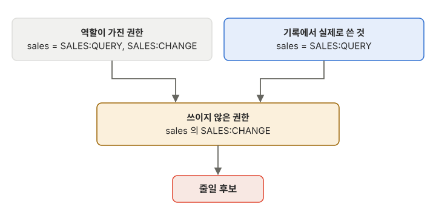
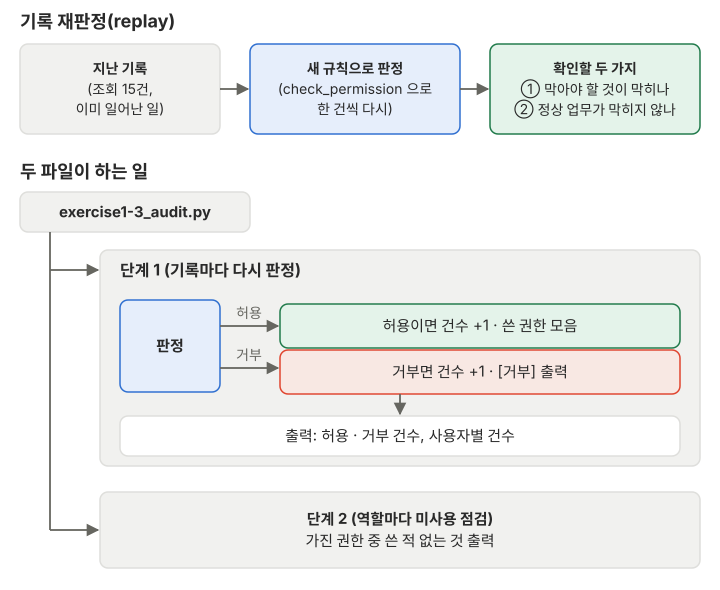

# 실습 1-3 · 기록 재판정과 미사용 권한 찾기

## 이번에 할 것: 기록 재판정과 미사용 권한

> **오늘 들어온 일**
> A사 보안 담당이 보낸 메시지: 「만든 판정 함수가 그때 있었다면 어떤 요청이 막혔을지 기록으로 확인해 주세요. 그리고 역할마다 준 권한 중에 실제로 한 번도 쓰이지 않은 것이 있는지도 찾아 주세요. 필요 없는 권한은 줄이려고 합니다.」
> - 이 실습에서 하는 일: 접속 기록 가운데 조회 15건을 `check_permission` 으로 다시 판정해 건수를 셉니다. 역할의 권한과 실제 사용을 맞춰 보고 쓰이지 않는 권한을 찾습니다. 마지막으로 오늘 만든 것을 올립니다.
> - 끝나면 쓰는 것: 보고서 (가)~(다) 답

> **읽을거리 — 문제가 아닙니다.** 이 아래부터 첫 「실습」 전까지는 이 실습의 배경지식입니다. 답할 질문도 따라 칠 명령도 없으니 읽고 이해만 합니다.

## 왜 지난 기록으로 다시 판정하는가

> **읽을거리 — 읽기만 합니다.** 문제가 아닙니다. 답할 질문도, 따라 칠 명령도 없습니다.

1. 새 규칙을 켜기 전에 지난 기록에 적용해 보면, 막아야 할 것이 막히는지와 정상 업무가 막히지 않는지를 미리 확인할 수 있습니다. 현업에서는 이것을 기록 재판정(replay)이라고 부릅니다.
2. 권한은 주기는 쉬워도 거두기는 잊기 쉽습니다. 실제 사용 기록과 맞춰 보면 쓰이지 않는 권한이 드러나고, 그것이 최소권한 점검의 출발점입니다.
3. 오늘의 미사용 권한 찾기는 Unit 6의 과다권한 탐지(90일 미사용)로 이어집니다.

## 3.1 접속 기록 파일

> **읽을거리 — 읽기만 합니다.** 문제가 아닙니다. 답할 질문도, 따라 칠 명령도 없습니다.

접근 기록 20줄 가운데 **조회(QUERY) 15줄**만 남겼습니다(로그인 · 로그아웃 줄은 권한 판정 대상이 아니라 뺐습니다). 번호는 그 기록의 번호 그대로입니다.

**`access_log.py`** — 아래 내용을 그대로 붙여 넣습니다. 학생이 쓰는 줄은 없습니다.

| 칸 | 예 | 뜻 |
|---|---|---|
| 번호 | `1` · `3` | 원래 기록의 번호 그대로입니다. 로그인 줄을 빼서 번호가 띄엄띄엄 있습니다 |
| 시각 · 사용자 | `"02:00"` · `"batch-night"` | 언제 · 누가 |
| 자원 · 행위 | `"SETTLE"` · `"QUERY"` | `check_permission` 에 그대로 전달하는 값 |

```python
LOG = [                                                          # 접근 기록 중 조회 15줄. (번호, 시각, 사용자, 자원, 행위)
    (1,  "02:00", "batch-night", "SETTLE", "QUERY"),             # 서비스 계정의 정산 집계
    (3,  "02:14", "seoyeon",     "SETTLE", "QUERY"),             # 새벽 · 등록 안 된 기기 NB-7741
    (4,  "02:15", "seoyeon",     "SETTLE", "QUERY"),             # 새벽 · NB-7741
    (5,  "02:15", "seoyeon",     "SETTLE", "QUERY"),             # 새벽 · NB-7741
    (7,  "09:05", "junho",       "SETTLE", "QUERY"),             # 재무의 정산 조회
    (9,  "10:44", "seoyeon",     "SALES",  "QUERY"),             # 영업의 영업 실적 조회
    (10, "11:30", "junho",       "SETTLE", "QUERY"),             # 재무의 정산 조회
    (11, "13:15", "seoyeon",     "SALES",  "QUERY"),             # 영업의 영업 실적 조회
    (12, "13:40", "seoyeon",     "SETTLE", "QUERY"),             # 낮 · 등록 기기에서 정산 조회
    (13, "14:02", "junho",       "SETTLE", "QUERY"),             # 재무의 정산 조회
    (14, "14:10", "seoyeon",     "SETTLE", "QUERY"),             # 낮 · 등록 기기에서 정산 조회
    (15, "14:35", "seoyeon",     "SETTLE", "QUERY"),             # 낮 · 등록 기기에서 정산 조회
    (16, "15:00", "seoyeon",     "SETTLE", "QUERY"),             # 낮 · 등록 기기에서 정산 조회
    (17, "15:25", "seoyeon",     "SETTLE", "QUERY"),             # 낮 · 등록 기기에서 정산 조회
    (18, "16:30", "seoyeon",     "SALES",  "QUERY"),             # 영업의 영업 실적 조회
]
```

**이 시간에 나오는 말** (이미 배운 방법입니다)

- 키별 건수는 `old_count = d.get(키, 0)` 로 지금까지 센 수를 꺼내고(처음이면 0), `d[키] = old_count + 1` 로 1 늘려 다시 적습니다(세는 모양을 두 줄로 나눈 것입니다).
- `for 키, 값 in d.items():` 로 딕셔너리의 키와 값을 함께 꺼냅니다(앞선 실습).
- `from rbac import check_permission, ROLES, USERS` 처럼 함수뿐 아니라 파일 맨 위의 변수도 같은 방법으로 불러옵니다.

<figure class="page-figure"></figure>

#### 기록 재판정(replay)과 두 파일이 하는 일

<figure class="page-figure"></figure>

- `allowed` · `denied` · `counts` · `used` 는 파일 맨 위에 미리 만들어져 있습니다.
- 현업에서는 결과를 숫자로 보고한 뒤에 규칙을 켭니다. 같은 기록으로 실제로 쓴 권한도 함께 모읍니다.

#### 문법 상자 · 단계 1 · 단계 2에서 쓰는 모양 (예시 값 · 읽기만 합니다)

키를 문자열로 만들어 건수 세기 — 예시 사용자 `minsu`

```python
counts = {}                                                       # 값별 횟수를 담을 빈 딕셔너리
key = "minsu" + " 허용"                      # "minsu 허용"

old_count = counts.get(key, 0)                                   # 그 키의 지금까지 센 수(처음이면 0)
counts[key] = old_count + 1                                      # 1 늘려서 다시 적는다
```

| 읽은 기록(예시) | 만든 키 | 센 뒤 `counts` |
|---|---|---|
| minsu 허용 | `"minsu 허용"` | `{'minsu 허용': 1}` |
| minsu 허용 | `"minsu 허용"` | `{'minsu 허용': 2}` |
| minsu 거부 | `"minsu 거부"` | `{'minsu 허용': 2, 'minsu 거부': 1}` |

역할마다 빈 리스트를 먼저 만들고 쌓기 — 예시 역할 `hr`

```python
if role not in used:                          # 이 역할이 처음이면
    used[role] = []                           # 빈 리스트부터
used[role].append(f"{resource}:{action}")     # 쓴 권한을 추가함
```

| 읽은 허용 기록(예시) | 쌓은 뒤 `used` |
|---|---|
| hr · STAFF:QUERY | `{'hr': ['STAFF:QUERY']}` |
| hr · PAY:QUERY | `{'hr': ['STAFF:QUERY', 'PAY:QUERY']}` |

- 빈 리스트 없이 바로 `append` 하면 `KeyError` 가 납니다.

`items()` 와 `used.get(역할, [])` — 기록에 없는 역할은 빈 리스트

```python
ROLES = {"hr": ["STAFF:QUERY", "PAY:QUERY"], "guest": ["NEWS:QUERY"]}   # 예시
used  = {"hr": ["STAFF:QUERY"]}                                   # 예시: 실제로 쓴 기록(hr 은 STAFF:QUERY 만 썼다)

for role, role_permissions in ROLES.items():                      # 역할 이름과 그 역할의 권한 리스트를 하나씩 꺼낸다
    print(role, role_permissions, used.get(role, []))             # 역할 · 권한 · 쓴 기록을 출력한다
# hr ['STAFF:QUERY', 'PAY:QUERY'] ['STAFF:QUERY']
# guest ['NEWS:QUERY'] []          ← 기록에 없는 역할은 빈 리스트
```

- 거부 줄 출력 모양(예시): `[거부] 99 03:00 kim SALES QUERY - 등록되지 않은 사용자` (이 기록에 없는 예시입니다. 이유는 실습 1-2 함수가 리턴한 `reason` 입니다.)

> **여기부터 문제입니다.** 위는 읽을거리였고, 아래에서 직접 합니다.

## 실습 1-3 · 기록 재판정과 미사용 권한 찾기

**이런 상황이 있습니다**

- 보안 담당이 「RBAC 를 그때 켰다면 무엇이 막혔을지」 숫자로 알고 싶어 합니다. 막혀야 할 것이 막히는지와 정상 업무가 막히지 않는지를 모두 봐야 합니다.
- 같은 기록으로 「매트릭스의 ○ 중 실제로 쓰이지 않는 것」도 찾아 달라고 합니다. 쓰이지 않는 권한은 줄일 후보지만, 하루 기록에 안 보였다고 모두 지우면 정상 업무가 막힐 수 있습니다.
- 현업에서는 새 규칙을 켜기 전에 과거 기록에 적용해 보고 결과를 숫자로 보고합니다.
- 이 점검을 정기적으로 돌려 「쓰이지 않은 권한 리스트」를 만들고, 담당자 확인을 거쳐 회수합니다.

**할 일**

1. `access_log.py` 와 `exercise1-3_audit.py` 를 만듭니다(3.1).
2. `exercise1-3_audit.py` 의 <mark>단계 1: 재판정 반복문</mark>(건수 세기 · 거부 출력 · 쓴 권한 모으기)과 <mark>단계 2: 미사용 점검</mark>(쓰이지 않은 권한 출력)를 직접 씁니다.
3. 실행해서 <mark>거부된 기록</mark>, <mark>사용자별 허용 · 거부 건수</mark>, <mark>쓰이지 않은 권한</mark>을 읽습니다.
4. 쓰이지 않은 권한 중 <mark>줄일 것과 남길 것</mark>을 이유와 함께 나눕니다.

**`exercise1-3_audit.py`**

```python
from rbac import check_permission, ROLES, USERS                  # 판정 함수와 역할 · 사용자 정보를 불러온다
from access_log import LOG                                       # access_log.py 의 기록 리스트를 불러온다

allowed = 0                                                      # 허용 건수
denied = 0                                                       # 거부 건수
counts = {}                                                      # "사용자 허용" · "사용자 거부" → 건수
used = {}                                                        # 역할 → 실제로 쓴 권한 리스트

# ← 단계 1 재판정: 기록을 하나씩 다시 판정하며 건수와 쓴 권한 모으기
# 1. LOG 에서 (번호, 시각, 사용자, 자원, 행위)를 하나씩 꺼낸다
# 2. check_permission 으로 판정해 is_allowed, reason 으로 나눠 받는다
# 3. is_allowed 이면 allowed 를 1 늘리고, counts 의 "사용자 허용" 을 1 늘리고(키를 count_key 에, 지금까지 센 수를 old_count 에 담은 뒤 old_count + 1 로 다시 적는다), 그 사용자의 역할을 role 에 담는다
# 4. 같은 허용 기록에서, used 에 role 이 아직 없으면 used[role] = [] 로 빈 리스트를 먼저 만들고,
#    used[role] 리스트에 "자원:행위" 문자열을 추가한다
# 5. 아니면 denied 를 1 늘리고, "[거부]" 와 번호 · 시각 · 사용자 · 자원 · 행위 · 이유를 출력하고,
#    counts 의 "사용자 거부" 를 같은 방법(count_key · old_count)으로 1 늘린다

print("허용", allowed, "거부", denied)                           # 전체 건수를 출력한다
print(counts)                                                    # 사용자별 건수를 출력한다

# ← 단계 2 미사용 점검: 쓰이지 않은 권한 출력하기
# 6. ROLES 에서 역할과 권한 리스트를 하나씩 꺼낸다
# 7. 그 리스트의 권한을 하나씩 꺼내, used.get(역할, []) 에 없으면 "쓰이지 않음", 역할, 권한 을 출력한다
```

- 키는 `user + " 허용"` 처럼 사용자 이름과 문자열을 합쳐 만듭니다. 문자열과 문자열은 `+` 로 이어 붙입니다(`"seoyeon" + " 허용"` 은 `seoyeon 허용`).
- `for log_id, time, user, resource, action in LOG:` 처럼 반복문의 이름은 기록 한 줄의 값 개수(다섯 개)만큼 쓰고, 아래 코드에서는 같은 이름을 씁니다.
- 거부 줄은 `print("[거부]", log_id, time, user, resource, action, "-", reason)` 모양으로 출력합니다.
- `used.get(role, [])` 는 그 역할이 기록에 한 번도 없을 때 빈 리스트를 리턴합니다. 그러면 그 역할의 권한은 모두 「쓰이지 않음」이 됩니다.
- 거부된 기록은 쓴 권한으로 모으지 않습니다. 거부된 요청은 권한을 쓴 것이 아니기 때문입니다.
- 딕셔너리 안에 리스트를 만들어 쌓는 모양은 이렇습니다: `if role not in used:` 다음 줄에 `used[role] = []` 로 빈 리스트를 먼저 만들고, 그다음 줄에 `used[role].append(값)` 으로 추가합니다(앞선 실습의 `.append`).
- 코드는 `# ← 단계 1` 주석 아래, `print("허용", …)` 줄 **위**에 씁니다. 단계 2 코드는 `# ← 단계 2` 주석 아래에 씁니다. 들여쓰기 구조는 아래와 같습니다.

```
for … in LOG:                  # 단계 1: 들여쓰기 없음
    is_allowed, reason = …             # 4칸
    if is_allowed:                     # 4칸
        …                      # 허용일 때: 8칸 (그 안의 if role not in used: 안쪽은 12칸)
    else:                      # 4칸
        …                      # 거부일 때: 8칸

for … in ROLES.items():        # 단계 2: 들여쓰기 없음
    for … in …:                # 4칸
        if …:                  # 8칸
            print(…)           # 12칸
```

- 맞게 썼다면 단계 1 끝에 `허용 7 거부 8` 이 나오고, 단계 2 에서 `쓰이지 않음` 줄이 7개 나옵니다.

**순서**

1. **[터미널]** 위치가 `…/access_control` 인지 확인합니다. 아니면 그 폴더로 들어갑니다.
   ```bash
   pwd
   ```
   - 명령 풀이: `pwd` 지금 있는 폴더의 위치를 보여 줌
   - 결과가 `…/access_control` 로 끝나지 않으면 `cd access_control` 로 들어갑니다(`security-agent-toolkit` 에서 시작했다면).
2. **[VS Code 또는 터미널]** `access_log.py` 와 `exercise1-3_audit.py` 를 만들고 각각 붙여 넣습니다. 파일마다 아래 세 가지 방법 중 **하나만** 고릅니다.
   - **방법 1 · VS Code 에서 만들기**: 파일마다 아래 네 가지를 반복합니다.
     1. VS Code 왼쪽 목록에서 `access_control` 폴더를 클릭해 선택합니다(선택하지 않으면 다른 폴더에 만들어집니다).
     2. 목록 위쪽의 **새 파일**(New File, 파일 모양에 `+`) 아이콘을 누릅니다.
     3. 이름 칸에 파일 이름을 입력하고 Enter 를 누릅니다. 이름은 차례로 `access_log.py` · `exercise1-3_audit.py` 입니다.
     4. 열린 파일에 위 코드 상자의 내용을 복사해 붙여 넣고 저장합니다.
   - **방법 2 · touch 로 만들기**: 터미널에서 파일마다 한 줄씩 치고, 각각 VS Code 에서 열어 코드 붙여넣기: `touch access_log.py` → `touch exercise1-3_audit.py`
   - **방법 3 · vim 으로 만들기**: 파일마다 한 번씩 합니다: `vim access_log.py` → `vim exercise1-3_audit.py` (각각 `i` → 코드 붙여넣기 → `Esc` → `:wq` Enter. 줄 앞 공백이 줄마다 밀려 있으면 `Esc` → `:q!` 로 나와서 방법 1 이나 방법 2 로 다시 만듭니다)
3. **[VS Code]** `exercise1-3_audit.py` 의 `# ←` 아래 단계 1 과 단계 2 를 직접 씁니다. 실습 1-2 의 `exercise1-2_run.py` 반복문과 건수 세기, 3.1 의 권한 대조 그림을 떠올립니다.
4. **[터미널]** 실행합니다.
   ```bash
   python exercise1-3_audit.py
   ```
   - 명령 풀이: `python` 파이썬으로 파일을 실행 · `exercise1-3_audit.py` 실행할 파일
5. 거부된 번호를 기록에서 수상해 보이는 번호(새벽 3 · 4 · 5번, 낮의 12 · 14 · 15 · 16 · 17번)와 비교합니다. 2번은 로그인 줄이라 3.1 의 기록에서 뺐습니다.
   - 여기서 **보고서 (가) · (나)** 를 먼저 씁니다.
6. 나온 「쓰이지 않음」 줄마다 1.3 의 매트릭스와 계정 설명을 보고 「하루 기록에 없었을 뿐 필요한 권한」인지 「필요 없는 권한」인지 나눕니다.
   - 여기서 **보고서 (다)** 를 먼저 씁니다.
7. **[보고서]** Unit 1 의 `## 실습 1-3` › `### 실습 1-3` 아래를 채웁니다.
   - (가) [핵심 질문] 실행한 출력에서 허용 · 거부가 각각 몇 건이고 거부된 번호가 무엇인지 적어 주세요. 또 점수로 판단하던 방식(PDP)은 낮의 12 · 14 ~ 17번을 막지 못했는데 RBAC 는 막은 이유를, 두 방식이 무엇을 보고 판정하는지 비교해 설명해 주세요.
   - (나) [핵심 질문] 이 결과만으로 「RBAC 를 켜면 정상 업무는 막히지 않는다」고 말할 수 있나요? 이 기록으로 확인되는 것, 확인되지 않는 것, 기록이 하루치뿐이라서 생기는 한계를 적어 주세요.
   - (다) [핵심 질문] 실습 1-1 (나)에서 필요 이상이라고 고른 ○ 는 이 기록에서도 쓰이지 않았나요? 쓰이지 않은 권한 가운데 줄일 것 하나와 남길 것 하나를 고르고 각각 이유를 적어 주세요(`auditor` 는 사용자가 없어 전부 쓰이지 않음으로 나오므로 이 역할은 빼고 고릅니다).

## 마무리 · 이번 Unit에서 만든 것을 깃허브에 올리기

문제가 아니라 하루를 닫는 마무리입니다.

- 팀장이 「Module 3 첫날 만든 설정 파일과 판정 코드를 저장소에 남겨 달라」고 합니다. 올리기 전에 올라갈 파일을 확인하고, 비밀 키 파일(`.env`)이 섞이지 않았는지 봐야 합니다.

**순서**

1. **[터미널]** `security-agent-toolkit` 폴더로 옮기고 위치를 확인합니다. 결과가 `…/security-agent-toolkit` 으로 끝나야 합니다.
   ```bash
   cd ..
   pwd
   ```
   - 명령 풀이: `cd ..` 한 단계 위 폴더로 이동 · `pwd` 지금 위치 확인
   - 결과가 다르면 VS Code 왼쪽 목록에서 `security-agent-toolkit` 폴더를 오른쪽 클릭 › **Open in Integrated Terminal** 로 터미널을 새로 엽니다.
2. **[터미널]** 무엇이 바뀌었는지 먼저 봅니다. 빨간 목록에 `.env` 나 `.venv` 가 보이면 올리지 않고 멈춥니다.
   ```bash
   git status
   ```
   - 명령 풀이: `git status` 올릴 파일의 상태를 봄
   - `.env` 가 보이면: VS Code 왼쪽 목록에서 `security-agent-toolkit` 바로 아래의 `.gitignore` 를 열어 맨 아래에 `.env` 한 줄을 적고 저장한 뒤 `git status` 를 다시 칩니다. `.venv` 도 같은 방법으로 합니다.
   - 새 폴더는 `access_control/` 한 줄로 보입니다. 줄 수는 `Untracked files:` 아래에 보이는 줄을 그대로 셉니다.
   - 파이썬이 실행하면서 `access_control/__pycache__/` 라는 임시 폴더를 자동으로 만들어 두었을 수 있습니다. 올릴 필요가 없으므로 `.gitignore` 맨 아래에 `__pycache__/` 한 줄을 더 적고 저장합니다.
3. **[보고서]** `### 마무리 · 이번 Unit에서 만든 것을 깃허브에 올리기` 아래를 채웁니다. 올리기 전에 채워야 깃허브에 빈칸 없이 올라갑니다.
   - (가) `git status` 를 쳤을 때 빨간 목록에 줄이 몇 개였는지, 그 가운데 `.env` · `.venv` 가 있었는지 적어 주세요.
4. **[터미널]** 바뀐 파일을 모두 담고(`add`), 기록하고(`commit`), 올립니다(`push`).
   ```bash
   git add .
   git commit -m "Add access control day 1 RBAC config, checker and report"
   git push
   ```
   - 명령 풀이: `git add .` 바뀐 파일을 올릴 목록에 담음 · `git commit -m "…"` 따옴표 안의 설명을 붙여 기록으로 저장 · `git push` 깃허브로 올림
   - `git push` 가 거절(`rejected`)되면 `git pull` 을 입력해 받아 온 뒤 `git push` 를 다시 합니다
   - 편집기 화면이 뜨면 `Esc` 를 누르고 `:wq` 를 입력한 뒤 `Enter` 를 누릅니다
5. **[브라우저]** 깃허브의 내 저장소를 새로 고쳐 `access_control` 폴더를 열고, 오늘 만든 파일이 모두 있는지 확인합니다: `config` 폴더(안에 `users.json` · `roles.json`) · `rbac.py` · `access_log.py` · `exercise1-2_run.py` · `exercise1-3_audit.py` · Unit 1 안내 파일 · Unit 1 보고서.
   - 빠진 파일이 있으면 터미널에서 `ls access_control` 로 내 PC 에 있는지 봅니다. 있으면 2 ~ 4번을 다시 합니다.

## 실습 1-3 정리

| 하려는 일 | 코드 · 말 |
|---|---|
| 지난 기록에 새 규칙 적용 | 기록 재판정(replay): `for … in LOG:` 안에서 `check_permission(…)`, 같은 반복문에서 쓴 권한도 모음 |
| 키별 건수 세기 | `old_count = counts.get(키, 0)` → `counts[키] = old_count + 1` |
| 역할별 사용 모으기 | `used[role].append(f"{resource}:{action}")` |
| 쓰이지 않은 권한 | 역할의 권한 중 `used.get(role, [])` 에 없는 것 |
| 올리기(마무리) | `git status` → `git add .` → `git commit -m "…"` → `git push` |

---

## 이번 Unit 마무리

| 확인 | 문제 |
|---|---|
| 인증과 인가를 구분하고 매트릭스로 요청을 판정했다 | 실습 1-1 |
| `config/users.json` 과 `config/roles.json` 을 직접 쓰고 JSON 규칙을 확인했다 | 실습 1-1 |
| `check_permission` 이 모든 실패 경로를 다른 이유로 거부한다 | 실습 1-2 |
| 기록을 다시 판정해 건수를 세고 쓰이지 않은 권한을 찾았다 | 실습 1-3 |
| 오늘 만든 파일과 보고서를 깃허브에 올렸다 | 마무리 |

| 실습 | 오늘 만든 것 | 이어지는 곳 |
|---|---|---|
| 실습 1-1 | 권한 매트릭스 · `users.json` · `roles.json` | Unit 2의 정책이 그대로 읽음 |
| 실습 1-2 | `check_permission` (`rbac.py`) | Unit 2의 `policy.py`, Unit 9의 서버로 열기 |
| 실습 1-3 | 기록 재판정 · 쓰이지 않은 권한 | Unit 6의 과다권한 탐지(90일 미사용) |

다음 Unit(Unit 2)에서는 입사 · 이동 · 퇴사에 맞춰 **역할을 부여하고 접근을 회수**하는 함수와, 기간이 정해진 예외 권한을 다루는 정책 `policy.py` 를 만듭니다. 오늘의 `rbac.py` 를 그대로 불러 씁니다.

> **앞으로의 예고** — Module 3 후반(Unit 9)에는 오늘 쓴 `check_permission` 을 **서버**로 열어 봅니다. 이번에는 파이썬 파일(`.py`)로 서버를 만들어 터미널에서 켜 두고 다른 터미널에서 요청을 보냅니다. PDP(판단 서버)와 PEP(집행)를 직접 만져 보는 수업입니다. 그때까지는 오늘 만든 `rbac.py` 를 잘 두면 됩니다.

---

<!-- learn:answers -->
