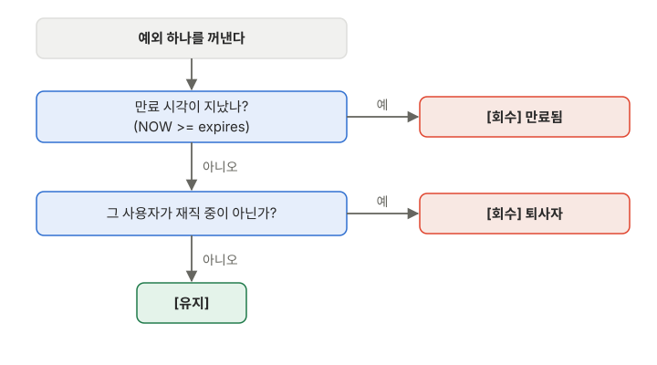

# 실습 2-2 · 기간이 정해진 예외 권한 만들기

## 목표: 예외 파일과 유효 판정 함수

> **오늘 들어온 일**
> A사 보안 담당이 보낸 메시지: 「영업팀 seoyeon 이 오늘 하루 월말 정산 대조를 도와야 합니다. 역할을 바꾸거나 영업 역할 전체에 권한을 주지 않고, 이 사람에게만 오늘 18시까지만 정산 조회를 허용해 줄 수 있나요? 끝난 예외가 그대로 남아 있지 않은지도 점검해 주세요.」
> - 이 실습에서 하는 일: 예외 권한 파일에 예외 두 건을 직접 쓰고, 「지금 이 예외가 유효한가」를 판정하는 함수를 직접 씁니다. 같은 실행의 아랫부분에서 예외 리스트 중 회수해야 할 것을 읽습니다.
> - 끝나면 쓰는 것: 보고서 (가)~(다) 답

> **읽을거리 — 문제가 아닙니다.** 이 아래부터 첫 「실습」 전까지는 이 실습의 배경지식입니다. 답할 질문도 따라 칠 명령도 없으니 읽고 이해만 합니다.

## 왜 예외에 만료 시각이 필요한가

> **읽을거리 — 읽기만 합니다.** 문제가 아닙니다. 답할 질문도, 따라 칠 명령도 없습니다.

1. 역할에 권한을 추가하면 그 역할의 모든 사람이 함께 늘어나고, 사람의 역할을 바꾸면 그 사람의 권한이 통째로 바뀝니다. 한 사람에게 잠시 필요한 일은 역할이 아니라 **그 사람에게만, 기간을 정해** 줘야 합니다.
2. 예외는 처음에 허용해 주기는 쉬워도, 일이 끝난 뒤 없애는 일(회수)은 잊기 쉽습니다. 그래서 **만료 시각을 함께 적고, 시각이 지나면 코드가 거부**하게 만듭니다.

## 2.1 예외 권한과 만료

> **읽을거리 — 읽기만 합니다.** 문제가 아닙니다. 답할 질문도, 따라 칠 명령도 없습니다.

- **예외 권한**(exception · 익셉션, 임시 권한)
  - 역할에는 없지만 특정 사용자에게 특정 권한을 따로 허용하는 것
  - 누구에게 · 어떤 권한을 · 언제까지 · 왜 주는지 함께 적는다
- **만료 시각**(expiry · 익스파이어리)
  - 예외가 끝나는 시각. 이 시각 **이후에는 거부**한다
  - 오늘은 「지금 시각이 만료 시각보다 **앞**일 때만 유효」로 정한다(만료 시각 정각에는 이미 거부)

여기서 **예외**는 파이썬의 오류(`try` · `except` 의 예외)가 아니라 「역할에는 없는데 특별히 허용한 것」을 뜻합니다.

오늘 쓰는 예외 파일에 들어갈 예외 다섯 건입니다. 1 ~ 3번은 붙여 넣고, 4 · 5번은 이 표를 보고 직접 씁니다.

| 번호 | 사용자 | 권한 | 만료 시각 | 이유 |
|---|---|---|---|---|
| 1 | `seoyeon` | `SETTLE:QUERY` | 2026-10-22 18:00 | 월말 정산 대조 지원 |
| 2 | `junho` | `SALES:CHANGE` | 2026-10-20 18:00 | 영업 실적 정정 |
| 3 | `dami` | `SALES:QUERY` | 2026-10-31 18:00 | 인수인계 |
| 4 | `batch-night` | `SALES:QUERY` | 2026-10-23 09:00 | 분기 집계 시험 |
| 5 | `gaeun` | `SETTLE:QUERY` | 2026-10-22 12:00 | 감사 자료 대응 |

- `batch-night` 는 사람이 아니라 프로그램이 쓰는 서비스 계정입니다.

## 2.2 문자열을 시각으로 바꿔 비교하기

> **읽을거리 — 읽기만 합니다.** 문제가 아닙니다. 답할 질문도, 따라 칠 명령도 없습니다.

**문법 상자 — `datetime.strptime` 의 형식 문자열**

앞선 실습에서는 `datetime.strptime(문자열, "%H:%M")` 으로 시 · 분을 읽었습니다. 오늘은 날짜까지 함께 읽습니다.

| 형식 | 뜻 | 예 |
|---|---|---|
| `%Y` | 네 자리 연도 | `2026` |
| `%m` | 두 자리 월 | `10` |
| `%d` | 두 자리 일 | `22` |
| `%H:%M` | 시:분(24시간) | `18:00` |

```python
from datetime import datetime                                    # 날짜 · 시각을 다루는 모듈에서 datetime 을 불러온다

now = datetime.strptime("2026-10-22 14:00", "%Y-%m-%d %H:%M")    # 문자열을 시각으로 바꾼다
expires = datetime.strptime("2026-10-22 18:00", "%Y-%m-%d %H:%M")  # 만료 시각도 시각으로 바꾼다
print(now < expires)                                             # 지금이 만료 전인가?
print(now >= expires)                                            # 지금이 만료 시각 이후인가?
```

```
True
False
```

- 문자열 그대로 `"2026-10-22 14:00" < "2026-10-22 18:00"` 를 비교해도 결과가 맞아 보이지만, 형식이 하나라도 다르면(`"2026-10-22 9:00"`) 틀립니다. 문자열 비교는 앞에서부터 한 글자씩 보기 때문에 `9:00` 이 `18:00` 보다 크다고 나옵니다. 시각은 **시각으로 바꾼 뒤** 비교합니다.
- 골격과 실행 파일에 나오는 `TIME_FORMAT` 은 `exception_policy.py` 위쪽에 적혀 있는 형식 문자열 `"%Y-%m-%d %H:%M"` 입니다.
- **오늘은 지금 시각을 `2026-10-22 14:00` 으로 고정합니다.** 실제 운영에서는 `datetime.now()` 를 쓰지만, 그러면 실행할 때마다 결과가 달라져 정답과 비교할 수 없기 때문입니다. 함수가 지금 시각을 `now` 로 받게 만들면 고정 시각과 `datetime.now()` 를 모두 쓸 수 있습니다.

## 2.3 예외 리스트에서 회수할 것 찾기

> **읽을거리 — 읽기만 합니다.** 문제가 아닙니다. 답할 질문도, 따라 칠 명령도 없습니다.

- 예외는 만료 시각이 지나도 리스트에 그대로 남습니다. 그래서 리스트를 **정기적으로 점검해** 회수할 것을 뽑습니다. 회수 대상은 두 가지입니다.
  - **만료됨**: 만료 시각이 이미 지난 예외. 코드가 거부하더라도 리스트에 남아 있으면 누가 언제 무엇을 받았는지 헷갈립니다.
  - **퇴사자**: 만료 전이라도 사람이 이미 나갔으면 바로 회수합니다.
- 조건은 위에서부터 차례로 봅니다. 앞 조건에 맞으면 뒤 조건은 보지 않습니다(`if` → `elif` → `else`, 앞선 실습).

<figure class="page-figure"></figure>

- 만료됐으면서 퇴사자이기도 한 예외는 첫 조건에 걸려 「만료됨」으로만 출력됩니다. 회수한다는 결과는 같고 기록에 남는 이유만 달라집니다.
- 현업에서는 이 점검을 매일 돌려 「회수 리스트」를 만들고, 회수한 예외는 지우지 않고 회수 시각과 이유를 남깁니다.

> **여기부터 문제입니다.** 위는 읽을거리였고, 아래에서 직접 합니다.

## 실습 2-2 · 유효한 예외 찾기와 회수 대상 읽기

**이런 상황이 있습니다**

- `seoyeon` 은 영업 역할이라 정산 조회 권한이 없습니다. 그런데 오늘 18시까지 월말 정산 대조를 도와야 해서, 역할은 그대로 두고 이 사람에게만 정산 조회를 잠깐 허용했습니다. 이것이 예외입니다.
  정산 포털은 요청을 받을 때마다 「이 사람에게 지금 유효한 예외가 있나?」를 확인해야 합니다. 그래서 그 확인을 하는 함수가 필요합니다.
- 예외는 만들기만 하고 정리하지 않으면 계속 쌓입니다. 이미 만료됐거나, 퇴사한 사람에게 남은 예외를 찾아 「회수 리스트」를 만듭니다.
- 현업의 임시 권한 기능(JIT · 저스트 인 타임, 필요한 때만 잠깐 접근을 주는 방식)도 요청이 올 때마다 이 확인을 하고, 리스트 점검은 매일 돌립니다.

**할 일**

1. `config/exceptions.json` 에 예외 세 건을 붙여 넣고, 2.1 의 표를 보고 **4번 · 5번 예외 두 건을 직접** 씁니다.
2. `exception_policy.py` 를 만들고 `find_exception` 본문을 직접 씁니다.
3. `exercise2-2_run.py` 를 실행해서 <mark>여섯 건의 판정</mark>(단계 1: 판정)과 <mark>회수할 예외</mark>(단계 2: 점검)를 읽습니다.

**`config/exceptions.json`** — 아래 세 건을 붙여 넣습니다.

```json
[
  {"id": 1, "user": "seoyeon", "permission": "SETTLE:QUERY", "expires": "2026-10-22 18:00", "reason": "월말 정산 대조 지원"},
  {"id": 2, "user": "junho", "permission": "SALES:CHANGE", "expires": "2026-10-20 18:00", "reason": "영업 실적 정정"},
  {"id": 3, "user": "dami", "permission": "SALES:QUERY", "expires": "2026-10-31 18:00", "reason": "인수인계"}
]
```

- 4번 · 5번 예외는 `]` 줄 바로 위에, 한 건에 한 줄씩 넣습니다. 모양은 위의 세 건과 같고, 줄 앞에 공백 2칸을 둡니다: `{"id": 번호, "user": "…", "permission": "…", "expires": "…", "reason": "…"}`
- 쉼표는 **마지막 줄만 빼고** 줄마다 붙습니다. 3번 줄 끝에 쉼표를 추가하고, 4번 줄 끝에도 쉼표를 쓰고, 마지막인 5번 줄 뒤에는 쓰지 않습니다. 끝부분은 이런 모양이 됩니다(`…` 자리는 직접 채웁니다).

```
  {"id": 3, …},
  {"id": 4, …},
  {"id": 5, …}
]
```

- 저장한 뒤 `python -m json.tool config/exceptions.json`(맥북은 `python3 -m json.tool config/exceptions.json`)을 꼭 실행합니다. 실습 2-3 에서 이 파일을 읽으므로, 오류가 나면 쉼표를 고친 뒤 실습 2-3으로 갑니다.

**`exception_policy.py`**

```python
import json                                                      # JSON 파일을 읽는 모듈을 불러온다
from datetime import datetime                                    # 문자열을 시각으로 바꾸는 데 쓴다

with open("config/exceptions.json", encoding="utf-8") as exceptions_file:      # 예외 파일을 연다
    EXCEPTIONS = json.load(exceptions_file)                                    # 예외 딕셔너리들의 리스트로 읽는다

TIME_FORMAT = "%Y-%m-%d %H:%M"                                   # 만료 시각 문자열의 형식


def find_exception(user, permission, now):                       # 사용자 · "자원:행위" · 지금 시각을 받는 함수
    """now 시각에 유효한 예외가 있으면 (True, 예외 번호)를 리턴한다.
    없으면 (False, None)을 리턴한다.
    역할에 없는 권한을 임시로 허용해도 되는지 확인할 때 쓴다.
    """
    # ← 아래를 직접 씁니다 (주석은 두고 각 주석 바로 아래 줄에 씁니다)
    # 1. EXCEPTIONS 에서 예외 exception 를 하나씩 꺼낸다
    # 2.   exception 의 "user" 가 user 와 같고 "permission" 이 permission 과 같으면
    # 3.     exception 의 "expires" 를 TIME_FORMAT 으로 시각으로 바꿔 expires 에 담는다
    # 4.     now 가 expires 보다 앞이면 True 와 exception 의 "id" 를 리턴한다
    # 5. 반복이 끝날 때까지 못 찾았으면 False, None 을 리턴한다
```

- `find_exception` 의 들여쓰기: 1번 `for` 는 4칸, 2번 `if` 는 8칸, 3번은 12칸, 4번의 `if` 는 12칸이고 그 안의 `return` 은 16칸, 5번은 다시 4칸입니다.

**`exercise2-2_run.py`** — 그대로 붙여 넣습니다. 학생이 쓰는 줄은 없습니다. 단계 1(판정)은 `find_exception` 으로 여섯 건을 판정하고, 단계 2(점검)는 2.3 의 순서대로 예외 리스트를 하나씩 점검해 회수할 것을 찾습니다.

```python
import json                                                      # 사용자 파일을 읽는 데 쓴다
from datetime import datetime                                    # 지금 시각을 만드는 데 쓴다
from exception_policy import find_exception, EXCEPTIONS, TIME_FORMAT   # 판정 함수 · 예외 리스트 · 시각 형식을 불러온다

NOW = datetime.strptime("2026-10-22 14:00", TIME_FORMAT)         # 오늘 실습의 지금 시각(고정)

CHECKS = [                                                       # 단계 1 에서 판정할 (사용자, "자원:행위") 리스트
    ("seoyeon", "SETTLE:QUERY"),                                 # 오늘 18시까지 예외
    ("junho", "SALES:CHANGE"),                                   # 10/20 에 끝난 예외
    ("dami", "SALES:QUERY"),                                     # 퇴사자에게 남은 예외
    ("batch-night", "SALES:QUERY"),                              # 다음 날 아침까지 예외
    ("gaeun", "SETTLE:QUERY"),                                   # 오늘 12시에 끝난 예외
    ("seoyeon", "ACCOUNT:CHANGE"),                               # 예외가 없는 권한
]

print("--- 단계 1: 판정 - 지금 유효한 예외가 있나")                 # 단계 1 시작을 알리는 줄
for user, permission in CHECKS:                                  # 하나씩 꺼낸다
    print(user, permission, "->", find_exception(user, permission, NOW))   # 사용자 권한 -> (결과, 번호) 를 출력한다

with open("config/users.json", encoding="utf-8") as users_file:           # Unit 1에서 만든 사용자 파일을 연다
    USERS = json.load(users_file)                                         # 사용자 → 정보 딕셔너리로 읽는다

print("--- 단계 2: 점검 - 예외 리스트에서 회수할 것")                 # 단계 2 시작을 알리는 줄
for exception in EXCEPTIONS:                                           # 예외를 하나씩 꺼낸다
    user_info = USERS[exception["user"]]                               # 그 예외를 받은 사용자의 정보 딕셔너리를 꺼낸다
    expires = datetime.strptime(exception["expires"], TIME_FORMAT)     # 만료 시각을 시각으로 바꾼다
    if NOW >= expires:                                           # 이미 만료됐으면
        print("[회수] 만료됨", exception["id"], exception["user"], exception["permission"], exception["expires"])   # 만료된 예외를 출력한다
    elif not user_info["employed"]:                              # 만료 전인데 재직 중이 아니면(`not` 은 참 · 거짓을 뒤집음)
        print("[회수] 퇴사자", exception["id"], exception["user"], exception["permission"], exception["expires"])   # 퇴사자의 예외를 출력한다
    else:                                                        # 둘 다 아니면
        print("[유지]", exception["id"], exception["user"], exception["permission"], exception["expires"])   # 유지할 예외를 출력한다
```

- 예외를 세 건만 넣고 실행하면 4번 · 5번 예외가 없어서 `batch-night` · `gaeun` 이 `(False, None)` 으로 나오고 단계 2 도 세 줄만 나옵니다. 다섯 건을 모두 쓴 뒤의 결과를 읽습니다.
- 채우기 전에 실행해도 오류 없이 실행됩니다. 단계 1 은 여섯 줄 모두 `None` 이고, 단계 2 는 예외 리스트만 읽으므로 그대로 나옵니다.

**순서**

1. **[VS Code 또는 터미널]** 세 파일을 만들고 각각 붙여 넣습니다.
   - 만드는 방법은 실습 2-1 의 순서 1번과 같습니다(VS Code 새 파일 아이콘 · `touch` · `vim` 중 하나). 만들 파일 이름은 차례로 `config/exceptions.json` · `exception_policy.py` · `exercise2-2_run.py` 입니다. 앞에 폴더가 붙은 이름은 폴더도 함께 만들어집니다. 붙여 넣을 내용은 위 코드 상자입니다.
2. **[VS Code]** `config/exceptions.json` 에 4번 · 5번 예외를 직접 씁니다. 2.1 의 표에서 사용자 · 권한 · 만료 시각 · 이유를 글자 그대로 옮깁니다.
3. **[VS Code]** `exception_policy.py` 의 `find_exception` 본문을 직접 씁니다. 2.2 의 문법 상자를 보고 씁니다.
4. **[터미널]** 실행합니다.
   ```bash
   python exercise2-2_run.py
   ```
   - 명령 풀이: `python` 파이썬으로 파일을 실행 · `exercise2-2_run.py` 실행할 파일
   맥북: `python3 exercise2-2_run.py`
5. 출력은 두 단계입니다. 단계 1(판정)은 여섯 건의 판정(`(True, 번호)` 또는 `(False, None)`)이고, 단계 2(점검)는 예외 다섯 건마다 `[회수]` 또는 `[유지]` 입니다.
6. **[보고서]** Unit 2 의 `## 실습 2-2` › `### 실습 2-2` 아래를 채웁니다.
   - (가) 단계 1 출력 여섯 줄과 단계 2 출력 다섯 줄을 붙여 넣고, 회수할 예외의 번호를 적어 주세요.
   - (나) [핵심 질문] 예외 신청서에 만료 시각이 비어 있어도 접수된다면 어떤 일이 쌓이고, 1년 뒤 감사에서 어떤 지적을 받을까요? 만료를 반드시 적게 하려면 시스템에 어떤 규칙을 넣겠습니까?
   - (다) [핵심 질문] 서비스 계정 `batch-night` 의 예외 4번(영업 실적 조회, 분기 집계 시험)을 다음 분기에도 쓰게 기간을 연장해 달라는 요청이 왔습니다. 연장해 주기 전에 무엇을 확인하고, 연장한다면 어떤 조건을 붙이겠습니까? 연장하지 않는다면 대신 무엇을 제안하겠습니까?

## 실습 2-2 정리

| 하려는 일 | 코드 · 말 |
|---|---|
| 예외 한 건 | 사용자 · 권한 · 만료 시각 · 이유 |
| 문자열을 시각으로 | `datetime.strptime("2026-10-22 18:00", "%Y-%m-%d %H:%M")` |
| 아직 유효한가 | `now < expires` (만료 시각 정각에는 이미 거부) |
| 회수 리스트 | 만료됨 · 퇴사자 → [회수], 나머지 → [유지] |

---
