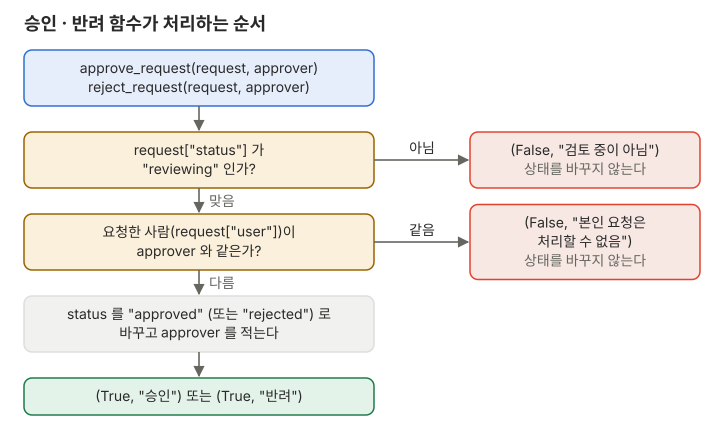

# 실습 4-2 · 승인·반려 함수 만들기

## 목표: 승인·반려 함수

> **오늘 들어온 일**
>
> A사 보안 담당이 보낸 메시지: 「접수된 요청서를 제가 하나씩 보고 승인하거나 반려합니다. 그런데 같은 요청서를 실수로 두 번 승인하거나, 이미 반려한 요청서를 나중에 승인하는 일이 생기면 안 됩니다. 검토 중인 요청서만 처리되게 하고, 누가 처리했는지도 요청서에 남겨 주세요. 요청한 본인이 자기 요청을 처리하는 일도 막아 주세요.」
> - 이 실습에서 하는 일: 요청서를 승인하는 함수 `approve_request` 를 직접 쓰고, 반려하는 함수 `reject_request` 는 남은 부분을 채웁니다. 본인 요청과 두 번째 처리를 시도해 막히는 것을 확인합니다.
> - 끝나면 쓰는 것: 보고서 (가)~(다) 답

> **읽을거리 — 문제가 아닙니다.** 이 아래부터 첫 「문제」 전까지는 이 실습의 배경지식입니다. 답할 질문도 따라 칠 명령도 없으니 읽고 이해만 합니다.

## 왜 처리 순서와 처리자를 남기는가

> **읽을거리 — 읽기만 합니다.** 문제가 아닙니다. 답할 질문도, 따라 칠 명령도 없습니다.

1. 요청서는 **정해진 순서로만** 상태를 바꿉니다.
2. 누가 승인하거나 반려했는지 적어 두어야, 나중에 문제가 생겼을 때 책임을 찾고 감사에 답할 수 있습니다.

## 2.1 상태가 바뀌는 순서

> **읽을거리 — 읽기만 합니다.** 문제가 아닙니다. 답할 질문도, 따라 칠 명령도 없습니다.

| 지금 상태 | 할 수 있는 처리 | 처리 뒤 상태 | 다시 처리하면 |
|---|---|---|---|
| `reviewing` | 승인 | `approved` | — |
| `reviewing` | 반려 | `rejected` | — |
| `approved` · `rejected` | (없음) | 그대로 | `(False, "검토 중이 아님")` |

- 이 규칙을 코드로 쓰는 방법은 간단합니다. **바꾸기 전에 지금 상태를 먼저 확인**하고, 맞지 않으면 아무것도 바꾸지 않고 `False` 와 이유를 리턴합니다.
- `approved` 가 된 요청서를 `granted` 로 바꾸는 일은 실습 4-3에 합니다.

<figure class="page-figure"></figure>

## 2.2 승인자를 정하는 규칙

> **읽을거리 — 읽기만 합니다.** 문제가 아닙니다. 답할 질문도, 따라 칠 명령도 없습니다.

- 오늘은 승인자를 `security_manager` 한 사람으로 둡니다. 사람 이름이 아니라 보안 담당자가 쓰는 계정 이름입니다.
- 현업에서는 요청한 권한에 따라 승인자가 달라집니다.
- 오늘은 요청한 본인 여부를 확인하는 검사를 승인 · 반려 두 함수에 넣습니다.

**문법 상자 — 상태 확인과 키의 값 바꾸기**

**① 있는 키는 값을 바꾸고, 없던 키는 이렇게 쓰면 새로 생깁니다**

```python
request = {"id": 1, "status": "reviewing"}                          # approver 키가 아직 없는 요청서

request["status"] = "approved"                                     # 있는 키의 값을 바꾼다
request["approver"] = "security_manager"                                     # 없던 키는 이렇게 쓰면 새로 생긴다

print(request)                                                     # 요청서 전체를 출력한다
```

실행 결과:

```
{'id': 1, 'status': 'approved', 'approver': 'security_manager'}
```

**② 딕셔너리에 키가 있는지 확실하지 않을 때는 `.get("키 이름")` 으로 꺼냅니다**

```python
request = {"id": 1, "status": "reviewing"}                          # 요청서 한 장. approver 키는 아직 없다
print(request["status"])                                           # [ ] 로 있는 키의 값을 꺼낸다
print(request.get("status"))                                       # .get 으로 있는 키의 값을 꺼내도 같은 값이 나온다
```

실행 결과:

```
reviewing
reviewing
```

없는 키를 꺼내면 두 방법이 달라집니다.

```python
request = {"id": 1, "status": "reviewing"}                          # 요청서 한 장. approver 키는 아직 없다
print(request.get("approver"))                                     # 없는 키를 .get 으로 꺼내면 오류 없이 None(값 없음)이 나온다
print(request["approver"])                                         # 없는 키를 [ ] 로 꺼내면 KeyError 오류가 나고 프로그램이 멈춘다
```

실행 결과:

```
None
Traceback (most recent call last):
  File "…/파일이름.py", line 3, in <module>
    print(request["approver"])                                         # 없는 키를 [ ] 로 꺼내면 KeyError 오류가 나고 프로그램이 멈춘다
KeyError: 'approver'
```

- `[ ]` 는 키가 없으면 오류(`KeyError`)가 나고 프로그램이 멈춥니다. `.get( )` 은 키가 없어도 멈추지 않고 `None`(값이 없다는 뜻의 값)을 꺼냅니다.
- 이 문제의 단계 2에서는 네 장 모두 처리되어 `approver` 키가 있으므로 `None` 이 나오지 않습니다. 그래도 아직 처리하지 않은 요청서가 섞여 있을 때 멈추지 않도록 `.get` 을 씁니다.

> **여기부터 문제입니다.** 위는 읽을거리였고, 아래에서 직접 합니다.

## 실습 4-2 · 승인·반려 함수와 재처리 차단

**이런 상황이 있습니다**

- **지금은**: 접수된 요청서 네 장이 `reviewing`(검토 중) 상태로 쌓여 있고, 보안 담당 `security_manager` 가 하나씩 보고 승인하거나 반려합니다. 사람이 하다 보면 같은 요청서를 두 번 처리하거나, 요청한 본인이 자기 요청을 처리하는 일이 생길 수 있습니다.
- **그래서 만드는 것**: 승인 함수 `approve_request` 와 반려 함수 `reject_request` 입니다. 두 함수는 ① 검토 중인 요청서만 처리하고 ② 요청한 본인이 처리하려 하면 막고 ③ 처리하면 상태를 바꿔 누가 처리했는지 요청서에 적습니다.
- **실행하면**: 본인 승인을 시험하는 한 줄과 처리 시도 여섯 줄이 나옵니다. 줄마다 성공 여부(`True` / `False`)와 이유가 붙고, 끝에 요청서 리스트의 상태와 처리한 사람이 나옵니다.
- **현업에서는**: 승인 도구도 처리가 끝난 신청은 다시 처리하지 못하게 막고, 처리한 사람과 시각을 기록으로 남깁니다.

**할 일**

1. `req_review.py` 와 `exercise4-2_run.py` 두 파일을 만들고, `approve_request` 본문을 직접 쓰고 `reject_request` 는 남은 부분을 채웁니다.
2. 실행해서 <mark>본인 승인 시험과 처리 여섯 건의 결과</mark>(단계 1: 처리)와 <mark>요청서 리스트</mark>(단계 2: 점검)을 읽습니다.

**`req_review.py`**

```python
def approve_request(request, approver):                          # 요청서와 승인자 이름을 받는 함수
    """검토 중인 요청서를 승인한다.
    보안 담당자가 권한 요청을 처리할 때 쓰고 (성공 여부, 이유)를 리턴한다.
    """
    # ← 아래를 직접 씁니다 (주석은 두고 각 주석 바로 아래 줄에 씁니다)
    # 1. request["status"] 가 "reviewing" 이 아니면 False, "검토 중이 아님" 을 리턴한다
    # 2. request["user"] 가 approver 와 같으면(요청한 사람이 스스로 처리하려는 것) False, "본인 요청은 처리할 수 없음" 을 리턴한다
    # 3. request["status"] 를 "approved" 로 바꾼다
    # 4. request["approver"] 를 approver 로 정한다
    # 5. True, "승인" 을 리턴한다


def reject_request(request, approver):                           # 요청서와 반려하는 사람 이름을 받는 함수
    """검토 중인 요청서를 반려한다.
    보안 담당자가 권한 요청을 거절할 때 쓰며 (성공 여부, 이유)를 리턴한다.
    """
    if request["status"] != "reviewing":                         # 검토 중이 아니면(이미 처리됐으면)
        return False, "검토 중이 아님"                             # 바꾸지 않고 이유를 알린다
    if request["user"] == approver:                              # 요청한 사람이 스스로 처리하려고 하면
        return False, "본인 요청은 처리할 수 없음"                  # 바꾸지 않고 이유를 알린다
    # ← 아래를 직접 씁니다 (주석은 두고 각 주석 바로 아래 줄에 씁니다)
    # 1. request["status"] 를 "rejected" 로 바꾼다
    # 2. request["approver"] 를 approver 로 정한다
    # 3. True, "반려" 를 리턴한다
```

- `approve_request` 의 본문은 함수 안이라 4칸으로 쓰고, `if` 아래 `return` 은 4칸 더(8칸) 들어갑니다. 1 · 2번 주석 밑에는 각각 `if` 줄과 그 안쪽 `return` 줄을 씁니다.
- `reject_request` 는 `approve_request` 와 모양이 같고, 바뀌는 문자열(`"rejected"` · `"반려"`)만 다릅니다. 그래서 앞의 두 검사(`if` 두 개)는 미리 채워 두었고, 1 ~ 3번 주석 아래만 씁니다.
- 채우기 전에 실행하면 `TypeError: cannot unpack non-iterable NoneType object` 오류가 납니다. `approve_request` 가 아무것도 리턴하지 않기 때문입니다.

**`exercise4-2_run.py`** — 그대로 붙여 넣습니다. 학생이 쓰는 줄은 없습니다. 실습 4-1의 `create_request` 로 요청서 네 장을 접수한 뒤, 단계 1은 본인 승인 시험 한 건과 처리 여섯 건을 넣고 단계 2는 요청서 리스트를 출력합니다.

```python
from req_create import REQUESTS, create_request                  # 실습 4-1에서 만든 요청서 함수와 리스트를 불러온다
from req_review import approve_request, reject_request           # 방금 만든 승인 · 반려 함수를 불러온다

INBOX = [                                                        # 접수에 성공하는 요청 네 건. (요청자, 자원, 행위, 희망 만료 시각, 이유, 접수 시각)
    ("seoyeon", "SETTLE", "QUERY", "2026-10-27 18:00", "정산 대조 지원", "2026-10-23 08:30"),
    ("gaeun", "SALES", "QUERY", "2026-10-28 18:00", "감사 자료 대응", "2026-10-23 08:40"),
    ("dami", "SALES", "QUERY", "2026-10-27 18:00", "인수인계 자료 확인", "2026-10-23 08:50"),
    ("junho", "SETTLE", "QUERY", "2026-10-27 18:00", "정산 확인", "2026-10-23 09:00"),
]
for user, resource, action, until, reason, received_at in INBOX:         # 요청을 하나씩 꺼내
    create_request(user, resource, action, until, reason, received_at)   # 접수한다(결과는 쓰지 않는다)

DECISIONS = [                                                    # 보안 담당(security_manager)이 내리는 처리 여섯 건. (요청 번호, 처리)
    (1, "승인"),                                                 # seoyeon 의 정산 조회
    (2, "반려"),                                                 # gaeun 의 영업 실적 조회
    (3, "승인"),                                                 # dami 의 영업 실적 조회
    (4, "승인"),                                                 # junho 의 정산 조회
    (1, "승인"),                                                 # 이미 승인한 1번을 다시 승인해 본다
    (2, "승인"),                                                 # 이미 반려한 2번을 승인해 본다
]

print("--- 단계 1: 처리 - 본인 요청 시험 한 건, 승인 · 반려 여섯 건을 처리한다")   # 단계 1 시작을 알리는 줄
is_success, result = approve_request(REQUESTS[0], "seoyeon")             # 요청자 seoyeon 이 자기 요청 1번을 스스로 승인해 본다
print(1, "본인 승인 ->", is_success, result)                              # 요청 번호 · 처리 -> 성공 여부 · 이유 를 출력한다
for number, decision in DECISIONS:                               # 처리를 하나씩 꺼낸다
    request = REQUESTS[number - 1]                               # 요청 번호로 요청서를 찾는다(번호는 1부터, 리스트 자리는 0부터)
    if decision == "승인":                                       # 승인이면
        is_success, result = approve_request(request, "security_manager")  # 승인 함수를 호출한다
    else:                                                        # 반려면
        is_success, result = reject_request(request, "security_manager")  # 반려 함수를 호출한다
    print(number, decision, "->", is_success, result)                    # 요청 번호 · 처리 -> 성공 여부 · 이유 를 출력한다

print("--- 단계 2: 점검 - 요청서 리스트")                            # 단계 2 시작을 알리는 줄
for request in REQUESTS:                                         # 요청서를 하나씩 꺼낸다
    print(request["id"], request["user"], request["status"], request.get("approver"))   # 번호 · 요청자 · 상태 · 처리한 사람을 출력한다
```

**순서**

1. **[VS Code 또는 터미널]** 파일을 만들고 각각 붙여 넣습니다. 파일마다 아래 세 가지 방법 중 **하나만** 고릅니다.
   - **방법 1 · VS Code 에서 만들기**: 파일마다 아래 네 가지를 반복합니다.
     1. VS Code 왼쪽 목록에서 `access_control` 폴더를 클릭해 선택합니다(선택하지 않으면 다른 폴더에 만들어집니다).
     2. 목록 위쪽의 **새 파일**(New File, 파일 모양에 `+`) 아이콘을 누릅니다.
     3. 이름 칸에 파일 이름을 입력하고 Enter 를 누릅니다. 이름은 차례로 `req_review.py` · `exercise4-2_run.py` 입니다.
     4. 열린 파일에 위 코드 상자의 내용을 복사해 붙여 넣고 저장합니다.
   - **방법 2 · touch 로 만들기**: 터미널에서 파일마다 한 줄씩 치고, 각각 VS Code 에서 열어 붙여넣기: `touch req_review.py` → `touch exercise4-2_run.py`
   - **방법 3 · vim 으로 만들기**: 파일마다 한 번씩 합니다: `vim req_review.py` → `vim exercise4-2_run.py` (각각 `i` → 붙여넣기 → `Esc` → `:wq` Enter. 줄 앞 공백이 줄마다 밀려 있으면 `Esc` → `:q!` 로 나와서 방법 1 이나 방법 2 로 다시 만듭니다)
2. **[VS Code]** `req_review.py` 의 두 함수 본문을 직접 씁니다. 2.1 의 표와 그림을 보고 씁니다.
3. **[터미널]** `pwd` 를 쳐서 마지막 폴더가 `access_control` 인지 확인한 뒤 실행합니다.
   ```bash
   python exercise4-2_run.py
   ```
   - 명령 풀이: `python` 파이썬으로 파일을 실행 · `exercise4-2_run.py` 실행할 파일
   - 맥북은 `python3 exercise4-2_run.py` 로 칩니다.
4. 출력은 두 단계입니다. 단계 1은 본인 승인 시험 한 줄과 처리 여섯 건의 결과(여섯 줄)이고, 단계 2는 요청서 리스트(네 줄)입니다. 본인 승인 시험은 `False`, 처리 여섯 건은 앞의 네 건이 `True`, 뒤의 두 건이 `False` 로 나와야 합니다.
5. **[보고서]** Unit 4 의 `## 실습 4-2` › `### 실습 4-2` 아래를 채웁니다.
   - (가) 실행한 출력 전체를 붙여 넣고, 막힌 세 줄이 각각 왜 막혔는지 적어 주세요.
   - (나) [핵심 질문] 이미 승인한 요청서를 다시 승인하지 못하게 막는 이유는 무엇인가요? 막지 않으면 어떤 일이 생길 수 있나요?
   - (다) [핵심 질문] `approve_request` 에서 `request["user"] == approver` 검사를 뺀다면 어떤 위험이 생길까요? 요청자가 친구에게 대신 승인해 달라고 부탁하면 이 검사로는 막을 수 없습니다. 이런 경우를 막으려면 무엇이 더 필요할까요?

## 실습 4-2 정리

| 하려는 일 | 코드 · 말 |
|---|---|
| 승인 · 반려는 검토 중일 때만 | `if request["status"] != "reviewing": return False, "검토 중이 아님"` |
| 본인 요청 막기 | `if request["user"] == approver: return False, "본인 요청은 처리할 수 없음"` |
| 상태 바꾸기 | `request["status"] = "approved"` (또는 `"rejected"`) |
| 처리한 사람 남기기 | `request["approver"] = approver` |
| 키가 없을 수 있을 때 꺼내기 | `request.get("approver")` |

---
