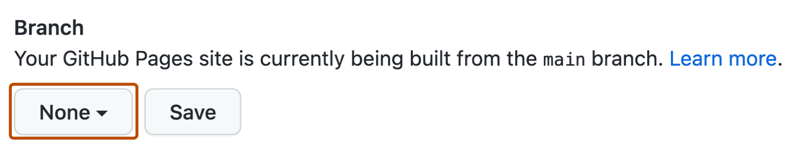

# 시작하기

## 목표와 전체 지도

Unit 1부터 Module 3 **접근통제 자동화**를 시작합니다. 이 Module에서는 **「누가 무엇을 해도 되나」를 표로 정하고 코드로 지키는 일**을 합니다. 실습 속 회사는 가상의 회사 **A사**입니다.

**Unit 1은 포트폴리오와 깃을 준비하는 날입니다.** 코드와 글을 함께 올릴 GitHub 저장소 하나(`network-study-notes`)를 먼저 만들어 포트폴리오 첫 화면까지 열고, 파이썬은 빈칸 한두 곳만 채우는 가벼운 실습으로 시작합니다.

**오늘의 계획 (약 2시간 35분)**

| 순서 | 시간 | 하는 일 |
|---|---|---|
| 1. 준비 | 약 60분 | 저장소 만들고 내려받기 · 포트폴리오 첫 화면 열기 |
| 2. 핵심 실습 | 약 60분 | 실습 1-1 ~ 1-3 (1-3 앞에서 「예외 판정 준비」) |
| 3. 글쓰기 | 20분 | 「문제 해결 과정을 블로그에 기록하기」에서 글 한 편 |
| 4. 마무리 | 15분 | 글쓰기 레슨에서 공개 점검 후 올리기 |

준비는 이 레슨의 3쪽부터 마지막 12쪽까지입니다. 실습을 하며 고민한 점을 떠올려 두고, 글쓰기 20분에는 문제와 해결 과정을 블로그에 남깁니다. 하루 3시간에서 남는 25분쯤은 밀린 곳을 따라잡는 여유 시간입니다.

**오늘 만들 것 세 가지**

| 실습 | 직접 쓰는 것 | 하는 일 |
|---|---|---|
| **실습 1-1** | `config/users.json` · `config/roles.json` | 표를 보고 JSON 파일 두 개를 씀 |
| **실습 1-2** | `rbac.py` 의 빈칸 두 곳(①·②) | 두 파일을 읽어 권한을 판정 |
| **실습 1-3** | `policy.py` 의 빈칸 두 곳(①·②) | 역할 판정과 예외 판정을 합침 |

**응용 1-1 ~ 1-5는 여유가 되면 해 보세요.** 핵심 실습 세 개와 글쓰기를 마치고 시간이 남을 때 합니다. 다음 Unit에 필요한 파일은 핵심 실습과 「예외 판정 준비」로 모두 갖춰지므로, 응용을 하지 않아도 다음 Unit을 따라갈 수 있습니다.

**Module 3 전체 지도** — 접근통제란 직원마다 「어떤 자원에 어떤 행위를 해도 되는지」를 정해 두고, 그 규칙대로 허용하거나 거부하는 일입니다. 학교 출입 카드로 내 교실과 도서관은 열리지만 교무실은 안 열리는 것과 같습니다.

- **자원**은 다루는 대상입니다. 예: 영업 실적(영업팀이 물건을 팔아 올린 매출), 정산 내역(회사가 돈을 주고받은 기록)
- **행위**는 그 대상에 하는 일입니다. 예: 조회(보기), 변경(고치기)
- **권한**은 「이 자원에 이 행위를 해도 된다」는 허락입니다.

회사에서는 직원이 들어오고(입사), 팀을 옮기고(부서 이동), 떠날(퇴사) 때마다 권한이 바뀝니다. 이것을 사람이 손으로 관리하면 빠뜨리기 쉽습니다. 그래서 Module 3에서는 회사가 권한과 관련해 하는 다섯 가지 일을 코드로 자동화합니다.

| Unit | 단계 | 하는 일 | 함께 하는 일 |
|---|---|---|---|
| Unit 1 | **권한 정하기** | 사용자 · 역할 파일에 「누가 어떤 자원에 무엇을 해도 되는지」를 적고, 요청마다 프로그램이 허용 · 거부를 판정 | 기간을 정해 따로 허용한 예외도 함께 판정 |
| Unit 2 | **권한 주기** | 직원이 요청서로 신청하면 담당자가 승인 · 반려하고, 승인된 요청에만 프로그램이 예외 권한을 줌 | 처리 기한을 넘긴 요청 찾기, 요청 이력 저장 |
| Unit 3 | **권한 점검하기** | 프로그램이 접속 기록을 읽어 퇴사 계정 · 만료된 예외에 남은 권한, 90일 넘게 안 쓰인 권한을 찾아 한 장의 리포트로 만듦 | 회수하지 않을 권한 가려내기 |
| Unit 4 | **권한 거두기** | 점검에서 나온 권한의 회수 계획을 세우고, 승인이 필요한 것은 담당자 승인 뒤 실행해 이력을 남김 | 업무 시간 · 접속 위치 같은 조건으로 판정하는 서버 만들기 |
| Unit 5 | **결과 보고하기** | 점검 체크리스트로 어긋난 곳 찾기 | 서버 로그를 집계해 한 주 점검 결과를 주간 보고서로 만들기 |

동아리방 열쇠로 비유하면 이렇습니다. 누가 열쇠를 가질지 정하고(1), 빌려 달라는 신청을 받아 맡은 사람(담당자)이 허락(승인)하거나 돌려보내고(반려)(2), 졸업한 사람이 아직 열쇠를 가졌는지 살피고(3), 필요 없는 열쇠를 돌려받고(회수)(4), 한 주 동안 있었던 일을 정리해 알립니다(5). 표의 **로그**는 프로그램이 「언제 누가 무엇을 했는지」 남기는 기록입니다.

Unit 1은 첫 단계인 권한 정하기입니다. 사용자와 역할을 파일로 적고, 그 파일을 읽어 허용 · 거부를 판정하는 함수를 만들고, 기간을 정해 따로 허용한 예외까지 함께 보는 최종 판정 함수로 묶습니다.

> **확인** — 오늘 할 네 가지(준비 · 핵심 실습 · 글쓰기 · 마무리)를 순서대로 말할 수 있으면 성공입니다. 헷갈리면 위 「오늘의 계획」 표를 한 번 더 봅니다.

## 먼저 알아 둘 말

이 Module에서 계속 나오는 말입니다. 지금 다 외울 필요 없이, 읽고 나서 실습에서 다시 만나면 됩니다.

| 말 | 뜻 | 예 |
|---|---|---|
| **접근통제** | 누가 어떤 자원(파일 · 데이터 · 기능)에 무엇을 해도 되는지 정해 두고, 그 밖의 일은 막는 것 | 출입 카드로 내 층만 열림 |
| **권한** | 할 수 있는 일 하나 | 「정산 내역을 조회해도 된다」 |
| **역할** | 권한 여러 개를 묶어 이름을 붙인 것 | `sales`(영업팀, 물건을 파는 팀)는 매출 조회 · 매출 수정 권한을 가짐 |
| **RBAC**(역할 기반 접근통제) | 사람마다 권한을 따로 주지 않고, **사람 → 역할 → 권한** 순서로 이어서 정하는 방식 | 사람이 30명이어도 역할이 5개면 표 5줄만 관리 |
| **인증** | 「이 사람이 누구인가」를 확인하는 것 | 로그인 |
| **인가** | 「그 사람이 이 일을 해도 되는가」를 확인하는 것 | 로그인한 뒤 막히는 것 |

학교로 치면 인증은 학생증을 보고 「이 학교 학생이 맞다」를 확인하는 일이고, 인가는 「이 학생이 교무실에 들어가도 되나」를 정하는 일입니다. 더 알고 싶으면 AI 에게 「인증과 인가의 차이를 중학생에게 설명하듯 알려 줘」라고 물어보세요.

이 Module은 **Python 코드를 짧게 직접 써 보는 연습**이기도 합니다. 긴 코드를 외우지 않고, 코드 안의 `#` 로 시작하는 설명(주석)이 시키는 일을 한두 줄씩 채웁니다.

> **확인** — 「인증」과 「인가」의 차이를 한 문장으로 말할 수 있으면 성공입니다. 아직 헷갈려도 괜찮습니다. 실습 1-1에서 다시 나옵니다.

## 저장소를 만들고 내려받아 작업 폴더 열기

이 과정에서 만드는 GitHub 저장소는 **`network-study-notes` 하나**입니다. 실습 코드와 포트폴리오 글을 모두 이 저장소에 둡니다. 이 페이지에서는 저장소를 만들어 내 컴퓨터로 내려받고(`git clone`), 그 폴더를 VS Code 로 연 뒤 Module 3의 작업 폴더를 만듭니다. 파일은 실습에서 필요할 때 하나씩 만듭니다.

1. **[브라우저]** GitHub 에서 새 저장소를 만듭니다. 이름은 `network-study-notes`, 공개 범위는 **Public**(Private 이면 포트폴리오 사이트를 남이 못 봅니다), **Add a README file** · `.gitignore` · license 는 모두 고르지 않습니다(빈 저장소). 이미 만들어 두었다면 건너뜁니다.

<!-- checklist -->
- [ ] GitHub 에 **Public** 빈 저장소 `network-study-notes` 를 만들었다(README 체크 안 함)
<!-- /checklist -->

2. **[VS Code]** 메뉴 **Terminal › New Terminal** 로 터미널을 엽니다. **터미널**(terminal)은 명령을 글자로 입력해 컴퓨터에 일을 시키는 창으로, VS Code 아래쪽에 열립니다. 윈도우의 VS Code 터미널은 처음에 **PowerShell** 로 열리는데, 이 과정의 명령(`pwd` · `mkdir -p` · `ls` · `cd`)은 모두 **Git Bash** 기준입니다. 그래서 터미널을 Git Bash 로 바꿉니다.
   - 터미널 오른쪽 위 `+` 옆의 **∨** 를 눌러 **Git Bash** 를 고릅니다. 터미널 이름 칸에 **bash** 가 보이면 됩니다.
   - 목록에 Git Bash 가 없으면 Git 이 아직 없는 것입니다. git-scm.com 에서 **Git for Windows** 를 기본값으로 설치하고 VS Code 를 껐다 켠 뒤 다시 고릅니다.
   - 매번 고르지 않으려면 같은 **∨** 에서 **Select Default Profile** › **Git Bash** 를 한 번 고릅니다. 그다음부터 **Terminal › New Terminal** 이 바로 Git Bash 로 열립니다.

   Git Bash 터미널에서 깃이 있는지 보고, 깃 설정은 처음 한 번만 합니다(이메일은 깃허브 계정 이메일이나 `…@users.noreply.github.com`).
   ```bash
   git --version
   git config --global user.name "내 이름"
   git config --global user.email "내 이메일"
   ```
3. **[터미널]** 바탕화면으로 가서 저장소를 내려받습니다. `<내 아이디>` 는 내 GitHub 아이디로 바꿉니다. 바탕화면에 `network-study-notes` 폴더가 생깁니다.
   ```bash
   cd ~/Desktop
   git clone https://github.com/<내 아이디>/network-study-notes.git
   ```
   - 명령 풀이: `cd ~/Desktop` 바탕화면으로 이동 · `git clone 주소` GitHub 저장소를 내 컴퓨터로 내려받음
   - `cd ~/Desktop` 에서 폴더를 찾을 수 없다고 나오면(윈도우에서 바탕화면이 OneDrive 안에 있는 경우 등) 그 줄 없이 `git clone` 만 칩니다. 그러면 지금 위치(보통 내 사용자 폴더)에 생기고, 4번에서 그 폴더를 엽니다.
   - `You appear to have cloned an empty repository.` 는 빈 저장소라서 나오는 안내이니 괜찮습니다. 공개(Public) 저장소는 내려받을 때 로그인이 필요 없습니다. GitHub 로그인은 7쪽에서 처음 올릴(`git push`) 때 합니다.
   - `already exists and is not an empty directory` 가 나오면 바탕화면에 같은 이름의 폴더가 이미 있는 것입니다. 그 폴더 이름을 바꿔 두고 다시 칩니다.
4. **[VS Code]** 메뉴 **File › Open Folder…** 로 바탕화면의 `network-study-notes` 폴더를 엽니다. 앞으로 이 폴더가 저장소 맨 위(루트)입니다.

<!-- checklist -->
- [ ] `git clone` 으로 내려받은 `network-study-notes` 폴더를 VS Code 로 열었다
<!-- /checklist -->

5. **[VS Code]** 폴더를 연 VS Code 창에서 메뉴 **Terminal › New Terminal** 로 터미널을 새로 엽니다. 새 터미널은 저장소 맨 위 폴더(`…/network-study-notes`)에서 열립니다. 터미널 이름 칸이 **bash** 가 아니면 2번처럼 **Git Bash** 를 고릅니다. 이 터미널에서 Module 3의 작업 폴더 `access_control` 과 그 안의 설정 폴더 `config` 를 만들고, `access_control` 폴더로 들어갑니다. Module 3의 파일은 모두 이 폴더에 둡니다.
   ```bash
   mkdir -p access_control/config
   cd access_control
   pwd
   ```
   - 명령 풀이: `mkdir -p` 폴더를 만듦(이미 있어도 오류 없음) · `cd access_control` 그 폴더 안으로 들어감 · `pwd` 지금 위치 확인
   - 마지막 `pwd` 가 `…/network-study-notes/access_control` 로 끝나면 됩니다.
   - 폴더는 이렇게 됩니다. 포트폴리오 파일은 7쪽에서 `network-study-notes` 바로 아래에 만듭니다.
     ```
     network-study-notes/   저장소 루트 (포트폴리오 파일도 여기)
       access_control/      Module 3
         config/
     ```

<!-- checklist -->
- [ ] `access_control/config` 폴더를 만들고, 터미널 위치가 `…/network-study-notes/access_control` 이다
<!-- /checklist -->

6. 다음 페이지부터 포트폴리오를 준비하고, 7쪽에서 필수 파일을 만들어 처음 올립니다(push). 오늘 준비 시간에 모두 합니다.
7. 각 실습은 **「할 일」을 위에서부터 차례로** 따라 합니다. `[창 이름]` 이 지금 쓸 창입니다. 막히면 각 실습의 「정답과 해설 보기」를 펼쳐 봅니다. 실습을 마친 뒤 「문제 해결 과정을 블로그에 기록하기」에서 고민과 해결 과정을 남깁니다.

> 오늘 명령은 모두 **Git Bash 터미널**에서 칩니다. 이 과정은 Python이 이미 설치되어 있다고 가정합니다. 터미널에서 `python --version` 을 쳐서 버전(예: `Python 3.12.1`)이 나오지 않거나 오류가 나면(윈도우에서는 `python3` 을 쳐도 똑같이 Microsoft Store 창이 뜨거나 오류가 납니다), 오류 문구를 그대로 AI 챗봇에게 붙여 넣고 윈도우에서 해결하는 방법을 물어보세요. `py --version` 으로 버전이 나오면 이 과정의 `python` 자리에 `py` 를 써도 됩니다. 오늘 나오는 이름 · 자원 · 숫자는 연습용 예시입니다.

> **확인** — 마지막 `pwd` 가 `…/network-study-notes/access_control` 로 끝나고 VS Code 왼쪽 목록에 `access_control/config` 가 보이면 성공입니다. 안 보이면 4번에서 연 폴더가 바탕화면의 `network-study-notes` 인지 보고 5번부터 다시 합니다.

---

## 자기소개 두 문장으로 시작하기

누군가 지원서에 있는 링크를 열었다고 생각해 보세요. 첫 화면에서 어떤 사람의 글을 읽게 될지 알려 주는 두 문장을 메모장에 써 봅니다.

1. 첫 문장에는 공개할 이름이나 별명과 지금 관심 있는 분야를 씁니다.
2. 다음 문장에는 그 분야에서 궁금한 문제 하나와 블로그에 남기고 싶은 내용을 씁니다.

> 네트워크 보안을 공부하는 민지입니다. 누가 어떤 시스템에 접근할 수 있는지 궁금해서, 권한을 확인하며 알게 된 점을 이곳에 기록하려고 합니다.

내가 평소에 쓰는 말로 읽어 보고 메모를 보관하세요. 7쪽에서 이 두 문장을 블로그 첫 화면에 넣습니다. 첫 실습이 끝나면 그 아래에 내가 풀어 본 문제와 실행 결과를 담은 글을 더합니다.

### 무엇을 남기나요

| 남길 것 | 놓는 곳 | 설명 |
|---|---|---|
| 코드 | `access_control/`(Module 3), 이후 `anomaly_detection/` · `soar_response/` | 실습에서 작성하고 고친 파이썬 · JSON 파일. 실습 폴더가 그대로 올라감 |
| 글 | `_posts/` | 고민을 내 말로 정리한 글 한 편 |
| 실행 결과 화면 | 글 안에 이미지로 | 코드를 돌린 터미널 출력이나 화면 캡처 |

실습에서 만난 문제와 직접 확인한 결과를 떠올려 글감을 고릅니다. 왜 그 방법을 골랐고 무엇을 배웠는지 블로그에 남깁니다.

### 전체 흐름

1. 내 GitHub 계정에 저장소를 만들고 내려받습니다(3쪽에서 했습니다). **저장소**(repository · 리포지토리)는 GitHub 에서 파일과 그 파일이 바뀐 기록을 함께 담아 두는 프로젝트 폴더입니다.
2. 필수 파일을 VS Code 에서 만들어 붙여 넣고 올립니다(push).
3. 이름과 주소를 내 것으로 바꾸고 GitHub Pages를 켭니다.
4. 글 틀을 복사해 글 한 편을 씁니다.
5. 공개 전에 올리면 안 되는 것이 없는지 점검합니다.

각 단계는 아래 페이지에서 차례로 따라 합니다. 중간에 Jekyll이 무엇인지, 화면이 안 나올 때 어디를 보는지도 짧게 다룹니다.

### 공개해도 되는 것, 안 되는 것

| 구분 | 예 |
|---|---|
| 공개해도 됩니다 | 내가 직접 쓴 실습 코드, 내가 쓴 글, 실습 결과 화면(개인 정보가 안 보이는 것) |
| 공개하면 안 됩니다 | `.env` 파일, API 키·토큰, 개인 이메일·전화번호, 다른 사람 이름, 회사 내부 자료 |

`.env` 는 비밀번호나 키를 적어 두는 설정 파일이고, API 키 · 토큰은 프로그램이 다른 서비스에 접속할 때 쓰는 비밀 문자열입니다. 한 번 올린 비밀 값은 지워도 기록에 남습니다. 올리기 전에 꼭 확인하세요.

저장소가 Public 이므로 **`access_control/` 같은 실습 폴더의 코드도 사이트에 함께 공개됩니다.** `.env` 와 키는 올리지 않습니다. 7쪽에서 만드는 `.gitignore` 에 `.env` · `.venv/` · `__pycache__/` 가 들어 있어 이 셋은 올라가지 않습니다.

> **확인** — 내가 관심 있는 문제와 블로그에 남길 내용을 두 문장에서 찾을 수 있는지 읽어 봅니다.

## Jekyll이 뭔가요?

GitHub Pages는 저장소에 올린 파일을 웹사이트로 보여 주는 무료 서비스입니다. 이때 글(마크다운 `.md` 파일)을 웹 페이지로 바꿔 주는 도구가 **Jekyll**(지킬)입니다. **마크다운**(Markdown · 마크다운)은 `#` 을 붙이면 제목, `-` 를 붙이면 목록이 되는 식으로 간단한 기호만 써서 글의 모양을 정하는 글쓰기 방식입니다. 웹 페이지를 만드는 언어인 HTML은 쓰지 않아도 됩니다. 글만 쓰면 Jekyll이 정해진 틀(레이아웃)에 끼워 넣어 페이지를 만들어 줍니다.

흐름은 이렇습니다. 글과 설정 파일을 GitHub에 올리면(push), GitHub Pages가 Jekyll을 실행해 사이트를 만들고(빌드), 내 사이트 주소에 결과를 보여 줍니다. 이 과정은 몇 분 걸릴 수 있습니다.

### Jekyll 설치: GitHub에서 사용하기와 내 컴퓨터에서 사용하기

이 실습은 GitHub Pages의 Jekyll을 사용하므로 **내 컴퓨터에 Jekyll을 설치하지 않아도 됩니다.** 이어지는 「필수 파일 붙여 넣기」에서 사이트 파일을 만들고 「이름 바꾸고 Pages 켜기」에서 GitHub Pages를 켭니다. 이미 설치된 도구를 GitHub가 실행하는 것이므로 `jekyll new`로 별도 사이트를 만들 필요도 없습니다.

내 컴퓨터에서 Jekyll을 직접 실행해 보고 싶다면 다음은 선택입니다. Windows에서는 Jekyll이 공식 지원되지 않아 환경에 따라 추가 설정이 필요할 수 있습니다.

1. [RubyInstaller 다운로드](https://rubyinstaller.org/downloads/)에서 **Ruby+Devkit**을 내려받아 기본 설정으로 설치합니다.
2. 설치 마지막에 `ridk install`을 실행하고 `MSYS2 and MINGW development toolchain`을 설치합니다.
3. 새 Windows 명령 프롬프트를 열어 아래를 한 줄씩 실행합니다.

```text
gem install jekyll bundler
jekyll -v
```

마지막 명령에 버전이 나오면 내 컴퓨터에 설치된 것입니다. 설치 과정이 달라지거나 오류가 나면 [Jekyll의 Windows 설치 안내](https://jekyllrb.com/docs/windows/)를 확인합니다. 이 설치는 GitHub Pages 게시의 필수 조건이 아닙니다. 로컬에서 만든 결과와 GitHub Pages의 빌드 결과는 버전 차이로 다를 수 있습니다.

### 폴더와 파일의 뜻

| 이름 | 뜻 |
|---|---|
| `_config.yml` | 사이트 이름, 주소 같은 설정 |
| `index.md`, `about.md` | 첫 화면, 소개처럼 한 장짜리 페이지 |
| `_posts/` | 글. 파일 이름은 `날짜-제목.md` 모양 |
| `assets/` | 글에 넣는 이미지 |
| `access_control/` 등 | 실습 폴더. `.py` · `.json` 이 사이트에 파일 그대로 올라감 |
| 글 맨 위 `---` 사이 | 제목, 날짜 같은 글의 정보(front matter) |

이름이 밑줄(`_`)로 시작하는 폴더(`_posts/`, `_templates/`)는 Jekyll이 특별하게 다룹니다. 그래서 `_templates/`에 둔 글 틀은 사이트에 나오지 않습니다.

### 글 한 편의 모양

`_posts/` 의 글은 두 부분입니다. 맨 위 `---` 두 줄 사이가 **front matter**(머리말)이고, 그 아래가 본문입니다. Jekyll은 머리말을 읽어 첫 화면의 글 목록에 제목과 날짜를 표시합니다.

```
---
layout: post
title: "역할로 권한 정하기"
date: 2026-11-20
module: 3
unit: 1
---

오늘은 사용자 · 역할 파일을 만들었다. ...
```

`layout` · `title` · `date` 는 꼭 적습니다. 머리말의 `---` 가 빠지거나 날짜가 미래면 글이 사이트에 나오지 않습니다.

### 영상으로 보기 (꼭 봅니다)

이 페이지 맨 아래의 영상(테디노트, 약 10분)은 **꼭 보고 다음 페이지로 갑니다.** GitHub에서 Jekyll 블로그를 만드는 과정을 처음부터 끝까지 보여 주므로, 뒤의 순서가 왜 그렇게 되는지 감이 잡힙니다. 영상의 화면은 지금과 조금 다를 수 있고, 실제로 만드는 일은 이 페이지 뒤의 순서를 따릅니다.

Jekyll을 깊이 배우지는 않습니다. 필요한 것만 하나씩 해 봅니다.

> **확인** — 영상을 다 보고, `_config.yml` · `_posts/` · front matter가 각각 무엇인지 한 마디씩 말할 수 있으면 성공입니다. 막히면 위 표와 「글 한 편의 모양」을 다시 봅니다.

## Git이 낯설다면 (선택)

**Git**(깃)은 파일이 바뀐 기록을 저장본으로 차곡차곡 남기는 도구이고, **GitHub**(깃허브)는 그 기록을 인터넷에 올려 두는 곳입니다. 이 과정에서는 3쪽의 `git clone` 으로 저장소를 내려받고, 그 뒤에는 `git add` · `git commit` · `git push` 세 명령으로 저장본을 만들어 올립니다. 쓰는 명령은 이 네 가지뿐입니다.

이미 Git이 익숙하면 이 페이지는 건너뛰어도 됩니다. 한 번 익숙해지고 싶으면 이 페이지 맨 아래의 영상(얄팍한 코딩사전, 얄코)을 보세요. 지금 다 이해할 필요는 없고, 내려받기(clone) · 저장본(commit) · 올리기(push)라는 말이 들리면 충분합니다.

> **확인** — commit과 push가 각각 무엇인지 한 마디로 말할 수 있으면 성공입니다. 이미 Git이 익숙하면 확인 없이 넘어갑니다.

## 필수 파일 붙여 넣기

저장소는 3쪽에서 이미 만들어 내려받았습니다. 이 페이지에서는 포트폴리오에 꼭 필요한 파일 네 개를 VS Code에서 만들고 처음으로 올립니다(push). 첫 화면에는 내가 쓴 소개가 나옵니다.

1. **[VS Code]** 아래 상자마다 파일을 만들어 내용을 붙여 넣고 저장합니다. 네 파일은 **`network-study-notes` 폴더 바로 아래**(저장소 루트)에 만듭니다. `access_control` 폴더 안이 아닙니다.
   - 왼쪽 목록 빈 곳(또는 `network-study-notes` 이름 줄)의 새 파일 아이콘으로 만들고, 이름은 상자 제목 그대로 적습니다.
2. **[터미널]** 맨 아래 「올리기」 상자대로 저장소 루트에서 처음으로 올립니다.

10쪽과 「문제 해결 과정을 블로그에 기록하기」 레슨에 나오는 `_templates/post-short.md` · `_templates/post-stuck.md` · `_templates/post-practice.md` 는 **글 틀**입니다. 이름 앞의 `_templates/` 는 저장소 루트의 `_templates` 폴더라는 뜻이지만, 이 폴더와 글 틀 파일은 이 페이지에서 만들지 않습니다. 글을 쓸 때 10쪽의 상자에서 글 틀을 복사해 `_posts` 의 새 글 파일에 바로 붙여 넣으면 됩니다. 글 틀을 저장소에 두고 쓰고 싶으면 그때 루트에 `_templates` 폴더를 만들어 넣어도 됩니다(`_config.yml` 의 `exclude` 에 있어 사이트에는 나오지 않습니다).

**1. `_config.yml`** — 사이트 이름과 주소 설정입니다. 아래 내용을 붙여 넣은 뒤 `description: >-` 바로 아래의 예시를 4쪽에서 쓴 두 문장으로 바꾸세요. 줄 앞의 공백 두 칸은 남겨 둡니다.

<!-- include: portfolio-starter/_config.yml -->

**2. `index.md`** — 첫 화면입니다. 소개가 보이고, 글을 게시하면 그 아래에 글 제목이 나타납니다.

<!-- include: portfolio-starter/index.md -->

이미 운영 중인 블로그라면 내 설정과 소개, 기존 글 파일명은 그대로 둡니다. 기존 `index.md`에서 `## 나의 진행`부터 최신 글 목록 끝까지를 위 상자의 `{% assign posts`로 시작하는 줄부터 끝까지로 교체하세요. 예전 삭제용 샘플이 그대로라면 본문을 확인한 뒤 그 샘플만 지웁니다. 이미 내 글로 바꾼 경우에는 파일을 보존하고 머리말의 `sample: true`만 지우세요.

**3. `about.md`** — 소개 페이지입니다. 설정에 쓴 소개가 여기에도 표시됩니다. 더 하고 싶은 이야기가 있으면 아래에 덧붙이세요.

<!-- include: portfolio-starter/about.md -->

**4. `.gitignore`** — 비밀키 파일이 실수로 올라가지 않게 막아 줍니다.

<!-- include: portfolio-starter/.gitignore -->

<!-- checklist -->
- [ ] 저장소 루트에 `_config.yml` · `index.md` · `about.md` · `.gitignore` 네 파일을 만들고 내 소개를 넣어 저장했다
<!-- /checklist -->

**올리기** — **[터미널]** `network-study-notes` 폴더에서 칩니다.

```bash
cd ..
pwd
git add .
git commit -m "Add portfolio starter files"
git branch -M main
git push -u origin main
cd access_control
```

- 명령 풀이: `cd ..` 저장소 루트로 올라감(`pwd` 가 `…/network-study-notes` 로 끝나야 함. 터미널을 새로 열어 이미 `…/network-study-notes` 에 있으면 `cd ..` 는 건너뜁니다) · `git branch -M main` 브랜치 이름을 `main` 으로 맞춤 · `git push -u origin main` 처음 올릴 때 한 번만 이렇게 치고, 다음부터는 `git push` 만 칩니다 · `cd access_control` 작업 폴더로 돌아옴
- 처음 나온 말: **브랜치**(branch)는 저장본(commit)이 차례로 쌓이는 줄 하나에 붙인 이름입니다. 오늘은 줄을 하나만 쓰고, 그 이름을 `main` 으로 맞춥니다. **`origin`** 은 3쪽에서 `git clone` 할 때 저절로 붙은, 내려받아 온 GitHub 저장소 주소의 별명입니다. 그래서 `git push -u origin main` 은 「`main` 줄의 저장본을 `origin`(내 GitHub 저장소)으로 올린다」는 뜻입니다.
- **처음 `git push` 할 때 GitHub 로그인 창이 뜹니다.** **Sign in with your browser** → 브라우저에서 내 계정으로 로그인 → **Authorize** 를 누릅니다. 공개 저장소라 3쪽의 `git clone` 때는 로그인이 필요 없었고, 올릴 때는 내 저장소에 쓸 권한이 있는지 확인하므로 여기서 처음 로그인합니다. 한 번 로그인하면 이 PC 에 저장되어 다음부터는 뜨지 않습니다.
- `access_control/config` 는 아직 빈 폴더라 올라가지 않습니다. 실습 파일이 생기면 마무리 때 함께 올라갑니다.
- `rejected` · `failed to push` 가 나오면 3쪽에서 저장소를 빈 채로(README 없이) 만들었는지 봅니다.

> **확인** — GitHub 의 `network-study-notes` 저장소를 새로 고쳤을 때 루트에 `_config.yml` · `index.md` · `about.md` · `.gitignore` 네 파일이 보이면 성공입니다. 빠진 것이 있으면 VS Code 에서 그 파일이 `network-study-notes` 바로 아래에 있는지, 이름에 오타나 앞뒤 빈칸이 없는지 보고 다시 올립니다.

<!-- checklist -->
- [ ] `git add` · `git commit` · `git push -u origin main` 으로 올리고, GitHub 저장소 루트에 네 파일이 보인다
<!-- /checklist -->

## 이름 바꾸고 Pages 켜기

### 3단계. 이름과 주소 바꾸기

VS Code 에서 `network-study-notes` 바로 아래의 `_config.yml` 을 엽니다. `# ← 내 것으로 바꾸기`가 붙은 줄을 내 것으로 고칩니다. `url` 줄은 비워 둔 그대로 두세요.

| 줄 | 바꿀 내용 |
|---|---|
| `title` | 사이트 이름 |
| `description` | 4쪽에서 쓴 자기소개 두 문장. 7쪽에서 넣은 문장을 다시 읽어 봅니다 |
| `author` | 내 이름 |
| `baseurl` | 시작 파일에 이미 `"/network-study-notes"` 가 들어 있습니다. 저장소 이름을 `network-study-notes` 로 만들었다면 그대로 둡니다. 다른 이름으로 만들었다면 그 이름으로 바꿉니다(앞의 `/` 는 남깁니다) |

소개에 더 덧붙일 이야기가 있으면 `about.md`에 적습니다. 바꾼 내용을 저장한 뒤 **[터미널]** 저장소 루트에서 올립니다(`cd ..` → `git add .` → `git commit -m "Set site name"` → `git push` → `cd access_control`).

<!-- checklist -->
- [ ] `_config.yml` 의 `title` · `description` · `author`를 내 것으로 고치고, `baseurl` 이 내 저장소 이름과 같은지 확인해 저장하고 push 했다
<!-- /checklist -->

### 이어서 Pages 켜기

**[브라우저]** 아래는 GitHub 공식 문서의 Pages 설정 화면입니다. 주황색 테두리의 브랜치 선택 메뉴에서 `main`을 고릅니다. 그림의 `None`은 선택 전 상태이며 화면은 업데이트에 따라 달라질 수 있습니다.



출처: [GitHub Docs · 게시 원본 설정](https://docs.github.com/en/pages/getting-started-with-github-pages/configuring-a-publishing-source-for-your-github-pages-site)

**Settings → Pages** 에서 **Source** 는 **Deploy from a branch**, **Branch** 는 `main` 과 `/ (root)` 를 고르고 **Save** 를 누릅니다. `/ (root)` 는 저장소 맨 위 폴더의 파일로 사이트를 만들라는 뜻입니다. 주소는 아래 모양입니다.

```
https://<내 아이디>.github.io/<저장소 이름>/
```

> **확인** — 1~2분 뒤 **Settings → Pages** 위쪽에 **Your site is live at …** 와 주소가 나오면 성공입니다. 안 나오면 다음 페이지의 「화면이 안 나오거나 이상할 때」 표를 봅니다.

<!-- checklist -->
- [ ] **Settings → Pages** 에서 `main` · `/ (root)` 로 Pages 를 켰다
<!-- /checklist -->

## 첫 화면 확인하고 막힐 때

### 이렇게 보이면 성공입니다

1. 저장소의 **Settings → Pages** 위쪽에 **Your site is live at …** 라는 문구와 주소가 나옵니다.
2. 그 주소를 열어 사이트 이름 아래에 4쪽에서 쓴 두 문장이 그대로 보이는지 읽습니다.
3. 위쪽의 **소개**를 누르면 `about.md`의 내용이 나옵니다.

첫 게시에서는 소개만으로 충분합니다. 첫 글을 올리면 **전체 글** 목록이 생깁니다. 나중에 대표로 고른 글은 그 위에 나타납니다.

### 화면이 안 나오거나 이상할 때

먼저 저장소의 **Actions** 탭을 엽니다. 가장 위 실행(**pages build and deployment**)이 초록 체크면 사이트가 만들어진 것이고, 빨간 ✗이면 그 실행을 눌러 오류 줄을 읽습니다. 오래 걸리는 경우도 많으니 올린 뒤 1~2분은 기다립니다.

| 증상 | 흔한 원인 | 고치는 법 |
|---|---|---|
| 주소를 열면 404 | Pages를 켜지 않았거나 브랜치가 다름 | **Settings → Pages**에서 `main`과 `/ (root)`가 골라졌는지 확인 |
| 글자만 보이고 모양이 없음 | `baseurl`이 저장소 이름과 다름 | `_config.yml`의 `baseurl: "/저장소 이름"` 확인(앞의 `/` 포함) |
| 글이 목록에 안 나옴 | 파일 이름이 `날짜-제목.md` 모양이 아님, 맨 위 `---`가 빠짐, 날짜가 미래 | 파일 이름과 맨 위 두 줄의 `---`, 날짜를 확인 |
| Actions에 빨간 ✗ | `_config.yml`의 들여쓰기·따옴표가 틀림 | 로그의 오류 줄이 가리키는 파일과 줄을 열어 고침 |

고친 뒤 저장소 루트에서 다시 `git add .` · `git commit` · `git push` 를 하면 사이트가 새로 만들어집니다.

> **확인** — 내 사이트 주소에서 내가 쓴 두 문장을 읽을 수 있으면 첫 게시에 성공했습니다. 안 보이면 위 표에서 내 증상과 같은 줄을 찾아 고칩니다.

<!-- checklist -->
- [ ] `https://<내 아이디>.github.io/network-study-notes/` 를 열어 첫 화면에 내가 쓴 두 문장이 보이는지 확인했다
<!-- /checklist -->

## 글 틀로 글 쓰기

글은 Unit마다 한 편씩 씁니다. 여기서는 글의 구조만 살펴봅니다. 지금 새 글을 만들거나 올릴 필요는 없습니다. 오늘 실습을 마친 뒤 「문제 해결 과정을 블로그에 기록하기」 레슨의 안내에 따라 글을 쓰고, 같은 레슨에서 코드와 함께 올립니다. 아래 틀은 글을 구성할 때 참고할 수 있는 예시입니다.

| 글 틀 | 언제 쓰나 |
|---|---|
| `post-short.md` | 기본. 세 문장 글 |
| `post-stuck.md` | 막혀서 끝내지 못한 날 |
| `post-practice.md` | 응용. 여유가 있을 때 긴 글 |

첫 글을 쓸 때 저장소 바로 아래에 `_posts` 폴더를 만듭니다. 날짜와 주제를 담은 파일에 아래 틀 하나를 붙여 넣으세요. 머리말에 `featured: true`를 추가하면 그 글은 홈의 **대표 글**에도 나옵니다. `summary:`에는 그 글을 고른 이유와 확인한 결과를 한 줄로 적을 수 있습니다.

**`_templates/post-short.md`** — 기본 글 틀입니다. 아래 세 질문에 한 문장씩 답하면 글 한 편이 됩니다. 질문은 글을 쓰기 위한 안내이므로, 공개 글에는 내 답을 문장으로 이어 씁니다.

1. **어떤 문제가 있었나?** 처음 읽는 사람이 상황을 알 수 있게 적습니다.
2. **무엇을 왜 선택했나?** 직접 쓰거나 바꾼 부분과 그 이유를 함께 적습니다.
3. **무엇으로 확인했나?** 어떤 입력을 넣었고 어떤 출력이 나왔는지 적습니다. 확인하지 못한 점이 있으면 범위를 밝혀 둡니다.

<!-- include: portfolio-starter/_templates/post-short.md -->

**`_templates/post-stuck.md`** — 끝내지 못한 문제를 기록하는 틀입니다. 실제로 본 증상, 확인하려고 한 일, 확인한 범위와 다음에 볼 곳을 씁니다.

<!-- include: portfolio-starter/_templates/post-stuck.md -->

**`_templates/post-practice.md`** — 선택 이유와 실행 결과를 더 자세히 설명할 때 씁니다. 내가 살펴본 다른 방법이나 확인의 한계도 적을 수 있습니다.

<!-- include: portfolio-starter/_templates/post-practice.md -->

**공개 글 예시 · 권한 목록에 없는 정산 조회를 거부하기**

실습의 샘플에서 영업 담당자의 정산 조회가 권한 목록에 없어도 허용됐습니다. 맡은 일에 필요한 권한만 열리도록, 요청한 권한이 역할의 권한 목록에 있는지 검사하는 두 줄을 채웠습니다. 같은 요청을 다시 넣었을 때 `seoyeon SETTLE QUERY -> False 권한 없음`이 출력되어 거부로 판정된 것을 확인했습니다.

이 예시는 [권한 판정 함수 실습](__SITE__/exercises/module/3/unit/1/lesson/3/page/4)에 나온 상황과 출력입니다. 내 글에는 내가 직접 확인한 출력을 옮깁니다. 코드 파일이 내 사이트에 함께 올라간다면 아래처럼 본문에 링크를 붙입니다. 다른 파일을 설명한 글에서는 링크 문구와 경로를 함께 바꿉니다.

<pre class="copyable"><code>[정산 조회를 판정하는 코드]({{ "/access_control/rbac.py" | relative_url }})</code></pre>

`relative_url`은 GitHub Pages 주소의 저장소 경로를 붙여 줍니다. 공개해도 되는 실행 화면을 쓸 때는 `assets/images/`에 넣고 ``처럼 실제 파일 이름으로 연결합니다. 링크나 화면을 넣었다면 게시된 글에서 직접 열어 봅니다.

> **확인** — 글 하나를 대표 글로 고를 때 머리말에 추가할 줄을 찾아봅니다. 실제 글은 실습을 마친 뒤 작성합니다.

## 쓰기 질문과 AI 도우미

글감이 떠오르지 않으면 아래 질문에서 하나를 고르고 직접 본 상황을 적습니다. 그 답을 문제, 선택과 이유, 확인한 결과로 이어 보세요.

### 아무 실습에나 쓰는 질문

1. 어떤 입력이나 상황에서 예상과 다른 결과를 봤나요?
2. 문제를 해결하거나 확인하기 위해 무엇을 먼저 했나요? 왜 그 순서였나요?
3. 제공된 코드에서 내가 직접 쓰거나 고친 줄은 무엇인가요?
4. 무엇을 실행했고, 어느 출력이 내 설명의 근거인가요?
5. 무엇까지 확인했고 아직 모르는 부분은 무엇인가요?
6. 과정을 모르는 사람이 제목만 보고 어떤 문제인지 알 수 있나요?

Unit마다 그 Unit의 글감 질문은 글쓰기 Lesson에 있습니다.

### AI 도우미에게 붙여 넣는 프롬프트

내 초안과 직접 확인한 근거를 준비한 뒤, 필요한 도우미 하나를 고릅니다. 예시 성과나 해 보지 않은 실행은 내 결과로 옮기지 않습니다. `[ ]` 아래에 내 내용을 넣고, 보내기 전에 비밀키·토큰·개인정보를 뺍니다. AI가 확인할 점을 물으면 내 코드와 출력에서 먼저 근거를 찾습니다.

**1. 코드 설명 정리 도우미**

<!-- include: portfolio-prompts/explain-code.txt -->

**2. 글 초안 다듬기 도우미**

<!-- include: portfolio-prompts/polish-draft.txt -->

**3. 내 글 점검 도우미**

<!-- include: portfolio-prompts/check-post.txt -->

> **확인** — 글감 하나와 그 글에 넣을 코드나 출력 한 곳을 짚을 수 있으면 시작할 준비가 된 겁니다. 막힌 실습이라면 마지막으로 직접 확인한 줄부터 적습니다.

## 공개 전 점검

공개하면 누구나 볼 수 있으므로 올리기 전에 점검합니다. 이 저장소에는 실습 코드(`access_control/` 등)도 함께 올라가므로, 앞의 "공개해도 되는 것, 안 되는 것" 표를 눈으로 한 번 훑어보고 점검 스크립트도 돌립니다.

1. **[VS Code]** `network-study-notes` 바로 아래(저장소 루트)에 `check_publish.py` 를 만들고 아래 상자의 내용을 붙여 넣어 저장합니다. 이 파일은 `_config.yml` 의 `exclude` 에 들어 있어 사이트에는 나오지 않습니다.
2. **[터미널]** 저장소 루트에서 점검하고, 끝나면 작업 폴더로 돌아옵니다. 앞으로 올리기 전에는 매번 이렇게 한 번 돌립니다.

```bash
cd ..
python check_publish.py
cd access_control
```

- 명령 풀이: `cd ..` 저장소 루트(`…/network-study-notes`)로 올라감 · `python check_publish.py` 저장소 안의 모든 파일을 점검 · `cd access_control` 작업 폴더로 돌아옴

이미 올린 키가 있다면 지우기 전에 해당 서비스에서 키부터 폐기해야 합니다.

<!-- include: portfolio-starter/check_publish.py -->

<!-- checklist -->
- [ ] `check_publish.py` 를 `network-study-notes` 바로 아래에 만들어 붙여 넣고 저장했다
<!-- /checklist -->

> **확인** — `check_publish.py` 출력 마지막에 `요약: 오류 0건, 주의 0건` 이 나오면 성공입니다. `[오류]` · `[주의]` 줄이 나오면 그 줄이 가리키는 파일을 고치고 다시 돌립니다.

<!-- checklist -->
- [ ] 저장소 루트에서 `python check_publish.py` 를 돌려 `오류 0건, 주의 0건` 을 보았다
<!-- /checklist -->
