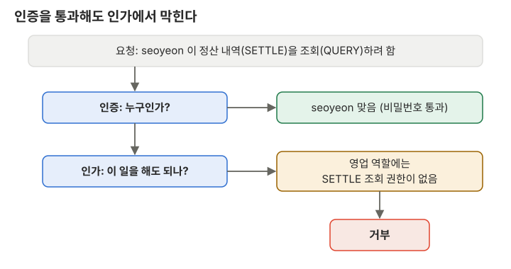
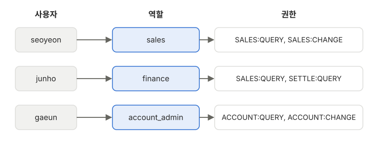

# 실습 1-1 · 사용자 파일과 역할 파일 만들기

## 목표: 사용자 파일과 역할 파일

> **오늘 들어온 일**
> A사 보안 담당(회사의 자료와 시스템을 지키는 일을 맡은 사람)이 보낸 메시지: 「얼마 전 영업팀 seoyeon 계정이 정산 내역을 조회했는데 막히지 않았습니다. 누가 어떤 자원에 무엇을 해도 되는지 표로 정하고, 그 표대로 막는 장치를 만들어 주세요.」
> - 이 실습에서 하는 일: 인증과 인가를 구분하고, 사용자 → 역할 → 권한으로 이어지는 표를 읽고, 사용자 파일 `config/users.json` 과 역할 파일 `config/roles.json` 을 직접 씁니다.
> - 끝나면: 어떤 문제가 있었고 어떻게 확인했는지 생각해 봅니다.

오늘 첫 실습은 파이썬이 아니라 **JSON 파일 두 개를 표를 보고 옮겨 쓰는 일**입니다. 코드를 몰라도 끝까지 할 수 있는 첫 성공입니다.

> **확인** — 오늘 만들 파일 두 개의 이름(`config/users.json` · `config/roles.json`)을 말할 수 있으면 성공입니다.

## 왜 사용자·역할 표가 필요한가

1. 얼마 전 사건에서 seoyeon 계정은 맡은 자원(영업 실적)이 아닌 정산 내역을 조회했는데, 막는 규칙이 없어서 통과했습니다. 「누가 무엇을 해도 되나」가 어디에도 적혀 있지 않았기 때문입니다.
2. 직원마다 권한을 하나씩 주면 직원이 수백 명일 때 관리가 안 됩니다. 예를 들어 seoyeon 이 영업팀에서 재무팀으로 옮겼는데 영업 권한을 지우는 것을 잊으면, 두 팀의 권한을 모두 갖게 됩니다.
3. 오늘 만드는 사용자 · 역할 파일과 판정 함수는 실습 1-3의 최종 판정(`policy.py`)과 다음 Unit 2(권한 주기)의 요청 · 승인 흐름에서 그대로 불러 씁니다.

> **확인** — seoyeon 의 정산 조회가 왜 막히지 않았는지 한 문장으로 말할 수 있으면 성공입니다. 막히면 1번을 다시 읽습니다.

## 1.1 인증과 인가

| 말 | 뜻 | 예 |
|---|---|---|
| **인증**(authentication · 오센티케이션) | 「이 사람이 누구인가」를 확인하는 것 | 비밀번호 · MFA 로 로그인 |
| **인가**(authorization · 오서라이제이션) | 「이 사람이 이 자원에 이 일을 해도 되나」를 정하는 것 | 영업팀은 영업 실적을 조회할 수 있지만 정산 내역은 조회할 수 없다 |

- MFA 는 **다중 인증**(Multi-Factor Authentication · 멀티 팩터 오센티케이션)의 약자로, 비밀번호에 문자 인증번호처럼 다른 확인 수단을 하나 더 붙여 본인을 확인하는 방식입니다.
- 인증을 통과해도 인가에서 막힐 수 있습니다. 이 사건은 비밀번호로 인증은 됐고, **인가를 확인하는 곳이 없었습니다.**
- 아래 그림의 **`SETTLE` 은 약자가 아니라 영어 단어 settle(정산하다, 결제를 마무리하다)입니다.** `SETTLE:QUERY` 는 「정산 쪽 조회 업무」라는 분류 이름으로 읽습니다.

<figure class="page-figure"></figure>

> **확인** — 「로그인은 됐는데 정산 화면이 막힘」이 인증과 인가 중 인가에서 막힌 것이라고 답할 수 있으면 성공입니다.

## 1.2 역할 기반 접근통제(RBAC)

- **RBAC**(Role-Based Access Control · 롤 베이스드 액세스 컨트롤, 역할 기반 접근통제)
  - 사용자에게 권한을 직접 주지 않고, **역할**에 권한을 주고 사용자에게 역할을 준다
  - 사용자 → 역할 → 권한 순서로 따라가서 허용 여부를 정한다
  - 학교에서 교실 열쇠를 「반장」이라는 자리에 주는 것과 비슷합니다. 반장이 바뀌면 열쇠도 새 반장이 받습니다.

| 말 | 뜻 | 예 |
|---|---|---|
| **역할**(role · 롤) | 하는 일이 같은 사람들의 묶음 | 영업(sales) · 재무(finance) · 계정 관리자(account_admin) |
| **권한**(permission · 퍼미션) | 「자원 하나에 행위 하나」를 허용하는 것. 오늘은 `자원:행위` 모양으로 쓴다 | `SALES:QUERY` 는 영업 실적 조회 |

<figure class="page-figure"></figure>

권한을 「준다」는 것은 그 사람이 할 수 있는 일을 파일에 적어 두는 것입니다. 영업팀이 30명이라고 할 때 두 방식을 파일 모양으로 비교하면 이렇습니다.

```
[직접 주기] 사용자 한 명마다 권한 리스트를 적는다 (30명이면 30곳)

   "seoyeon": {"permissions": ["SALES:QUERY", "SALES:CHANGE"]},
   "minsu":   {"permissions": ["SALES:QUERY", "SALES:CHANGE"]},
   ...                          ← 영업팀 30명 모두 같은 내용을 되풀이해 적는다

   영업팀 권한이 바뀌면      30곳을 하나씩 고친다
   부서를 옮긴 직원은        옛 권한을 지우는 것을 잊기 쉽다

[역할로 주기] 권한 리스트는 역할 한 곳에만 적고, 사용자에게는 역할 이름만 적는다

   roles.json  "sales": ["SALES:QUERY", "SALES:CHANGE"]        ← 권한은 여기에 한 번만 적는다
   users.json  "seoyeon": {"role": "sales"},                   ← 30명은 역할 이름만 적는다
               "minsu":   {"role": "sales"},
               ...

   영업팀 권한이 바뀌면      roles.json 의 sales 한 곳만 고친다
   부서를 옮긴 직원은        그 직원의 role 한 칸만 바꾼다
```

- 한 명이 영업에서 재무로 옮기면, 직접 주기는 그 사람의 권한 리스트에서 영업 권한 두 개를 지우고 재무 권한 두 개를 적느라 **네 군데**를 고치고(하나라도 빼먹으면 옛 권한이 남음), 역할로 주기는 `sales` → `finance` **한 군데**만 고칩니다.

> **확인** — 「영업팀 권한이 바뀌면 역할로 주기에서는 어디를 고치나」에 `roles.json` 의 `sales` 한 곳이라고 답하면 성공입니다.

## 1.3 권한 매트릭스와 최소권한

| 말 | 뜻 | 매트릭스에서는 |
|---|---|---|
| **권한 매트릭스**(permission matrix · 퍼미션 매트릭스) | 역할을 줄에, 권한을 칸에 놓고 허용(○)과 아님을 표시한 표 | 누가 무엇을 해도 되는지를 한눈에 확인하는 데 쓴다 |
| **최소권한**(least privilege · 리스트 프리빌리지) | 일에 필요한 만큼만 허용한다 | ○ 가 적을수록 좋다. 누가 계정을 훔쳐 쓰면 ○ 가 있는 일은 모두 할 수 있다 |
| **기본 거부**(default deny · 디폴트 디나이) | 허용하지 않은 것은 모두 거부한다 | ○ 가 없으면 모두 거부한다 |

기본 거부는 초대 명단에 이름이 없으면 들어올 수 없는 생일 파티와 같습니다. **방화벽**(firewall · 파이어월)은 회사 네트워크의 입구에서 정해 둔 규칙대로 연결을 통과시키거나 막는 장치입니다. 방화벽이 허용 목록에 없는 연결을 막는 것도 같은 생각입니다.

표에 나오는 자원과 행위입니다.

| 이름 | 종류 | 뜻 |
|---|---|---|
| `SALES` | 자원 | 영업 실적 |
| `SETTLE` | 자원 | 정산 내역 |
| `ACCOUNT` | 자원 | 직원 계정과 그 권한 설정 |
| `QUERY` | 행위 | 조회 |
| `CHANGE` | 행위 | 변경 |

- 역할 `batch` 는 **서비스 계정**(사람이 아니라 프로그램이 자동으로 쓰는 계정)의 역할입니다. `batch-night` 가 매일 02:00 에 정산 내역을 모아 합계를 냅니다(집계).

A사가 정한 권한 매트릭스(초안)입니다.

| 역할 | `SALES:QUERY` | `SALES:CHANGE` | `SETTLE:QUERY` | `ACCOUNT:QUERY` | `ACCOUNT:CHANGE` |
|---|---|---|---|---|---|
| `sales`(영업) | ○ | ○ | | | |
| `finance`(재무) | ○ | | ○ | | |
| `account_admin`(계정 관리자) | | | | ○ | ○ |
| `batch`(정산 집계 서비스 계정) | | | ○ | | |
| `auditor`(감사) | ○ | | ○ | ○ | |

- `auditor`(감사 담당)의 **감사**(audit · 오딧)는 규칙대로 일이 처리됐는지 나중에 기록으로 확인하는 일입니다. 시험이 끝난 뒤 채점이 규칙대로 됐는지 다시 살펴보는 것과 비슷합니다. 이 역할은 자료를 조회만 하고 바꾸지는 않습니다.

<h2>매트릭스에서 요청 하나 판정하기</h2>

읽는 법은 역할 줄과 권한 칸이 만나는 곳을 보는 것입니다.

| 예 | 역할 줄 × 권한 칸 | 칸 | 판정 |
|---|---|---|---|
| ① | `sales` × `SALES:QUERY` | ○ | 영업은 영업 실적을 조회해도 됩니다 |
| ② | `sales` × `SETTLE:QUERY` | 빈칸 | 영업이 정산 내역을 조회하면 거부입니다 |

요청 하나는 세 단계로 판정합니다. 본보기는 문제에 없는 요청입니다.

| 단계 | 하는 일 | 본보기: gaeun 의 직원 계정 조회(`ACCOUNT:QUERY`) |
|---|---|---|
| ① 역할 찾기 | 사용자의 역할을 계정 리스트에서 찾는다 | gaeun 의 역할은 `account_admin` |
| ② 칸 찾기 | 그 역할 줄과 요청한 권한 칸이 만나는 곳을 본다 | `account_admin` 줄 × `ACCOUNT:QUERY` 칸 |
| ③ ○ 확인 | ○ 가 있으면 허용, 없으면 거부 | ○ 있음 → 허용 |

- 다른 본보기: `auditor` 가 `ACCOUNT:CHANGE` 를 하려는 경우 그 칸에 ○ 가 없으므로 거부입니다(기본 거부).

> **확인** — `batch` × `SALES:QUERY` 를 매트릭스로 판정해 「거부」가 나오면 성공입니다. 허용이 나왔다면 `batch` 줄을 다시 따라가 봅니다.

## 1.4 JSON 으로 사용자 파일 만들기

매트릭스를 코드가 읽으려면 파일로 적어야 합니다. 이름과 값을 짝지어 적는 글 형식인 **JSON**(JavaScript Object Notation · 제이슨) 으로 씁니다. 오늘은 파일 두 개를 `config` 폴더에 둡니다.

| 파일 | 담는 것 | 모양 |
|---|---|---|
| `config/users.json` | 사용자 → 역할 · 재직 여부 | `"사용자": {"role": "역할", "employed": true}` |
| `config/roles.json` | 역할 → 권한 리스트 | `"역할": ["자원:행위", …]` |

JSON 에 쓰는 괄호는 두 가지입니다. 실습 1-2에서 파이썬이 이 파일을 읽으면 오른쪽 칸처럼 바뀝니다.

| 괄호 | 묶는 것 | 파이썬에서 |
|---|---|---|
| `{ }` | 「이름: 값」 짝 여러 개 | **딕셔너리**(dictionary · 딕셔너리, 이름(키)으로 값을 찾는 묶음) |
| `[ ]` | 값 여러 개를 순서대로 늘어놓음 | **리스트**(값을 순서대로 담는 묶음) |

예: `{"role": "sales"}` 에서 `"role"` 이 이름(키), `"sales"` 가 값입니다. `["SALES:QUERY", "SALES:CHANGE"]` 는 값 두 개가 든 리스트입니다.

JSON 을 쓸 때 지킬 규칙입니다.

| 규칙 | 맞음 | 틀림 |
|---|---|---|
| 참 · 거짓은 소문자 | `true` · `false` | 파이썬식 `True` · `False` |
| 문자열과 이름은 큰따옴표로만 감쌈 | 큰따옴표 `"` | 작은따옴표 `'` (JSON 오류) |
| 마지막 항목 뒤에는 쉼표를 쓰지 않음 | 쉼표 없이 닫음 | 마지막 항목 뒤 쉼표 |

- 설정을 코드와 나눠 파일에 두면, 직원이 바뀌어도 코드는 그대로 두고 파일만 고칩니다.
- 파일이 JSON 규칙에 맞는지는 `python -m json.tool config/users.json` 처럼 확인합니다. `-m json.tool` 은 파이썬에 들어 있는 JSON 검사 도구를 실행하라는 뜻입니다. 맞으면 내용이 다시 정리되어 출력되고, 틀리면 `Expecting …` 같은 오류와 줄 번호가 나옵니다.

<h2>매트릭스의 ○ 는 파일에서 어떻게 적히나</h2>

- 매트릭스의 ○ 는 사람이 보기 쉽게 그린 표시입니다. 파일에는 「○」 글자로 저장하지 않고, `roles.json` 리스트에 적힌 **권한 하나가 ○ 한 칸**입니다. 빈칸은 아예 적지 않으므로 리스트에 없으면 거부(기본 거부)입니다.
  - 예: `sales` 줄의 ○ 두 칸(`SALES:QUERY` · `SALES:CHANGE`) → `"sales": ["SALES:QUERY", "SALES:CHANGE"]`

두 파일은 역할 이름으로 이어집니다. seoyeon 이 무엇을 해도 되는지는 두 파일을 차례로 보면 압니다.

| 순서 | 파일 | 찾는 것 | 결과 |
|---|---|---|---|
| ① | `users.json` | `"seoyeon"` 줄 | `"role": "sales"` |
| ② | `roles.json` | `"sales"` 줄 | `["SALES:QUERY", "SALES:CHANGE"]` |
| ③ | 결과 | | seoyeon 은 영업 실적 조회 · 변경만 해도 됨 |

- 두 파일을 잇는 열쇠는 **역할 이름**입니다. `users.json` 의 `role` 과 `roles.json` 의 이름이 같은 문자열이어야 하고, `"Sales"` · `"sale"` 처럼 다르면 `roles.json` 에서 못 찾습니다.
- 권한은 `roles.json` 에 역할마다 한 번만 적고, 영업팀 30명은 `users.json` 에 역할 이름만 적습니다.
- 쉼표 하나 · 따옴표 하나만 틀려도 판정 코드가 파일을 읽지 못합니다. 그때 `python -m json.tool` 이 틀린 줄 번호와 함께 오류를 알려 줍니다. 아래는 Python 3.9 와 3.13 에서 직접 확인한 문구입니다. **줄 번호 · 문구는 Python 버전마다 조금 다릅니다.** 줄 번호는 내 파일에 따라서도 다릅니다.

| 틀린 곳 | `json.tool` 이 보여 주는 오류(예) |
|---|---|
| 줄 끝 쉼표가 빠짐 | `Expecting ',' delimiter: line 3 …` |
| 작은따옴표 `'seoyeon'` | `Expecting property name enclosed in double quotes: line 2 …` |
| 마지막 줄 뒤에 쉼표 | Python 3.13 이상: `Illegal trailing comma before end of object: line 3 …` (쉼표가 있는 줄) · 그 전 버전: `Expecting property name enclosed in double quotes: line 4 …` (쉼표 다음 줄) |
| 파이썬식 `True` | `Expecting value: line 2 …` |

> **확인** — `{'seoyeon': {"role": "sales", "employed": True}}` 에서 틀린 곳 두 개(작은따옴표, `True`)를 찾으면 성공입니다. 못 찾으면 위 「JSON 을 쓸 때 지킬 규칙」 표를 봅니다.

## 실습 1-1 · 사용자·역할 파일 만들고 약점 따지기

<h2>이런 상황이 있습니다</h2>

- 보안 담당이 「매트릭스 초안대로라면 요청들이 어떻게 판정되는지, 필요 이상의 ○ 가 있는지 먼저 봐 달라」고 합니다.
- 그다음에는 인사팀(직원의 입사 · 부서 이동 · 퇴사를 맡는 팀)이 보낸 계정 리스트와 매트릭스를 판정 코드가 읽을 수 있는 파일 두 개로 옮겨야 합니다.
- 실제 회사에서는 표를 코드로 옮기기 전에, 요청 몇 건을 표로 먼저 판정해 보며 표가 맞는지 확인합니다.
- 인사팀의 직원 명단은 자주 바뀌어서 접근통제 쪽 파일로 매일 옮겨 적습니다. 이때 퇴사 표시를 빠뜨리면 회사를 떠난 사람이 아직 로그인해 자료를 볼 수 있습니다. 그래서 실습 1-2의 판정 함수는 `employed` 가 `false` 인 사용자를 거부합니다.

<h2>할 일</h2>

1. 요청 여섯 건을 1.3 의 매트릭스로 <mark>판정</mark>합니다. (응용) 필요 이상으로 보이는 ○ 찾기는 선택 질문에서만 다룹니다. 지금은 건너뛰어도 됩니다.
2. 인사팀 계정 리스트로 <mark>`config/users.json`</mark> 을 **직접** 씁니다.
3. 매트릭스로 <mark>`config/roles.json`</mark> 의 세 역할을 **직접** 씁니다.
4. 두 파일을 <mark>`python -m json.tool`</mark> 로 확인하고, 파일의 <mark>약한 점</mark>(퇴사 반영이 늦을 때, 더 필요한 칸, 역할이 없는 사용자)을 따져 봅니다.

**자료 ①** — 요청 여섯 건

| 요청 | 사용자(역할) | 하려는 일 |
|---|---|---|
| ① | seoyeon(`sales`) | `SALES:QUERY` |
| ② | seoyeon(`sales`) | `SETTLE:QUERY` |
| ③ | junho(`finance`) | `SETTLE:QUERY` |
| ④ | junho(`finance`) | `SALES:CHANGE` |
| ⑤ | gaeun(`account_admin`) | `SETTLE:QUERY` |
| ⑥ | batch-night(`batch`) | `SETTLE:QUERY` |

**자료 ②** — 인사팀 계정 리스트

| 사용자 | 역할 | 재직 |
|---|---|---|
| `seoyeon` | `sales` | 재직 중 |
| `junho` | `finance` | 재직 중 |
| `gaeun` | `account_admin` | 재직 중 |
| `dami` | `sales` | 퇴사 |
| `batch-night` | `batch` | 재직 중(서비스 계정) |
| `tester` | `intern` | 재직 중 |


<h2>순서</h2>

1. 요청마다 사용자의 역할 줄을 찾고, 하려는 일의 칸에 ○ 가 있는지 봅니다. ○ 가 없으면 기본 거부입니다.
   - **(응용) — 선택 질문에서만 다룹니다. 지금은 건너뛰어도 됩니다.** 역할마다 ○ 를 하나씩 보며 「이 역할이 하는 일에 꼭 필요한가」를 따집니다. 계정 설명(영업은 영업 실적, 재무는 정산)을 떠올립니다.
   - 이 결과를 보고 왜 그렇게 판정되는지 생각해 봅니다.
2. **[터미널]** 위치가 `…/access_control` 인지 확인합니다.
   ```bash
   pwd
   ```
   - 명령 풀이: `pwd` 지금 있는 폴더의 위치를 보여 줌
3. **[VS Code]** `access_control` 폴더 안의 `config` 폴더에 `users.json` 파일을 만듭니다(작업 폴더 기준 경로 `config/users.json`).
   - 왼쪽 목록에서 `access_control` 폴더 안의 `config` 폴더를 오른쪽 클릭 › **New File** 을 누르고 이름을 `users.json` 으로 적습니다. `config` 폴더는 시작하기에서 만들었습니다.
4. **[VS Code]** 위 **자료 ②** 의 표를 보고 `config/users.json` 을 씁니다. 표의 한 줄(사용자 한 명)이 파일의 한 줄이 됩니다. 첫 사용자 `seoyeon` 은 이렇게 옮깁니다.

   | 표의 칸 | 표에 적힌 값 | 파일에 쓰는 모양 |
   |---|---|---|
   | 사용자 | `seoyeon` | 큰따옴표 안의 이름 `"seoyeon":` |
   | 역할 | `sales` | `"role": "sales"` |
   | 재직 | 재직 중 | `"employed": true` (퇴사면 `false`) |

   이 세 칸을 한 줄로 합치면 아래와 같습니다. `{` 는 파일 맨 위에 한 번 쓰는 시작 표시입니다. 이름 뒤의 `{"role": …, "employed": …}` 는 그 사람의 정보 두 가지를 묶은 것입니다.
   ```json
   {
     "seoyeon": {"role": "sales", "employed": true},
   ```
   표의 두 번째 줄 `junho` 부터 여섯 번째 줄 `tester` 까지 **다섯 명**을 같은 방법으로 한 줄씩 **직접** 이어서 씁니다. 사용자 이름과 역할은 표의 글자를 그대로 옮기고, 재직 칸만 보고 `true` 와 `false` 를 고릅니다.
   - 줄 끝마다 쉼표를 쓰고, **마지막 사용자 줄 뒤에는 쉼표 없이** 다음 줄에 `}` 를 씁니다(파일 맨 아래 닫는 표시).
   - 표에서 `퇴사` 인 사람만 `"employed": false` 이고, `재직 중` 이면(서비스 계정 `batch-night` 도 포함) `true` 입니다.

<!-- checklist -->
- [ ] `config/users.json` 을 만들고 여섯 명을 직접 써서 저장했다
<!-- /checklist -->

5. **[터미널]** JSON 규칙에 맞는지 확인합니다. 여섯 명이 다시 출력되면 됩니다.
   ```bash
   python -m json.tool config/users.json
   ```
   - 명령 풀이: `python -m json.tool` 파이썬의 JSON 검사 도구를 실행 · `config/users.json` 검사할 파일
   - `Expecting ',' delimiter: line 4` 처럼 나오면 그 줄 근처의 쉼표 · 따옴표를 봅니다.
6. **[VS Code]** `access_control` 폴더 안의 `config` 폴더에 `roles.json` 파일을 만듭니다(경로 `config/roles.json`).
   - 같은 방법으로 `config` 폴더를 오른쪽 클릭 › **New File** 로 `roles.json` 을 만들고 아래 내용을 붙여 넣습니다.
   ```json
   {
     "sales": ["SALES:QUERY", "SALES:CHANGE"],
     "account_admin": ["ACCOUNT:QUERY", "ACCOUNT:CHANGE"]
   }
   ```
   - 위 두 역할은 미리 적어 두었습니다. `"account_admin"` 줄 아래에 1.3 의 매트릭스를 보고 `finance` · `batch` · `auditor` 세 역할을 **직접** 씁니다. 권한은 매트릭스의 ○ 칸을 왼쪽부터 순서대로 씁니다.
   - `"account_admin"` 줄 끝에 쉼표를 추가하고, 새로 쓴 마지막 줄 뒤에는 쉼표를 쓰지 않습니다. 마지막 줄 뒤에 쉼표를 쓰면 JSON 오류가 나서 판정 코드가 파일을 아예 읽지 못합니다.

<!-- checklist -->
- [ ] `config/roles.json` 을 만들고 `finance` · `batch` · `auditor` 세 역할을 직접 써서 저장했다
<!-- /checklist -->

7. **[터미널]** 확인합니다. 역할 다섯 개가 출력되면 됩니다.
   ```bash
   python -m json.tool config/roles.json
   ```
   - 명령 풀이: `python -m json.tool` 파이썬의 JSON 검사 도구를 실행 · `config/roles.json` 검사할 파일
   - 오류 없이 출력되면 JSON 문법을 지킨 것입니다.

<!-- checklist -->
- [ ] `python -m json.tool` 로 두 파일을 확인해 오류 없이 다시 출력되었다
<!-- /checklist -->

8. **[생각해 보기]** 아래 질문을 살펴보고, 남기고 싶은 고민과 확인한 결과는 블로그 글에 적어도 좋습니다.
   - (가) [핵심 질문] 요청 ① ~ ⑥ 의 판정(허용 · 거부)을 적고, 요청 ② 는 인증과 인가 중 어디에서 막히는지 적어 주세요. 또 영업 계정이 정산 내역을 조회했는데 막지 못한 사건과 어떻게 이어지는지도 적어 주세요.
   - (나) [응용] 매트릭스에서 필요 이상으로 보이는 ○ 를 하나 고르고, 그 이유와 그 ○ 가 남아 있을 때의 위험을 적어 주세요.
   - (다) [핵심 질문] `users.json` 의 `tester` 는 역할이 `intern` 인데 `roles.json` 에는 `intern` 이 없습니다. 이 사용자가 요청하면 어떻게 판정되어야 하나요? 그 이유도 적어 주세요.

> **확인** — `python -m json.tool` 로 `users.json` 은 여섯 명, `roles.json` 은 역할 다섯 개가 오류 없이 다시 출력되면 성공입니다. `Expecting …` · `Illegal trailing comma …` 같은 오류가 나오면 그 줄 번호 근처의 쉼표 · 따옴표 · `true` 를 고치고 다시 확인합니다.


글감과 연결되는 입력이나 출력 한 줄을 골라 이번 유닛의 블로그 초안에 남깁니다.

<!-- answer: 11|실습 1-1 정답 -->

## 실습 1-1 정리

| 하려는 일 | 말 · 명령 |
|---|---|
| 누구인지 확인 | 인증(authentication) |
| 이 일을 해도 되는지 | 인가(authorization) |
| 역할에 권한을 주기 | RBAC: 사용자 → 역할 → 권한 (역할로 주면 옮길 때 한 군데) |
| 누가 무엇을 해도 되나 한눈에 | 권한 매트릭스, ○ 가 없으면 기본 거부 |
| JSON 파일 확인 | `python -m json.tool config/users.json` · `python -m json.tool config/roles.json` |

> **확인** — 위 표의 왼쪽 칸만 보고 오른쪽 말을 떠올릴 수 있으면 성공입니다. 막히는 줄은 그 절(1.1 ~ 1.4)로 돌아가 봅니다.

---
