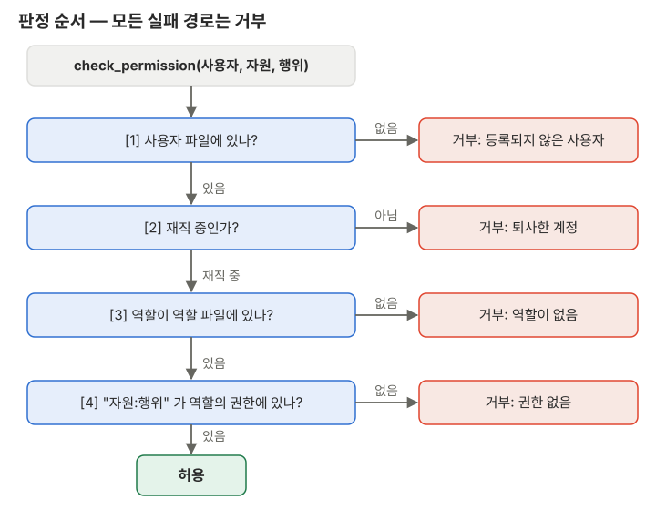

# 실습 1-2 · 권한 판정 함수 만들기

## 목표: 권한 판정 함수

> **오늘 들어온 일**
> A사 보안 담당이 보낸 메시지: 「표는 좋습니다. 이제 요청이 들어오면 이 표대로 허용 · 거부를 정하는 프로그램을 만들어 주세요. 거부할 때는 왜 거부했는지도 남겨야 감사(규칙대로 처리됐는지 기록으로 다시 살펴보는 일) 때 설명할 수 있습니다.」
> - 이 실습에서 하는 일: 실습 1-1에서 만든 사용자 파일과 역할 파일을 읽습니다. 그리고 사용자 · 자원 · 행위를 받아 **(허용 여부, 이유)** 를 리턴하는 함수 `check_permission` 을 `rbac.py` 에 만듭니다. 대부분은 미리 채워 두었고, 마지막 권한 검사 두 줄만 직접 씁니다.
> - 끝나면: 어떤 문제가 있었고 어떻게 확인했는지 생각해 봅니다.

## 왜 모든 실패를 거부해야 하는가

1. 표만 있고 막는 코드가 없으면 seoyeon 사건이 그대로 다시 일어납니다. 허용 · 거부를 정하는 **판단 지점**을 코드로 만들어야, 실제로 요청을 막거나 통과시키는 **집행 지점**(예: 정산 포털)이 그 판단을 따를 수 있습니다. 공연장으로 치면 명단을 보고 「들어가도 됩니다」를 정하는 사람이 판단 지점, 그 말대로 문을 열고 닫는 문지기가 집행 지점입니다.
2. 실패하는 경우는 여러 가지입니다. 없는 사용자, 퇴사자, 역할이 없는 사용자, 권한이 없는 요청. **어느 경우든 거부**해야 하고, 하나라도 빠지면 그 경우의 요청이 그대로 통과합니다.
3. 거부 이유를 구분해 남기면, 감사 때 「왜 막았나」를 설명하고 오탐(정상인데 막은 것)을 찾을 수 있습니다.

## 2.1 판정 순서 — 모든 실패 경로는 거부

<figure class="page-figure"></figure>

- 위에서부터 검사하다가 하나라도 걸리면 그 자리에서 거부를 리턴하고 끝납니다.
- 네 검사를 모두 지나야만 허용입니다. 검사 하나를 빼먹으면 그 경우는 **잘못 허용됩니다.** 경비원이 자리를 비운 문으로 아무나 지나가는 것과 같습니다. 이렇게 검사가 빠진 자리가 저절로 허용이 되는 위험을 **열림 기본 값**(fail-open · 페일 오픈)이라고 합니다.

<h2>걸리면 바로 끝내는 이유</h2>

뒤 검사는 앞 검사를 통과한 요청에만 할 수 있습니다. 앞에서 걸러 주지 않으면 코드가 멈춥니다.

| 검사 | 앞에서 걸러 주지 않으면 | 예 |
|---|---|---|
| [2] 재직 | 사용자 파일에 없는 사용자의 `employed` 를 꺼내려다 `KeyError` 로 멈춤 | `USERS["minsu"]["employed"]` → `KeyError: 'minsu'` |
| [4] 권한 | 역할 파일에 없는 역할의 리스트를 꺼내려다 `KeyError` 로 멈춤 | `ROLES["intern"]` → `KeyError: 'intern'` |

- `KeyError` 는 딕셔너리에 없는 키를 꺼내려 할 때 파이썬이 내는 오류입니다.
- 하나만 걸려도 결론은 거부라서 남은 검사를 더 볼 필요가 없습니다. 끝까지 다 지난 요청만 허용하는 것이 기본 거부입니다.

<h3>거부 이유 네 가지 — 감사 때 하는 말</h3>

| 거부 이유 | 어디서 막혔나 | 감사 때 하는 말 · 고칠 곳 |
|---|---|---|
| 등록되지 않은 사용자 | `users.json` 에 없음 | 명단에 적는 것을 빠뜨렸는지, 모르는 사람이 들어오려 했는지 |
| 퇴사한 계정 | `"employed": false` | 막는 게 맞음. 남은 계정은 거둬들여(회수) 못 쓰게 함 |
| 역할이 없음 | `roles.json` 에 없음 | 설정 누락 → `roles.json` 에 역할을 정해 넣음 |
| 권한 없음 | 리스트에 그 권한 없음 | 정상 차단. 한 계정에서 자주 나오면 몰래 엿보려는 신호(사건 신호) |

- 네 이유는 사용자 → 역할 → 권한을 찾아가다 막힐 수 있는 네 곳입니다. 이름은 수업에서 붙였습니다.
- 「거부」 하나로만 남기면 설정을 고칠 일과 사건 신호가 섞여 구분할 수 없습니다.

**이 시간에 나오는 말** (먼저 짧게 봅니다)

| 쓰는 모양 | 뜻 |
|---|---|
| `def 이름(받는 값):` | **함수**(이름을 붙여 둔 일 묶음)를 만듦. 예: `check_permission("seoyeon", "SALES", "QUERY")` 처럼 부르면 괄호 안 세 값을 받아 일을 함 |
| `import json` | 파이썬에 들어 있는 `json` 모듈(미리 만들어 둔 기능 묶음)을 불러와 `json.load` 를 쓸 수 있게 함 |
| `json.load(파일변수)` | `with open(…)` 으로 연 JSON 파일을 딕셔너리로 읽음 |
| `값 in 딕셔너리` | 딕셔너리에 그 키가 있는지 검사 |
| `값 not in 딕셔너리` | 그 키가 없는지 검사. 예: `role not in ROLES` |
| `값 not in 리스트` | 리스트에 그 값이 없는지 검사 |
| `return` | 함수가 결과를 돌려주고(리턴) 그 자리에서 끝남 |
| `return 값1, 값2` | 두 값을 함께 리턴. `is_allowed, reason = 함수(…)` 로 나눠 받음 |
| `f"{resource}:{action}"` | f-문자열. 따옴표 앞에 `f` 를 붙이면 `{ }` 자리에 그 변수의 값이 들어감 |
| `from 파일이름 import 함수이름` | 내가 만든 파일의 함수를 불러옴. 파일 이름에서 `.py` 는 뺌. 예: `from rbac import check_permission` |
| `if not 값:` | 값이 거짓(`False`)일 때 실행 |
| `""" … """` | 함수 첫 줄의 **독스트링**(docstring · 닥스트링). 함수가 무엇을 받고 리턴하는지 적은 설명 글이고 실행에는 영향이 없음 |

- 파이썬의 **모듈**은 `import` 로 불러 쓰는 기능 묶음이나 `.py` 파일입니다(`rbac.py` 도 다른 파일이 `from rbac import …` 로 불러 쓰면 모듈입니다). 이 과정의 단위인 「Module 3」과는 이름만 같고 다른 말입니다.
- 파일은 `with open(파일, encoding="utf-8") as 파일변수:` 로 엽니다. `with` 아래 들여 쓴 줄이 끝나면 파일이 저절로 닫히고, `encoding="utf-8"` 은 한글 같은 글자가 깨지지 않게 읽으라는 뜻입니다.

`rbac.py` 가 시작할 때 읽어 두는 `ROLES` · `USERS` 는 이런 모양이고, 함수는 `is_allowed, reason` 으로 나눠 리턴합니다.

```python
print(ROLES["sales"])                 # ['SALES:QUERY', 'SALES:CHANGE']
# {'role': 'sales', 'employed': True}   ← JSON 의 소문자 true 가 파이썬의 True 가 됨
print(USERS["seoyeon"])
print(USERS["seoyeon"]["employed"])   # True

is_allowed, reason = check_permission("minsu", "SALES", "QUERY")  # 판정 결과와 이유를 나눠 받는다
print(is_allowed, reason)                     # False 등록되지 않은 사용자
```

<h3>문법 상자 · 직접 쓰는 곳의 모양 (예시 값 · 읽기만 합니다)</h3>

직접 쓰는 곳은 `[4]` 권한 검사 하나입니다. 그 모양입니다.

```python
resource, action = "ACCOUNT", "CHANGE"    # 예시 값
permission = f"{resource}:{action}"       # 「자원:행위」 문자열을 만든다

print(permission)                         # ACCOUNT:CHANGE
print(permission not in ROLES["finance"]) # True  · finance 에는 없음
```

## 실습 1-2 · 권한 판정 함수 직접 쓰기

<h2>이런 상황이 있습니다</h2>

- 판정 함수의 검사 [1] ~ [3] 과 권한 문자열을 만드는 줄은 미리 써 두었습니다. 빠진 것은 마지막 [4] 권한 검사입니다. 이 검사가 없으면 seoyeon 의 정산 조회가 다시 통과합니다.
- 실제 회사의 접근통제 코드도 이렇게 검사를 위에서부터 차례로 걸고, 끝까지 지난 경우에만 허용합니다.

<h2>할 일</h2>

1. 아래 코드로 `rbac.py` 를 만들고, `# ←` 가 있는 <mark>두 곳</mark>(① · ②)을 한 줄씩 채웁니다.
2. 요청 아홉 건을 판정하는 `exercise1-2_run.py` 를 만들어 실행합니다.
3. 채운 <mark>뒤</mark>의 판정을 확인합니다. (응용) 채우기 전과 후의 비교는 선택 질문에서만 다룹니다. 지금은 건너뛰어도 됩니다.

<h2>준비</h2>

아래 `rbac.py` 는 실습 1-1에서 만든 두 파일 `config/users.json` 과 `config/roles.json` 을 **읽습니다.** 그 파일이 없으면 코드가 시작하자마자 멈춥니다. 터미널이 `…/access_control` 위치인지 확인한 뒤(`…/network-study-notes` 에 있다면 `cd access_control` 로 들어갑니다) 두 파일이 있는지 봅니다.

```bash
ls config
```

- 명령 풀이: `ls` 폴더 안의 파일 이름 리스트 · `config` 볼 폴더
- `roles.json` 과 `users.json` 두 개가 나와야 합니다. 없으면 실습 1-1로 돌아가 만듭니다. 없는 채로 실행하면 `FileNotFoundError: [Errno 2] No such file or directory: 'config/roles.json'` 오류가 납니다.

<h3><code>rbac.py</code></h3>

```python
import json                                                      # JSON 파일을 읽는 모듈을 불러온다

with open("config/roles.json", encoding="utf-8") as roles_file:           # 역할 파일을 연다
    ROLES = json.load(roles_file)                                         # 역할 → 권한 리스트 딕셔너리로 읽는다
with open("config/users.json", encoding="utf-8") as users_file:           # 사용자 파일을 연다
    USERS = json.load(users_file)                                         # 사용자 → 정보 딕셔너리로 읽는다


def check_permission(user, resource, action):                    # 사용자 · 자원 · 행위를 받는 함수
    # 함수 첫 줄의 """ … """ 는 함수 설명 글이고 실행에는 영향이 없다
    """요청을 허용할지 (허용 여부, 이유)로 리턴한다. 요청이 들어올 때 가장 먼저 쓰는 판정이고, 허용 리스트에 없으면 모두 거부한다."""
    # [1] 사용자 파일에 있나
    if user not in USERS:                                        # 사용자 파일에 없는 계정이면
        return False, "등록되지 않은 사용자"                       # 바로 거부하고 함수를 끝낸다
    # [2] 재직 중인가
    if not USERS[user]["employed"]:                              # 재직 중이 아니면
        return False, "퇴사한 계정"                                # 거부하고 함수를 끝낸다
    # [3] 역할이 역할 파일에 있나
    role = USERS[user]["role"]                                   # 이 사용자의 역할을 꺼낸다
    if role not in ROLES:                                        # 역할 파일에 없는 역할이면
        return False, "역할이 없음"                                # 거부하고 함수를 끝낸다
    # [4] 「자원:행위」가 그 역할의 권한 리스트에 있나
    permission = f"{resource}:{action}"                          # "자원:행위" 모양 문자열로 합친다
    # ① permission 이 ROLES[role] 리스트에 없으면   # ← 이 주석 바로 아래 줄에 씁니다 (4칸)
    # ② "권한 없음" 을 이유로 거부한다   # ← 이 주석 바로 아래 줄에 씁니다 (8칸)

    return True, "허용"                                          # 모든 검사를 지나면 허용한다
```

<h3><code>exercise1-2_run.py</code></h3>

```python
from rbac import check_permission                                # rbac.py 의 판정 함수를 불러온다

REQUESTS = [                                                     # 판정할 요청 리스트. (사용자, 자원, 행위)
    ("seoyeon", "SALES", "QUERY"),                               # 영업이 영업 실적 조회
    ("seoyeon", "SETTLE", "QUERY"),                              # 영업이 정산 조회 (seoyeon 사건)
    ("junho", "SETTLE", "QUERY"),                                # 재무가 정산 조회
    ("junho", "SALES", "CHANGE"),                                # 재무가 영업 실적 변경
    ("dami", "SALES", "QUERY"),                                  # 퇴사자가 영업 실적 조회
    ("minsu", "SALES", "QUERY"),                                 # 사용자 파일에 없는 계정
    ("gaeun", "ACCOUNT", "CHANGE"),                              # 계정 관리자가 권한 변경
    ("batch-night", "SETTLE", "QUERY"),                          # 서비스 계정이 정산 집계
    ("tester", "SALES", "QUERY"),                                # 역할 파일에 없는 역할(intern)
]

for user, resource, action in REQUESTS:                          # 요청을 하나씩 꺼낸다
    is_allowed, reason = check_permission(user, resource, action)        # 판정 결과와 이유를 나눠 받는다
    # 사용자 · 자원 · 행위 -> 결과 이유 를 출력한다
    print(user, resource, action, "->", is_allowed, reason)
```

- `REQUESTS` 의 괄호 `( )` 하나가 요청 한 건입니다. `for user, resource, action in REQUESTS:` 는 요청을 한 건씩 꺼내 세 값을 차례로 `user` · `resource` · `action` 에 나눠 담습니다.
- 주석의 `[1]` ~ `[4]` 는 2.1 그림의 검사 번호입니다.
- 주석 줄은 그대로 두고, **각 주석 바로 아래 줄**에 씁니다. ① 은 `if` 줄이라 4칸, ② 는 그 `if` 안쪽의 `return` 줄이라 8칸에서 시작합니다.
- 출력 한 줄의 모양은 `사용자 자원 행위 -> True(또는 False) 이유` 이고, 요청이 아홉 건이라 아홉 줄이 나옵니다.

<h3>직접 쓰는 곳</h3>

| 빈칸 | 쓰는 줄 | 들여쓰기 |
|---|---|---|
| ① | `permission` 이 리스트에 없으면 (`if`) | 4칸 |
| ② | 「권한 없음」으로 거부 (`return`) | 8칸 |

- ① 확인: ① 만 쓰고 실행하면 `IndentationError: expected an indented block after 'if' statement` 가 나옵니다. ② 를 아직 안 써서 나는 오류이니 정상입니다. 막히면: 위 문법 상자의 `permission not in ROLES["finance"]` 에서 `"finance"` 자리에 `role` 을 넣고, 앞에 `if`, 끝에 `:` 를 붙입니다.
- ② 확인: ② 까지 쓰고 실행하면 `seoyeon SETTLE QUERY -> False 권한 없음` 이 나오면 성공입니다. 그래도 `True 허용` 이 나오면 줄 맨 앞에 `return` 이 있는지 봅니다. 막히면: 바로 위 `[3]` 의 `return False, "역할이 없음"` 과 같은 모양이고 이유만 다릅니다.
- 채우기 전에 실행해도 오류 없이 돌아갑니다. 검사 [1] ~ [3] 이 있어서 `minsu` · `dami` · `tester` 는 거부되지만, `seoyeon` 의 정산 조회와 `junho` 의 영업 실적 변경은 `True 허용` 으로 나옵니다. 검사 하나가 빠지면 그 경우가 그대로 통과한다는 것을 보여 주는 결과입니다.

<h2>순서</h2>

1. **[VS Code]** 작업 폴더 `access_control` 바로 아래에 `rbac.py` 를 만들고 위 코드를 붙여 넣습니다.
   - **VS Code 에서 만들기**
     1. VS Code 왼쪽 목록에서 `access_control` 폴더를 클릭해 선택합니다(선택하지 않으면 다른 폴더에 만들어집니다).
     2. 목록 위쪽의 **새 파일**(New File, 파일 모양에 `+`) 아이콘을 누릅니다.
     3. 이름 칸에 `rbac.py` 라고 입력하고 Enter 를 누릅니다.
     4. 열린 파일에 코드를 복사해 붙여 넣고 저장합니다. ① · ② 는 4번에서 채우니 지금은 붙여 넣기만 합니다.
2. **[VS Code]** `exercise1-2_run.py` 도 같은 방법으로 만듭니다.
   - **VS Code 에서 만들기**
     1. VS Code 왼쪽 목록에서 `access_control` 폴더를 클릭해 선택합니다(선택하지 않으면 다른 폴더에 만들어집니다).
     2. 목록 위쪽의 **새 파일**(New File, 파일 모양에 `+`) 아이콘을 누릅니다.
     3. 이름 칸에 `exercise1-2_run.py` 라고 입력하고 Enter 를 누릅니다.
     4. 열린 파일에 코드를 복사해 붙여 넣고 저장합니다.

<!-- checklist -->
- [ ] `access_control` 폴더 바로 아래에 `rbac.py` 와 `exercise1-2_run.py` 를 차례로 만들어 붙여 넣고 저장했다
<!-- /checklist -->

3. **[터미널]** `pwd` 가 `…/access_control` 로 끝나는지 확인합니다. **(응용) — 아래 「채우기 전 실행」은 선택 질문에서만 다룹니다. 지금은 건너뛰어도 됩니다.** 응용을 한다면 **채우기 전에** 한 번 실행해서 허용되면 안 되는 요청이 있는지 봅니다.
   ```bash
   python exercise1-2_run.py
   ```
   - 명령 풀이: `python` 파이썬으로 파일을 실행 · `exercise1-2_run.py` 실행할 파일
4. **[VS Code]** `rbac.py` 의 `# ←` 두 곳(① · ②)을 채웁니다. 2.1 의 판정 순서 그림의 [4] 를 보고 씁니다. 실행은 VS Code 의 ▶ 단추가 아니라 터미널에서 합니다. 코드가 `config/` 파일을 지금 위치(`…/access_control`) 기준으로 찾기 때문입니다.

<!-- checklist -->
- [ ] `rbac.py` 의 ① · ② 두 줄을 채워 저장했다
<!-- /checklist -->

5. **[터미널]** 다시 실행합니다. 아홉 줄의 결과와 이유가 2.1 의 그림에서 읽은 것과 같은지 확인합니다.
   ```bash
   python exercise1-2_run.py
   ```
   - 명령 풀이: `python` 파이썬으로 파일을 실행 · `exercise1-2_run.py` 실행할 파일

<!-- checklist -->
- [ ] `python exercise1-2_run.py` 를 실행해 `False` 다섯 줄이 나왔고, 그 이유(「등록되지 않은 사용자」 · 「퇴사한 계정」 · 「역할이 없음」 · 「권한 없음」 두 줄)가 2.1 의 「거부 이유 네 가지」 표의 네 이유와 같다
<!-- /checklist -->

6. **[생각해 보기]** 아래 질문을 살펴보고, 남기고 싶은 고민과 확인한 결과는 블로그 글에 적어도 좋습니다.
   - (가) [핵심 질문] 채운 뒤 실행한 출력 아홉 줄을 붙여 넣고, 거부된 요청마다 2.1 그림의 몇 번 검사에서 걸렸는지 적어 주세요.
   - (나) [응용] 채우기 전에 실행하면 `minsu` · `dami` · `tester` 만 거부됩니다. 그 출력에서 허용되면 안 되는 요청을 모두 고르고, 각각 왜 허용되면 안 되는지 적어 주세요. 검사 [4] 하나가 빠졌을 뿐인데 왜 이런 일이 생기나요?
   - (다) [응용] 퇴사 처리하면서 `dami` 의 역할을 `users.json` 에서 `"none"` 으로 바꿨다고 가정합니다. 이때 검사 [2](재직)와 [3](역할)의 순서를 바꾸면 `dami` 의 이유가 어떻게 달라지나요? 순서가 왜 중요한지 적어 주세요.

**확인** — 다시 실행했을 때 아홉 줄 중 `False` 가 다섯 줄이고, 이유가 「등록되지 않은 사용자」 · 「퇴사한 계정」 · 「역할이 없음」 · 「권한 없음」(두 줄)으로 나오면 성공입니다. 안 나오면 이 실습의 「정답과 해설 보기」에 있는 출력과 한 줄씩 맞춰 보고, 다른 줄이 있으면 위 「직접 쓰는 곳」의 확인을 다시 봅니다.


글감과 연결되는 입력이나 출력 한 줄을 골라 이번 유닛의 블로그 초안에 남깁니다.

<!-- answer: 11|실습 1-2 정답 -->

## 실습 1-2 정리

| 하려는 일 | 코드 |
|---|---|
| JSON 파일 읽기 | `with open("config/roles.json", encoding="utf-8") as roles_file:` → `json.load(roles_file)` |
| 키가 없으면 거부 | `if user not in USERS: return False, "…"` |
| 권한 문자열 만들기 | `permission = f"{resource}:{action}"` |
| 리스트에 없으면 거부 | `if permission not in ROLES[role]: return False, "권한 없음"` |
| 끝까지 지나면 허용 | `return True, "허용"` |
| 다른 파일에서 쓰기 | `from rbac import check_permission` |

---
