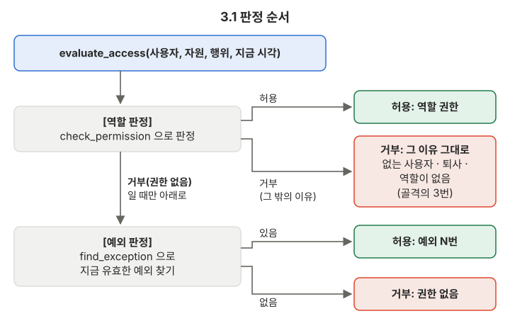
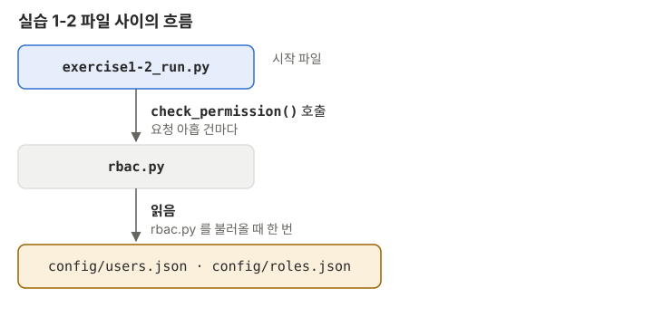

# 실습 1-3 · 최종 판정 policy.py 만들기

## 목표: 최종 판정 함수

> **오늘 들어온 일**
> A사 보안 담당이 보낸 메시지: 「지금은 "역할로 허용되나?"와 "예외로 허용되나?"를 따로 확인해서, 정산 포털이 어느 결과를 믿어야 할지 모르겠습니다. 요청 하나를 넣으면 "허용인지 거부인지"와 "왜 그런지"가 한 번에 나오게 해 주세요. 이미 퇴사한 사람은 예외가 남아 있어도 열리면 안 됩니다.」
> - 이 실습에서 하는 일: 실습 1-2에서 만든 `check_permission` 과 「제공 파일」의 `find_exception` 을 불러 최종 판정 함수 `evaluate_access` 를 `policy.py` 에 만들고, 오늘 요청 아홉 건을 판정한 결과를 읽습니다. 대부분은 미리 채워 두었고, 퇴사자가 예외로 열리지 않게 막는 두 줄만 직접 씁니다.
> - 끝나면 쓰는 것: 문제 해결 기록 (가) 답. (나) · (다)는 여유가 되면 하는 응용입니다

## 왜 판정을 한 함수에 모으는가

1. 판정 기준이 두 곳에 흩어져 있으면, 그 판정을 받아 실제로 문을 열고 닫는 쪽(집행 지점, 예: 정산 포털)이 어느 결과를 따를지 매번 정해야 합니다. 최종 판정을 한 함수가 하면 규칙이 한 곳에 모입니다.
2. 예외는 **역할 권한이 없을 때만** 봐야 합니다. 그리고 사용자 자체가 거부 대상인 경우(없는 사용자 · 퇴사자 · 역할이 없음)는 예외가 있어도 열면 안 됩니다. 이 순서가 틀리면 예외 3번이 남아 있는 퇴사자 `dami` 가 예외로 허용됩니다.
3. `policy.py` 는 다음 Unit 2(권한 주기)의 요청 · 승인 · 부여 흐름이 불러 쓰는 함수입니다.

## 3.1 판정 순서

<figure class="page-figure"></figure>

`policy.py` 가 불러 쓰는 두 함수입니다.

| 함수 | 들어 있는 파일 | 넣는 값 | 리턴 |
|---|---|---|---|
| `check_permission` | `rbac.py`(실습 1-2에서 만든 그대로, 고치지 않음) | 사용자 · 자원 · 행위 | `(True 또는 False, 이유)` |
| `find_exception` | `exception_policy.py`(「제공 파일」 레슨에서 복사해 만듦) | 사람 · 권한 · 지금 시각 | 유효한 예외가 있으면 `(True, 예외 번호)`, 없으면 `(False, None)` |

- `check_permission` 의 이유는 「권한 없음」 · 「퇴사한 계정」 · 「등록되지 않은 사용자」 · 「역할이 없음」 중 하나입니다.
- `policy.py` 는 실습 1-1에서 만든 역할 파일(`roles.json`)과 사용자 파일(`users.json`)을 `rbac.py` 를 거쳐 그대로 씁니다.
- `find_exception` 이 보는 예외 다섯 건은 `config/exceptions.json` 에 있습니다.
- **서비스 계정**은 사람이 아니라 프로그램이 쓰는 계정입니다(`batch-night`). 사람이 로그인하지 않고, 키나 비밀번호를 설정 파일에 두고 접속하는 경우가 많습니다.
- `[역할 판정]` 에서 「권한 없음」일 때만 예외를 봅니다. 사용자 자체가 거부 대상인 경우는 예외 검사까지 가지 않습니다.

**이 시간에 나오는 말** (먼저 짧게 봅니다)

| 쓰는 모양 | 뜻 |
|---|---|
| `from … import …` 두 줄 | `from rbac import check_permission` · `from exception_policy import find_exception` 처럼 두 파일의 함수를 함께 불러옴 |
| `값 != "권한 없음"` | 이유 문자열이 「권한 없음」이 아닌지 검사 |
| `f"예외 {found_exception_id}번"` | f-문자열로 이유를 만듦(실습 1-2의 `permission` 과 같은 모양) |
| `if … elif … else` | `if` 조건이 아니면 `elif` 조건을 보고, 둘 다 아니면 `else` 아래를 실행(`exercise1-3_run.py`) |
| `A and B` | 두 조건이 모두 참일 때만 참 |
| `==` | 「같은가」를 묻는 비교. 값을 담는 `=` 와 다름 |
| `counts = {}` | 아무것도 없는 빈 딕셔너리를 만듦. 세면서 키가 하나씩 생김 |

## 3.2 허용 방식별로 세기

판정 결과는 세 갈래로 셉니다.

| 갈래 | 판정 | 이유 |
|---|---|---|
| **역할로 허용** | 허용 | 「역할 권한」 |
| **예외로 허용** | 허용 | 「예외 N번」 |
| **거부** | 거부 | 거부 이유 |

- 허용을 둘로 나눠 세는 이유는 **예외로 열린 일이 얼마나 되는지** 숫자로 보기 위해서입니다. 예를 들어 영업팀 사람들이 정산 조회 예외를 자꾸 받는다면, 영업 역할에 그 권한이 원래 필요한 것일 수 있습니다. 그래서 실제 회사에서는 예외 허용 건수를 따로 세어 매주 보안 담당에게 알립니다.
- 세는 모양은 두 줄입니다: `old_count = counts.get(키, 0)` 로 지금까지 센 수를 꺼내고(처음이면 0), `counts[키] = old_count + 1` 로 1 늘려 다시 적습니다. 실행 파일에 이미 적혀 있으니 읽기만 합니다.
- 요청마다 시각이 다르면 `"2026-10-22 " + 시각` 으로 날짜 문자열과 시각 문자열을 이어 붙인 뒤 `datetime.strptime(문자열, "%Y-%m-%d %H:%M")` 으로 비교할 수 있는 시각을 만듭니다.
- **만료 뒤 시도**: 거부 이유가 「권한 없음」인데 같은 사람 · 같은 권한의 예외가 예외 리스트에 있으면, 예외가 끝난 뒤에도 다시 시도한 것입니다. 퇴사자(`dami`)처럼 사람이 거부 대상인 경우는 예외가 남아 있어도 만료 뒤 시도로 보지 않습니다.
- 순서는 「역할 권한으로 허용」을 먼저 검사하고, 그다음 「그 밖의 허용」(예외)을 검사합니다. 거꾸로 하면 역할로 허용된 요청이 예외로 세어집니다.

## 3.3 파일 사이의 흐름을 그림으로 그리기

> **(응용) — 이 쪽은 문제 해결 기록 1-3 (다)에서만 씁니다. 지금은 건너뛰어도 됩니다.** 핵심 실습과 체크리스트에는 이 그림 그리기가 들어 있지 않습니다.

- 파일이 여러 개가 되면 「어느 파일이 어느 파일의 무엇을 호출하는가」를 머릿속에만 두기 어렵습니다. 글자로 그림을 그리면 한 곳이 고장 났을 때 어느 화살표에서 멈추는지 바로 보입니다.
- 그림 규칙은 다음과 같습니다.
  - 파일은 상자(`+---+` 와 `| 파일 이름 |`)로 그리고, 시작 파일을 맨 위에 둡니다.
  - 상자 아래로 `|` 와 `v` 로 이어 가고, `+-->` 옆에 **호출하는 함수 이름**을 씁니다.
  - 파일이 읽는 설정 파일은 `읽음` 아래에 적습니다.
  - 그림에는 파일 이름 · 호출하는 함수 · 읽는 설정 파일만 넣습니다. 그 밖의 가져오기(`datetime` 등)는 그리지 않습니다.
  - 오른쪽 선이 한글 때문에 조금 안 맞아도 괜찮습니다.
- **파일 맨 위에서 설정 파일을 읽는 줄(`with open(…)`)은 그 파일을 불러오는(`import`) 순간 실행됩니다.** 그래서 설정 파일이 깨져 있으면 함수를 부르기도 전에, 그 파일을 불러오는 화살표에서 멈춥니다.
- 아래는 실습 1-2의 파일들로 그린 본보기를 그림으로 옮긴 것입니다. 문제 해결 기록 (다)에서는 실습 1-3의 파일들로 위 규칙에 따라 글자로 직접 그립니다.

<figure class="page-figure"></figure>

## 실습 1-3 · 최종 판정 함수와 아홉 건 읽기

**이런 상황이 있습니다**

- 지금은 역할을 확인하는 함수(`check_permission`)와 예외를 확인하는 함수(`find_exception`)가 따로 있습니다. 정산 포털 개발팀은 요청 하나를 넣으면 「허용인지 거부인지」와 「이유」가 한 번에 나오는 함수 하나를 원합니다. 두 확인을 3.1 의 순서대로 합칩니다.
- 보안 담당은 하루가 끝나면 세 가지를 알고 싶어 합니다. 오늘 예외로 허용된 요청이 몇 건인지, 예외 번호마다 몇 번 쓰였는지, 이미 끝난 예외로 다시 시도한 요청이 있는지입니다. 오늘 요청 아홉 건을 그 시각대로 판정하면서 이 숫자를 셉니다.
- 실제 회사에서는 이 집계(건수를 모아 세는 일)를 하루가 끝날 때 자동으로 만들어 보안 담당에게 보냅니다.
- 오늘 만들 `evaluate_access` 처럼 여러 규칙을 정해진 순서로 합쳐 결과 하나를 내는 부분이, 실습 1-2에서 본 **판단 지점**입니다.

**할 일**

1. 「제공 파일」 레슨의 세 파일(`config/exceptions.json` · `exception_policy.py` · `config_loader.py`)이 있는지 확인합니다.
2. `policy.py` 를 만들고 `evaluate_access` 의 `# ←` 두 곳(① · ②)을 한 줄씩 채웁니다.
3. `exercise1-3_run.py` 를 실행해서 <mark>아홉 건의 결과</mark>, <mark>만료 뒤 시도</mark>, <mark>예외 번호별 사용 건수</mark>를 읽습니다.

**준비** — `policy.py` 는 「제공 파일」의 `exception_policy.py` 를 불러오고, 그 파일은 `config/exceptions.json` 을 읽습니다. 터미널이 `…/access_control` 위치인지 확인한 뒤 파일이 있는지 봅니다.

```bash
ls
ls config
```

- `exception_policy.py` 와 `config/exceptions.json` 이 보이지 않으면 「제공 파일」 레슨에서 먼저 만듭니다. 없는 채로 실행하면 `ModuleNotFoundError: No module named 'exception_policy'` 나 `FileNotFoundError: … 'config/exceptions.json'` 오류가 납니다.

**`policy.py`**

```python
from rbac import check_permission                                # 실습 1-2에서 만든 역할 판정 함수를 불러온다
from exception_policy import find_exception                      # 제공 파일의 예외 판정 함수를 불러온다


def evaluate_access(user, resource, action, now):                # 사용자 · 자원 · 행위 · 지금 시각을 받는 함수
    """(허용 여부, 이유)를 리턴한다.
    역할 권한 → 유효한 예외 → 거부 순서로 보며, 임시 예외까지 포함해 요청을 판정할 때 쓴다.
    """
    # 1. 역할 판정을 먼저 하고 결과와 이유를 나눠 받는다
    is_allowed, reason = check_permission(user, resource, action)        # 역할 판정을 먼저 한다
    # 2. 역할로 허용되면 「역할 권한」으로 허용한다
    if is_allowed:                                                       # 역할로 허용되면
        return True, "역할 권한"                                   # 역할 권한으로 허용한다
    # 3. 사용자 자체가 거부 대상이면(없음 · 퇴사 · 역할이 없음) 예외를 보지 않고 그 이유로 거부한다
    # ① reason 이 "권한 없음" 이 아니면   # ← 이 주석 바로 아래 줄에 씁니다 (4칸)
    # ② False 와 그 reason 을 그대로 리턴한다   # ← 이 주석 바로 아래 줄에 씁니다 (8칸)

    # 4. 「권한 없음」일 때만 유효한 예외를 찾는다
    found, found_exception_id = find_exception(user, f"{resource}:{action}", now)   # 유효한 예외를 찾는다
    # 5. 예외가 있으면 예외 번호와 함께 허용한다
    if found:                                                    # 있으면
        return True, f"예외 {found_exception_id}번"                            # 예외 번호와 함께 허용한다
    # 6. 둘 다 없으면 거부한다
    return False, "권한 없음"                                      # 둘 다 없으면 거부한다
```

**`exercise1-3_run.py`** — 그대로 붙여 넣습니다. 학생이 쓰는 줄은 없습니다. 이 파일은 오늘 요청 아홉 건을 그 시각대로 `evaluate_access` 로 판정합니다. 그리고 3.2 의 순서로 방식별 건수와 예외 번호별 사용 건수를 세고, 예외가 끝난 뒤의 시도를 알립니다.

```python
from datetime import datetime                                    # 요청 시각을 만드는 데 쓴다
from policy import evaluate_access                               # 방금 만든 최종 판정 함수를 불러온다
from exception_policy import EXCEPTIONS                          # 제공 파일의 예외 리스트를 불러온다

TODAY_LOG = [                                                    # 오늘 정산 포털 요청 기록. (시각, 사용자, 자원, 행위)
    ("09:10", "seoyeon", "SETTLE", "QUERY"),                     # 예외 1번 기간 안
    ("10:00", "dami", "SALES", "QUERY"),                         # 퇴사자(예외 3번이 남아 있음)
    ("11:40", "gaeun", "SETTLE", "QUERY"),                       # 예외 5번 기간 안
    ("12:30", "gaeun", "SETTLE", "QUERY"),                       # 예외 5번이 12:00 에 끝난 뒤
    ("13:00", "junho", "SETTLE", "QUERY"),                       # 역할 권한으로 허용되는 요청
    ("14:00", "batch-night", "SALES", "QUERY"),                  # 예외 4번 기간 안
    ("15:00", "junho", "SALES", "CHANGE"),                       # 예외 2번은 10/20(화) 에 끝남
    ("16:20", "seoyeon", "SETTLE", "QUERY"),                     # 예외 1번 기간 안
    ("18:05", "seoyeon", "SETTLE", "QUERY"),                     # 예외 1번이 18:00 에 끝난 뒤
]

counts = {}                                                      # "역할로 허용" · "예외로 허용" · "거부" → 건수
used = {}                                                        # "예외 N번" → 오늘 쓰인 건수

for time, user, resource, action in TODAY_LOG:                   # 기록을 하나씩 꺼낸다
    now = datetime.strptime("2026-10-22 " + time, "%Y-%m-%d %H:%M")   # 오늘 날짜와 그 요청의 시각을 시각으로 바꾼다
    is_allowed, reason = evaluate_access(user, resource, action, now)    # 그 시각으로 최종 판정을 받는다
    print(time, user, resource, action, "->", is_allowed, reason)        # 결과를 출력한다
    if is_allowed and reason == "역할 권한":                               # 역할로 허용이면
        count_key = "역할로 허용"                                     # 세는 기준이 되는 키
        old_count = counts.get(count_key, 0)                     # 그 키의 지금까지 센 수(처음이면 0)
        counts[count_key] = old_count + 1                        # 1 늘려서 다시 적는다
    elif is_allowed:                                                     # 그 밖의 허용은 예외로 허용
        count_key = "예외로 허용"                                     # 세는 기준이 되는 키
        old_count = counts.get(count_key, 0)                     # 그 키의 지금까지 센 수(처음이면 0)
        counts[count_key] = old_count + 1                        # 1 늘려서 다시 적는다
        old_count = used.get(reason, 0)                          # 그 키의 지금까지 센 수(처음이면 0)
        used[reason] = old_count + 1                             # 1 늘려서 다시 적는다
    else:                                                        # 거부면
        count_key = "거부"                                         # 세는 기준이 되는 키
        old_count = counts.get(count_key, 0)                     # 그 키의 지금까지 센 수(처음이면 0)
        counts[count_key] = old_count + 1                        # 1 늘려서 다시 적는다
        if reason == "권한 없음":                                 # 거부 이유가 「권한 없음」일 때만
            permission = resource + ":" + action                 # "자원:행위" 모양 권한 문자열을 만든다
            for exception in EXCEPTIONS:                               # 예외 리스트를 하나씩 꺼낸다
                # 같은 사람 · 같은 권한의 예외가 있으면
                if exception["user"] == user and exception["permission"] == permission:
                    # 만료 뒤 시도로 알린다
                    print(
                        "[만료 뒤 시도]",
                        time,
                        user,
                        resource,
                        action,
                        "- 만료된 예외",
                        exception["id"],
                        exception["expires"]
                    )

print(counts)                                                    # 방식별 건수를 출력한다
print("예외 사용", used)                                          # 예외 번호별 사용 건수를 출력한다
```

**직접 쓰는 곳** — `policy.py` 의 3번 아래 두 줄입니다. 주석 줄은 그대로 두고 각 주석 바로 아래 줄에 씁니다.

| 빈칸 | 쓰는 줄 | 들여쓰기 |
|---|---|---|
| ① | `reason` 이 「권한 없음」이 아니면 (`if`) | 4칸 |
| ② | `False` 와 그 `reason` 을 리턴 (`return`) | 8칸 |

- ① 확인: ① 만 쓰고 실행하면 `IndentationError: expected an indented block after 'if' statement` 가 나옵니다. ② 를 아직 안 써서 나는 오류이니 정상입니다. 막히면: 「아닌가」는 `!=` 로 묻습니다. `if reason != ` 뒤에 `"권한 없음"` 과 `:` 를 붙입니다.
- ② 확인: ② 까지 쓰고 실행하면 `10:00 dami SALES QUERY -> False 퇴사한 계정` 이 나오면 성공입니다. `True 예외 3번` 이 나오면 줄 맨 앞에 `return` 이 있는지 봅니다. 막히면: 2번의 `return True, "역할 권한"` 과 같은 모양이고, `True` 가 `False` 로, 이유가 `reason` 으로 바뀝니다.
- 채우기 전에 실행해도 오류 없이 돌아갑니다. 다만 퇴사자 `dami` 가 `True 예외 3번` 으로 허용되고, 마지막 줄 「예외 사용」에 `'예외 3번': 1` 이 섞여 나옵니다. 3번이 빠지면 퇴사자도 예외로 열린다는 것을 보여 주는 결과입니다.

**순서**

1. **[VS Code]** 두 파일을 만들고 각각 붙여 넣습니다.
   - 만드는 방법은 실습 1-2 의 순서 1번과 같습니다. VS Code 왼쪽 목록에서 `access_control` 폴더를 오른쪽 클릭 › **New File** 로 `access_control` 바로 아래에 만듭니다. 만들 파일 이름은 차례로 `policy.py` · `exercise1-3_run.py` 입니다. 붙여 넣을 내용은 위 코드 상자입니다.

<!-- checklist -->
- [ ] `access_control` 폴더 바로 아래에 `policy.py` 와 `exercise1-3_run.py` 를 차례로 만들어 붙여 넣고 저장했다
<!-- /checklist -->

2. **[VS Code]** `policy.py` 의 `# ←` 두 곳(① · ②)을 채웁니다. 3.1 의 그림에서 「없는 사용자 · 퇴사 · 역할 없음」으로 바로 거부하는 화살표를 보고 씁니다.

<!-- checklist -->
- [ ] `policy.py` 의 빈칸 ①·②를 채워 저장했다
<!-- /checklist -->

3. **[터미널]** 실행합니다.
   ```bash
   python exercise1-3_run.py
   ```
   - 명령 풀이: `python` 파이썬으로 파일을 실행 · `exercise1-3_run.py` 실행할 파일
4. 요청 아홉 건의 결과 사이에 `[만료 뒤 시도]` 줄이 섞여 나오고, 마지막 두 줄이 방식별 건수와 예외 번호별 사용 건수입니다.

<!-- checklist -->
- [ ] `python exercise1-3_run.py` 를 실행해 마지막 두 줄과 `[만료 뒤 시도]` 세 줄이 확인과 같았다
<!-- /checklist -->

5. **[문제 해결 기록]** `report_u1.md` 의 `## 실습 1-3` 아래를 채웁니다.
   - (가) [핵심 질문] 실행한 출력 전체를 붙여 넣고, `[만료 뒤 시도]` 로 출력된 세 건의 사용자와 끝난 예외 번호, 마지막 줄 「예외 사용」에서 예외 1번이 쓰인 횟수를 적어 주세요.
   - (나) [응용] 역할 판정에서 「권한 없음」이 아닌 이유(퇴사 · 없는 사용자 · 역할이 없음)로 거부되면 예외를 보지 않게 했습니다. 채우기 전에 실행한 출력의 `10:00 dami SALES QUERY` 줄을 보고, 3번 주석(`# 3. …`) 자리가 비어 있을 때 퇴사자 `dami` 가 왜 그렇게 판정되는지 3.1 의 그림으로 설명하고, 실제 회사에서 이런 허점이 어떤 사고로 이어질 수 있는지 적어 주세요.
   - (다) [응용] 오늘 실습 1-3까지 만든 파일들이 서로 어떻게 이어지는지 그려 보세요. `exercise1-3_run.py` 에서 출발해, 파일 이름 · 함수 이름 · 읽는 설정 파일을 상자와 화살표(`+---+` · `|` · `v` · `+-->`)로 이어 글자로 그립니다(3.3 의 본보기를 참고). 그린 뒤, `config/exceptions.json` 이 깨졌을 때 이 그림의 어느 화살표에서 멈추는지 적어 주세요.

**확인** — 마지막 두 줄이 `{'예외로 허용': 4, '거부': 4, '역할로 허용': 1}` 과 `예외 사용 {'예외 1번': 2, '예외 5번': 1, '예외 4번': 1}` 이고 `[만료 뒤 시도]` 줄이 세 줄이면 성공입니다. 안 나오면 「정답」 레슨의 실습 1-3 출력과 한 줄씩 맞춰 보고, `dami` 줄이 다르면 위 「직접 쓰는 곳」의 확인을 다시 봅니다.

## 실습 1-3 정리

| 하려는 일 | 코드 · 말 |
|---|---|
| 역할 판정 먼저 | `is_allowed, reason = check_permission(user, resource, action)` |
| 사람이 막히면 예외도 안 봄 | `if reason != "권한 없음": return False, reason` |
| 예외 찾기 | `found, found_exception_id = find_exception(user, f"{resource}:{action}", now)` |
| 이유 남기기 | `"역할 권한"` · `f"예외 {found_exception_id}번"` · 거부 이유 |
| 방식별로 세기 | 「역할 권한」 허용 → 역할로 · 그 밖의 허용 → 예외로 · 거부 |
| 만료 뒤 시도 | 거부 이유가 「권한 없음」이고 같은 사람 · 같은 권한의 예외가 리스트에 있음 |

---

## 이번 Unit 마무리 · 깃허브에 올리기

하루를 닫는 마무리입니다(15분). 핵심 실습 세 개를 끝낸 뒤 합니다.

**1. 오늘 한 일 확인**

1. 인증과 인가를 구분하고, 매트릭스로 요청을 판정했다 (실습 1-1)
2. `config/users.json` 과 `config/roles.json` 을 직접 쓰고 JSON 규칙을 확인했다 (실습 1-1)
3. `check_permission` 이 모든 실패 경로를 서로 다른 이유로 거부한다 (실습 1-2)
4. `evaluate_access` 가 역할 권한을 먼저 보고, 「권한 없음」일 때만 예외를 본다 (실습 1-3)
5. 문제 해결 기록 `report_u1.md` 의 실습 1-1 ~ 1-3 칸에 `답:` 뒤가 비어 있는 질문이 없다

**2. 파일 확인** — **[터미널]** `access_control` 폴더에서 확인합니다.

```bash
ls
ls config
```

아래 파일이 모두 보여야 합니다. `config/` 가 붙은 파일은 `ls config` 에서 보입니다.

| 파일 | 만든 곳 |
|---|---|
| `rbac.py` · `exercise1-2_run.py` | 실습 1-2 |
| `exception_policy.py` · `config_loader.py` | 「제공 파일」 |
| `policy.py` · `exercise1-3_run.py` | 실습 1-3 |
| `report_u1.md` | 「문제 해결 기록 쓰기」 |
| `config/users.json` · `config/roles.json` | 실습 1-1 |
| `config/exceptions.json` | 「제공 파일」 |

**3. 깃허브에 올리기**

저장소 `network-study-notes` 는 「시작하기」 3쪽에서 내려받았고 7쪽에서 처음 올려 두었습니다. 작업 폴더 `access_control` 은 그 저장소 루트 바로 아래에 있으므로, 저장소 루트(`..`)로 올라가 올리면 오늘 만든 파일이 함께 올라갑니다. 이 저장소는 Public 이므로 `access_control` 의 파일도 누구나 볼 수 있습니다.

1. **[터미널]** `network-study-notes` 폴더로 옮기고 위치를 확인합니다. 결과가 `…/network-study-notes` 으로 끝나야 합니다.
   ```bash
   cd ..
   pwd
   ```
   - 명령 풀이: `cd ..` 한 단계 위 폴더로 이동 · `pwd` 지금 위치 확인
   - 결과가 다르면 VS Code 메뉴 **Terminal › New Terminal** 로 터미널을 새로 엽니다. 새 터미널은 저장소 맨 위 폴더(`…/network-study-notes`)에서 열리므로 `cd ..` 없이 `pwd` 만 다시 칩니다. 터미널 이름 칸이 **bash** 가 아니면 시작하기 3쪽처럼 **Git Bash** 를 고릅니다.
2. **[터미널]** 무엇이 바뀌었는지 먼저 봅니다. 빨간 목록에 `.env`(비밀번호 · 키를 적어 두는 파일)나 `.venv`(파이썬이 쓰는 가상 환경 폴더)가 보이면 올리지 않고 멈춥니다.
   ```bash
   git status
   git status -u
   ```
   - 명령 풀이: `git status` 올릴 파일의 상태를 봄 · `git status -u` 아직 안 올린 새 파일을 폴더로 접지 않고 파일 하나하나로 풀어 보여 줌
   - 오늘 처음 올리는 `access_control` 폴더는 `git status` 에서 안의 파일이 하나씩 나오지 않고 **`access_control/` 한 줄로 접혀** 나옵니다. 그 밖에는 시작하기 12쪽에서 만든 `check_publish.py` 처럼 아직 올리지 않은 새 파일이 한 줄씩 나옵니다. 예를 들면 빨간 목록이 `access_control/` · `check_publish.py` 두 줄입니다.
   - 그래서 `access_control` 안에 `.env` 가 없는지는 `git status` 만으로는 안 보입니다. `git status -u` 로 풀어 본 목록(`access_control/rbac.py` · `access_control/config/users.json` …)에 `.env` · `.venv` 가 없으면 됩니다. `.gitignore` 에 적힌 파일은 `-u` 로 풀어도 나오지 않습니다.
   - 시작하기 7쪽에서 만든 `.gitignore` 에 `.env` · `.venv/` · `__pycache__/`(파이썬이 실행하면서 자동으로 만든 임시 폴더)가 들어 있어 보통은 보이지 않습니다. 보이면 VS Code 왼쪽 목록에서 `network-study-notes` 바로 아래에 `.gitignore` 가 있는지 보고, 그 파일 맨 아래에 보인 이름(예: `.env`)을 한 줄 적고 저장한 뒤 `git status` 를 다시 칩니다.
3. **[문제 해결 기록]** `report_u1.md` 의 `## 마무리` 아래 (가)를 채웁니다. 2번의 `git status` 빨간 목록 줄과, `git status -u` 에서 `.env` · `.venv` 가 있었는지를 적습니다. 올리기 전에 채워야 깃허브에 빈칸 없이 올라갑니다. 못 적은 칸이 있으면 `모름 — 막힌 곳: …` 으로 적고 올립니다.
4. **[터미널]** 저장소 루트에서 공개 전 점검 스크립트를 돌립니다. 시작하기 12쪽에서 만든 `check_publish.py` 이고, 올리기 전에는 매번 이렇게 한 번 돌립니다.
   ```bash
   python check_publish.py
   ```
   - 명령 풀이: `python check_publish.py` 저장소 안의 모든 파일에 비밀 값 · 개인 정보가 없는지 점검
   - 마지막 줄에 `요약: 오류 0건, 주의 0건` 이 나오면 5번으로 갑니다. `[오류]` · `[주의]` 줄이 나오면 그 줄이 가리키는 파일을 고치고 다시 돌립니다.
5. **[터미널]** 바뀐 파일을 모두 담고(`add`), 기록하고(`commit`), 올립니다(`push`).
   ```bash
   git add .
   git commit -m "Add access control unit 1 roles, checker, policy and report"
   git push
   ```
   - 명령 풀이: `git add .` 바뀐 파일을 올릴 목록에 담음 · `git commit -m "…"` 따옴표 안의 설명을 붙여 기록으로 저장 · `git push` 깃허브로 올림
   - `git push` 가 거절(`rejected`)되면 `git pull --no-rebase` 로 받아 와 합친 뒤 `git push` 를 다시 합니다. 그때 편집기 화면이 뜨면 `Esc` 를 누르고 `:wq` 를 입력한 뒤 `Enter` 를 누릅니다. 이 화면은 git 이 두 기록을 합친 기록에 붙일 메시지를 확인하라고 여는 편집기(vim)라서, 메시지는 고치지 않고 저장하고 닫기만 하면 됩니다.

<!-- checklist -->
- [ ] 저장소 루트에서 `git status` · `git status -u` 로 `.env` 가 없는 것을 보고, `python check_publish.py` 가 `오류 0건` 인 것을 확인한 뒤 `git add` · `git commit` · `git push` 로 올렸다
<!-- /checklist -->

6. **[브라우저]** 깃허브의 내 저장소를 새로 고쳐 `access_control` 폴더를 열고, 위 「2. 파일 확인」 표의 파일이 모두 있는지 확인합니다.

<!-- checklist -->
- [ ] GitHub 저장소의 `access_control` 폴더에서 「2. 파일 확인」 표의 파일을 모두 보았다
<!-- /checklist -->

- 시간이 남아 응용을 했다면 응용 파일까지 만든 뒤 이 「3. 깃허브에 올리기」의 2 ~ 5번을 한 번 더 하면 됩니다. 같은 날 여러 번 올려도 괜찮습니다.

**확인** — 깃허브의 `access_control` 폴더에 「2. 파일 확인」 표의 파일이 모두 보이고 `.env` 가 없으면 성공입니다. 안 보이는 파일이 있으면 `git status` 를 다시 쳐서 그 파일이 빨간 목록에 남아 있는지 보고 5번을 다시 합니다.

**4. 이어지는 곳**

| 파일 · 함수 | 다음에 쓰는 곳 |
|---|---|
| `users.json` · `roles.json` · `rbac.py` | Module 3 끝까지 그대로 불러 씀 |
| `policy.py` 의 `evaluate_access` | 다음 Unit 2(권한 주기)에서 요청으로 권한을 주기 전과 준 뒤의 판정을 비교할 때 |
| `config_loader.py` 의 `load_json` | Unit 2부터 설정 파일을 읽을 때 |

---

<!-- learn:answers -->
