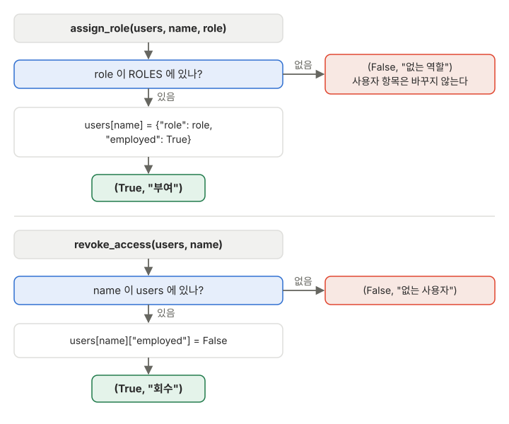

# 응용 1-2 · 역할 부여·회수 함수 만들기

## 목표: 역할 부여·회수 함수

> **여유가 되면 해 보세요.** 핵심 실습 1-1 ~ 1-3과 글쓰기를 먼저 마칩니다. 이 응용을 하지 않아도 다음 Unit을 따라가는 데 문제가 없습니다.

> **오늘 들어온 일**
> 인사팀이 이번 주 인사 변경을 보내왔습니다: 「① minsu 신입 입사, 영업팀에서 일함 ② seoyeon 영업팀에서 재무팀으로 이동 ③ junho 퇴사」
> A사 보안 담당이 말합니다: 「사용자 파일을 손으로 고치다 보면 역할 이름을 잘못 쓰거나 퇴사 처리를 빠뜨릴 수 있습니다. 입사 · 이동 · 퇴사를 함수로 처리하고, 없는 역할 이름은 막아 주세요.」
> - 이 실습에서 하는 일: 사용자에게 역할을 부여하는 함수 `assign_role` 과 퇴사자의 접근을 회수하는 함수 `revoke_access` 를 직접 만들고, 인사 변경 전과 후에 같은 요청을 판정해 달라진 점을 읽습니다.
> - 끝나면 쓰는 것: 보고서 (가)~(다) 답

## 왜 입사·이동·퇴사를 함수로 처리하는가

1. 사람은 계속 바뀝니다. 입사하고, 부서를 옮기고, 퇴사합니다. 역할 기반 접근통제(RBAC)에서는 사람마다 권한을 따로 고치지 않고 **역할 한 칸**만 바꾸면 그 사람의 권한이 통째로 바뀝니다(실습 1-1).
2. 사용자 파일을 손으로 고치면 역할 이름을 `salse` 처럼 잘못 쓰거나, 퇴사 처리를 빠뜨릴 수 있습니다. 함수로 처리하면 검사가 언제나 같은 순서로 들어갑니다.
3. 퇴사 처리가 빠지면 퇴사자의 계정이 계속 쓸 수 있는 상태로 남습니다. 실습 1-1의 `users.json` 에서 `employed` 칸이 그 상태를 적는 칸이었습니다.
4. 실제 회사의 계정 관리에서는 이 세 가지를 입사(joiner · 조이너) · 이동(mover · 무버) · 퇴사(leaver · 리버)라고 부르고, 계정 관리의 기본 흐름으로 다룹니다.

## 1.1 입사 · 이동 · 퇴사와 사용자 파일

| 인사 변경 | 사용자 파일에서 하는 일 | 남는 것 | 함수 |
|---|---|---|---|
| 입사 | 사용자 항목을 **새로 만들고** 역할을 적는다 | — | `assign_role` |
| 부서 이동 | 역할 칸의 값을 새 역할로 **바꾼다**(예: `sales` → `finance`) | 이전 역할은 남지 않는다 | `assign_role` |
| 퇴사 | 그 사람 항목 안의 `employed` 값만 `false` 로 바꾼다 | 항목(`"junho": {…}`) 자체는 파일에서 **삭제하지 않고 남겨 둔다** | `revoke_access` |

| 말 | 뜻 | 예 · 오늘의 규칙 |
|---|---|---|
| **사용자 항목** | `users.json` 에서 사람 한 명을 나타내는 한 덩어리 | `"junho": {"role": "finance", "employed": true}` 전체 |
| **부여**(assign · 어사인) | 사용자에게 역할을 주는 것 | 역할 파일(`roles.json`)에 없는 역할 이름이면 부여하지 않고 거부한다 |
| **회수**(revoke · 리보크) | 사용자의 접근을 없애는 것 | 오늘은 `employed` 값을 `false` 로 바꿔서 실습 1-2의 `check_permission` 이 「퇴사한 계정」으로 거부하게 한다 |

- 사용자 한 명은 역할 하나만 가집니다(`"role": "sales"`). 이동하면 그 칸의 값을 `finance` 로 **바꾸므로**, 이전 역할 `sales` 의 권한은 더 이상 갖지 않고 새 역할 `finance` 의 권한만 갖습니다.
- 만약 이전 역할을 지우지 않고 새 역할을 하나 더 붙이면(`sales` 와 `finance` 를 둘 다 가지면) 두 역할의 권한을 모두 갖게 되어 권한이 계속 쌓입니다. 오늘 만드는 함수는 이렇게 하지 않습니다.
- 퇴사자의 항목을 삭제하지 않고 남겨 두는 이유가 두 가지 있습니다.
  - 삭제하면 그 사람의 요청이 「등록되지 않은 사용자」로 나와서, 퇴사자와 처음부터 없던 계정을 구분할 수 없습니다.
  - 예외 리스트를 점검할 때(응용 1-3) 예외를 가진 사람이 재직 중인지 사용자 항목에서 찾습니다. 항목이 없으면 찾지 못해 오류가 납니다.
- 두 함수는 실습 1-2의 `check_permission` 처럼 `(성공 여부, 이유)` 를 리턴합니다.

<figure class="page-figure"></figure>

## 1.2 함수가 딕셔너리를 바꾸는 방식

**문법 상자 — 딕셔너리 칸 바꾸기**

| 하려는 일 | 코드 |
|---|---|
| 새 칸을 만들거나 같은 이름의 칸을 덮어쓰기 | `users["minsu"] = {"role": "sales", "employed": True}` |
| 칸 안의 값 하나만 바꾸기 | `users["junho"]["employed"] = False` |
| 그 이름의 칸이 있는지 묻기 | `"minsu" in users` · `"salse" not in ROLES` |

- 파이썬에서는 참이 `True`, 거짓이 `False` 입니다. 파일(JSON)에 적을 때만 소문자 `true` · `false` 입니다.
- 딕셔너리를 함수에 전달하면, 함수는 **같은 딕셔너리**를 받습니다. 복사본이 아니라 내 공책 자체를 친구에게 건네주는 것과 같습니다. 그래서 함수 안에서 바꾼 값이 함수 밖에도 남습니다.

```python
users = {"junho": {"role": "finance", "employed": True}}         # 사용자 딕셔너리 하나

def retire(user_dict):                                           # 사용자 딕셔너리를 받아 junho 를 퇴사 처리하는 함수
    """사용자 딕셔너리에서 junho 를 퇴사 처리한다.
    함수가 받은 딕셔너리를 직접 바꾼다는 것을 보여 줄 때 쓴다.
    """
    user_dict["junho"]["employed"] = False                       # 받은 딕셔너리 안의 값을 바꾼다

retire(users)                                                    # 함수에 딕셔너리를 넘긴다
print(users)                                                     # 함수 밖의 딕셔너리를 출력한다
```

```
{'junho': {'role': 'finance', 'employed': False}}
```

- 위 예에서 함수 안의 `user_dict` 와 바깥의 `users` 는 이름만 다르고 **같은 딕셔너리 하나**입니다. 그래서 함수 안에서 바꾼 값이 바깥에도 남습니다.
- 오늘도 같습니다. `rbac.py` 가 읽어 둔 `USERS` 를 `assign_role(USERS, …)` 에 전달하면, `check_permission` 도 같은 `USERS` 를 보므로 바뀐 사용자로 판정합니다. 바뀐 딕셔너리를 따로 리턴하지 않아도 됩니다.
- 함수 안에서 `users = {...}` 처럼 **새 딕셔너리를 만들어 이름에 담으면** 바깥은 바뀌지 않습니다. 오늘은 `users[name] = …` 처럼 받은 딕셔너리의 칸을 바꿉니다.
- 오늘은 컴퓨터 메모리(프로그램이 실행되는 동안 값을 담아 두는 곳)에 읽어 둔 딕셔너리만 바꿉니다. 실습 1-1에서 만든 `config/users.json` 파일은 다른 실습도 함께 읽으므로 고치지 않습니다. 그래서 저장하지 않으며, 프로그램이 끝나면 바꾼 내용도 사라집니다.

## 응용 1-2 · 인사 변경 처리와 전후 판정 비교

**이런 상황이 있습니다**

- 인사팀이 이번 주 인사 변경 세 건(입사 · 이동 · 퇴사)을 보냈습니다. 지금은 사람이 `users.json` 을 직접 고치는데, 역할 이름을 `salse` 처럼 잘못 쓰거나 퇴사 처리를 빠뜨릴 수 있습니다. 그래서 함수로 처리하고, 없는 역할 이름이면 거부하게 만듭니다.
- 고친 뒤에는 권한이 실제로 달라졌는지 확인해야 합니다. 같은 요청 네 건을 인사 변경 전과 후에 각각 판정해서 결과를 비교합니다.
- 실제 회사의 계정 관리에서는 입사 · 이동 · 퇴사를 처리할 때 누가 언제 무엇을 바꿨는지 기록으로 남깁니다. 나중에 문제가 생기면 그 기록으로 원인을 찾습니다(오늘은 기록까지 만들지 않습니다).

**할 일**

1. `role_admin.py` · `apply1-2_run.py` 두 파일을 만들고, `assign_role` 과 `revoke_access` 본문(함수 안에 들여써서 채우는 줄들)을 직접 씁니다.
2. 실행해서 <mark>인사 변경 전 판정</mark> 네 줄, <mark>통보 처리 결과</mark> 여섯 줄, <mark>인사 변경 후 판정</mark> 네 줄을 읽습니다.

**`role_admin.py`**

```python
from rbac import ROLES                                           # 실습 1-2의 rbac.py 가 읽어 둔 역할 딕셔너리를 불러온다


def assign_role(users, name, role):                              # 사용자 딕셔너리 · 이름 · 역할을 받는 함수
    """사용자에게 역할을 부여한다.
    신입이 입사하거나 부서를 옮겼을 때 쓰고 (성공 여부, 이유)를 리턴한다.
    """
    # ← 아래를 직접 씁니다 (주석은 두고 각 주석 바로 아래 줄에 씁니다)
    # 1. role 이 ROLES 에 없으면 False, "없는 역할" 을 리턴한다
    # 2. users[name] 을 {"role": role, "employed": True} 로 바꾼다(새 사용자도, 이동하는 사용자도 같은 줄이다)
    # 3. True, "부여" 를 리턴한다


def revoke_access(users, name):                                  # 사용자 딕셔너리 · 이름을 받는 함수
    """퇴사한 사용자의 접근을 회수한다.
    역할은 남기고 `employed` 값만 바꾸며 (성공 여부, 이유)를 리턴한다.
    퇴사자 계정을 정리할 때 쓴다.
    """
    # ← 아래를 직접 씁니다 (주석은 두고 각 주석 바로 아래 줄에 씁니다)
    # 1. name 이 users 에 없으면 False, "없는 사용자" 를 리턴한다
    # 2. users[name]["employed"] 를 False 로 바꾼다
    # 3. True, "회수" 를 리턴한다
```

- 코드에서 거짓은 첫 글자가 대문자인 `False` 입니다. 소문자 `false` 는 JSON 파일 안에서만 쓰고, 코드에 쓰면 `NameError`(정해 둔 적 없는 이름을 썼다는 오류)가 납니다.
- 두 함수 모두 본문은 함수 안이라 4칸으로 쓰고, `if` 아래 `return` 은 4칸 더(8칸) 들어갑니다. 1번 주석 밑에는 `if` 줄과 그 안쪽 `return` 줄, 이렇게 두 줄을 씁니다.
- 1번의 `return` 이 2번의 대입(`=` 로 값을 담는 줄)보다 **먼저** 와야 합니다. 대입을 먼저 하면 오타 역할도 사용자 항목에 들어간 뒤입니다.
- 채우기 전에 실행해도 오류 없이 실행됩니다. 이때 정상 결과는 다음과 같습니다.
  - 통보 처리 여섯 줄 가운데 `hana 가 사용자에 들어갔나` 한 줄만 `False` 입니다.
  - 나머지 다섯 줄은 `None` 으로 나옵니다(함수가 아무것도 리턴하지 않기 때문입니다).
  - 인사 변경 후 판정이 변경 전과 같습니다.

아래 실행 파일에 나오는 **`SETTLE` 은 약자가 아니라 영어 단어 settle(정산하다, 결제를 마무리하다)입니다.** `SETTLE:QUERY` 는 「정산 쪽 조회 업무」라는 분류 이름으로 읽습니다.

**`apply1-2_run.py`** — 그대로 붙여 넣습니다. 학생이 쓰는 줄은 없습니다. 이 파일은 세 가지를 차례로 합니다. 먼저 인사 변경 전에 요청 네 건을 판정합니다. 다음으로 인사팀 통보 세 건과 시험 두 건(오타 역할 `salse`, 없는 사용자 `ghost`)을 함수로 처리합니다. 마지막으로 같은 요청 네 건을 다시 판정합니다.

```python
from rbac import USERS, check_permission                         # 실습 1-2의 사용자 딕셔너리와 판정 함수를 불러온다
from role_admin import assign_role, revoke_access                # 방금 만든 부여 · 회수 함수를 불러온다

CHECKS = [                                                       # 인사 변경 전후에 같은 요청을 판정해 볼 리스트. (사용자, 자원, 행위)
    ("minsu", "SALES", "QUERY"),                                 # 오늘 입사하는 신입
    ("seoyeon", "SALES", "CHANGE"),                              # 재무로 옮기는 사람의 영업 실적 변경
    ("seoyeon", "SETTLE", "QUERY"),                              # 재무로 옮기는 사람의 정산 조회
    ("junho", "SETTLE", "QUERY"),                                # 오늘 퇴사하는 사람의 정산 조회
]


def run_checks(title):                                           # 제목을 받아 CHECKS 를 판정해 출력하는 함수
    """제목을 붙여 CHECKS 의 요청을 모두 판정해 출력한다.
    인사 변경 전후의 판정을 비교해 볼 때 쓴다.
    """
    print("---", title)                                          # 제목 줄을 출력한다
    for user, resource, action in CHECKS:                        # 요청을 하나씩 꺼낸다
        is_allowed, reason = check_permission(user, resource, action)    # 실습 1-2의 판정 함수로 판정한다
        print(user, resource, action, "->", is_allowed, reason)          # 사용자 · 자원 · 행위 -> 결과 이유 를 출력한다


run_checks("인사 변경 전")                                        # 변경 전 판정을 출력한다

print("--- 인사팀 통보 처리")                                      # 통보 처리 구간 시작을 알리는 줄
print("입사 minsu", assign_role(USERS, "minsu", "sales"))        # 신입 minsu 에게 영업 역할을 부여한다
print("입사 hana", assign_role(USERS, "hana", "salse"))          # 역할 이름 오타(salse)로 부여를 시도한다
print("hana 가 사용자에 들어갔나", "hana" in USERS)                # 오타라면 hana 가 들어가지 않아야 한다
print("이동 seoyeon", assign_role(USERS, "seoyeon", "finance"))  # seoyeon 의 역할을 재무로 바꾼다
print("퇴사 junho", revoke_access(USERS, "junho"))               # junho 의 접근을 회수한다
print("퇴사 ghost", revoke_access(USERS, "ghost"))               # 사용자 파일에 없는 이름의 회수를 시도한다

run_checks("인사 변경 후")                                        # 변경 후 판정을 출력한다
```

**순서**

1. **[VS Code]** 두 파일을 만들고 각각 붙여 넣습니다.
   - **VS Code 에서 만들기**: 파일마다 아래 네 가지를 반복합니다.
     1. VS Code 왼쪽 목록에서 `access_control` 폴더를 클릭해 선택합니다(선택하지 않으면 다른 폴더에 만들어집니다).
     2. 목록 위쪽의 **새 파일**(New File, 파일 모양에 `+`) 아이콘을 누릅니다.
     3. 이름 칸에 파일 이름을 입력하고 Enter 를 누릅니다. 이름은 차례로 `role_admin.py` · `apply1-2_run.py` 입니다.
     4. 열린 파일에 위 코드 상자의 내용을 복사해 붙여 넣고 저장합니다.

<!-- checklist optional -->
- [ ] `apply1-2_run.py` 를 만들어 붙여 넣고 저장했다
<!-- /checklist -->

2. **[VS Code]** `role_admin.py` 의 두 함수 본문을 직접 씁니다. 1.1 의 그림과 1.2 의 문법 상자를 보고 씁니다.

<!-- checklist optional -->
- [ ] `access_control` 폴더 바로 아래에 `role_admin.py` 를 만들고 두 함수 본문을 직접 써서 저장했다
<!-- /checklist -->

3. **[터미널]** 위치가 `…/access_control` 인지 확인하고 실행합니다.
   ```bash
   python apply1-2_run.py
   ```
   - 명령 풀이: `python` 파이썬으로 파일을 실행 · `apply1-2_run.py` 실행할 파일
   맥북: `python3 apply1-2_run.py`
4. 출력은 제목 줄 세 개를 빼면 세 부분입니다. 윗부분은 인사 변경 **전**의 판정 네 줄, 가운데는 통보 처리 결과 여섯 줄, 아랫부분은 인사 변경 **후**의 판정 네 줄입니다. 같은 네 요청이 어떻게 달라졌는지 비교합니다.

<!-- checklist optional -->
- [ ] `python apply1-2_run.py` 를 실행해 인사 변경 전 · 후 판정을 비교했다
<!-- /checklist -->

5. **[보고서]** `report_u1.md` 의 `## 응용 1-2` 아래를 채웁니다(보고서 파일은 「보고서 쓰기」 레슨에서 만듭니다).
   - (가) 실행한 출력 전체를 붙여 넣고, `hana` 가 사용자 딕셔너리에 들어갔는지 적어 주세요.
   - (나) [핵심 질문] `seoyeon` 은 영업에서 재무로 옮겼습니다. 역할 값 하나를 바꿨을 뿐인데 `SALES CHANGE` 와 `SETTLE QUERY` 의 결과가 각각 어떻게 달라졌나요? 이동한 사람에게 이전 역할의 권한이 남아 있으면 어떤 문제가 생기는지도 적어 주세요.
   - (다) [핵심 질문] 인사팀이 `junho` 의 퇴사 통보를 퇴사 당일이 아니라 사흘 뒤에 보냈습니다. 그 사흘 동안 `junho` 의 계정으로 어떤 일이 생길 수 있고, 이 간격을 줄이려면 보안 담당으로서 무엇을 하겠습니까?

<!-- checklist optional -->
- [ ] `report_u1.md` 의 `## 응용 1-2` 아래를 채웠다
<!-- /checklist -->

## 응용 1-2 정리

| 하려는 일 | 코드 · 말 |
|---|---|
| 입사 · 이동 | `assign_role(users, name, role)` — 없는 역할이면 `(False, "없는 역할")` |
| 퇴사 | `users[name]["employed"] = False` — 사용자 항목은 삭제하지 않음 |
| 있는지 묻기 | `name in users` · `role not in ROLES` |
| 바뀐 사용자로 판정 | 함수에 넘긴 `USERS` 가 `check_permission` 이 읽는 `USERS` 와 같은 딕셔너리 |

---
