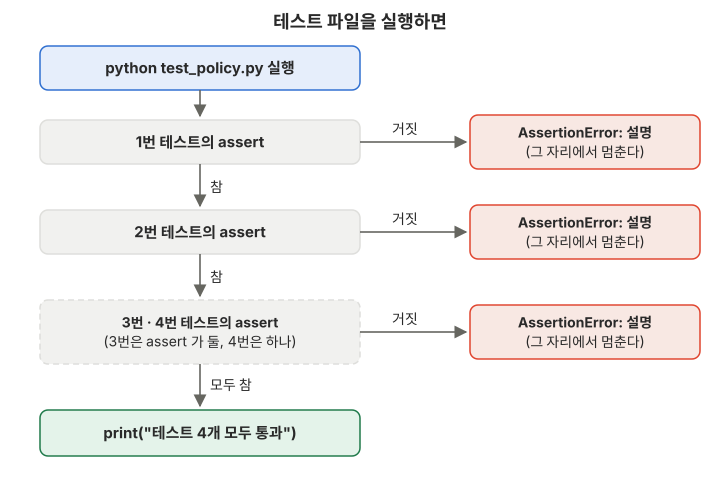

# 도전 1-5 · assert 테스트 네 가지 만들기

## 목표: 규칙 네 가지 테스트

> **선택입니다. 시간이 남을 때 합니다.** 핵심 실습 1-1 ~ 1-3과 글쓰기를 먼저 마칩니다. 이 도전을 하지 않아도 다음 Unit을 따라가는 데 문제가 없습니다.

> **오늘 들어온 일**
> A사 보안 담당이 보낸 메시지: 「정책 코드(`policy.py`)를 누가 고칠 때마다, 사람이 접근 요청(예: junho 가 정산을 조회하려 함)을 하나씩 직접 넣어 보고 결과를 눈으로 확인하면 빠뜨리는 것이 생깁니다. 꼭 지켜야 할 규칙을 코드로 적어 두고, 한 번 실행하면 모두 지켜지는지 확인되게 해 주세요.」
> - 이 실습에서 하는 일: 꼭 지켜야 할 네 가지 규칙을 `assert` 테스트로 직접 설계해 실행합니다. 그다음 팀원이 제안한 규칙의 테스트를 실행해 보고, 실패 메시지를 읽고 판단합니다.
> - 끝나면 쓰는 것: 보고서 (가)~(다) 답

> **읽을거리 — 문제가 아닙니다.** 이 아래부터 첫 「문제」 전까지는 이 실습의 배경지식입니다. 답할 질문도 따라 칠 명령도 없으니 읽고 이해만 합니다.

## 왜 규칙을 테스트로 적어 두는가

> **읽을거리 — 읽기만 합니다.** 문제가 아닙니다. 답할 질문도, 따라 칠 명령도 없습니다.

1. 접근통제 코드는 한 줄만 바뀌어도 막아야 할 것이 열릴 수 있습니다. 바꿀 때마다 같은 확인을 사람이 반복하면 빠뜨립니다.
2. **테스트**는 「이 요청은 이렇게 판정되어야 한다」를 코드로 적어 두고 자동으로 확인하는 것입니다. `assert` 를 써서 적고, `AssertionError` 없이 끝까지 실행되면 적어 둔 규칙이 모두 지켜지고 있다는 뜻입니다.
3. 강의계획서 Module 3 평가기준의 「4가지 테스트 케이스가 모두 예상대로 동작하는가」가 이 도전입니다.

## 2.1 테스트 케이스와 assert

> **읽을거리 — 읽기만 합니다.** 문제가 아닙니다. 답할 질문도, 따라 칠 명령도 없습니다.

- **테스트 케이스**(test case · 테스트 케이스)
  - 「이 입력이면 이 결과가 나와야 한다」 한 쌍
  - 기대 결과를 **먼저** 정하고, 실행 결과와 비교한다
- **경계값**(boundary value · 바운더리 밸류)
  - 결과가 바뀌는 바로 그 지점의 값. 예: 만료 시각 18:00 의 1분 전(17:59)과 정각(18:00)
  - 실수가 가장 많이 숨어 있는 곳이라 꼭 테스트한다

**문법 상자 — `assert` (어서트)**

`assert` 는 「이 조건은 반드시 참이어야 한다」고 적어 두는 문장입니다. 조건이 참이면 아무 일 없이 다음 줄로 가고, 거짓이면 `AssertionError` 를 내며 프로그램이 그 자리에서 멈춥니다.

| 쓰는 모양 | 조건이 거짓일 때 |
|---|---|
| `assert 조건` | `AssertionError` 로 멈춘다 |
| `assert 조건, "설명"` | `AssertionError: 설명` 으로 멈춘다. 어느 규칙이 깨졌는지 설명이 알려 준다 |
| `assert 조건 1 and 조건 2, "설명"` | 두 조건이 모두 참이어야 통과한다. 하나라도 거짓이면 멈춘다 |

아래 코드는 읽기만 합니다. 한 칸마다 한 가지만 보여 줍니다.

**① 조건이 참이면 — 아무 일 없이 다음 줄로 갑니다**

```python
assert 1 + 1 == 2                                  # 1 + 1 은 2 라서 조건이 참이다
print("다음 줄로 왔다")                                  # 참이었으니 이 줄까지 실행된다
```

실행 결과:

```
다음 줄로 왔다
```

**② 조건이 거짓이면 — `AssertionError` 로 멈추고, 아래 줄은 실행되지 않습니다**

```python
assert 1 + 1 == 3                                  # 1 + 1 은 3 이 아니라서 조건이 거짓이다
print("여기는 실행되지 않는다")                         # 위에서 멈추므로 이 줄은 실행되지 않는다
```

실행 결과:

```
Traceback (most recent call last):
  File "…/파일이름.py", line 1, in <module>
    assert 1 + 1 == 3                                  # 1 + 1 은 3 이 아니라서 조건이 거짓이다
AssertionError
```

**③ 설명을 붙이면 — 멈출 때 설명이 `AssertionError:` 뒤에 함께 나옵니다**

```python
assert 1 + 1 == 3, "1 + 1 은 3 이 아니다"            # 거짓이면 쉼표 뒤의 설명이 오류 메시지에 함께 나온다
```

실행 결과:

```
Traceback (most recent call last):
  File "…/파일이름.py", line 1, in <module>
    assert 1 + 1 == 3, "1 + 1 은 3 이 아니다"            # 거짓이면 쉼표 뒤의 설명이 오류 메시지에 함께 나온다
AssertionError: 1 + 1 은 3 이 아니다
```

**④ `and` 로 두 조건을 한 번에 — 오늘 1번 테스트의 모양입니다**

```python
is_allowed = True                                          # 허용 여부를 담은 변수
reason = "역할 권한"                                  # 이유를 담은 변수

assert is_allowed == True and reason == "역할 권한", "허용이고 이유도 맞아야 한다"   # 두 조건이 모두 참이어야 통과한다
print("둘 다 참이라 통과")                              # 통과하면 이 줄까지 실행된다
```

실행 결과:

```
둘 다 참이라 통과
```

**⑤ `not in` 으로 「없다」를 확인 — 오늘 4번 테스트의 모양입니다**

```python
users = {}                                         # 사용자가 한 명도 없는 딕셔너리
assert "seoyeon" not in users, "seoyeon 이 없어야 한다"  # not in 은 「안에 없다」가 참이다
print("seoyeon 이 없어서 통과")                         # 통과하면 이 줄까지 실행된다
```

실행 결과:

```
seoyeon 이 없어서 통과
```

- `==` 는 「같은가」를 묻는 비교이고, `=` 는 값을 담는 대입입니다. `assert` 의 조건에는 `==` 를 씁니다.
- `Traceback` 이 나왔다고 프로그램이 망가진 것이 아닙니다. `assert` 가 「기대와 다르다」고 정상적으로 알려 준 것입니다.

- 테스트는 **적어 둔 규칙**만 확인합니다. 네 테스트가 모두 통과해도 적지 않은 상황(다른 사람 · 다른 시각 · 다른 자원)은 확인되지 않은 것입니다.

오늘 설계할 네 가지입니다.

| 번호 | 무엇을 지키나 | 입력 | 기대 결과 |
|---|---|---|---|
| 1 | 정상 허용 | `junho` · `SETTLE` · `QUERY` · 14:00 | 허용, 「역할 권한」 |
| 2 | 권한 없음은 거부 | `seoyeon` · `ACCOUNT` · `CHANGE` · 14:00 | 거부, 「권한 없음」 |
| 3 | 만료 경계 | `seoyeon` · `SETTLE` · `QUERY` · 17:59 와 18:00 | 17:59 허용(「예외 1번」), 18:00 거부 |
| 4 | 설정 고장이면 아무도 없음 | 없는 파일 `config/no_such.json` 을 `load_json` 으로 읽기 | `seoyeon` 이 들어 있지 않음 |

<figure class="page-figure"></figure>

(중간에 하나라도 거짓이면 `AssertionError: 설명` 을 내고 그 자리에서 멈춥니다.)

## 2.2 팀원의 제안과 실패 메시지 읽기

> **읽을거리 — 읽기만 합니다.** 문제가 아닙니다. 답할 질문도, 따라 칠 명령도 없습니다.

팀원 두 명이 새 규칙을 제안했습니다. 두 제안을 테스트로 적어 둔 파일이 `test_policy_extra.py` 이고, 실행하면 제안이 지금 정책과 맞는지 알 수 있습니다.

| 번호 | 팀원의 제안 | 테스트가 확인하는 것 |
|---|---|---|
| 5 | 퇴사자는 예외가 남아 있어도 막아야 한다 | `dami` 의 영업 실적 조회가 거부되는가 |
| 6 | 만료 시각 18:00 정각에도 허용해야 한다 | `seoyeon` 의 정산 조회가 18:00 에 허용되는가 |

- `dami` 는 실습 1-1에서 만든 `users.json` 에서 퇴사한 계정이고, 예외 3번이 아직 남아 있습니다.

테스트가 실패하면 이 순서로 생각합니다.

1. 실패 메시지를 읽어서 **어느 규칙**이 깨졌는지 확인합니다.
2. **코드가 틀렸는지**, 아니면 **제안한 기대 결과가 지금 정해 둔 정책과 다른지** 판단합니다.
3. 바로 코드를 고치지 않습니다. 정책이 바뀌어야 한다면 코드만이 아니라 그 규칙의 테스트와 설명 글도 함께 고칩니다.

실패 메시지는 이렇게 읽습니다. 아래는 읽기만 하는 예입니다.

```
Traceback (most recent call last):
  File "…/test_policy_extra.py", line 19, in <module>     <-- 몇 번째 줄에서 멈췄나 (폴더 경로는 PC 마다 다름)
    assert is_allowed == True, "6. 만료 정각에도 허용되어야 한다(팀원 제안)"   <-- 어느 assert 인가
AssertionError: 6. 만료 정각에도 허용되어야 한다(팀원 제안)           <-- assert 에 적은 설명
```

- 맨 아래 `AssertionError:` 뒤의 문자열은 `assert` 에 적은 설명입니다. 설명에 번호를 붙여 두면 어느 규칙이 깨졌는지 바로 압니다.

> **여기부터 문제입니다.** 위는 읽을거리였고, 아래에서 직접 합니다.

## 도전 1-5 · 규칙 네 가지 테스트와 팀원 제안 시험

**이런 상황이 있습니다**

- 보안 담당이 말합니다. 「누가 `policy.py` 를 고치더라도, 꼭 지켜야 할 규칙 네 가지가 깨지면 바로 알고 싶습니다.」 오늘은 이 네 가지를 **테스트**로 만듭니다. 테스트는 「접근 요청(예: `junho` 가 14:00 에 정산 조회)」과 「기대하는 판정(예: 허용)」을 한 쌍으로 코드에 적어 두고, 실행하면 실제 판정이 기대와 같은지 자동으로 비교해 주는 코드입니다. 1번은 예시로 써 두었으니, 2 ~ 4번을 같은 모양으로 씁니다.
- 팀원 두 명이 새 규칙을 제안했고, 제안마다 테스트(5번, 6번)를 `test_policy_extra.py` 에 미리 만들어 두었습니다. 이 파일을 실행하면 각 제안이 지금 정책과 맞는지 통과 · 실패로 나옵니다. 실패가 나오면 둘 중 어느 쪽인지 판단합니다. ① 정책 코드가 틀렸다 ② 제안이 우리가 정한 정책과 다르다. 이 실습에서는 **코드를 고치지 않고 판단만** 합니다.
- 현업에서는 접근통제 코드를 바꿀 때마다 이런 테스트를 먼저 실행하고, 하나라도 실패하면 반영하지 않습니다.

**할 일**

1. `test_policy.py` 를 만들고 2 ~ 4번 테스트를 직접 씁니다.
2. 실행해서 <mark>테스트 4개 모두 통과</mark>가 나오는지 확인합니다.
3. `test_policy_extra.py` 를 만들고 실행해서 <mark>어느 테스트가 통과하고 어느 테스트가 실패하는지</mark> 읽습니다.

**`test_policy.py`**

```python
from datetime import datetime                                    # 시각을 만드는 데 쓴다
from policy import evaluate_access                               # 실습 1-3에서 만든 최종 판정 함수
from config_loader import load_json                              # 제공 파일(또는 도전 1-4)의 안전한 읽기 함수


def at(text):                                                    # "2026-10-22 14:00" 같은 문자열을 받아
    """「연-월-일 시:분」 모양 문자열을 시각으로 바꾼다.
    테스트에서 판정할 시각을 만들 때 쓴다.
    """
    return datetime.strptime(text, "%Y-%m-%d %H:%M")             # "연-월-일 시:분" 모양 문자열을 시각으로 바꿔 리턴한다


# 1. 정상 허용 — 예시로 써 둔 테스트
when = at("2026-10-22 14:00")                                    # 요청 시각을 만든다
is_allowed, reason = evaluate_access("junho", "SETTLE", "QUERY", when)   # 재무의 정산 조회를 판정한다
assert is_allowed == True and reason == "역할 권한", "1. 정상 허용"       # 허용이고 이유가 「역할 권한」이어야 한다

# ← 아래를 직접 씁니다 (2.1 의 표를 보고 씁니다)
# 2. seoyeon 의 ACCOUNT CHANGE 를 14:00 에 판정해 is_allowed, reason 으로 받고, 거부이며 이유가 "권한 없음" 인지 assert 한다
# 3. seoyeon 의 SETTLE QUERY 를 17:59 에 판정해 is_allowed, reason 으로 받고, 허용이며 이유가 "예외 1번" 인지 assert 한다
#    같은 요청을 18:00 에 판정해 is_allowed, reason 으로 다시 받고, 거부인지 assert 한다
# 4. load_json 으로 "config/no_such.json" 을 기본값 {} 로 읽어 users 에 담고,
#    "seoyeon" 이 users 에 없는지(in 의 반대는 not in) assert 한다

print("테스트 4개 모두 통과")                                     # 위 assert 가 모두 지나가면 출력된다
```

- 각 주석 바로 아래 줄에 씁니다. `assert 조건 1 and 조건 2, "설명"` 에서 `and` 는 두 조건을 잇고, 쉼표 뒤의 문자열은 거짓일 때 나오는 설명입니다.
- `assert` 의 설명은 표의 번호와 같게 씁니다. 예: `"2. 권한 없음"`, `"3-1. 만료 1분 전 허용"`, `"3-2. 만료 정각 거부"`, `"4. 설정 고장이면 사용자 없음"`.
- 4번은 `evaluate_access` 가 아니라 `config_loader.py` 의 `load_json` 이 돌려주는 기본값을 확인하는 테스트입니다. 실행하면 `[경고] 설정 파일 없음: config/no_such.json` 이 먼저 출력되는데, `load_json` 의 경고라서 정상입니다.
- 2 ~ 4번을 쓰기 전에 실행해도 오류 없이 돌아갑니다(`config_loader.py` 가 있는 경우). 테스트가 1번 하나뿐인데도 「테스트 4개 모두 통과」가 나오지만, 아직 네 개를 확인한 것이 아닙니다.

**`test_policy_extra.py`** — 그대로 붙여 넣습니다. 학생이 쓰는 줄은 없습니다. 팀원의 두 제안(5 · 6번)을 테스트로 적은 파일입니다.

```python
from datetime import datetime                                    # 시각을 만드는 데 쓴다
from policy import evaluate_access                               # 실습 1-3에서 만든 최종 판정 함수


def at(text):                                                    # 문자열을 시각으로 바꾸는 짧은 함수
    """「연-월-일 시:분」 모양 문자열을 시각으로 바꾼다.
    테스트에서 판정할 시각을 만들 때 쓴다.
    """
    return datetime.strptime(text, "%Y-%m-%d %H:%M")             # "연-월-일 시:분" 모양 문자열을 시각으로 바꿔 리턴한다


when = at("2026-10-22 14:00")                                    # 요청 시각을 만든다
is_allowed, reason = evaluate_access("dami", "SALES", "QUERY", when)     # 5. 팀원 제안: 퇴사자는 예외가 있어도 거부되어야 한다
assert is_allowed == False and reason == "퇴사한 계정", "5. 퇴사자는 예외가 있어도 거부"  # 퇴사자는 이유가 「퇴사한 계정」이어야 통과한다
print("5 통과")                                                  # 5번 assert 를 지났다고 알린다

when = at("2026-10-22 18:00")                                    # 요청 시각을 만든다
is_allowed, reason = evaluate_access("seoyeon", "SETTLE", "QUERY", when)  # 6. 팀원 제안: 만료 정각에도 허용되어야 한다
assert is_allowed == True, "6. 만료 정각에도 허용되어야 한다(팀원 제안)"           # 만료 정각에도 허용인지 확인한다
print("6 통과")                                                  # 6번 assert 를 지났다고 알린다
```

**순서**

1. **[VS Code]** `test_policy.py` 를 만들고 붙여 넣습니다.
   - **VS Code 에서 만들기**
     1. VS Code 왼쪽 목록에서 `access_control` 폴더를 클릭해 선택합니다(선택하지 않으면 다른 폴더에 만들어집니다).
     2. 목록 위쪽의 **새 파일**(New File, 파일 모양에 `+`) 아이콘을 누릅니다.
     3. 이름 칸에 `test_policy.py` 라고 입력하고 Enter 를 누릅니다.
     4. 열린 파일에 내용을 복사해 붙여 넣고 저장합니다.
2. **[VS Code]** 2 ~ 4번 테스트를 직접 씁니다. 1번과 같은 모양으로 씁니다.
3. **[터미널]** 위치가 `…/access_control` 인지 확인하고 실행합니다. 마지막 줄에 `테스트 4개 모두 통과` 가 나오면 됩니다.
   ```bash
   python test_policy.py
   ```
   - 명령 풀이: `python` 파이썬으로 파일을 실행 · `test_policy.py` 실행할 파일
   맥북: `python3 test_policy.py`
   - `AssertionError` 가 나오면 설명 문자열로 어느 테스트인지 보고, 그 테스트의 입력과 기대 결과가 2.1 의 표와 같은지 다시 봅니다. `ModuleNotFoundError` 가 나오면 `pwd` 가 `…/access_control` 인지 확인하고, `No module named 'config_loader'` 이면 「제공 파일」의 `config_loader.py` 가, `No module named 'policy'` 이면 실습 1-3 파일이 없는 것입니다.
4. **[VS Code]** `test_policy_extra.py` 를 만들고 붙여 넣습니다.
   - 만드는 방법은 위 1번과 같습니다(VS Code 새 파일 아이콘). 만들 파일 이름은 `test_policy_extra.py` 입니다. 붙여 넣을 내용은 위 코드 상자입니다.
5. **[터미널]** 실행합니다. **`5 통과` 가 먼저 출력되고, 그다음 6번 테스트에서 `AssertionError` 가 나는 것이 정상입니다.** 5번 테스트에서 멈췄다면 그 사실을 보고서 (가)에 적습니다.
   ```bash
   python test_policy_extra.py
   ```
   - 명령 풀이: `python` 파이썬으로 파일을 실행 · `test_policy_extra.py` 실행할 파일
   맥북: `python3 test_policy_extra.py`
   - 오류 메시지에서 `line` 뒤의 숫자(몇 번째 줄인지)와 맨 마지막 줄 `AssertionError: …` 의 설명을 읽습니다(2.2).
6. **[보고서]** `report_u1.md` 의 `## 도전 1-5` 아래를 채웁니다.
   - (가) `test_policy_extra.py` 를 실행한 출력 전체를 붙여 넣고, 실패한 줄 번호와 `AssertionError:` 뒤에 나온 글자를 적어 주세요.
   - (나) [핵심 질문] 그 실패는 코드가 틀렸다는 뜻인가요, 제안이 우리가 정한 만료 규칙과 다르다는 뜻인가요? 근거를 적어 주세요.
   - (다) [핵심 질문] 정책 코드를 바꿀 때마다 `test_policy.py` 의 1 ~ 4번 테스트를 돌리지 않으면 어떤 사고가 날 수 있나요? 네 개 중 하나를 골라, 그 테스트가 막아 주는 사고를 구체적인 장면으로 적어 주세요.

## 도전 1-5 정리

| 하려는 일 | 코드 · 말 |
|---|---|
| 기대 결과 적기 | `assert 조건, "설명"` |
| 두 조건 함께 | `assert is_allowed == True and reason == "역할 권한", "1. 정상 허용"` |
| 경계값 | 결과가 바뀌는 지점의 바로 앞과 그 지점(17:59 · 18:00) |
| 실패하면 | `AssertionError: 설명` + 줄 번호 → 코드가 틀렸나, 기대가 정책과 다른가를 먼저 판단 |

- 도전 파일을 깃허브에 올리려면 실습 1-3 끝의 「이번 Unit 마무리」 3번 순서를 한 번 더 합니다.

---

<!-- learn:answers -->
