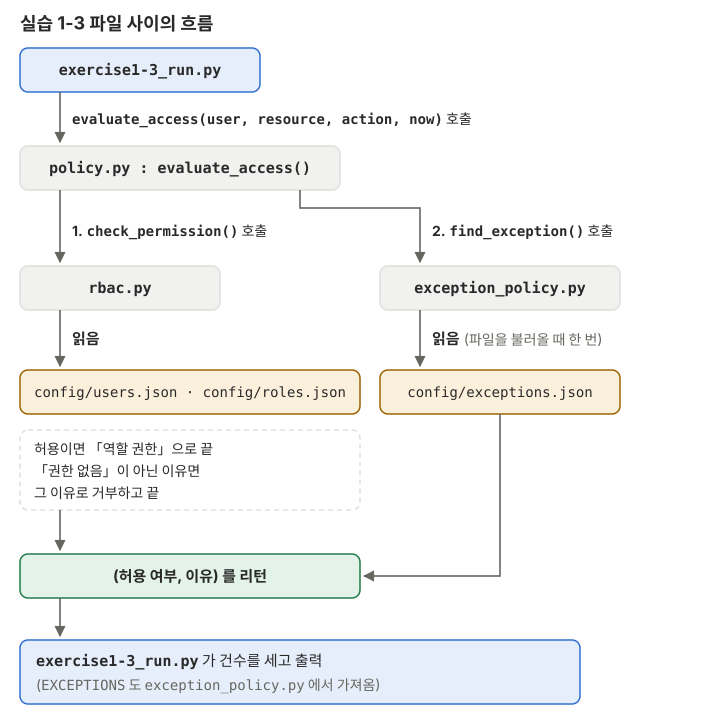

# 정답

## 정답을 읽는 법

설명하는 답은 한 예이고, 핵심이 같으면 맞습니다.

1. **핵심 실습**: 실습 1-1 · 1-2 · 1-3 정답입니다. 오늘 모두가 하는 실습이니 먼저 맞춰 봅니다.
2. **도전(선택)**: 도전 1-1 ~ 1-5 정답입니다. 도전을 한 사람만 봅니다.
3. 정답마다 결과, 왜, 자주 틀리는 곳, 관제에서는 순서로 읽습니다. **관제**는 보안 담당이 시스템과 기록을 계속 지켜보며 이상한 일을 찾아 대응하는 일입니다.

---

## 실습 1-1 정답

 **`config/users.json` 입니다.**

```json
{
  "seoyeon": {"role": "sales", "employed": true},
  "junho": {"role": "finance", "employed": true},
  "gaeun": {"role": "account_admin", "employed": true},
  "dami": {"role": "sales", "employed": false},
  "batch-night": {"role": "batch", "employed": true},
  "tester": {"role": "intern", "employed": true}
}
```

 **`config/roles.json` 입니다.**

```json
{
  "sales": ["SALES:QUERY", "SALES:CHANGE"],
  "account_admin": ["ACCOUNT:QUERY", "ACCOUNT:CHANGE"],
  "finance": ["SALES:QUERY", "SETTLE:QUERY"],
  "batch": ["SETTLE:QUERY"],
  "auditor": ["SALES:QUERY", "SETTLE:QUERY", "ACCOUNT:QUERY"]
}
```

 **터미널에 입력합니다.**

```bash
python -m json.tool config/users.json
python -m json.tool config/roles.json
```

**결과**


- (가) ① 허용 · ② 거부 · ③ 허용 · ④ 거부 · ⑤ 거부 · ⑥ 허용입니다. 요청 ② 는 **인가**에서 막힙니다. seoyeon 은 비밀번호로 본인임을 확인받았으므로(인증 통과) 누구인지는 맞습니다. 그러나 `sales` 역할에는 `SETTLE:QUERY` 칸에 ○ 가 없어 「이 일을 해도 되나」에서 거부됩니다. seoyeon 사건은 인증만 있고 인가를 확인하는 곳이 없어서 같은 요청이 통과했습니다.
- (나) 한 예: `finance` 의 `SALES:QUERY`. 재무는 정산을 맡고 영업 실적 조회는 하는 일에 꼭 필요하다는 근거가 없습니다. 이 ○ 가 남아 있으면 재무 계정이 도용됐을 때 영업 실적까지 노출됩니다. `auditor` 의 `ACCOUNT:QUERY` 처럼 감사 목적이 분명하면 남길 수 있다고 답해도 맞습니다. 이유가 「하는 일에 필요한가」로 설명되면 됩니다.
- (다) **거부**되어야 합니다. 역할 `intern` 에 어떤 권한을 줄지 아무도 정하지 않았으므로, 정하지 않은 것은 허용하지 않는 기본 거부 원칙에 따라 막습니다. 이유는 「역할이 없음」처럼 따로 남겨, 역할 파일에 빠진 역할이 있다는 것을 담당자가 알 수 있게 합니다.

**왜** — 인증은 「누구」, 인가는 「무엇을」입니다. RBAC 는 인가를 역할 단위로 관리해서, 사람이 바뀌어도 표는 그대로 둡니다. 설정을 파일로 나누면 코드를 고치지 않고 사람만 바꿀 수 있고, JSON 규칙이 하나만 틀려도 프로그램이 파일을 못 읽으므로 먼저 검사합니다. 매트릭스와 설정 파일이 같아야 코드가 표대로 판정하고, 표에 없는 역할은 권한이 없는 것으로 다룹니다.

**자주 틀리는 곳**

| 틀리는 곳 | 얼마나 | 바로잡기 |
|---|---|---|
| ⑤ 를 「계정 관리자는 높은 권한이니 허용」으로 판정 | 많음 | 매트릭스에 ○ 가 없으면 직급과 상관없이 거부 |
| 인증과 인가를 같은 말로 씀 | 많음 | 인증은 「누구」, 인가는 「무엇을」 |
| `true` 를 파이썬처럼 `True` 로 씀 | 가장 많음 | JSON 오류. 소문자 `true` |
| 마지막 줄 뒤 쉼표 | 많음 | 마지막 줄 뒤에는 쉼표를 쓰지 않음 |
| 작은따옴표(`'sales'`) 사용 | 많음 | 큰따옴표만 씀 |
| `batch-night` 를 `batch_night` 로 쓰는 오타 | 많음 | 표의 글자를 그대로 옮김 |
| `"account_admin"` 줄 끝에 쉼표를 안 붙임 | 있음 | JSON 오류. 쉼표를 붙임 |
| `auditor` 에 `ACCOUNT:CHANGE` 까지 넣음 | 있음 | 매트릭스의 ○ 는 `ACCOUNT:QUERY` 하나 |

**관제에서는** — 「로그인은 정상인데 맡지 않은 자원에 접근」한 기록은 인가 쪽 문제로 분류하고 매트릭스와 대조합니다. 퇴사자 계정이 살아 있는 것은 감사에서 가장 자주 지적되는 항목이라 인사 리스트와 계정 리스트를 정기적으로 대조하고, 역할 파일에 없는 역할을 가진 사용자는 설정 누락의 신호입니다.

---

## 실습 1-2 정답

 **터미널에 입력합니다.**

```bash
python exercise1-2_run.py
```

**채운 코드** (한 예)

```python
    if not USERS[user]["employed"]:                              # 재직 중이 아니면
        return False, "퇴사한 계정"                                # 거부하고 함수를 끝낸다
    role = USERS[user]["role"]                                   # 이 사용자의 역할을 꺼낸다
    if role not in ROLES:                                        # 역할 파일에 없는 역할이면
        return False, "역할이 없음"                                # 거부하고 함수를 끝낸다
    permission = f"{resource}:{action}"                          # "자원:행위" 모양 문자열로 합친다
    if permission not in ROLES[role]:                            # 그 역할의 권한 리스트에 없으면
        return False, "권한 없음"                                  # 거부하고 함수를 끝낸다
```

**결과**

- 채우기 전 출력은 다음과 같습니다(`minsu` 만 거부).

```
seoyeon SALES QUERY -> True 허용
seoyeon SETTLE QUERY -> True 허용
junho SETTLE QUERY -> True 허용
junho SALES CHANGE -> True 허용
dami SALES QUERY -> True 허용
minsu SALES QUERY -> False 등록되지 않은 사용자
gaeun ACCOUNT CHANGE -> True 허용
batch-night SETTLE QUERY -> True 허용
tester SALES QUERY -> True 허용
```

  내가 채운 코드는 위의 코드입니다. 줄 수가 달라도 주석이 말한 일을 하면 맞습니다.


- (가) 채운 뒤의 출력입니다.

```
seoyeon SALES QUERY -> True 허용
seoyeon SETTLE QUERY -> False 권한 없음
junho SETTLE QUERY -> True 허용
junho SALES CHANGE -> False 권한 없음
dami SALES QUERY -> False 퇴사한 계정
minsu SALES QUERY -> False 등록되지 않은 사용자
gaeun ACCOUNT CHANGE -> True 허용
batch-night SETTLE QUERY -> True 허용
tester SALES QUERY -> False 역할이 없음
```

  거부된 요청이 걸린 검사입니다.

  | 요청 | 걸린 검사 |
  |---|---|
  | `minsu` | [1](사용자 없음) |
  | `dami` | [2](퇴사) |
  | `tester` | [3](역할 없음) |
  | `seoyeon` 의 정산 조회 · `junho` 의 영업 실적 변경 | [4](권한 없음) |

- (나) 허용되면 안 되는 요청은 네 건입니다: `seoyeon` 의 정산 조회(영업에는 정산 권한이 없음), `junho` 의 영업 실적 변경(재무에는 변경 권한이 없음), `dami` 의 영업 실적 조회(퇴사자), `tester` 의 영업 실적 조회(역할 `intern` 이 역할 파일에 없음). 검사가 [1] 하나뿐이면 [2] ~ [4] 의 경우가 모두 마지막 `return True` 까지 내려가 허용됩니다. seoyeon 사건(영업 계정의 정산 조회)도 다시 통과합니다. 이것이 **열림 기본 값(fail-open)** 문제입니다. 확인하지 못한 경우를 통과시키면 그 틈이 그대로 공격 경로가 됩니다.
- (다) 판정은 둘 다 거부지만 **이유가 달라집니다.** 지금 순서([2] → [3])면 「퇴사한 계정」으로 남습니다. 순서를 바꾸면([3] → [2]) 역할 `none` 이 역할 파일에 없어서 [3] 에서 먼저 걸려 「역할이 없음」으로 남고, 퇴사자라는 진짜 이유가 기록에서 사라집니다. 사람 자체를 먼저 확인하고(있나 · 재직 중인가) 그다음 역할 · 권한을 보는 순서가 이유를 정확하게 남깁니다.

**왜** — 접근통제 함수는 「허용할 조건을 모두 확인한 뒤에만 허용」해야 합니다. 맨 끝의 `return True` 앞에 빠진 검사가 있으면 그 경우는 모두 허용됩니다.

**자주 틀리는 곳**

| 틀리는 곳 | 얼마나 | 결과 |
|---|---|---|
| `return` 을 빼고 `False, "퇴사한 계정"` 만 씀 | 많음 | 검사가 아무 일도 안 함 |
| `f"{resource}:{action}"` 에서 `f` 를 뺌 | — | 글자 그대로 `{resource}:{action}` 이 되어 모두 「권한 없음」 |
| `role` 을 담기 전에 `role not in ROLES` 를 씀 | 있음 | `NameError` |
| 들여쓰기가 `if` 와 맞지 않음 | — | `IndentationError` |

**관제에서는** — 거부 이유가 구분돼 있으면 「권한 없음」이 몰리는 계정(사건 신호)과 「역할이 없음」이 몰리는 계정(설정 누락)을 나눠 볼 수 있습니다.

---

## 실습 1-3 정답

 **터미널에 입력합니다.**

```bash
python exercise1-3_run.py
```

**채운 코드** (한 예)

```python
    is_allowed, reason = check_permission(user, resource, action)        # 역할 판정을 먼저 한다
    if is_allowed:                                                       # 역할로 허용되면
        return True, "역할 권한"                                   # 역할 권한으로 허용한다
    if reason != "권한 없음":                                     # 사용자 자체가 거부 대상이면(없음 · 퇴사 · 역할이 없음)
        return False, reason                                     # 예외를 보지 않고 그 이유로 거부한다
    found, found_exception_id = find_exception(user, f"{resource}:{action}", now)   # 유효한 예외를 찾는다
    if found:                                                    # 있으면
        return True, f"예외 {found_exception_id}번"                            # 예외 번호와 함께 허용한다
    return False, "권한 없음"                                      # 둘 다 없으면 거부한다
```

**결과**

- (가) 출력은 다음과 같습니다. 코드는 위의 채운 코드이고, 줄 수가 달라도 주석이 말한 일을 하면 맞습니다.

```
09:10 seoyeon SETTLE QUERY -> True 예외 1번
10:00 dami SALES QUERY -> False 퇴사한 계정
11:40 gaeun SETTLE QUERY -> True 예외 5번
12:30 gaeun SETTLE QUERY -> False 권한 없음
[만료 뒤 시도] 12:30 gaeun SETTLE QUERY - 만료된 예외 5 2026-10-22 12:00
13:00 junho SETTLE QUERY -> True 역할 권한
14:00 batch-night SALES QUERY -> True 예외 4번
15:00 junho SALES CHANGE -> False 권한 없음
[만료 뒤 시도] 15:00 junho SALES CHANGE - 만료된 예외 2 2026-10-20 18:00
16:20 seoyeon SETTLE QUERY -> True 예외 1번
18:05 seoyeon SETTLE QUERY -> False 권한 없음
[만료 뒤 시도] 18:05 seoyeon SETTLE QUERY - 만료된 예외 1 2026-10-22 18:00
{'예외로 허용': 4, '거부': 4, '역할로 허용': 1}
예외 사용 {'예외 1번': 2, '예외 5번': 1, '예외 4번': 1}
```

  `[만료 뒤 시도]` 세 건은 다음과 같고, 「예외 사용」 줄에서 예외 1번은 **2번** 쓰였습니다.

  | 시각 | 요청 | 끝난 예외 |
  |---|---|---|
  | 12:30 | `gaeun` 의 정산 조회 | 예외 5번이 12:00 에 끝난 뒤의 시도 |
  | 15:00 | `junho` 의 영업 실적 변경 | 예외 2번이 10/20(화) 18:00 에 끝난 뒤의 시도 |
  | 18:05 | `seoyeon` 의 정산 조회 | 예외 1번이 18:00 에 끝난 뒤의 시도 |

  `dami` 10:00 요청은 `[역할 판정]` 에서 「퇴사한 계정」으로 거부되어 「권한 없음」이 아니므로 예외 리스트를 보지 않습니다. 사람 자체가 거부 대상이라 예외가 남아 있어도 만료 뒤 시도로 보지 않습니다.
- (나) **허용**됩니다. `dami` 는 `[역할 판정]` 에서 「퇴사한 계정」으로 거부되지만, 골격의 3번 주석(`# 3. …`)이 없으면 바로 `[예외 판정]` 으로 가서 예외 3번(10/31(토) 까지)을 찾아 「예외 3번」으로 허용됩니다. 현업에서는 퇴사자가 남은 예외로 영업 자료를 조회하고, 로그에는 정상 허용으로 남아 아무도 눈치채지 못하는 사고로 이어질 수 있습니다. 감사에서는 퇴사자 계정이 사용된 기록으로 지적됩니다.
- (다) 그림은 다음과 같고, 핵심(누가 누구를 호출하는가)이 같으면 맞습니다. `config/exceptions.json` 이 깨지면 `policy.py` 가 `exception_policy.py` 를 불러오는 맨 위의 `import` 에서 멈추고(`JSONDecodeError`), `exercise1-3_run.py` 는 요청을 한 건도 판정하기 전에 끝납니다.

<figure class="page-figure"></figure>

**왜** — 여러 규칙을 합칠 때는 「사람이 유효한가」를 먼저 보고, 그다음 「무엇으로 허용하나」를 봅니다. 예외는 역할 권한을 보충할 뿐 사람 검사를 건너뛰게 하면 안 됩니다. 허용을 「역할」과 「예외」로 나눠 세고 예외 번호별로 쓰인 횟수를 세면, 예외로 열리는 일이 얼마나 되는지 숫자로 보입니다.

**자주 틀리는 곳**

| 틀리는 곳 | 얼마나 | 결과 |
|---|---|---|
| `find_exception` 에 `resource` 만 넣음 | 많음 | 항상 `(False, None)`. 예외 파일은 `"SETTLE:QUERY"` 처럼 「자원:행위」 문자열로 적혀 있음 |
| 3번을 `if reason == "권한 없음"` 으로 뒤집어 씀 | 있음 | 반대로 동작 |
| `return` 을 빼먹음 | — | 실행할 때 `TypeError`(아래 문구) |

`return` 을 빼먹었을 때 나오는 문구는 `TypeError: cannot unpack non-iterable NoneType object` 입니다.

**관제에서는** — 판정 이유에 「역할 권한」 · 「예외 N번」 · 거부 이유가 남아 있으면, 감사 때 「왜 열렸나」를 예외 번호로 바로 찾아갈 수 있습니다. 거부된 요청이 끝난 예외와 같은 사람 · 같은 권한이면 만료 뒤 시도로 따로 모아 담당자에게 알리고, 같은 예외가 계속 쓰이면 역할을 새로 만들지, 예외를 끝낼지 판단합니다.

## 도전 1-1 정답

> 여기부터는 **도전(선택)** 정답입니다. 핵심 실습 정답은 앞의 실습 1-1 ~ 1-3 정답에 있습니다.

 **터미널에 입력합니다.**

```bash
python challenge1-1_audit.py
```

**채운 코드** (한 예)

단계 1:

```python
for log_id, time, user, resource, action in LOG:                 # 기록을 하나씩 꺼낸다
    is_allowed, reason = check_permission(user, resource, action)        # 판정 결과와 이유를 받는다
    if is_allowed:                                                       # 허용이면
        allowed = allowed + 1                                    # 허용 건수를 1 늘리고
        count_key = user + " 허용"                                 # 세는 기준이 되는 키
        old_count = counts.get(count_key, 0)                     # 그 키의 지금까지 센 수(처음이면 0)
        counts[count_key] = old_count + 1                        # 1 늘려서 다시 적는다
        role = USERS[user]["role"]                               # 그 사용자의 역할을 꺼내고
        if role not in used:                                     # 이 역할이 처음이면
            used[role] = []                                      # 빈 리스트를 만든 뒤
        used[role].append(f"{resource}:{action}")                # 쓴 권한을 리스트에 추가한다
    else:                                                        # 거부면 (쓴 권한으로 모으지 않는다)
        denied = denied + 1                                      # 거부 건수를 1 늘리고
        print("[거부]", log_id, time, user, resource, action, "-", reason)   # 거부된 기록을 출력하고
        count_key = user + " 거부"                                 # 세는 기준이 되는 키
        old_count = counts.get(count_key, 0)                     # 그 키의 지금까지 센 수(처음이면 0)
        counts[count_key] = old_count + 1                        # 1 늘려서 다시 적는다
```

단계 2:

```python
for role, permissions in ROLES.items():                          # 역할과 권한 리스트를 하나씩 꺼낸다
    for permission in permissions:                               # 권한을 하나씩 꺼내
        if permission not in used.get(role, []):                 # 실제로 쓴 리스트에 없으면
            print("쓰이지 않음", role, permission)                 # 쓰이지 않은 권한으로 출력한다
```

**결과**

- 출력은 다음과 같습니다(역할 순서는 `roles.json` 의 순서를 따릅니다).

```
[거부] 3 02:14 seoyeon SETTLE QUERY - 권한 없음
[거부] 4 02:15 seoyeon SETTLE QUERY - 권한 없음
[거부] 5 02:15 seoyeon SETTLE QUERY - 권한 없음
[거부] 12 13:40 seoyeon SETTLE QUERY - 권한 없음
[거부] 14 14:10 seoyeon SETTLE QUERY - 권한 없음
[거부] 15 14:35 seoyeon SETTLE QUERY - 권한 없음
[거부] 16 15:00 seoyeon SETTLE QUERY - 권한 없음
[거부] 17 15:25 seoyeon SETTLE QUERY - 권한 없음
허용 7 거부 8
{'batch-night 허용': 1, 'seoyeon 거부': 8, 'junho 허용': 3, 'seoyeon 허용': 3}
쓰이지 않음 sales SALES:CHANGE
쓰이지 않음 account_admin ACCOUNT:QUERY
쓰이지 않음 account_admin ACCOUNT:CHANGE
쓰이지 않음 finance SALES:QUERY
쓰이지 않음 auditor SALES:QUERY
쓰이지 않음 auditor SETTLE:QUERY
쓰이지 않음 auditor ACCOUNT:QUERY
```

- (가) 허용 7건 · 거부 8건이고, 거부된 번호는 3 · 4 · 5 · 12 · 14 · 15 · 16 · 17번입니다(모두 `seoyeon` 의 `SETTLE:QUERY`). 한 예: 점수 판단은 기기 · 시각 · 국가 · 건수 같은 **상황**을 보고 위험 점수를 매깁니다. 낮의 12 · 14 ~ 17번은 등록 기기 · 낮 시간 · 적은 건수라 점수가 낮아 허용됐습니다. RBAC 는 **역할이 그 자원에 그 행위를 해도 되는지**만 봅니다. 상황이 정상이어도 영업 역할에는 정산 조회 권한이 없으므로 시각과 상관없이 모두 막습니다. 둘은 서로 다른 것을 보므로 함께 써야 합니다.
- (나) **말할 수 없습니다.** 확인되는 것은 「이 하루 기록의 조회 15건에서 seoyeon 의 정산 조회 8건만 거부됐고, 재무 · 서비스 계정 · 영업의 영업 실적 조회는 막히지 않았다」입니다. 확인되지 않는 것은 다른 날 · 다른 직원의 업무, 기록에 없는 변경(`CHANGE`) 요청, 그리고 seoyeon 이 정산 조회를 해야 하는 정당한 업무가 있었는지입니다. 하루치 기록의 한계도 있습니다. 월말 정산, 분기 감사, 계정 변경처럼 가끔 하는 업무가 빠지므로 「쓰이지 않음」을 바로 지우면 정상 업무가 막힙니다. 현업에서는 보통 **90일** 같은 긴 기간을 정해 한 번도 쓰이지 않은 권한을 후보로 뽑고 담당자 확인을 거칩니다(Unit 3, 과다권한 탐지).
- (다) 한 예: 실습 1-1 에서 `finance` 의 `SALES:QUERY` 를 필요 이상이라고 골랐다면 이 기록에서도 `쓰이지 않음 finance SALES:QUERY` 로 나와 두 근거가 일치합니다. **줄일 것은 `finance` 의 `SALES:QUERY`** 입니다. 재무의 일(정산)에 필요하다는 근거가 없고 기록에도 쓰이지 않았습니다. **남길 것은 `account_admin` 의 `ACCOUNT:CHANGE`** 입니다. 계정 관리자는 이 일을 맡은 역할이고, 하루 기록에 계정 변경이 없었을 뿐입니다. `sales` 의 `SALES:CHANGE` 는 영업이 실적을 고쳐야 하는지 영업팀에 확인한 뒤 정한다고 답해도 맞습니다. 참고로 `auditor` 역할은 사용자가 한 명도 없어서 모든 권한이 「쓰이지 않음」으로 나옵니다. 지금 당장 위험은 없지만 나중에 누군가에게 잘못 붙으면 넓은 조회 권한이 생기므로, 감사가 실제로 필요한 때 기간을 정해 주는 쪽으로 처리합니다.

**왜** — 새 규칙을 과거 기록에 먼저 적용하면 켜는 날 정상 업무가 갑자기 막히는 일과 막아야 할 것을 놓치는 일을 미리 줄일 수 있습니다. 최소권한은 「준 권한」과 「쓴 권한」을 맞춰 볼 때 실제로 확인되고, 쓰이지 않는 권한은 사고가 나면 피해 범위만 넓힙니다.

**자주 틀리는 곳**

| 틀리는 곳 | 얼마나 | 결과 | 바로잡기 |
|---|---|---|---|
| `for user, resource, action in LOG` 처럼 세 개만 받음 | 가장 많음 | `ValueError: too many values to unpack` | 다섯 값을 받음 |
| `old_count = counts[키]` 처럼 `.get` 없이 꺼냄 | 많음 | 처음 보는 키에서 `KeyError` | `.get(키, 0)` |
| 거부된 기록까지 `used` 에 모음 | 많음 | `sales` 가 `SETTLE:QUERY` 를 「쓴」 것처럼 됨 | 거부는 쓴 것이 아님 |
| `used[role]` 을 만들기 전에 `append` | 있음 | `KeyError` | 빈 리스트를 먼저 만듦 |
| 단계 2 에서 `used[role]` 로 바로 꺼냄 | 있음 | 기록에 없는 역할(`auditor`)에서 `KeyError` | `used.get(role, [])` |

출력만 보고 「정상 업무는 막히지 않는다」고 단정하거나 「쓰이지 않음」을 모두 바로 지우자고 결론 내는 것도 흔한 실수입니다.

**관제에서는** — 규칙을 바꾸기 전과 후의 판정 차이를 숫자로 남겨 두면 켠 뒤 문의가 들어왔을 때 원인이 규칙 변경인지 바로 알 수 있습니다. 미사용 권한 리스트는 정기 권한 점검의 첫 자료이고, 그대로 회수하지 않고 역할 담당자 확인을 거쳐 회수 이력을 남깁니다.

---

## 도전 1-2 정답

 **터미널에 입력합니다.**

```bash
python challenge1-2_run.py
```

**채운 코드** (한 예)

```python
    if role not in ROLES:                                        # 역할 파일에 없는 역할이면
        return False, "없는 역할"                                 # 부여하지 않고 거부한다
    users[name] = {"role": role, "employed": True}               # 사용자 항목을 새로 만들거나 덮어쓴다
    return True, "부여"                                           # 부여했다고 알린다
```

```python
    if name not in users:                                        # 사용자 파일에 없는 이름이면
        return False, "없는 사용자"                               # 회수할 것이 없다고 알린다
    users[name]["employed"] = False                              # employed 값을 False 로 바꾼다
    return True, "회수"                                           # 회수했다고 알린다
```

- 위 코드는 `assign_role` 과 `revoke_access` 의 본문입니다. 줄 수가 달라도 주석이 말한 일을 하면 맞습니다.

**결과**

- (가) 출력은 다음과 같고, `hana` 줄은 `False` 입니다. 역할 이름 `salse` 가 `ROLES` 에 없어서 부여가 거부되고 사용자 항목도 만들어지지 않았습니다.

```
--- 인사 변경 전
minsu SALES QUERY -> False 등록되지 않은 사용자
seoyeon SALES CHANGE -> True 허용
seoyeon SETTLE QUERY -> False 권한 없음
junho SETTLE QUERY -> True 허용
--- 인사팀 통보 처리
입사 minsu (True, '부여')
입사 hana (False, '없는 역할')
hana 가 사용자에 들어갔나 False
이동 seoyeon (True, '부여')
퇴사 junho (True, '회수')
퇴사 ghost (False, '없는 사용자')
--- 인사 변경 후
minsu SALES QUERY -> True 허용
seoyeon SALES CHANGE -> False 권한 없음
seoyeon SETTLE QUERY -> True 허용
junho SETTLE QUERY -> False 퇴사한 계정
```

- (나) `SALES CHANGE` 는 **허용에서 거부**(`권한 없음`)로, `SETTLE QUERY` 는 **거부에서 허용**으로 바뀌었습니다. `seoyeon` 의 역할이 `sales` 에서 `finance` 로 바뀌었고, `finance` 에는 `SALES:QUERY` 와 `SETTLE:QUERY` 만 있고 `SALES:CHANGE` 가 없기 때문입니다. 역할 값 하나만 바꿨는데 권한 전체가 바뀐 것입니다. 이동한 사람에게 이전 역할의 권한(영업 실적 변경)이 남아 있으면 새 업무에 필요 없는 권한이 계속 쌓입니다. 계정이 도용되거나 실수가 생기면 영향받는 범위가 넓어지고, 일에 필요한 만큼만 준다는 최소권한과도 어긋납니다.
- (다) 사흘 동안 `junho` 의 사용자 항목은 아직 재직(`employed` 가 `true`)이라서 정산 조회가 계속 허용됩니다. 나간 사람이 자료를 내려받거나 변경할 수 있고, 로그에는 정상 사용자의 행동으로 남아서 나중에 가려내기 어렵습니다. 간격을 줄이는 방법은 여러 가지가 있습니다. ① 인사 시스템이 퇴사가 확정되는 즉시 보안 담당에게 알리게 한다 ② 퇴사 예정일을 미리 받아 그 시각에 맞춰 회수한다 ③ 인사 명단과 계정 리스트를 매일 대조해 어긋난 계정을 찾는다 ④ 퇴사 당일 회수 확인을 체크리스트에 넣는다. 두 가지 이상 쓰고 핵심이 같으면 맞습니다.

**왜** — 사람이 바뀔 때마다 파일을 손으로 고치면 오타와 빠뜨림이 생깁니다. 함수로 처리하면 「없는 역할은 거부」 같은 검사가 늘 같은 순서로 들어갑니다. 역할 값 하나만 바꾸면 권한이 통째로 바뀌므로, 이동한 사람에게 이전 권한이 남지 않게 새 역할로 **바꿉니다.**(역할을 하나 더 붙이지 않습니다.) 퇴사자 항목을 삭제하지 않고 `employed` 값만 바꾸면, 거부 이유가 「퇴사한 계정」으로 남아서 처음부터 없던 계정과 구분됩니다.

**자주 틀리는 곳**

| 틀리는 곳 | 얼마나 | 결과 |
|---|---|---|
| `if role in ROLES:` 로 `not` 을 빼먹음 | 가장 많음 | 정상 역할을 모두 거부 |
| 사용자 항목을 먼저 바꾸고 역할을 검사 | 많음 | 오타 역할이 이미 들어간 뒤에 거부(`hana 가 사용자에 들어갔나` 가 `True`) |
| `False` 를 소문자 `false` 로 씀 | 있음 | `NameError`. 소문자는 JSON 파일에서만 씀 |
| `return` 을 빼먹음 | — | 통보 처리 줄이 `None` 으로 나옴 |
| 함수 안에서 `users = {…}` 로 새 딕셔너리를 만들어 담음 | — | 바깥의 `USERS` 는 바뀌지 않음(아래) |

마지막 경우는 부여 결과는 `(True, '부여')` 인데 `minsu` 와 `seoyeon` 의 변경 후 판정이 변경 전과 같습니다.

**관제에서는** — 인사 통보와 계정 상태를 정기적으로 대조합니다. 퇴사 당일에 접근을 회수하지 않으면 퇴사자 계정을 쓸 수 있는 시간이 생기고, 이동한 사람은 이전 역할의 권한이 남지 않았는지 확인합니다. 부여와 회수는 누가 언제 했는지 기록으로 남겨 감사에 대비합니다.

---

## 도전 1-3 정답

 **터미널에 입력합니다.**

```bash
python challenge1-3_run.py
```

**`config/exceptions.json` 의 4번 · 5번 예외** (한 예)

```json
  {"id": 4, "user": "batch-night", "permission": "SALES:QUERY", "expires": "2026-10-23 09:00", "reason": "분기 집계 시험"},
  {"id": 5, "user": "gaeun", "permission": "SETTLE:QUERY", "expires": "2026-10-22 12:00", "reason": "감사 자료 대응"}
```

- `"id": 3` 줄 끝에는 쉼표가 있고, `"id": 5` 줄 뒤에는 쉼표가 없어야 합니다.

**채운 코드** (한 예)

```python
    for exception in EXCEPTIONS:                                       # 예외를 하나씩 꺼낸다
        if exception["user"] == user and exception["permission"] == permission:   # 사람과 권한이 같으면
            expires = datetime.strptime(exception["expires"], TIME_FORMAT)  # 만료 시각을 시각으로 바꾸고
            if now < expires:                                    # 아직 만료 전이면
                return True, exception["id"]                           # 유효한 예외와 그 번호를 리턴한다
    return False, None                                           # 못 찾았으면 없다고 리턴한다
```

**결과**

- (가) 출력은 다음과 같고, 회수할 것은 **2번 · 5번(만료됨)과 3번(퇴사자)** 입니다. 코드는 위의 채운 코드입니다. 줄 수가 달라도 주석이 말한 일을 하면 맞습니다.

```
seoyeon SETTLE:QUERY -> (True, 1)
junho SALES:CHANGE -> (False, None)
dami SALES:QUERY -> (True, 3)
batch-night SALES:QUERY -> (True, 4)
gaeun SETTLE:QUERY -> (False, None)
seoyeon ACCOUNT:CHANGE -> (False, None)
```

```
[유지] 1 seoyeon SETTLE:QUERY 2026-10-22 18:00
[회수] 만료됨 2 junho SALES:CHANGE 2026-10-20 18:00
[회수] 퇴사자 3 dami SALES:QUERY 2026-10-31 18:00
[유지] 4 batch-night SALES:QUERY 2026-10-23 09:00
[회수] 만료됨 5 gaeun SETTLE:QUERY 2026-10-22 12:00
```

  - 단계 1 에서 `(False, None)` 이 나온 세 건의 이유는 다음과 같습니다.

    | 요청 | 이유 |
    |---|---|
    | `junho` | 예외 2번이 10/20(화) 18:00 에 이미 만료됐습니다 |
    | `gaeun` | 예외 5번이 오늘 12:00 에 만료됐고 지금은 14:00 입니다 |
    | `seoyeon` 의 `ACCOUNT:CHANGE` | 예외 자체가 없습니다 |

  - `dami` 의 예외 3번은 `(True, 3)` 으로 유효하게 나오지만 퇴사자입니다. 예외 판정은 재직 여부를 보지 않으므로, 이 결과만 보고 허용하면 안 되고 사용자 파일의 `employed` 칸을 함께 봐야 합니다(실습 1-3).
- (나) 만료 시각이 없는 예외는 아무도 회수하지 않아서 계속 열린 채로 쌓입니다. 1년 뒤에는 누가 왜 받았는지 아는 사람이 없고, 이동 · 퇴사한 사람에게도 남아서 감사에서 「과다권한」 · 「회수 누락」을 지적받습니다. 규칙 예: 만료 시각이 비어 있으면 접수하지 않는다, 최대 기간(예: 30일)을 정하고 넘기려면 다시 승인받는다, 만료가 가까워지면 알림을 보낸다.
- (다) 확인할 것: 이 일이 정말 프로그램이 하는 집계 작업인지, 사람이 자기 일을 서비스 계정으로 대신하려는 것인지, 요청자와 승인자가 누구인지, 연장하려는 기간과 권한이 얼마나 되는지. 서비스 계정은 로그인한 사람이 없어서 누가 썼는지 추적하기 어렵고 키가 새면 피해가 크므로, 사람이 쓰려는 것이면 연장하지 않고 사람 계정에 기간을 정해 주도록 제안하는 것이 안전합니다. 프로그램의 집계 작업이 맞다면 다음 조건을 붙여 연장할 수 있습니다. 기간은 짧게(작업이 끝나는 날까지) 하고, 권한은 조회만 주고, 사용 기록을 따로 감시하고, 만료되면 자동으로 회수합니다. 연장 또는 거절 어느 쪽이든 판단 근거가 있으면 맞습니다.

**왜** — 예외는 사람 · 권한 · 시각이 모두 맞아야 유효합니다. 시각을 시각으로 바꿔 비교하면 「언제까지」를 코드가 확인합니다. 코드가 만료된 예외를 거부하더라도 리스트에 남은 예외는 점검을 어렵게 하므로, 퇴사자의 예외는 만료 시각과 상관없이 바로 회수합니다.

**자주 틀리는 곳**

| 틀리는 곳 | 얼마나 | 결과 |
|---|---|---|
| `return False, None` 을 `for` 안에 넣음 | 가장 많음 | 첫 예외만 보고 끝남. `seoyeon` 말고는 모두 `False` |
| 형식에서 `%m` 과 `%M` 을 헷갈림 | — | `ValueError`. `%m` 은 월, `%M` 은 분 |
| `now <= expires` 로 씀 | — | 18:00 정각이 허용됨 |
| 4 · 5번 예외를 빼먹거나 3번 줄 끝 쉼표를 빼먹음 | — | `json.decoder.JSONDecodeError` |

**관제에서는** — 만료 시각이 지난 예외로 들어온 요청이 거부된 기록은 「예외가 끝난 것을 모르고 계속 시도」한 신호라서 담당자에게 알립니다. 회수 리스트는 매일 만들고, 회수한 예외는 지우지 않고 「회수 시각 · 회수 이유」를 남겨 감사 기록으로 둡니다(Unit 4, 권한 거두기).

---

## 도전 1-4 정답

 **터미널에 입력합니다.**

```bash
python challenge1-4_broken.py
```

**채운 코드** (한 예)

```python
    try:                                                         # 아래를 시도한다
        with open(path, encoding="utf-8") as input_file:                  # 파일을 연다
            return json.load(input_file)                                  # 읽은 내용을 바로 리턴한다
    except FileNotFoundError:                                    # 파일이 없으면
        print("[경고] 설정 파일 없음:", path)                      # 경고를 남기고
        return default                                           # 기본값을 리턴한다
    except json.JSONDecodeError:                                 # JSON 이 깨졌으면
        print("[경고] 설정 파일 깨짐:", path)                      # 경고를 남기고
        return default                                           # 기본값을 리턴한다
```

**결과**

- 위 코드는 `load_json` 본문입니다. 줄 수가 달라도 주석이 말한 일을 하면 맞습니다.
- (가) 출력은 다음과 같습니다. 첫 경고는 파일이 없어서(`FileNotFoundError`), 둘째 경고는 마지막 쉼표 때문에 JSON 규칙이 틀려서(`JSONDecodeError`) 나왔습니다.

```
config/users.json -> 사용자 6 명을 읽음, 판정을 계속한다
[경고] 설정 파일 없음: config/users_typo.json
config/users_typo.json -> 사용자 0 명, 등록된 사용자가 없다
[경고] 설정 파일 깨짐: config/users_broken.json
config/users_broken.json -> 사용자 0 명, 등록된 사용자가 없다
```
- (나) 판정 프로그램이 오류로 멈추면 정산 포털이 판정을 받지 못해 업무가 막힙니다. 그러면 현장에서는 급한 업무를 위해 판정을 끄거나 건너뛰고 **모두 통과**시키기 쉽습니다. 빈 설정을 리턴하면 프로그램은 계속 돌면서 모든 요청을 거부하므로, 열려서는 안 되는 것이 열리는 일은 없습니다. 경고가 남아서 운영자는 무엇을 고쳐야 하는지 바로 압니다.
- (다) 추가할 것 예: ① 경고를 화면에만 찍지 않고 파일 로그에 남기고 담당자에게 메일 · 메신저로 알린다 ② 판정 프로그램이 지금 빈 설정으로 돌고 있는지 알려 주는 상태 확인 명령이나 화면을 둔다 ③ 마지막으로 정상이던 설정 사본을 보관해 두고 한 번에 되돌릴 수 있게 한다. 가장 먼저 할 것은 알림이 좋습니다. 모두 거부되는 상태를 모르면 업무가 왜 멈췄는지 찾는 데 시간이 걸리고, 그동안 현장에서 판정을 끄자는 요구가 커지기 때문입니다. 다른 것을 먼저 골라도 이유가 있으면 맞습니다.

**왜** — 실패를 피할 수는 없으니, 실패했을 때 어떻게 동작할지를 정해 둡니다. 접근통제는 실패하면 모두 막는 쪽이어야 합니다. 고장을 일부러 만들어 보면 실제 고장 때 어떻게 되는지 미리 알고, 기본값이 원래 자료와 같은 모양이어야 뒤의 코드가 그대로 동작합니다.

**자주 틀리는 곳**

| 틀리는 곳 | 얼마나 | 결과 |
|---|---|---|
| `except JSONDecodeError:` 처럼 `json.` 을 뺌 | 가장 많음 | `NameError` |
| `except:` 만 써서 모든 오류를 그냥 넘김 | — | 코드의 오타까지 숨겨져 원인을 찾기 어려움. 오류 이름을 정확히 적음 |
| `return default` 를 빼먹음 | — | `None` 이 리턴되어 시험 파일에서 `TypeError`(아래 문구 ①) |
| `load_json(path)` 처럼 기본값을 뺌 | — | `TypeError`(아래 문구 ②) |
| 깨진 파일을 붙여 넣으면서 쉼표를 지움 | 있음 | 정상 파일이 되어 버림 |

- 문구 ①: `TypeError: argument of type 'NoneType' is not iterable`
- 문구 ②: `TypeError: missing 1 required positional argument`

**관제에서는** — 「설정 파일 깨짐」 경고는 누군가 설정을 바꿨다는 뜻이기도 해서, 경고가 나면 최근 변경 이력(git)을 함께 봅니다. 고장 시험(장애 주입)을 정기적으로 해 두면, 실제로 모두 막혔을 때 원인을 설정에서 먼저 찾습니다.

---

## 도전 1-5 정답

 **터미널에 입력합니다.**

```bash
python test_policy.py
python test_policy_extra.py
```

**채운 코드** (한 예)

```python
when = at("2026-10-22 14:00")                                    # 요청 시각을 만든다
is_allowed, reason = evaluate_access("seoyeon", "ACCOUNT", "CHANGE", when)  # 2. 권한 없음
assert is_allowed == False and reason == "권한 없음", "2. 권한 없음"      # 권한 없음으로 거부되는지 확인한다

when = at("2026-10-22 17:59")                                    # 요청 시각을 만든다
is_allowed, reason = evaluate_access("seoyeon", "SETTLE", "QUERY", when)  # 3. 만료 1분 전
assert is_allowed == True and reason == "예외 1번", "3-1. 만료 1분 전 허용"  # 만료 1분 전에는 예외 1번으로 허용되는지 확인한다
when = at("2026-10-22 18:00")                                    # 요청 시각을 만든다
is_allowed, reason = evaluate_access("seoyeon", "SETTLE", "QUERY", when)  # 3. 만료 정각
assert is_allowed == False, "3-2. 만료 정각 거부"                       # 만료 정각에는 거부되는지 확인한다

users = load_json("config/no_such.json", {})                     # 4. 없는 파일을 읽는다
assert "seoyeon" not in users, "4. 설정 고장이면 사용자 없음"                # 설정이 고장 나면 사용자 딕셔너리에 seoyeon 이 없어야 한다
```

**결과**

- 위 코드는 `test_policy.py` 의 2 ~ 4번 테스트입니다. 줄 수가 달라도 주석이 말한 일을 하면 맞습니다. `python test_policy.py` 의 출력은 다음과 같습니다.

```
[경고] 설정 파일 없음: config/no_such.json
테스트 4개 모두 통과
```

- (가) 출력은 다음과 같습니다. 실패한 줄은 6번 `assert` 줄이고(아래 예에서는 `line 19`, 파일에 줄을 추가하거나 빼면 숫자가 달라집니다), 설명은 「6. 만료 정각에도 허용되어야 한다(팀원 제안)」입니다. 파일 앞의 폴더 경로도 PC 마다 다릅니다.

```
5 통과
Traceback (most recent call last):
  File "…/test_policy_extra.py", line 19, in <module>
    assert is_allowed == True, "6. 만료 정각에도 허용되어야 한다(팀원 제안)"           # 만료 정각에도 허용인지 확인한다
AssertionError: 6. 만료 정각에도 허용되어야 한다(팀원 제안)
```

- (나) **제안이 지금 정책과 다르다는 뜻입니다.** 「지금 시각이 만료 시각보다 앞일 때만 유효, 정각에는 이미 거부」로 정했고, 코드(`now < expires`)는 그대로 지키고 있습니다. 위의 3번 테스트(만료 정각 거부)도 같은 규칙을 확인해 통과했습니다. 그래서 코드를 고칠 일이 아니라, 제안을 받아들일지 정책으로 정할 일입니다.
- (다) 예: 3번 테스트(만료 17:59 허용, 18:00 거부)가 없으면, 누군가 정책 코드를 한 줄 고치다 비교를 잘못 써서 만료된 예외가 정각 뒤에도 열려 있어도 눈으로는 알아채지 못합니다. 그러면 퇴근 뒤 밤에 이미 끝난 예외로 정산 자료가 조회되고, 다음 날 감사에서야 발견됩니다. 다른 예: 4번 테스트(설정 없음)가 없으면 설정 파일 읽기를 고치다 「사용자가 없으면 허용」으로 바뀌어도 잡지 못해 모든 요청이 열립니다. 하나를 골라 구체적인 장면을 적으면 맞습니다.

**왜** — 테스트는 기대를 먼저 적고 실제와 비교합니다. 경계값을 넣어야 비교 기호 하나의 실수까지 잡습니다. 테스트 실패는 「무엇인가 서로 다르다」는 신호일 뿐, 어느 쪽이 틀렸는지는 정책을 보고 판단합니다. 실패를 없애려고 코드부터 바꾸면 정책이 알리지 않고 바뀝니다.

**자주 틀리는 곳**

| 틀리는 곳 | 얼마나 | 결과 · 바로잡기 |
|---|---|---|
| `and` 대신 쉼표를 씀(아래 예) | 가장 많음 | 뒤쪽은 설명으로 읽혀 이유를 검사하지 않음 |
| 3번에서 두 번째 판정을 하지 않고 첫 `is_allowed` 를 다시 검사 | 있음 | 두 번째 판정을 다시 받아 검사 |
| 6번이 실패하자 `exception_policy.py` 의 `<` 를 `<=` 로 고침 | 많음 | 3번 테스트가 깨지고 정책이 알리지 않고 바뀜 |
| `Traceback` 이 나왔다고 프로그램이 망가졌다고 생각 | 있음 | 테스트가 정상적으로 차이를 알려 준 것 |

쉼표를 쓴 예: `assert is_allowed == False and reason == "권한 없음"` 을 `assert is_allowed == False, reason == "권한 없음"` 으로 씁니다.

**관제에서는** — 정책을 바꾸는 요청에는 「바꾼 뒤에도 통과해야 하는 테스트」를 함께 붙이게 합니다. 테스트가 없는 정책 변경은 받지 않습니다. 규칙 변경 요청은 「테스트로 적은 제안」 형태로 받으면 무엇이 바뀌는지 분명해지고, 실패한 테스트는 변경 검토 회의의 출발점이 됩니다.

---
