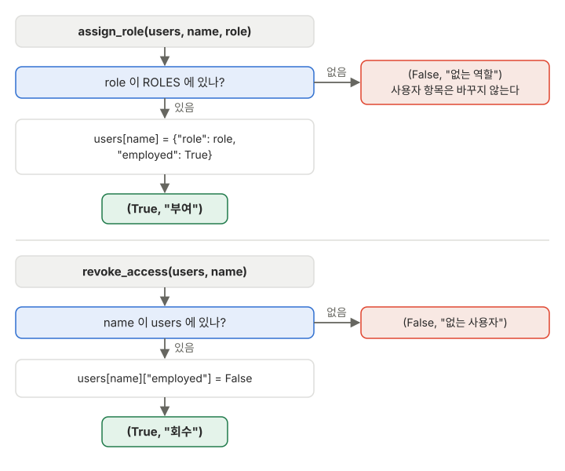
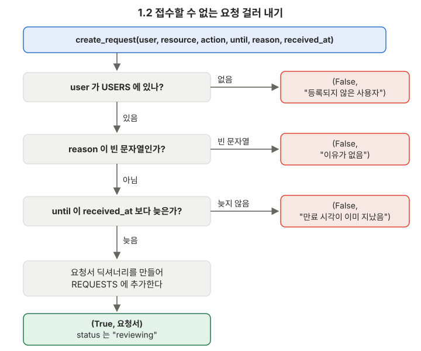

# 실습 2-1 · 권한 요청서 만들기

## 목표: 요청서 접수 함수

> **오늘 들어온 일**
>
> A사 보안 담당이 보낸 메시지: 「어제 18시에 끝난 정산 예외가 오늘도 필요해서, seoyeon 이 저에게 메신저로 다시 부탁했습니다. 이렇게 메신저나 말로 받으면 나중에 확인할 기록이 남지 않습니다. 요청을 요청서 한 장으로 적어 리스트에 모아 주세요. 정보가 빠졌거나 잘못된 요청은 받지 않게 해 주세요.」
> - 말 풀이: **정산**은 회사가 주고받은 돈을 맞춰 보는 일입니다. 「정산 예외」는 seoyeon 이 원래 역할로는 못 보는 정산 자료(`SETTLE`)를 정해 둔 시각까지만 보게 따로 허락받은 권한입니다.
> - 이 실습에서 하는 일: 요청 하나를 요청서(딕셔너리)로 만들어 리스트에 추가하는 함수 `create_request` 를 `req_create.py` 에 만듭니다. 대부분은 미리 채워 두었고, 만료 시각 검사 두 줄과 리스트에 추가하는 한 줄만 직접 씁니다. 실행해서 접수된 요청과 접수되지 않은 요청을 읽습니다.
> - 끝나면 쓰는 것: 보고서 (가) 답. (나)는 여유가 되면 하는 응용입니다

## 왜 요청을 요청서로 받는가

1. 메신저나 말로 받은 요청은 기록이 남지 않습니다. 승인 기준도 사람마다 다르고, 받아 놓고 **회수**(빌려준 권한을 다시 거둬들이는 것. 빌려준 열쇠를 돌려받는 것과 같음)를 잊습니다.
2. 요청을 **요청서**(request form · 리퀘스트 폼)라는 정해진 모양의 기록으로 받으면, 필요한 정보가 빠진 요청은 접수 단계에서 걸러 낼 수 있습니다.
3. 이번 Unit의 전체 흐름은 세 단계입니다.
   - 실습 2-1: 요청서를 **접수**합니다(받아서 번호를 붙여 모아 둠).
   - 실습 2-2: 보안 담당이 **승인 · 반려**합니다.
   - 제공 파일 `req_grant.py`: 정책으로 한 번 더 확인한 뒤 **예외 권한을 부여**합니다(실제로 권한을 손에 쥐여 줌). 응용 2-1에서 직접 써 볼 수 있습니다.
   - 부여된 예외는 `policy.py` 의 `evaluate_access` 가 그대로 허용으로 판정합니다.

## 1.1 요청서와 상태

- **딕셔너리**: 이름표(키)와 값을 짝지어 담는 상자입니다. 예: `{"user": "seoyeon", "status": "reviewing"}` 은 이름표 두 개에 값이 하나씩 붙은 딕셔너리입니다.
- **요청서**: 요청 한 건을 적은 딕셔너리. 접수할 때 키 아홉 개를 씁니다(아래 표는 `resource` · `action` 을 한 행에 묶어 여덟 행입니다). 실습 2-2에서 `approver` 키가, 예외를 부여할 때(`req_grant.py`) `exception_id` 키가 더 생깁니다.
- **키**(key · 키): 딕셔너리에서 값을 찾는 이름입니다. `request["status"]` 에서 `"status"` 가 키이고, 그 키에 들어 있는 `"reviewing"` 이 값입니다.
- **이력**: 무슨 일이 어떤 순서로 있었는지 남겨 둔 기록. 요청서에 처리 결과를 남기면 나중에 되짚어 볼 수 있습니다.
- **상태**(status · 스테이터스): `status` 키의 값으로, 그 요청서가 지금 어디까지 처리됐는지를 적습니다. 정해 둔 문자열 중 하나만 씁니다.

| 키 | 뜻 | 값의 예 |
|---|---|---|
| `id` | 요청 번호 | `1` |
| `user` | 요청한 사람 | `"seoyeon"` |
| `resource` · `action` | 달라는 권한의 자원과 행위 | `"SETTLE"` · `"QUERY"` |
| `permission` | 위 둘을 `자원:행위` 로 합친 문자열 | `"SETTLE:QUERY"` |
| `until` | 요청자가 바라는 만료 시각 | `"2026-10-27 18:00"` |
| `reason` | 요청 이유 | `"정산 대조 지원"` |
| `requested_at` | 접수한 시각 | `"2026-10-23 08:30"` |
| `status` | 처리 상태 | `"reviewing"` |

| 상태 문자열 | 뜻 | 쓰이는 실습 |
|---|---|---|
| `reviewing` | 검토 중. 접수 직후의 상태 | 실습 2-1 |
| `approved` · `rejected` | 승인됨 · 반려됨(검토한 사람이 거절해서 돌려보냄) | 실습 2-2 |
| `granted` | 예외 권한이 부여됨 | 제공 파일 `req_grant.py` (응용 2-1) |

<figure class="page-figure"></figure>

## 1.2 접수할 수 없는 요청

접수 단계에서는 세 가지만 걸러 냅니다.

| 이런 요청 | 접수 단계에서 |
|---|---|
| 사용자 파일에 없는 이름 | 걸러 냄 |
| 이유가 비어 있는 요청 | 걸러 냄 |
| 희망 만료 시각(`until`)이 접수 시각과 같거나 앞섬(이미 지남) | 걸러 냄 |
| 퇴사한 사람 · 이미 권한이 있는 사람의 요청 | 걸러 내지 않음. 부여 단계에서 `req_grant.py` 의 정책 코드가 확인 |
| `until` 이 비었거나 너무 먼 미래인 요청 | 확인하지 않음 |

- 함수가 받는 접수 시각 `received_at` 은 요청서의 `requested_at` 키의 값으로 그대로 들어갑니다.

<figure class="page-figure"></figure>

**문법 상자 · 직접 쓰는 곳의 모양** (예시 값 · 읽기만 합니다)

직접 쓰는 곳은 만료 시각 검사(① · ②)와 리스트에 추가하기(③)입니다. 그 모양입니다.

**① 같은 형식의 시각 문자열은 `<=` · `>` 로 비교해도 시각 순서와 같습니다**

```python
print("2026-10-27 18:00" > "2026-10-23 09:15")                    # 같은 형식의 문자열은 앞에서부터 비교한다. 늦은 시각이 더 크다
print("2026-10-22 18:00" <= "2026-10-23 09:15")                   # 어제 시각은 오늘 접수 시각보다 작으므로 참이다
```

실행 결과:

```
True
True
```

- `exception_policy.py` 는 시각 문자열을 `strptime` 으로 시각으로 바꿔 비교합니다. `strptime` 은 `"2026-10-23 09:15"` 같은 글자를 파이썬이 계산할 수 있는 날짜 · 시각 값으로 바꾸는 함수입니다. 오늘의 `until` 과 `received_at` 은 `"2026-10-23 09:15"` 처럼 자릿수까지 같은 형식이라, 문자열 그대로 비교해도 같은 결과가 나옵니다.

**② `.append(값)` 은 리스트 끝에 값 하나를 붙입니다**

```python
names = []                                                         # 빈 리스트
names.append("seoyeon")                                            # 끝에 하나를 붙인다
names.append("gaeun")                                              # 또 하나를 붙인다
print(names, len(names))                                           # 리스트와 개수를 출력한다
```

실행 결과:

```
['seoyeon', 'gaeun'] 2
```

## 실습 2-1 · 요청서 모으고 접수 불가 걸러 내기

**이런 상황이 있습니다**

- **지금은**: 직원이 메신저로 「정산 조회 권한을 주세요」라고 부탁하면, 보안 담당이 그 메시지를 찾아서 처리합니다. 메시지가 여기저기 흩어져 있어서 누가 · 언제 · 무엇을 부탁했는지 한곳에서 볼 수 없습니다.
- **그래서 만드는 것**: 요청 하나를 **요청서**(딕셔너리) 한 장으로 적어 리스트 `REQUESTS` 에 모으는 함수 `create_request` 입니다. 정보가 잘못된 요청은 리스트에 넣지 않고 이유를 알려 줍니다.
- **실행하면**: 들어온 요청 일곱 건이 하나씩 접수가 시도됩니다. 줄마다 「접수됨, 요청 번호 …」 또는 「접수 안 됨: 이유」가 나오고, 끝에 접수된 요청서 리스트가 나옵니다.
- **현업에서는**: 권한 신청 도구도 요청자 · 시각 · 이유가 없는 신청은 받지 않고, 받은 신청마다 번호를 붙여 기록으로 남깁니다.

**할 일**

1. 아래 코드로 `req_create.py` 를 만들고, `# ←` 가 있는 <mark>세 곳</mark>(① · ② · ③)을 한 줄씩 채웁니다.
2. 요청 일곱 건을 접수하는 `exercise2-1_run.py` 를 만들어 실행합니다.
3. 채우기 <mark>전과 후</mark>의 출력을 비교합니다. 단계 1(접수)에서 접수된 네 건 · 접수되지 않은 세 건을, 단계 2(점검)에서 요청서 리스트를 읽습니다.

**`req_create.py`**

```python
from rbac import USERS                                           # rbac.py 의 사용자 딕셔너리를 불러온다

REQUESTS = []                                                    # 접수한 요청서를 모아 두는 리스트(프로그램이 끝나면 사라진다)


def create_request(user, resource, action, until, reason, received_at):  # 요청자 · 자원 · 행위 · 희망 만료 시각 · 이유 · 접수 시각을 받는 함수
    """권한 요청서를 만들어 REQUESTS 에 넣고 (True, 요청서)를 리턴한다.
    직원이 권한을 요청할 때 쓰며, 접수할 수 없으면 (False, 이유)를 리턴한다.
    """
    if user not in USERS:                                        # 사용자 파일에 없는 이름이면
        return False, "등록되지 않은 사용자"                       # 접수하지 않고 이유를 알린다
    if reason == "":                                             # 이유가 비어 있으면
        return False, "이유가 없음"                                # 접수하지 않고 이유를 알린다
    # ① until 이 received_at 과 같거나 앞서면   # ← 이 주석 바로 아래 줄에 씁니다 (4칸)
    # ② "만료 시각이 이미 지났음" 을 이유로 접수하지 않는다   # ← 이 주석 바로 아래 줄에 씁니다 (8칸)
    request_id = len(REQUESTS) + 1                               # 다음 요청 번호(지금 개수 + 1)
    permission = f"{resource}:{action}"                          # "자원:행위" 모양 권한 문자열
    request = {                                                  # 요청서 한 장. 상태는 검토 중으로 시작한다
        "id": request_id,                                        # 요청 번호
        "user": user,                                            # 요청자
        "resource": resource,                                    # 자원
        "action": action,                                        # 행위
        "permission": permission,                                # 권한
        "until": until,                                          # 희망 만료 시각
        "reason": reason,                                        # 요청 이유
        "requested_at": received_at,                             # 접수 시각
        "status": "reviewing",                                   # 상태: 검토 중
    }
    # ③ REQUESTS 리스트 끝에 request 를 추가한다   # ← 이 주석 바로 아래 줄에 씁니다 (4칸)
    return True, request                                         # 접수했다고 알리고 요청서를 리턴한다
```

- 앞의 두 검사(사용자 · 이유)와 요청서를 만드는 줄은 미리 써 두었습니다. `if user not in USERS:` 는 「`USERS` 딕셔너리의 키 가운데 `user` 이름이 없으면」이라는 뜻입니다.
- `f"{resource}:{action}"` 처럼 따옴표 앞에 `f` 를 붙이면, 중괄호 자리에 변수 값이 들어갑니다. `resource` 가 `"SETTLE"`, `action` 이 `"QUERY"` 면 `"SETTLE:QUERY"` 가 됩니다.
- 요청서 딕셔너리는 `{ }` 안이라 키 하나마다 줄을 바꿔 써도 한 문장이고, 키 아홉 개는 1.1 의 표와 같습니다.
- `request_id = len(REQUESTS) + 1` 은 지금까지 리스트에 든 요청서 수에 1을 더한 다음 요청 번호입니다. ③ 을 쓰지 않으면 리스트가 늘지 않아 번호가 계속 `1` 입니다.
- 주석 줄은 그대로 두고, **각 주석 바로 아래 줄**에 씁니다. ① 은 `if` 줄이라 4칸, ② 는 그 `if` 안쪽의 `return` 줄이라 8칸, ③ 은 함수 본문의 한 줄이라 4칸에서 시작합니다.

**`exercise2-1_run.py`** — 그대로 붙여 넣습니다. 학생이 쓰는 줄은 없습니다. 단계 1은 요청 일곱 건을 `create_request` 로 접수하고, 단계 2는 접수된 요청서 리스트를 출력합니다.

- `for user, resource, … in INBOX:` 는 `INBOX` 에서 요청을 한 건씩 꺼내, 괄호 안 여섯 값을 앞에서부터 여섯 변수에 나눠 담습니다.
- `create_request` 는 값 두 개를 한 번에 돌려줍니다(리턴). `is_success, result = …` 는 그 두 값을 차례로 두 변수에 나눠 받는 줄입니다. 예: `(True, 요청서)` 가 오면 `is_success` 는 `True`, `result` 는 요청서입니다. 더 알고 싶으면 AI 에게 「파이썬 함수가 값 두 개를 리턴하고 나눠 받는 것을 중학생에게 설명하듯 알려 줘」라고 물어보세요.

```python
from req_create import REQUESTS, create_request                  # 방금 만든 요청서 함수와 리스트를 불러온다

INBOX = [                                                        # 들어온 요청 일곱 건. (요청자, 자원, 행위, 희망 만료 시각, 이유, 접수 시각)
    ("seoyeon", "SETTLE", "QUERY", "2026-10-27 18:00", "정산 대조 지원", "2026-10-23 08:30"),           # 어제 끝난 예외가 아직 필요함
    ("gaeun", "SALES", "QUERY", "2026-10-28 18:00", "감사 자료 대응", "2026-10-23 08:40"),              # 계정 관리자의 영업 실적 조회
    ("dami", "SALES", "QUERY", "2026-10-27 18:00", "인수인계 자료 확인", "2026-10-23 08:50"),           # 접수 단계에서는 걸러지지 않는 요청
    ("junho", "SETTLE", "QUERY", "2026-10-27 18:00", "정산 확인", "2026-10-23 09:00"),                  # 접수 단계에서는 걸러지지 않는 요청
    ("hana", "SALES", "QUERY", "2026-10-27 18:00", "신규 업무 지원", "2026-10-23 09:05"),               # 접수되는지 실행해서 확인
    ("seoyeon", "ACCOUNT", "QUERY", "2026-10-27 18:00", "", "2026-10-23 09:10"),                        # 접수되는지 실행해서 확인
    ("gaeun", "ACCOUNT", "QUERY", "2026-10-22 18:00", "어제 적은 요청서 재사용", "2026-10-23 09:15"),   # 접수되는지 실행해서 확인
]

print("--- 단계 1: 접수 - 요청 일곱 건을 하나씩 넣는다")             # 단계 1 시작을 알리는 줄
for user, resource, action, until, reason, received_at in INBOX:         # 요청을 하나씩 꺼낸다
    is_success, result = create_request(user, resource, action, until, reason, received_at)   # 접수를 시도하고 결과를 받는다
    if is_success:                                                       # 접수됐으면
        print(user, resource, action, "-> 접수됨, 요청 번호", result["id"])   # 요청 번호를 출력한다
    else:                                                        # 접수되지 않았으면
        print(user, resource, action, "-> 접수 안 됨:", result)    # 이유를 출력한다

print("--- 단계 2: 점검 - 요청서 리스트")                            # 단계 2 시작을 알리는 줄
for request in REQUESTS:                                         # 요청서를 하나씩 꺼낸다
    print(request["id"], request["user"], request["permission"], request["status"])   # 번호 · 요청자 · 권한 · 상태를 출력한다
```

**직접 쓰는 곳**

| 빈칸 | 쓰는 줄 | 들여쓰기 |
|---|---|---|
| ① | `until` 이 `received_at` 보다 늦지 않으면 (`if`) | 4칸 |
| ② | 「만료 시각이 이미 지났음」으로 접수 안 함 (`return`) | 8칸 |
| ③ | 리스트 끝에 `request` 추가 (`.append`) | 4칸 |

- ① 확인: ① 만 쓰고 실행하면 `IndentationError: expected an indented block after 'if' statement` 가 나옵니다. ② 를 아직 안 써서 나는 오류이니 정상입니다. 막히면: 문법 상자 ① 의 `"2026-10-22 18:00" <= "2026-10-23 09:15"` 에서 두 문자열 자리에 `until` 과 `received_at` 을 넣고, 앞에 `if`, 끝에 `:` 를 붙입니다.
- ② 확인: ② 까지 쓰고 실행하면 `gaeun ACCOUNT QUERY -> 접수 안 됨: 만료 시각이 이미 지났음` 이 나와야 합니다. 막히면: 바로 위 `return False, "이유가 없음"` 과 같은 모양이고 이유만 다릅니다.
- ③ 확인: ③ 까지 쓰고 실행하면 요청 번호가 `1` · `2` · `3` · `4` 로 늘고, 단계 2에 요청서 네 줄이 나오면 성공입니다. 막히면: 문법 상자 ② 의 `names.append("seoyeon")` 에서 `names` 자리에 `REQUESTS`, `"seoyeon"` 자리에 `request` 를 넣습니다.
- 채우기 전에 실행해도 오류 없이 돌아갑니다. 다만 이미 지난 만료 시각의 `gaeun` 요청까지 접수되고, 리스트에 아무것도 쌓이지 않아 요청 번호가 모두 `1` 이며 단계 2가 비어 나옵니다. 정답 레슨에 이 출력이 있습니다.

**순서**

1. **[VS Code]** 파일을 만들고 각각 붙여 넣습니다. 파일마다 아래 네 가지를 반복합니다.
   1. VS Code 왼쪽 목록에서 `access_control` 폴더를 클릭해 선택합니다(선택하지 않으면 다른 폴더에 만들어집니다).
   2. 목록 위쪽의 **새 파일**(New File, 파일 모양에 `+`) 아이콘을 누릅니다.
   3. 이름 칸에 파일 이름을 입력하고 Enter 를 누릅니다. 이름은 차례로 `req_create.py` · `exercise2-1_run.py` 입니다.
   4. 열린 파일에 위 코드 상자의 내용을 복사해 붙여 넣고 저장합니다.

<!-- checklist -->
- [ ] `access_control` 폴더에 `req_create.py` 와 `exercise2-1_run.py` 를 만들어 코드 상자 내용을 붙여 넣고 저장했다
<!-- /checklist -->

2. **[터미널]** `pwd` 를 쳐서 마지막 폴더가 `access_control` 인지 확인한 뒤, **채우기 전에** 한 번 실행해서 접수되면 안 되는 요청과 요청 번호를 봅니다.
   ```bash
   python exercise2-1_run.py
   ```
   - 명령 풀이: `python` 파이썬으로 파일을 실행 · `exercise2-1_run.py` 실행할 파일
   - 맥북은 `python3 exercise2-1_run.py` 로 칩니다.

<!-- checklist -->
- [ ] 채우기 전에 `python exercise2-1_run.py` 를 실행해 출력을 봤다
<!-- /checklist -->

3. **[VS Code]** `req_create.py` 의 `# ←` 세 곳(① · ② · ③)을 채웁니다. 1.2 의 그림과 문법 상자를 보고 씁니다.
4. **[터미널]** 다시 실행합니다. 출력은 두 단계입니다. 단계 1은 요청 일곱 건의 접수 결과(일곱 줄)이고, 단계 2는 접수된 요청서 리스트(네 줄)입니다.
   ```bash
   python exercise2-1_run.py
   ```

<!-- checklist -->
- [ ] `req_create.py` 의 빈칸 ① · ② · ③ 을 채우고 다시 실행해 「접수됨」 네 줄과 「접수 안 됨」 세 줄이 나왔다
<!-- /checklist -->

5. **[보고서]** `access_control/report_u2.md` 의 `## 실습 2-1` 아래를 채웁니다(보고서 파일은 「보고서 쓰기」 레슨에서 만듭니다).
   - (가) [핵심 질문] 채운 뒤 실행한 출력 전체를 붙여 넣고, 접수되지 않은 세 건이 각각 `create_request` 의 어느 `if` 조건 때문에 접수되지 않았는지 적어 주세요.
   - (나) [응용] 요청서의 `until`(희망 만료 시각)은 요청자가 직접 적습니다. 요청자가 적은 기간을 그대로 믿고 승인해도 될까요? 승인하기 전에 확인할 것을 두 가지 이상 적어 주세요.

**확인** — 다시 실행했을 때 단계 1에 「접수됨」 네 줄(요청 번호 1 ~ 4)과 「접수 안 됨」 세 줄이, 단계 2에 `reviewing` 요청서 네 줄이 나오면 성공입니다. 안 나오면 「정답」 레슨의 실습 2-1 출력과 한 줄씩 맞춰 보고, 다른 줄이 있으면 위 「직접 쓰는 곳」의 확인을 다시 봅니다.

## 실습 2-1 정리

| 하려는 일 | 코드 · 말 |
|---|---|
| 요청서 한 장 | 딕셔너리 |
| 키: 누가 · 무엇을 | `id` · `user` · `resource` · `action` · `permission` |
| 키: 언제 · 왜 · 상태 | `until` · `reason` · `requested_at` · `status` |
| 다음 요청 번호 | `len(REQUESTS) + 1` |
| 접수 못 하는 요청 | 사용자 파일에 없음 · 이유가 `""` · `until <= received_at` |
| 접수 못 할 때 리턴 | `(False, 이유)` |
| 접수한 요청의 상태 | `"reviewing"` |
| 리스트에 추가하기 | `REQUESTS.append(request)` |

---
