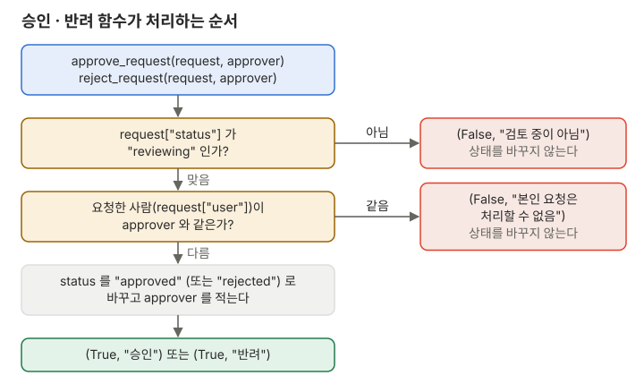

# 실습 2-2 · 승인·반려 함수 만들기

## 목표: 승인·반려 함수

> **오늘 들어온 일**
>
> A사 보안 담당이 보낸 메시지: 「접수된 요청서를 제가 하나씩 보고 승인하거나 반려합니다. 그런데 같은 요청서를 실수로 두 번 승인하거나, 이미 반려한 요청서를 나중에 승인하는 일이 생기면 안 됩니다. 검토 중인 요청서만 처리되게 하고, 누가 처리했는지도 요청서에 남겨 주세요. 요청한 본인이 자기 요청을 처리하는 일도 막아 주세요.」
> - 이 실습에서 하는 일: 승인 함수 `approve_request` 와 반려 함수 `reject_request` 를 `req_review.py` 에 만듭니다. 대부분은 미리 채워 두었고, 승인 함수의 상태 검사 두 줄만 직접 씁니다. 본인 요청과 두 번째 처리를 시도해 막히는 것을 확인합니다.
> - 끝나면 쓰는 것: 보고서 (가) · (나) 답. (다)는 여유가 되면 하는 응용입니다

## 왜 처리 순서와 처리자를 남기는가

1. 요청서는 **정해진 순서로만** 상태를 바꿉니다. 체험학습 신청서도 「검토 중 → 허락 또는 돌려보냄」 순서로 한 번만 처리되는 것과 같습니다.
2. 누가 승인하거나 반려했는지 적어 두어야, 나중에 문제가 생겼을 때 책임을 찾고 **감사**에 답할 수 있습니다. 감사는 점검하는 사람이 「이 권한은 누가 왜 줬나요?」 하고 기록을 확인하는 일입니다.

## 2.1 상태가 바뀌는 순서

| 지금 상태 | 할 수 있는 처리 | 처리 뒤 상태 | 다시 처리하면 |
|---|---|---|---|
| `reviewing` | 승인 | `approved` | — |
| `reviewing` | 반려 | `rejected` | — |
| `approved` · `rejected` | (없음) | 그대로 | `(False, "검토 중이 아님")` |

- 이 규칙을 코드로 쓰는 방법은 간단합니다. **바꾸기 전에 지금 상태를 먼저 확인**하고, 맞지 않으면 아무것도 바꾸지 않고 `False` 와 이유를 리턴합니다.
- `approved` 가 된 요청서를 `granted` 로 바꾸는 일은 제공 파일 `req_grant.py` 가 합니다(응용 2-1에서 직접 써 볼 수 있습니다).

<figure class="page-figure"></figure>

## 2.2 승인자를 정하는 규칙

- 오늘은 승인자를 `security_manager` 한 사람으로 둡니다. 사람 이름이 아니라 보안 담당자가 쓰는 계정 이름입니다.
- 현업에서는 요청한 권한에 따라 승인자가 달라집니다. 예를 들어 정산(돈 계산) 자료는 돈을 맡은 부서의 책임자가 승인합니다.
- 오늘은 요청한 본인 여부를 확인하는 검사를 승인 · 반려 두 함수에 넣습니다. 자기가 낸 신청서를 자기가 허락하면, 아무도 확인하지 않은 것과 같기 때문입니다.

**문법 상자 · 직접 쓰는 곳의 모양** (예시 값 · 읽기만 합니다)

직접 쓰는 곳은 `approve_request` 의 상태 검사(① · ②) 하나입니다. 그 모양입니다.

**① `!=` 는 「같지 않은가」를 묻습니다**

```python
request = {"id": 1, "status": "approved"}                          # 이미 승인된 요청서

print(request["status"] != "reviewing")                            # 검토 중이 아닌가? 참이다
print(request["status"] == "reviewing")                            # 검토 중인가? 거짓이다
```

실행 결과:

```
True
False
```

- 상태가 `"reviewing"` 이 **아닐 때** 막아야 하므로 `!=` 를 씁니다. `==` 를 쓰면 거꾸로 검토 중인 것만 막힙니다.
- 상태를 바꾸는 `request["status"] = "approved"` 처럼 `=` 하나는 값을 담는 대입이고, `==` · `!=` 는 비교입니다. `if` 의 조건에는 비교를 씁니다.

**② 실행 파일이 쓰는 `.get("키 이름")`** — 딕셔너리에 키가 있는지 확실하지 않을 때 이렇게 꺼냅니다

```python
request = {"id": 1, "status": "reviewing"}                          # 요청서 한 장. approver 키는 아직 없다
print(request["status"])                                           # [ ] 로 있는 키의 값을 꺼낸다
print(request.get("status"))                                       # .get 으로 있는 키의 값을 꺼내도 같은 값이 나온다
```

실행 결과:

```
reviewing
reviewing
```

없는 키를 꺼내면 두 방법이 달라집니다.

```python
request = {"id": 1, "status": "reviewing"}                          # 요청서 한 장. approver 키는 아직 없다
print(request.get("approver"))                                     # 없는 키를 .get 으로 꺼내면 오류 없이 None(값 없음)이 나온다
print(request["approver"])                                         # 없는 키를 [ ] 로 꺼내면 KeyError 오류가 나고 프로그램이 멈춘다
```

실행 결과:

```
None
Traceback (most recent call last):
  File "…/파일이름.py", line 3, in <module>
    print(request["approver"])                                         # 없는 키를 [ ] 로 꺼내면 KeyError 오류가 나고 프로그램이 멈춘다
          ~~~~~~~^^^^^^^^^^^^
KeyError: 'approver'
```

- 파일 경로와 `~~~^^^` 표시 줄은 내 PC 와 파이썬 버전에 따라 조금 다르게 나올 수 있습니다. 마지막 줄 `KeyError: 'approver'` 가 같으면 됩니다.
- `[ ]` 는 키가 없으면 오류(`KeyError`)가 나고 프로그램이 멈춥니다. `.get( )` 은 키가 없어도 멈추지 않고 `None`(값이 없다는 뜻의 값)을 꺼냅니다.
- 이 실습의 단계 2에서는 네 장 모두 처리되어 `approver` 키가 있으므로 `None` 이 나오지 않습니다. 그래도 아직 처리하지 않은 요청서가 섞여 있을 때 멈추지 않도록 `.get` 을 씁니다.

## 실습 2-2 · 승인·반려 함수와 재처리 차단

**이런 상황이 있습니다**

- **지금은**: 접수된 요청서 네 장이 `reviewing`(검토 중) 상태로 쌓여 있고, 보안 담당 `security_manager` 가 하나씩 보고 승인하거나 반려합니다. 사람이 하다 보면 같은 요청서를 두 번 처리하거나, 요청한 본인이 자기 요청을 처리하는 일이 생길 수 있습니다.
- **그래서 만드는 것**: 승인 함수 `approve_request` 와 반려 함수 `reject_request` 입니다. 두 함수는 ① 검토 중인 요청서만 처리하고 ② 요청한 본인이 처리하려 하면 막고 ③ 처리하면 상태를 바꿔 누가 처리했는지 요청서에 적습니다.
- **실행하면**: 본인 승인을 시험하는 한 줄과 처리 시도 여섯 줄이 나옵니다. 줄마다 성공 여부(`True` / `False`)와 이유가 붙고, 끝에 요청서 리스트의 상태와 처리한 사람이 나옵니다.
- **현업에서는**: 승인 도구도 처리가 끝난 신청은 다시 처리하지 못하게 막고, 처리한 사람과 시각을 기록으로 남깁니다.

**할 일**

1. 아래 코드로 `req_review.py` 를 만들고, `approve_request` 의 `# ←` 가 있는 <mark>두 곳</mark>(① · ②)을 한 줄씩 채웁니다. `reject_request` 는 다 써 두었습니다.
2. 요청서 네 장을 처리하는 `exercise2-2_run.py` 를 만들어 실행합니다.
3. 채우기 <mark>전과 후</mark>의 출력을 비교합니다. 단계 1(처리)에서 본인 승인 시험과 처리 여섯 건의 결과를, 단계 2(점검)에서 요청서 리스트를 읽습니다.

**`req_review.py`**

```python
def approve_request(request, approver):                          # 요청서와 승인자 이름을 받는 함수
    """검토 중인 요청서를 승인한다.
    보안 담당자가 권한 요청을 처리할 때 쓰고 (성공 여부, 이유)를 리턴한다.
    """
    # ① request["status"] 가 "reviewing" 이 아니면   # ← 이 주석 바로 아래 줄에 씁니다 (4칸)
    # ② "검토 중이 아님" 을 이유로 처리하지 않는다   # ← 이 주석 바로 아래 줄에 씁니다 (8칸)
    if request["user"] == approver:                              # 요청한 사람이 스스로 처리하려고 하면
        return False, "본인 요청은 처리할 수 없음"                  # 바꾸지 않고 이유를 알린다
    request["status"] = "approved"                               # 상태를 승인됨으로 바꾼다
    request["approver"] = approver                               # 누가 승인했는지 적어 둔다
    return True, "승인"                                          # 승인했다고 알린다


def reject_request(request, approver):                           # 요청서와 반려하는 사람 이름을 받는 함수
    """검토 중인 요청서를 반려한다.
    보안 담당자가 권한 요청을 거절할 때 쓰며 (성공 여부, 이유)를 리턴한다.
    """
    if request["status"] != "reviewing":                         # 검토 중이 아니면(이미 처리됐으면)
        return False, "검토 중이 아님"                             # 바꾸지 않고 이유를 알린다
    if request["user"] == approver:                              # 요청한 사람이 스스로 처리하려고 하면
        return False, "본인 요청은 처리할 수 없음"                  # 바꾸지 않고 이유를 알린다
    request["status"] = "rejected"                               # 상태를 반려됨으로 바꾼다
    request["approver"] = approver                               # 누가 반려했는지 적어 둔다
    return True, "반려"                                          # 반려했다고 알린다
```

- 두 함수는 모양이 같고, 바뀌는 문자열(`"approved"` · `"승인"` 과 `"rejected"` · `"반려"`)만 다릅니다. `reject_request` 의 첫 검사가 ① · ② 의 본보기입니다.
- 주석 줄은 그대로 두고, **각 주석 바로 아래 줄**에 씁니다. ① 은 `if` 줄이라 4칸, ② 는 그 `if` 안쪽의 `return` 줄이라 8칸에서 시작합니다.

**`exercise2-2_run.py`** — 그대로 붙여 넣습니다. 학생이 쓰는 줄은 없습니다. 실습 2-1의 `create_request` 로 요청서 네 장을 접수한 뒤, 단계 1은 본인 승인 시험 한 건과 처리 여섯 건을 넣고 단계 2는 요청서 리스트를 출력합니다. `REQUESTS[0]` 처럼 리스트 이름 뒤 `[ ]` 에 자리 번호를 쓰면 그 자리의 항목을 꺼냅니다. 자리 번호는 0부터 세므로 `REQUESTS[0]` 이 1번 요청서입니다.

```python
from req_create import REQUESTS, create_request                  # 실습 2-1에서 만든 요청서 함수와 리스트를 불러온다
from req_review import approve_request, reject_request           # 방금 만든 승인 · 반려 함수를 불러온다

INBOX = [                                                        # 접수에 성공하는 요청 네 건. (요청자, 자원, 행위, 희망 만료 시각, 이유, 접수 시각)
    ("seoyeon", "SETTLE", "QUERY", "2026-10-27 18:00", "정산 대조 지원", "2026-10-23 08:30"),
    ("gaeun", "SALES", "QUERY", "2026-10-28 18:00", "감사 자료 대응", "2026-10-23 08:40"),
    ("dami", "SALES", "QUERY", "2026-10-27 18:00", "인수인계 자료 확인", "2026-10-23 08:50"),
    ("junho", "SETTLE", "QUERY", "2026-10-27 18:00", "정산 확인", "2026-10-23 09:00"),
]
for user, resource, action, until, reason, received_at in INBOX:         # 요청을 하나씩 꺼내
    create_request(user, resource, action, until, reason, received_at)   # 접수한다(결과는 쓰지 않는다)

DECISIONS = [                                                    # 보안 담당(security_manager)이 내리는 처리 여섯 건. (요청 번호, 처리)
    (1, "승인"),                                                 # seoyeon 의 정산 조회
    (2, "반려"),                                                 # gaeun 의 영업 실적 조회
    (3, "승인"),                                                 # dami 의 영업 실적 조회
    (4, "승인"),                                                 # junho 의 정산 조회
    (1, "승인"),                                                 # 이미 승인한 1번을 다시 승인해 본다
    (2, "승인"),                                                 # 이미 반려한 2번을 승인해 본다
]

print("--- 단계 1: 처리 - 본인 요청 시험 한 건, 승인 · 반려 여섯 건을 처리한다")   # 단계 1 시작을 알리는 줄
is_success, result = approve_request(REQUESTS[0], "seoyeon")             # 요청자 seoyeon 이 자기 요청 1번을 스스로 승인해 본다
print(1, "본인 승인 ->", is_success, result)                              # 요청 번호 · 처리 -> 성공 여부 · 이유 를 출력한다
for number, decision in DECISIONS:                               # 처리를 하나씩 꺼낸다
    request = REQUESTS[number - 1]                               # 요청 번호로 요청서를 찾는다(번호는 1부터, 리스트 자리는 0부터)
    if decision == "승인":                                       # 승인이면
        is_success, result = approve_request(request, "security_manager")  # 승인 함수를 호출한다
    else:                                                        # 반려면
        is_success, result = reject_request(request, "security_manager")  # 반려 함수를 호출한다
    print(number, decision, "->", is_success, result)                    # 요청 번호 · 처리 -> 성공 여부 · 이유 를 출력한다

print("--- 단계 2: 점검 - 요청서 리스트")                            # 단계 2 시작을 알리는 줄
for request in REQUESTS:                                         # 요청서를 하나씩 꺼낸다
    print(request["id"], request["user"], request["status"], request.get("approver"))   # 번호 · 요청자 · 상태 · 처리한 사람을 출력한다
```

**직접 쓰는 곳**

| 빈칸 | 쓰는 줄 | 들여쓰기 |
|---|---|---|
| ① | 상태가 `"reviewing"` 이 아니면 (`if`) | 4칸 |
| ② | 「검토 중이 아님」으로 처리 안 함 (`return`) | 8칸 |

- ① 확인: ① 만 쓰고 실행하면 `IndentationError: expected an indented block after 'if' statement` 로 시작하는 오류가 나옵니다(뒤에 `on line 번호` 가 붙습니다). ② 를 아직 안 써서 나는 오류이니 정상입니다. 막히면: 아래 `reject_request` 의 첫 `if` 줄과 똑같이 씁니다.
- ② 확인: ② 까지 쓰고 실행하면 처리 여섯 건의 마지막 두 줄이 `1 승인 -> False 검토 중이 아님` 과 `2 승인 -> False 검토 중이 아님` 으로 나오면 성공입니다. 막히면: `reject_request` 의 첫 `return` 줄과 똑같고, 줄 맨 앞에 `return` 이 있는지 봅니다.
- 채우기 전에 실행해도 오류 없이 돌아갑니다. 본인 승인은 막히지만, 이미 승인한 1번을 다시 승인해도 `True 승인`, 이미 반려한 2번을 승인해도 `True 승인` 으로 나오고, 단계 2에서 2번이 `approved` 로 바뀝니다. 상태 검사 하나가 빠지면 처리한 결정이 뒤집힌다는 것을 보여 주는 결과입니다.

**순서**

1. **[VS Code]** 파일을 만들고 각각 붙여 넣습니다. 파일마다 아래 세 가지를 반복합니다(시작하기 4번과 같은 방법입니다).
   1. VS Code 왼쪽 목록에서 `access_control` 폴더를 오른쪽 클릭 › **New File** 을 누릅니다(다른 폴더를 누르면 그 폴더에 만들어집니다).
   2. 이름 칸에 파일 이름을 입력하고 Enter 를 누릅니다. 이름은 차례로 `req_review.py` · `exercise2-2_run.py` 입니다.
   3. 열린 파일에 위 코드 상자의 내용을 복사해 붙여 넣고 저장합니다.

<!-- checklist -->
- [ ] `access_control` 폴더에 `req_review.py` 와 `exercise2-2_run.py` 를 만들어 코드 상자 내용을 붙여 넣고 저장했다
<!-- /checklist -->

2. **[터미널]** `pwd` 를 쳐서 마지막 폴더가 `access_control` 인지 확인합니다. `…/network-study-notes` 로 끝나면 `cd access_control` 로 들어갑니다. 그다음 **채우기 전에** 한 번 실행해서 다시 처리되면 안 되는 줄을 봅니다.
   ```bash
   python exercise2-2_run.py
   ```
   - 명령 풀이: `python` 파이썬으로 파일을 실행 · `exercise2-2_run.py` 실행할 파일

<!-- checklist -->
- [ ] 채우기 전에 `python exercise2-2_run.py` 를 실행해 출력을 봤다
<!-- /checklist -->

3. **[VS Code]** `req_review.py` 의 `# ←` 두 곳(① · ②)을 채웁니다. 2.1 의 표와 그림을 보고 씁니다.
4. **[터미널]** 다시 실행합니다. 단계 1은 본인 승인 시험 한 줄과 처리 여섯 건의 결과(여섯 줄)이고, 단계 2는 요청서 리스트(네 줄)입니다.
   ```bash
   python exercise2-2_run.py
   ```

<!-- checklist -->
- [ ] `req_review.py` 의 빈칸 ① · ② 를 채우고 다시 실행해 마지막 두 줄이 `False 검토 중이 아님` 으로 나왔다
<!-- /checklist -->

5. **[보고서]** `access_control/report_u2.md` 에 씁니다(보고서 파일은 「보고서 쓰기」 레슨에서 만듭니다). (가) · (나)는 `## 실습 2-2` 아래에, (다)는 `## 실습 응용 질문` 의 `2-2 (다)` 칸에 씁니다.
   - (가) [핵심 질문] 채운 뒤 실행한 출력 전체를 붙여 넣고, 막힌 세 줄이 각각 왜 막혔는지 적어 주세요.
   - (나) [핵심 질문] 이미 승인한 요청서를 다시 승인하지 못하게 막는 이유는 무엇인가요? 막지 않으면 어떤 일이 생길 수 있나요?
   - (다) [응용] `approve_request` 에서 `request["user"] == approver` 검사를 뺀다면 어떤 위험이 생길까요? 요청자가 친구에게 대신 승인해 달라고 부탁하면 이 검사로는 막을 수 없습니다. 이런 경우를 막으려면 무엇이 더 필요할까요?

**확인** — 다시 실행했을 때 본인 승인 시험이 `False`, 처리 여섯 건은 앞의 네 건이 `True`, 뒤의 두 건이 `False 검토 중이 아님` 이고, 단계 2에서 2번만 `rejected` 로 나오면 성공입니다. 안 나오면 「정답」 레슨의 실습 2-2 출력과 한 줄씩 맞춰 보고, 다른 줄이 있으면 위 「직접 쓰는 곳」의 확인을 다시 봅니다.

## 실습 2-2 정리

| 하려는 일 | 코드 · 말 |
|---|---|
| 승인 · 반려는 검토 중일 때만 | `if request["status"] != "reviewing":` |
| 검토 중이 아니면 리턴 | `return False, "검토 중이 아님"` |
| 본인 요청 막기 | `if request["user"] == approver:` |
| 본인 요청이면 리턴 | `return False, "본인 요청은 처리할 수 없음"` |
| 상태 바꾸기 | `request["status"] = "approved"` (또는 `"rejected"`) |
| 처리한 사람 남기기 | `request["approver"] = approver` |
| 키가 없을 수 있을 때 꺼내기 | `request.get("approver")` |
---

<!-- learn:answers -->
