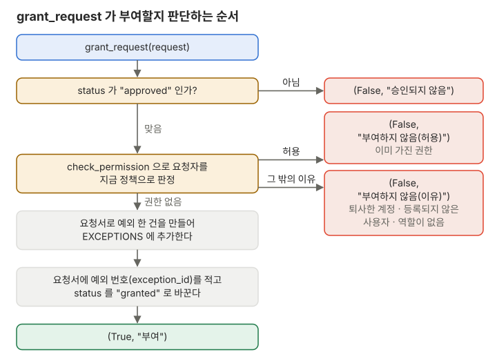

# 응용 2-1 · 정책 확인 후 예외 권한 부여

## 목표: 예외 권한 부여 함수

> **여유가 되면 해 보세요.** 핵심 실습 2-1 · 2-2와 글쓰기를 먼저 마칩니다. 이 응용을 하지 않아도 다음 Unit을 따라가는 데 문제가 없습니다.

> **오늘 들어온 일**
>
> A사 보안 담당이 보낸 메시지: 「승인한 요청서를 제가 직접 예외 파일에 옮겨 적으면 실수가 납니다. 예외 번호를 겹치게 적거나, 만료 시각을 잘못 옮기거나, 하나를 빠뜨립니다. 승인된 요청서를 코드가 정책으로 한 번 더 확인하고, 통과한 것만 예외 권한을 부여하게 해 주세요. 어느 예외를 부여했는지도 요청서에 남겨 주세요.」
> - 이 실습에서 하는 일: 승인된 요청서를 `rbac.py` 의 `check_permission` 으로 한 번 더 확인하고, 통과하면 예외를 만들어 `EXCEPTIONS` 에 추가하는 함수 `grant_request` 를 직접 씁니다. 부여 전과 후에 `policy.py` 의 `evaluate_access` 로 판정해 비교합니다. 「제공 파일」로 받은 `req_grant.py` 를 내가 직접 쓰는 응용입니다.
> - 끝나면 쓰는 것: 문제 해결 기록 (가)~(다) 답

## 왜 승인 뒤에 정책으로 다시 확인하는가

1. 승인은 사람이 합니다. 그 뒤에 코드가 정책으로 한 번 더 확인하는 것을 **이중 검증**이라고 합니다. 담임 선생님이 체험학습을 허락해도 행정실에서 서류를 한 번 더 보는 것과 같습니다. 사람은 깜빡할 수 있기 때문입니다.
2. 부여는 새 규칙을 만들지 않고, `config/exceptions.json` 에 적힌 것과 같은 **예외**(기간이 정해진 임시 권한)를 한 건 추가하는 일입니다.

## 3.1 부여할지 판단하는 순서

- 요청자를 지금 정책으로 판정한 이유(`judge_reason`)에 따라 처리가 갈립니다.
- 이 이유는 `rbac.py` 의 `check_permission` 이 리턴하는 문자열입니다. `check_permission` 은 사용자 파일과 역할 파일만 보고 판정합니다(예외는 보지 않습니다).
- 예를 들어 4번 junho 는 역할로 이미 그 권한이 있습니다. 실행하면 같은 junho 가 두 단계에서 다르게 나옵니다.
  - 단계 1: `evaluate_access` 로 판정해 `역할 권한` 이라고 나옵니다.
  - 단계 2: `check_permission` 의 이유를 써서 `부여하지 않음(허용)` 이라고 나옵니다.
  - 쓰는 함수가 달라서 글자가 다를 뿐, 둘 다 「이미 허용」이라는 뜻입니다.

| 판정 결과 | 뜻 | 부여 |
|---|---|---|
| 허용 (`is_allowed` 가 `True`, 이유 「허용」) | 이미 그 권한이 있음 | 하지 않음 |
| 「권한 없음」 | 사람은 정상인데 권한만 없음 | **예외 권한 부여** |
| 「퇴사한 계정」 · 「등록되지 않은 사용자」 · 「역할이 없음」 | 사람 쪽에 문제가 있음 | 하지 않음 |

<figure class="page-figure"></figure>

## 3.2 요청서가 예외가 되는 방법

| 요청서의 키 | 예외의 키 |
|---|---|
| (없음. 새 번호) | `id` = `len(EXCEPTIONS) + 1` |
| `user` | `user` |
| `permission` | `permission` |
| `until` | `expires` |
| `reason` | `reason` |

- 예외를 만든 뒤에는 거꾸로, 예외의 `id` 를 요청서의 `exception_id` 키에 적어 둡니다. 그러면 요청서만 보고도 어느 예외를 부여했는지 찾을 수 있습니다.
- `EXCEPTIONS` 는 `exception_policy.py` 가 `config/exceptions.json` 을 읽어 만든 리스트입니다. 오늘은 이 리스트에 한 건을 추가하기만 하고, `exceptions.json` 파일은 고치지 않습니다. 프로그램이 끝나면 추가한 예외도 사라집니다.
- `exception_policy.py` 의 `find_exception` 이 같은 `EXCEPTIONS` 를 읽으므로, 추가한 예외는 바로 판정에 쓰입니다.
- `exceptions.json` 의 예외가 다섯 건이므로 새 예외의 번호는 5 + 1 = 6번입니다. 시작하기에서 본 숫자가 5가 아니면 6번이 아닌 다른 번호가 나옵니다.

**문법 상자 — 부여할지 가르는 조건과 번호 정하기**

**① `or` 로 두 조건 중 하나라도 맞는지 묻기**

```python
is_allowed = False                                                         # 허용이 아닌 판정
reason = "퇴사한 계정"                                                # 판정 이유
print(is_allowed or reason != "권한 없음")                                   # 둘 중 하나라도 참이면 참이다

reason = "권한 없음"                                                  # 이유를 바꾸면
print(is_allowed or reason != "권한 없음")                                   # 둘 다 거짓이라 거짓이다
```

실행 결과:

```
True
False
```

**② 리스트에 딕셔너리를 추가하고, 번호는 지금 개수 + 1 로 정하기**

```python
exceptions = [{"id": 1}, {"id": 2}]                                # 예외 두 건이 든 리스트

new_id = len(exceptions) + 1                                       # 번호는 지금 개수 + 1 로 정한다
new_exception = {"id": new_id}                                     # 새 예외 한 건을 만든다

exceptions.append(new_exception)                                   # 리스트 끝에 추가한다
print(exceptions)                                                  # 세 건이 되었다
```

실행 결과:

```
[{'id': 1}, {'id': 2}, {'id': 3}]
```


## 응용 2-1 · 정책 확인 후 예외 권한 부여

**이런 상황이 있습니다**

- **지금은**: 승인한 요청서의 내용을 보안 담당이 예외 파일에 직접 옮겨 적습니다. 옮겨 적다 예외 번호를 겹치게 적거나, 만료 시각을 잘못 옮기거나, 하나를 빠뜨리기 쉽고 시간도 걸립니다.
- **그래서 만드는 것**: `grant_request` 입니다. 승인된 요청서를 받아서 `rbac.py` 의 `check_permission` 으로 지금 정책을 한 번 더 확인하고, 통과한 것만 **예외**로 `EXCEPTIONS` 에 추가합니다.
- **오늘 데이터**: 요청서 네 장입니다. 1번 seoyeon · 3번 dami · 4번 junho 는 승인됐고, 2번 gaeun 은 반려됐습니다.
- **실행하면**: 세 단계가 차례로 나옵니다. 단계 1은 부여하기 전의 판정, 단계 2는 부여를 시도한 결과, 단계 3은 부여한 뒤의 판정입니다. 부여 전과 후를 비교해 무엇이 달라졌는지 봅니다.
- **현업에서는**: 권한 부여 도구도 승인된 신청을 바로 부여하지 않고, 지금 정책으로 한 번 더 확인한 뒤에 부여합니다.

**할 일**

1. `req_grant.py` 와 `apply2-1_run.py` 두 파일을 만들고, `grant_request` 본문을 직접 씁니다. 「제공 파일」로 만든 `req_grant.py` 가 이미 있으면, 그 내용을 모두 지우고 아래 골격으로 바꿔 씁니다. 골격 상태로 두면 응용 2-3도 같은 `TypeError` 로 멈추고 깃허브에도 그대로 올라가니, 끝까지 쓰지 못했으면 「제공 파일」 레슨의 코드 상자를 다시 붙여 넣어 완성본으로 되돌려 둡니다.
2. 실행해서 <mark>부여 전 판정</mark>(단계 1: 판정), <mark>부여 시도의 결과</mark>(단계 2: 부여), <mark>부여 후 판정</mark>(단계 3: 점검)을 읽습니다.

**`req_grant.py`**

```python
from rbac import check_permission                                # rbac.py 의 역할 판정 함수를 불러온다
# exception_policy.py 의 예외 리스트를 불러온다
from exception_policy import EXCEPTIONS


def grant_request(request):                                      # 요청서를 받는 함수
    """승인된 요청서를 정책으로 한 번 더 확인하고 통과하면 예외 권한을 부여한다.
    승인 뒤 실제로 권한을 줄 때 쓰며 (성공 여부, 이유)를 리턴한다.
    """
    # ← 아래를 직접 씁니다 (주석은 두고 각 주석 바로 아래 줄에 씁니다)
    # 1. request["status"] 가 "approved" 가 아니면 False, "승인되지 않음" 을 리턴한다
    # 2. request 의 "user" · "resource" · "action" 을 각각 user · resource · action 에 담는다 (세 줄)
    # 3. check_permission(user, resource, action) 을 is_allowed, judge_reason 으로 나눠 받는다
    # 4. is_allowed 이거나 judge_reason 이 "권한 없음" 이 아니면 False, f"부여하지 않음({judge_reason})" 을 리턴한다
    # 5. len(EXCEPTIONS) + 1 을 exception_id 에 담는다 (다음 예외 번호)
    # 6. 예외 딕셔너리 exception 을 만든다. 키 다섯 개의 값은 이렇게 정한다:
    #    "id" 는 exception_id, "user" · "permission" · "reason" 은 request 의 같은 이름 키,
    #    "expires" 는 request["until"] (이름이 다른 것에 주의)
    # 7. EXCEPTIONS 에 exception 을 추가한다
    # 8. request["exception_id"] 를 exception["id"] 로 정한다 (어느 예외를 부여했는지 요청서에 적어 둔다)
    # 9. request["status"] 를 "granted" 로 바꾼다
    # 10. True, "부여" 를 리턴한다
```

- 본문은 모두 함수 안이라 4칸으로 쓰고, `if` 아래 `return` 은 4칸 더(8칸) 들어갑니다. 6번의 딕셔너리는 괄호 안이라 줄을 바꿔도 됩니다.
- 6번에서 딕셔너리를 변수 `exception` 에 담아 두면, 7번(`EXCEPTIONS.append(exception)`)과 8번(`exception["id"]`)에서 같은 값을 다시 쓸 수 있습니다.
- 4번의 `judge_reason` 은 `check_permission` 이 리턴하는 판정 이유 문자열입니다(요청서의 `reason`, 즉 요청 이유와는 다릅니다). 「허용」이면 이미 가진 권한이라서 부여하지 않습니다.
- 채우기 전에 실행하면 `TypeError: cannot unpack non-iterable NoneType object` 오류가 납니다. 실행 파일은 값 두 개를 나눠 받으려는데, 함수가 아무것도 리턴하지 않아(`None`) 나눌 것이 없기 때문입니다.

**`apply2-1_run.py`** — 그대로 붙여 넣습니다. 학생이 쓰는 줄은 없습니다. 요청서 네 장을 접수하고 1 · 3 · 4번은 승인, 2번은 반려한 뒤, 단계 1 · 2 · 3을 차례로 실행합니다.
- 중간의 `show` 함수는 요청서마다 `policy.py` 의 `evaluate_access` 로 판정해 출력합니다.
- 단계 2 끝에서는 예외 번호를 출력합니다. `"exception_id" in request` 는 요청서 딕셔너리에 `exception_id` 키가 있으면 `True` 이므로, 부여된 요청서만 골라집니다.

```python
from datetime import datetime                                    # 지금 시각을 만드는 데 쓴다
from req_create import REQUESTS, create_request                  # 실습 2-1에서 만든 요청서 함수와 리스트를 불러온다
from req_review import approve_request, reject_request           # 실습 2-2에서 만든 승인 · 반려 함수를 불러온다
from req_grant import grant_request                              # 방금 직접 쓴 부여 함수를 불러온다
from policy import evaluate_access                               # policy.py 의 최종 판정 함수를 불러온다

NOW = datetime.strptime("2026-10-23 10:00", "%Y-%m-%d %H:%M")    # 오늘 실습의 지금 시각(고정)

# 접수에 성공하는 요청 네 건. (요청자, 자원, 행위, 희망 만료 시각, 이유, 접수 시각)
INBOX = [
    ("seoyeon", "SETTLE", "QUERY", "2026-10-27 18:00", "정산 대조 지원", "2026-10-23 08:30"),
    ("gaeun", "SALES", "QUERY", "2026-10-28 18:00", "감사 자료 대응", "2026-10-23 08:40"),
    ("dami", "SALES", "QUERY", "2026-10-27 18:00", "인수인계 자료 확인", "2026-10-23 08:50"),
    ("junho", "SETTLE", "QUERY", "2026-10-27 18:00", "정산 확인", "2026-10-23 09:00"),
]
for user, resource, action, until, reason, received_at in INBOX:         # 요청을 하나씩 꺼내
    create_request(user, resource, action, until, reason, received_at)   # 접수한다
for number in [1, 3, 4]:                                         # 보안 담당이 1 · 3 · 4번을 승인하고
    approve_request(REQUESTS[number - 1], "security_manager")    # 승인 처리한다
reject_request(REQUESTS[1], "security_manager")                  # 2번은 반려한다


def show(title):                                                 # 제목을 받아 요청서마다 지금 판정을 출력하는 함수
    """요청서마다 지금의 최종 판정을 출력한다.
    승인과 부여 전후에 판정이 어떻게 달라지는지 볼 때 쓴다.
    """
    print("---", title)                                          # 제목 줄을 출력한다
    for request in REQUESTS:                                     # 요청서를 하나씩 꺼낸다
        user = request["user"]                                   # 요청자
        resource = request["resource"]                           # 자원
        action = request["action"]                               # 행위
        is_allowed, reason = evaluate_access(user, resource, action, NOW)   # 23일 10:00 의 최종 판정을 받는다
        # 요청 번호 · 요청자 · 권한 -> 판정 을 출력한다
        print(request["id"], request["user"], request["permission"], "->", is_allowed, reason)


show("단계 1: 판정 - 부여 전")                                     # 부여하기 전의 판정을 본다

print("--- 단계 2: 부여 - 요청서마다 부여를 시도한다")                # 단계 2 시작을 알리는 줄
for request in REQUESTS:                                         # 요청서를 하나씩 꺼낸다
    is_allowed, result = grant_request(request)                          # 부여를 시도한다
    # 요청 번호 · 요청자 · 상태 -> 결과 를 출력한다
    print(request["id"], request["user"], request["status"], "->", is_allowed, result)

for request in REQUESTS:                                         # 요청서를 하나씩 꺼낸다
    if "exception_id" in request:                                # exception_id 키가 있는 요청서(부여된 것)만
        print("부여된 예외 번호:", request["exception_id"])         # 그 예외 번호를 출력한다

show("단계 3: 점검 - 부여 후")                                     # 부여한 뒤의 판정을 다시 본다
```

**순서**

1. **[VS Code]** 파일을 만들고 각각 붙여 넣습니다. 파일마다 아래 세 가지를 반복합니다(시작하기 4번과 같은 방법입니다).
   1. VS Code 왼쪽 목록에서 `access_control` 폴더를 오른쪽 클릭 › **New File** 을 누릅니다(다른 폴더를 누르면 그 폴더에 만들어집니다).
   2. 이름 칸에 파일 이름을 입력하고 Enter 를 누릅니다. 이름은 차례로 `req_grant.py` · `apply2-1_run.py` 입니다.
   3. 열린 파일에 위 코드 상자의 내용을 복사해 붙여 넣고 저장합니다.

<!-- checklist optional -->
- [ ] `access_control` 폴더의 `req_grant.py` 를 골격으로 바꾸고, `apply2-1_run.py` 를 만들어 붙여 넣은 뒤 저장했다
<!-- /checklist -->

2. **[VS Code]** `req_grant.py` 의 `grant_request` 본문을 직접 씁니다. 3.1 의 표와 그림을 보고 씁니다.

<!-- checklist optional -->
- [ ] `req_grant.py` 의 `grant_request` 본문을 직접 썼다
<!-- /checklist -->

3. **[터미널]** `pwd` 를 쳐서 마지막 폴더가 `access_control` 인지 확인합니다. `…/network-study-notes` 로 끝나면 `cd access_control` 로 들어간 뒤 실행합니다.
   ```bash
   python apply2-1_run.py
   ```
   - 명령 풀이: `python` 파이썬으로 파일을 실행 · `apply2-1_run.py` 실행할 파일
4. 출력은 세 단계입니다. 단계 1은 부여 전 판정(네 줄), 단계 2는 부여 시도의 결과(네 줄)와 `부여된 예외 번호:` 한 줄, 단계 3은 부여 후 판정(네 줄)입니다. 부여 전과 후에 달라진 줄이 하나 있습니다.

<!-- checklist optional -->
- [ ] `python apply2-1_run.py` 를 실행해 세 단계 출력과 `부여된 예외 번호:` 한 줄이 나왔다
<!-- /checklist -->

5. **[문제 해결 기록]** `access_control/report_u2.md` 의 `## 응용 2-1` 아래를 채웁니다.
   - (가) 실행한 출력 전체를 붙여 넣고, 부여를 시도한 네 건이 각각 어떻게 됐는지 적어 주세요.
   - (나) 승인자가 승인한 3번 요청(`dami`)을 코드가 부여하지 않았습니다. 코드의 이 확인이 없었다면 어떤 일이 생겼을까요? 승인자가 이 문제를 미리 막기 어려운 이유도 적어 주세요.
   - (다) 부여한 예외의 만료 시각에는 요청서의 희망 만료 시각을 그대로 썼습니다. 그 시각이 지나면 이 예외는 어떻게 될까요? 만료된 예외를 정리하는 점검은 누가 얼마나 자주 하면 좋을까요?

<!-- checklist optional -->
- [ ] `report_u2.md` 의 `## 응용 2-1` 칸을 채웠다
<!-- /checklist -->

## 응용 2-1 정리

| 하려는 일 | 코드 · 말 |
|---|---|
| 승인된 것만 부여 | `if request["status"] != "approved":` |
| 승인되지 않았으면 리턴 | `return False, "승인되지 않음"` |
| 정책으로 한 번 더 판정 | `check_permission(user, resource, action)` |
| 판정 결과 나눠 받기 | `is_allowed, judge_reason = …` |
| 부여하지 않는 경우 | `if is_allowed or judge_reason != "권한 없음":` |
| 부여하지 않을 때 리턴 | `return False, f"부여하지 않음({judge_reason})"` |
| 예외 권한 부여 ① 번호 | `exception_id = len(EXCEPTIONS) + 1` |
| 예외 권한 부여 ② 만들기 | `exception = {"id": exception_id, …}` |
| 예외 권한 부여 ③ 추가 | `EXCEPTIONS.append(exception)` |
| 어느 예외인지 적기 | `request["exception_id"] = exception["id"]` |
| 부여 끝 표시 | `request["status"] = "granted"` |

- 다 쓴 뒤에는 「제공 파일」 완성본과 같게 동작하므로 응용 2-3에서 그대로 불러 씁니다. 깃허브에는 실습 2-2 끝 「이번 Unit 마무리」의 2 ~ 4번을 한 번 더 해서 올립니다.

---

<!-- learn:answers -->
