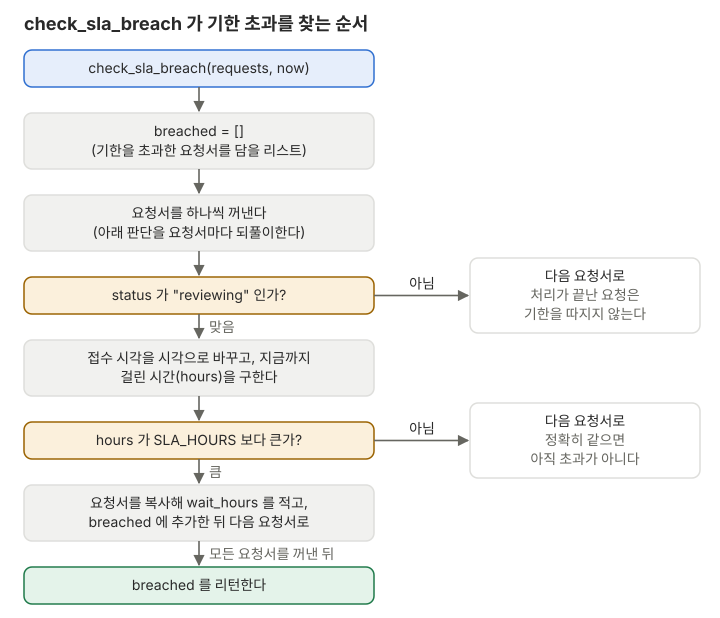

# 응용 2-2 · 처리 기한 넘긴 요청 찾기(SLA)

## 목표: 기한 초과 점검 함수

> **여유가 되면 해 보세요.** 핵심 실습 2-1 · 2-2와 글쓰기를 먼저 마칩니다. 이 응용을 하지 않아도 다음 Unit을 따라가는 데 문제가 없습니다.

> **오늘 들어온 일**
>
> A사 관제 담당(요청이 정해진 시간 안에 처리되는지 지켜보는 사람)이 보낸 메시지: 「요청서를 접수해 놓고 승인자가 처리를 미루는 일이 있습니다. 그러면 권한이 필요한 직원은 일을 못 하고 메신저로 계속 재촉합니다. 리스트를 눈으로 훑어서는 오래된 요청을 놓치기 쉽습니다. 접수한 지 4시간이 지났는데도 아직 검토 중인 요청서를 찾아서 알려 주세요.」
> - 이 실습에서 하는 일: 접수한 지 정해진 시간(SLA, 오늘은 4시간)이 지났는데도 아직 검토 중인 요청서를 찾는 함수 `check_sla_breach` 를 직접 씁니다. 요청서 여섯 장 가운데 어느 것이 몇 시간 지났는지 읽습니다.
> - 끝나면 쓰는 것: 문제 해결 기록 (가)~(다) 답

## 왜 처리 기한을 점검하는가

1. 요청은 접수한 뒤에 승인자가 봐 주어야 진행됩니다. 오래 방치되면 요청자의 일이 막힙니다. 그사이에 요청자가 퇴사하거나 역할이 바뀌면, 승인할 때의 판단도 달라집니다.
2. **SLA**(service level agreement · 서비스 레벨 어그리먼트)는 「이 일은 이 시간 안에 처리한다」는 처리 기한의 약속입니다. 택배가 「주문하고 이틀 안에 도착」을 약속하는 것과 같습니다. 오늘은 검토 중인 요청서를 접수 후 4시간 안에 처리하는 것으로 정합니다.
3. 기한을 초과한 요청서를 코드로 찾아 두면, 사람이 리스트를 눈으로 훑지 않아도 매일 아침 알림을 보낼 수 있습니다.

## 1.1 기한이 지났는지 가리는 방법

- **어떤 요청서를 보나**: 아직 처리 중인 요청서, 즉 상태가 `reviewing`(검토 중)인 것만 봅니다. 이미 승인되거나 반려된 요청서는 처리가 끝났으므로 기한을 따지지 않습니다.
- **얼마나 지났나**: `지금 시각 − 접수 시각` 으로 구합니다. 이 값을 시간(hour) 단위 숫자로 바꿔서 SLA 시간(`SLA_HOURS`, 오늘은 4)과 비교합니다.
- **SLA 시간은 어디에 두나**: 코드에 4를 직접 쓰지 않고 `config/sla.json` 파일에 적어 두고 읽습니다. 그러면 기한을 4시간에서 2시간으로 바꿀 때 코드는 그대로 두고 파일만 고치면 됩니다.
- **파일은 어떻게 읽나**: `config_loader.py` 의 `load_json` 으로 읽습니다. 파일이 없거나 깨졌을 때는 기본값 4를 씁니다. `load_json(…)["hours"]` 는 읽어 온 딕셔너리에서 `"hours"` 키의 값을 바로 꺼내는 모양입니다.
- **기한이 지난 요청은 어떻게 하나**: 현업에서는 승인자의 윗사람이나 대리 승인자(승인자가 자리에 없을 때 대신 승인하는 사람)에게 넘깁니다. 이것을 **에스컬레이션**(escalation · 에스컬레이션)이라고 합니다. 가게 직원이 해결하지 못한 일을 점장에게 넘기는 것과 같습니다. 오늘은 넘기는 일은 만들지 않고, 기한이 지난 요청을 찾는 데까지만 합니다.
- **`now` 이름**: 함수가 받는 `now` 는 **지금 시각**(datetime)입니다. `policy.py` 의 `evaluate_access` 가 받는 `now` 와 같은 뜻입니다.

<figure class="page-figure"></figure>

**문법 상자 — 걸린 시간을 시간 단위 숫자로 바꾸기**

- `datetime.strptime(문자열, 형식)` 은 시각 문자열을 계산할 수 있는 시각으로 바꿉니다. `exception_policy.py` 에서 쓴 것과 같습니다.
- 형식 문자열 `"%Y-%m-%d %H:%M"` 은 「연-월-일 시:분」 모양이라는 뜻입니다. `exception_policy.py` 의 `TIME_FORMAT` 에 이미 적혀 있어서 오늘은 그것을 불러다 씁니다. 아래 상자에서는 그 모양을 그대로 볼 수 있습니다.

**① 시각에서 시각을 빼면 「걸린 시간」이 나옵니다**

```python
from datetime import datetime                                       # 시각을 다루는 모듈에서 datetime 을 불러온다

requested = datetime.strptime("2026-10-23 09:15", "%Y-%m-%d %H:%M")   # 접수 시각
now = datetime.strptime("2026-10-23 14:00", "%Y-%m-%d %H:%M")         # 지금 시각
gap = now - requested                                               # 시각에서 시각을 빼면 「걸린 시간」이 나온다
print(gap)                                                          # 시:분:초 모양이라 숫자처럼 비교할 수 없다
```

실행 결과:

```
4:45:00
```

- 걸린 시간은 `4:45:00` 처럼 「시:분:초」 모양입니다. 숫자가 아니라서 `SLA_HOURS`(4)와 `>` 로 비교할 수 없습니다.

**② `.total_seconds()` 로 걸린 시간을 초 단위 숫자로 바꿉니다**

```python
from datetime import datetime                                       # 시각을 다루는 모듈에서 datetime 을 불러온다

requested = datetime.strptime("2026-10-23 09:15", "%Y-%m-%d %H:%M")   # 접수 시각
now = datetime.strptime("2026-10-23 14:00", "%Y-%m-%d %H:%M")         # 지금 시각
gap = now - requested                                               # 시각에서 시각을 빼면 「걸린 시간」이 나온다
seconds = gap.total_seconds()                                    # 시간 차이를 초 단위 숫자로 바꾼다
print(seconds)                                                   # 걸린 시간을 전부 초로 센 숫자다(4시간 45분 = 17100초)
```

실행 결과:

```
17100.0
```

- `.total_seconds()` 는 걸린 시간을 전부 초로 세어 숫자로 줍니다. 4시간 45분은 4 × 3600 + 45 × 60 = 17100초입니다.
- 실제 코드에서는 `gap` 없이 한 줄로 `(now - requested).total_seconds()` 처럼 씁니다. 뺄셈을 괄호로 묶은 뒤에 `.total_seconds()` 를 붙이는 것입니다. 괄호 없이 `now - requested.total_seconds()` 로 쓰면 `requested` 에 먼저 `.total_seconds()` 가 붙어 오류가 납니다.

**③ 3600 으로 나눠 시간 단위 숫자로 만듭니다**

```python
from datetime import datetime                                       # 시각을 다루는 모듈에서 datetime 을 불러온다

requested = datetime.strptime("2026-10-23 09:15", "%Y-%m-%d %H:%M")   # 접수 시각
now = datetime.strptime("2026-10-23 14:00", "%Y-%m-%d %H:%M")         # 지금 시각
gap = now - requested                                               # 시각에서 시각을 빼면 「걸린 시간」이 나온다
seconds = gap.total_seconds()                                    # 시간 차이를 초 단위 숫자로 바꾼다
hours = seconds / 3600                                           # 3600 으로 나눠 시간 단위로 바꾼다
print(hours)                                                     # 1시간은 3600초라서, 나누면 시간 단위 숫자가 된다
```

실행 결과:

```
4.75
```

- 1시간은 3600초이므로 초 숫자를 3600 으로 나누면 시간 단위 숫자(4.75)가 됩니다. 이제 `SLA_HOURS` 와 비교할 수 있습니다.
- 3600 으로 나누는 것을 빼먹으면 숫자가 초 단위(17100.0)라서 항상 4보다 커집니다.
- 걸린 시간이 SLA 시간보다 「큰」 것만 초과로 셉니다. 정확히 4시간이면 초과가 아닙니다(`4.0 > 4` 는 거짓).

**④ `.copy()` 로 복사하면 원래 요청서는 그대로 두고, `round(숫자, 1)` 은 소수 첫째 자리로 반올림합니다**

```python
request = {"id": 1, "status": "reviewing"}                          # 요청서 한 장

overdue = request.copy()                                            # .copy() 는 딕셔너리를 복사한 새 딕셔너리를 만든다
overdue["wait_hours"] = round(4.26, 1)                              # 복사본에만 키를 추가한다. round(숫자, 1) 은 소수 첫째 자리까지 반올림한다

print(request)                                                      # 원래 요청서는 그대로다
print(overdue)                                                      # 복사본에만 wait_hours 키가 생겼다
```

실행 결과:

```
{'id': 1, 'status': 'reviewing'}
{'id': 1, 'status': 'reviewing', 'wait_hours': 4.3}
```

- 복사본에 적는 이유: 원래 요청서에 `wait_hours` 를 바로 적으면 `REQUESTS` 안의 요청서까지 바뀝니다. 점검 결과는 복사본에만 적고 요청서 기록은 그대로 둡니다. 원본 시험지는 두고 복사본에 채점 메모를 하는 것과 같습니다.
- 더 알고 싶으면 AI 에게 「파이썬에서 딕셔너리를 `.copy()` 하지 않고 다른 변수에 넣으면 왜 원본도 바뀌는지 중학생에게 설명하듯 알려 줘」라고 물어보세요.


## 응용 2-2 · 처리 기한 초과 요청 찾기

**이런 상황이 있습니다**

- **지금은**: 요청서를 접수해 놓고 승인자가 오래 확인하지 않으면 요청자의 일이 막힙니다. 지금은 사람이 리스트를 눈으로 훑어서 오래된 요청을 찾기 때문에 놓치기 쉽습니다.
- **그래서 만드는 것**: `check_sla_breach` 입니다. 요청서 리스트와 지금 시각을 받아, **검토 중이고 접수한 지 SLA 시간(4시간)을 초과한** 요청서만 골라 리스트로 리턴합니다. SLA 시간은 코드에 쓰지 않고 `config/sla.json` 에서 읽습니다.
- **오늘 데이터**: 요청서 여섯 장이고, 지금 시각은 14:00 으로 고정합니다. 그중 한 장은 이미 승인되어 있습니다.
- **실행하면**: 단계 1은 요청서 현황(번호 · 요청자 · 상태 · 접수 시각), 단계 2는 SLA 를 초과한 요청서와 접수한 뒤 지난 시간이 나옵니다.
- **현업에서는**: 신청 처리 도구도 접수 후 정해진 시간이 지난 신청에 알림을 보내거나 윗사람에게 넘깁니다(에스컬레이션).

**할 일**

1. `req_sla.py` · `config/sla.json` · `apply2-2_run.py` 세 파일을 만들고, `check_sla_breach` 본문을 직접 씁니다.
2. 실행해서 <mark>요청서 현황</mark>(단계 1: 현황)과 <mark>기한을 초과한 요청</mark>(단계 2: 판정)을 읽습니다.

**`config/sla.json`** — 그대로 붙여 넣습니다. 처리 기한(시간)을 적은 설정 파일이고, `access_control` 안의 `config` 폴더(`users.json` 이 있는 곳)에 만듭니다.

<pre class="copyable"><code>{"hours": 4}
</code></pre>

**`req_sla.py`**

```python
from datetime import datetime                                    # 문자열을 시각으로 바꾸는 데 쓴다
from config_loader import load_json                              # config_loader.py 의 안전한 읽기 함수를 불러온다
from exception_policy import TIME_FORMAT                         # 시각 문자열의 형식("%Y-%m-%d %H:%M")을 불러온다

SLA_HOURS = load_json("config/sla.json", {"hours": 4})["hours"]  # 처리 기한(시간). 파일이 없거나 깨졌으면 기본값 4


def check_sla_breach(requests, now):                             # 요청서 리스트와 지금 시각(datetime)을 받는 함수
    """처리 기한(SLA_HOURS)을 넘긴 검토 중 요청서 리스트를 리턴한다.
    오래 방치된 요청을 담당자에게 알릴 때 쓴다.
    """
    # ← 아래를 직접 씁니다 (주석은 두고 각 주석 바로 아래 줄에 씁니다)
    # 1. 기한을 초과한 요청서를 담을 빈 리스트 breached 를 만든다
    # 2. requests 에서 request 를 하나씩 꺼낸다
    # 3.   request["status"] 가 "reviewing" 이면(검토 중인 것만 본다)
    # 4.     request["requested_at"] 을 TIME_FORMAT 으로 시각으로 바꿔 requested 에 담는다
    # 5.     (now - requested) 를 .total_seconds() 로 초 단위 숫자로 바꾸고 3600 으로 나눠 hours 에 담는다
    # 6.     hours 가 SLA_HOURS 보다 크면(같으면 아직 아니다)
    # 7.       request.copy() 로 요청서를 복사해 overdue 에 담는다
    # 8.       overdue["wait_hours"] 를 round(hours, 1) 로 정한다 (지난 시간을 소수 첫째 자리까지 반올림)
    # 9.       breached 에 overdue 를 추가한다
    # 10. 반복이 끝나면 breached 를 리턴한다
```

- **영어 이름의 뜻**: `breach`(브리치)는 약속이나 기준을 「어기다」라는 뜻이고, `breached` 는 「어긴」입니다. 그래서 `check_sla_breach` 는 「SLA 를 어겼는지(기한을 초과했는지) 확인」, `breached` 는 「기한을 어긴 요청서를 담는 리스트」입니다.
- 코드는 각 주석 바로 아래 줄에 씁니다. 주석 안에서 들여쓴 모양은 코드의 깊이를 보여 줍니다. 칸 수는 아래와 같습니다.

| 줄 | 칸 수 |
|---|---|
| `breached = []` · `for` | 4칸 |
| `for` 아래의 `if request["status"] …` | 8칸 |
| 그 `if` 안의 두 줄(`requested` · `hours`)과 `if hours > …` | 12칸 |
| 그 `if` 안의 세 줄(`overdue` · `wait_hours` · `breached.append`) | 16칸 |
| 마지막 `return` | 4칸 |

- `SLA_HOURS` 와 `TIME_FORMAT` 은 파일 위쪽에 이미 있습니다. 새로 만들지 않고 그대로 씁니다.
- 채우기 전에 실행하면 단계 1은 정상으로 나오고, 단계 2에서 `TypeError: 'NoneType' object is not iterable` 오류가 납니다. 함수가 아무것도 리턴하지 않아 `for` 가 돌 리스트가 없기 때문입니다.

**`apply2-2_run.py`** — 그대로 붙여 넣습니다. 학생이 쓰는 줄은 없습니다. 요청 여섯 건을 접수하고 4번을 승인한 뒤, 단계 1은 요청서 현황을 출력하고 단계 2는 `check_sla_breach` 로 기한을 초과한 요청서를 출력합니다.

```python
from datetime import datetime                                    # 지금 시각을 만드는 데 쓴다
from req_create import REQUESTS, create_request                  # 실습 2-1에서 만든 요청서 함수와 리스트를 불러온다
from req_review import approve_request                           # 실습 2-2에서 만든 승인 함수를 불러온다
from req_sla import SLA_HOURS, check_sla_breach                  # 방금 만든 기한 점검 함수와 SLA 시간을 불러온다

NOW = datetime.strptime("2026-10-23 14:00", "%Y-%m-%d %H:%M")    # 이번 실습의 지금 시각(고정)

INBOX = [                                                        # 오늘 들어온 요청 여섯 건. (요청자, 자원, 행위, 희망 만료 시각, 이유, 접수 시각)
    ("seoyeon", "SETTLE", "QUERY", "2026-10-27 18:00", "정산 대조 지원", "2026-10-23 08:30"),    # 08:30 에 접수한 요청
    ("gaeun", "SALES", "QUERY", "2026-10-28 18:00", "감사 자료 대응", "2026-10-23 10:30"),       # 10:30 에 접수한 요청
    ("dami", "SALES", "QUERY", "2026-10-27 18:00", "인수인계 자료 확인", "2026-10-23 12:00"),    # 낮에 접수한 요청
    ("junho", "SETTLE", "QUERY", "2026-10-27 18:00", "정산 확인", "2026-10-23 09:00"),           # 나중에 승인해서 처리가 끝나게 될 요청
    ("seoyeon", "ACCOUNT", "QUERY", "2026-10-27 18:00", "계정 권한 점검", "2026-10-23 07:50"),   # 07:50 에 접수한 요청
    ("tester", "SALES", "QUERY", "2026-10-27 18:00", "시험 계정 확인", "2026-10-23 10:00"),      # 10:00 정각에 접수한 요청
]
for user, resource, action, until, reason, received_at in INBOX:         # 요청을 하나씩 꺼내
    create_request(user, resource, action, until, reason, received_at)   # 접수한다
approve_request(REQUESTS[3], "security_manager")                 # 4번(junho)은 이미 승인해 처리가 끝난 요청으로 만든다

print("--- 단계 1: 현황 - SLA 시간", SLA_HOURS, "시간, 지금 14:00")   # 단계 1 시작을 알리는 줄
for request in REQUESTS:                                         # 요청서를 하나씩 꺼낸다
    print(request["id"], request["user"], request["status"], request["requested_at"])   # 번호 · 요청자 · 상태 · 접수 시각을 출력한다

print("--- 단계 2: 판정 - SLA 를 초과한 요청")                       # 단계 2 시작을 알리는 줄
for request in check_sla_breach(REQUESTS, NOW):                  # 기한을 초과한 요청서를 하나씩 꺼낸다
    print(request["id"], request["user"], "접수", request["requested_at"], "->", request["wait_hours"], "시간 지남")   # 번호 · 요청자 · 접수 시각 · 지난 시간을 출력한다
```

**순서**

1. **[VS Code]** 파일을 만들고 각각 붙여 넣습니다. 파일마다 아래 세 가지를 반복합니다(시작하기 4번과 같은 방법입니다).
   1. VS Code 왼쪽 목록에서 `access_control` 폴더를 오른쪽 클릭 › **New File** 을 누릅니다(다른 폴더를 누르면 그 폴더에 만들어집니다).
   2. 이름 칸에 파일 이름을 입력하고 Enter 를 누릅니다. 이름은 차례로 `req_sla.py` · `config/sla.json` · `apply2-2_run.py` 입니다.
   3. 열린 파일에 위 코드 상자의 내용을 복사해 붙여 넣고 저장합니다.
2. **[터미널]** 파일을 만든 뒤 `ls config` 를 쳐서 `sla.json` 이 `users.json` 과 같은 `config` 폴더 안에 있는지 확인합니다.
   - `config` 안에 또 `config` 가 생겼다면 위치가 틀린 것이니 옮깁니다.
   - `sla.json` 을 비워 두면 실행할 때 `[경고] 설정 파일 깨짐: config/sla.json` 이 나옵니다. 그래도 기본값 4로 돌아가 실행은 되니, 이 경고가 보이면 붙여 넣은 내용을 확인합니다.

<!-- checklist optional -->
- [ ] `access_control` 폴더에 `req_sla.py` 와 `apply2-2_run.py` 를 만들어 붙여 넣고 저장했다
- [ ] `access_control/config` 폴더에 `sla.json` 을 만들어 `{"hours": 4}` 를 붙여 넣고 저장했다
<!-- /checklist -->

3. **[VS Code]** `req_sla.py` 의 `check_sla_breach` 본문을 직접 씁니다. 1.1 의 그림과 문법 상자를 보고 씁니다.

<!-- checklist optional -->
- [ ] `req_sla.py` 의 `check_sla_breach` 본문을 직접 썼다
<!-- /checklist -->

4. **[터미널]** 위치가 `…/access_control` 인지 확인하고 실행합니다. `pwd` 가 `…/network-study-notes` 로 끝나면 `cd access_control` 을 먼저 칩니다.
   ```bash
   pwd
   python apply2-2_run.py
   ```
   - 명령 풀이: `pwd` 지금 위치 확인 · `python` 파이썬으로 파일을 실행 · `apply2-2_run.py` 실행할 파일
5. 출력은 두 단계입니다. 단계 1은 요청서 현황(여섯 줄)이고, 단계 2는 기한을 초과한 요청서와 지난 시간입니다.

<!-- checklist optional -->
- [ ] `python apply2-2_run.py` 를 실행해 요청서 현황 여섯 줄과 기한 초과 요청이 나왔다
<!-- /checklist -->

6. **[문제 해결 기록]** `access_control/report_u2.md` 의 `## 응용 2-2` 아래를 채웁니다(문제 해결 기록 파일은 「문제 해결 기록 쓰기」 레슨에서 만듭니다).
   - (가) 실행한 출력 전체를 붙여 넣고, 접수한 뒤 4시간을 초과한 요청이 몇 번인지, 접수한 뒤 몇 시간이 지났는지 적어 주세요.
   - (나) 승인자(`security_manager`)가 4시간을 초과하도록 처리하지 않은 요청을 찾았다면, 관제 담당은 누구에게 어떤 조치를 하면 좋을까요? 알림만 보낼 때와 윗사람에게 넘길 때(에스컬레이션)는 어떤 기준(예: 얼마나 더 지났을 때)으로 나누면 좋을까요?
   - (다) 상태(`reviewing` 인지)는 확인하지 않고 접수 시각만 보고 기한을 따진다면, 리스트에 어떤 문제가 생기나요? 그 리스트를 받은 사람은 무엇이 곤란할까요?

<!-- checklist optional -->
- [ ] `report_u2.md` 의 `## 응용 2-2` 칸을 채웠다
<!-- /checklist -->

## 응용 2-2 정리

| 하려는 일 | 코드 · 말 |
|---|---|
| 처리 기한 읽기 | `load_json("config/sla.json", {"hours": 4})["hours"]` |
| 검토 중인 것만 보기 | `if request["status"] == "reviewing":` |
| 접수 시각을 시각으로 | `datetime.strptime(request["requested_at"], TIME_FORMAT)` |
| 걸린 시간(시간 단위) | `(now - requested).total_seconds() / 3600` |
| 기한을 초과했는지 | `hours > SLA_HOURS` (정확히 같으면 아직 아님) |
| 요청서 복사하기 | `overdue = request.copy()` |
| 복사본에 지난 시간 적기 | `overdue["wait_hours"] = round(hours, 1)` |

---
