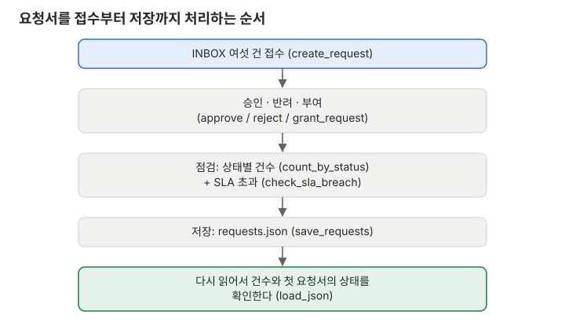

# 응용 2-3 · 요청 이력 저장과 상태별 건수

## 목표: 저장 함수와 건수 세기

> **여유가 되면 해 보세요.** 핵심 실습 2-1 · 2-2와 글쓰기를 먼저 마칩니다. 이 응용은 응용 2-2의 `req_sla.py` · `config/sla.json` 을 불러 쓰므로 응용 2-2를 먼저 합니다. 이 응용을 하지 않아도 다음 Unit을 따라가는 데 문제가 없습니다.

> **오늘 들어온 일**
>
> A사 관제 담당이 보낸 메시지: 「지금까지 만든 요청서는 프로그램을 끄면 사라집니다. 접수 · 승인 · 반려 · 부여를 한 번 돌리고 나면 요청서 전체를 파일로 남겨 주세요. 그리고 상태별로 몇 건인지 숫자로 보고 싶은데, 손으로 세면 시간이 걸리고 틀리기 쉽습니다.」
> - 이 실습에서 하는 일: 요청서 리스트를 `requests.json` 으로 저장하는 함수 `save_requests` 와 상태별 건수를 세는 함수 `count_by_status` 를 직접 씁니다. 실습 2-1 · 2-2, 「권한 부여 준비」 `req_grant.py`, 응용 2-2에서 만든 함수를 모두 이어서 한 번 돌려 봅니다.
> - 끝나면: 어떤 문제가 있었고 어떻게 확인했는지 생각해 봅니다.

## 왜 요청 이력을 파일로 남기는가

1. 요청서는 프로그램이 켜져 있는 동안에만 남아 있고, 프로그램이 끝나면 사라집니다. 파일로 저장해야 다음 날에도 요청서를 볼 수 있습니다. 여기서 **이력**은 요청이 어떻게 처리됐는지 남은 기록입니다.
2. 상태별 건수는 매일 아침 한눈에 보는 숫자입니다.

## 2.1 JSON 파일로 저장하기

- JSON(제이슨)은 `users.json` 처럼 딕셔너리 · 리스트 모양을 그대로 글자로 적어 두는 파일 형식입니다. 지금까지는 JSON 파일을 **읽기**만 했습니다. 이번에는 파일에 **쓰기**를 합니다.

| 파일 열기 | 뜻 |
|---|---|
| `open(path, encoding="utf-8")` | 읽기 모드. 파일이 있어야 하고, 내용을 읽기만 한다 |
| `open(path, "w", encoding="utf-8")` | 쓰기 모드. 파일이 없으면 만들고, **있으면 내용을 지우고 새로 쓴다** |

- `json.dump(데이터, 파일, ensure_ascii=False, indent=2)` 는 데이터를 JSON 문자열로 바꿔 파일에 씁니다.

| 넣는 값 | 뜻 |
|---|---|
| `ensure_ascii=False` | 한글을 그대로 쓴다 |
| `indent=2` | 사람이 읽기 쉽게 줄을 나누고 2칸씩 들여 쓴다 |

<figure class="page-figure"></figure>

<h2>문법 상자 — 파일에 JSON 쓰기</h2>

아래 코드는 읽기만 합니다. 따라 치지 않습니다.

<h2>① <code>&quot;w&quot;</code> 로 열고 <code>json.dump</code> 로 쓰기</h2>

```python
import json                                                         # JSON 을 다루는 모듈을 불러온다

data = [{"id": 1, "reason": "정산 확인"}]                             # 저장할 리스트
with open("demo.json", "w", encoding="utf-8") as demo_file:                 # 파일을 쓰기 모드("w")로 연다
    json.dump(data, demo_file, ensure_ascii=False, indent=2)                # 리스트를 파일에 JSON 으로 쓴다
file = open("demo.json", encoding="utf-8")                       # 파일을 연다
text = file.read()                                               # 내용을 문자열로 읽는다
print(text)                                                      # 쓴 파일을 다시 열어 내용을 출력한다
```

실행 결과:

```
[
  {
    "id": 1,
    "reason": "정산 확인"
  }
]
```

<h2>② <code>ensure_ascii=False</code> 를 빼면 한글이 <code>\uXXXX</code> 문자열로 바뀌어 사람이 읽을 수 없습니다</h2>

```python
import json                                                         # JSON 을 다루는 모듈을 불러온다

data = [{"id": 1, "reason": "정산 확인"}]                             # 저장할 리스트
with open("demo.json", "w", encoding="utf-8") as demo_file:                 # 파일을 쓰기 모드("w")로 연다
    # ensure_ascii=False 를 빼고 쓴다
    json.dump(data, demo_file, indent=2)
file = open("demo.json", encoding="utf-8")                       # 파일을 연다
text = file.read()                                               # 내용을 문자열로 읽는다
print(text)                                                      # 쓴 파일을 다시 열어 내용을 출력한다
```

실행 결과:

```
[
  {
    "id": 1,
    "reason": "\uc815\uc0b0 \ud655\uc778"
  }
]
```

- `as demo_file` 은 열린 파일을 `demo_file` 이라는 이름으로 부르겠다는 뜻이고, 파일은 `with` 아래에 들여쓴 줄 안에서만 열려 있습니다.
- `open(…).read()` 는 파일을 열어 내용 전체를 문자열로 읽습니다. 위 코드는 방금 쓴 파일을 확인하려고 한 번 더 읽어 출력한 것입니다.
- 세는 모양 `old_count = counts.get(키, 0)` → `counts[키] = old_count + 1` 은 Unit 1 실습 1-3의 `exercise1-3_run.py` 에서 본 것과 같습니다. `counts.get(키, 0)` 은 그 키가 있으면 값을, 없으면 0 을 꺼냅니다. 예: `"reviewing"` 을 처음 만나면 0 + 1 = 1 을 적고, 두 번째 만나면 1 + 1 = 2 를 적습니다.

## 응용 2-3 · 요청서 저장하고 상태별 건수 세기

<h2>이런 상황이 있습니다</h2>

- **지금은**: 접수 · 승인 · 부여 · 기한 점검 결과가 프로그램이 켜져 있는 동안에만 남아 있어서, 프로그램을 끄면 모두 사라집니다. 관제 담당은 상태별로 몇 건인지도 숫자로 보고 싶어 하는데, 손으로 세면 틀리기 쉽습니다.
- **그래서 만드는 것**: `save_requests`(요청서 전체를 `requests.json` 파일에 저장하고 저장한 건수를 리턴)와 `count_by_status`(상태별 건수를 딕셔너리로 리턴)입니다.
- **실행하면**: 세 단계가 나옵니다. 단계 1은 요청 여섯 건의 처리 결과, 단계 2는 상태별 건수와 SLA 초과 요청 번호, 단계 3은 저장 결과입니다. 끝나면 `requests.json` 을 열어 한글이 그대로 저장됐는지 봅니다.
- **현업에서는**: 신청 도구도 신청 기록을 지우지 않고 보관하고, 상태별 건수를 날마다 세어 보냅니다.

<h2>할 일</h2>

1. `request_flow.py` 와 `apply2-3_run.py` 두 파일을 만들고, `save_requests` 와 `count_by_status` 본문을 직접 씁니다.
2. 실행해서 <mark>처리 결과</mark>(단계 1: 처리), <mark>상태별 건수와 SLA 초과</mark>(단계 2: 점검), <mark>저장 결과</mark>(단계 3: 저장)를 읽습니다. `requests.json` 파일도 열어 봅니다.

<h3><code>request_flow.py</code></h3>

```python exercise
import json                                                      # JSON 파일을 쓰는 모듈을 불러온다


def save_requests(requests, path):                               # 요청서 리스트와 저장할 파일 경로를 받는 함수
    """요청서 리스트를 JSON 파일로 저장한다(한글은 그대로).
    요청 처리 상태를 다음에도 이어 보려고 남길 때 쓴다.
    """
    # ← 아래를 직접 씁니다 (주석은 두고 각 주석 바로 아래 줄에 씁니다)
    # 1. path 를 쓰기 모드("w")로, encoding="utf-8" 로 열어 f 로 받는다
#|     with open(path, "w", encoding="utf-8") as output_file:
    # 2.   json.dump 로 requests 를 f 에 쓴다. ensure_ascii=False 와 indent=2 를 함께 쓴다
#|         json.dump(requests, output_file, ensure_ascii=False, indent=2)
    # 3. 저장한 요청서 건수 len(requests) 를 리턴한다 (with 블록 밖, 함수 안쪽 줄에 맞춘다)
#|     return len(requests)


def count_by_status(requests):                                   # 요청서 리스트를 받는 함수
    """상태별 요청서 개수를 센다.
    검토 중 · 승인 · 부여가 각각 몇 개인지 현황을 볼 때 쓴다.
    """
    # ← 아래를 직접 씁니다 (주석은 두고 각 주석 바로 아래 줄에 씁니다)
    # 1. 빈 딕셔너리 counts 를 만든다
#|     counts = {}
    # 2. requests 에서 request 를 하나씩 꺼낸다
#|     for request in requests:
    # 3.   request["status"] 를 status 에 담는다
#|         status = request["status"]
    # 4.   counts.get(status, 0) 을 old_count 에 담는다 (없으면 0)
#|         old_count = counts.get(status, 0)
    # 5.   counts[status] 를 old_count + 1 로 정한다
#|         counts[status] = old_count + 1
    # 6. 반복이 끝나면 counts 를 리턴한다
#|     return counts
```

- 본문은 모두 함수 안이라 4칸으로 쓰고, `with` 와 `for` 안쪽은 4칸 더(8칸) 들어갑니다. 각 주석 바로 아래 줄에 씁니다. `save_requests` 의 `return len(requests)` 는 `with` 와 같은 4칸입니다.
- `save_requests` 1번의 「f 로 받는다」는 문법 상자의 `as demo_file` 처럼 `as` 뒤에 열린 파일의 이름을 붙이라는 뜻입니다. 이름은 `f` 가 아니어도 되고, 정답은 `output_file` 을 씁니다.
- 채우기 전에 처음 실행하면(`requests.json` 이 아직 없을 때) 이렇게 나옵니다.

| 어디서 | 나오는 것 | 이유 |
|---|---|---|
| 단계 2 첫 줄 | `None` | `count_by_status` 가 아무것도 리턴하지 않음 |
| 단계 3 | `저장 함수가 리턴한 건수: None` | `save_requests` 가 파일을 만들지 않음 |
| 단계 3 (이어서) | `[경고] 설정 파일 없음: requests.json` 뒤에 `IndexError` | `save_requests` 가 파일을 만들지 않음 |

<h3><code>apply2-3_run.py</code></h3>

그대로 붙여 넣습니다. 학생이 쓰는 줄은 없습니다. 요청 여섯 건을 접수하고 처리한 뒤, 단계 1은 승인 · 반려 · 부여 결과를 출력하고, 단계 2는 상태별 건수와 SLA 초과 요청을 출력합니다. 단계 3은 `requests.json` 으로 저장한 뒤 다시 읽어 확인합니다.

```python
from datetime import datetime                                    # 지금 시각을 만드는 데 쓴다
# config_loader.py 의 안전한 읽기 함수를 불러온다
from config_loader import load_json
from req_create import REQUESTS, create_request                  # 실습 2-1에서 만든 요청서 함수와 리스트를 불러온다
from req_review import approve_request, reject_request           # 실습 2-2에서 만든 승인 · 반려 함수를 불러온다
from req_grant import grant_request                              # 권한 부여 준비(또는 응용 2-1)의 부여 함수를 불러온다
from req_sla import check_sla_breach                             # 응용 2-2에서 만든 기한 점검 함수를 불러온다
from request_flow import save_requests, count_by_status          # 방금 만든 저장 · 집계 함수를 불러온다

NOW = datetime.strptime("2026-10-23 14:00", "%Y-%m-%d %H:%M")    # 이번 실습의 지금 시각(고정)

# 오늘 들어온 요청 여섯 건. (요청자, 자원, 행위, 희망 만료 시각, 이유, 접수 시각)
INBOX = [
    ("seoyeon", "SETTLE", "QUERY", "2026-10-27 18:00", "정산 대조 지원", "2026-10-23 08:30"),
    ("gaeun", "SALES", "QUERY", "2026-10-28 18:00", "감사 자료 대응", "2026-10-23 10:30"),
    ("dami", "SALES", "QUERY", "2026-10-27 18:00", "인수인계 자료 확인", "2026-10-23 12:00"),
    ("junho", "SETTLE", "QUERY", "2026-10-27 18:00", "정산 확인", "2026-10-23 09:00"),
    ("seoyeon", "ACCOUNT", "QUERY", "2026-10-27 18:00", "계정 권한 점검", "2026-10-23 07:50"),
    ("tester", "SALES", "QUERY", "2026-10-27 18:00", "시험 계정 확인", "2026-10-23 10:00"),
]
for user, resource, action, until, reason, received_at in INBOX:         # 요청을 하나씩 꺼내
    create_request(user, resource, action, until, reason, received_at)   # 접수한다

print("--- 단계 1: 처리 - 승인 · 반려 · 부여")                      # 단계 1 시작을 알리는 줄
approve_request(REQUESTS[0], "security_manager")                 # 1번 승인
reject_request(REQUESTS[1], "security_manager")                  # 2번 반려
approve_request(REQUESTS[2], "security_manager")                 # 3번 승인
approve_request(REQUESTS[3], "security_manager")                 # 4번 승인
for request in REQUESTS:                                         # 요청서를 하나씩 꺼내
    is_success, result = grant_request(request)                          # 부여를 시도한다(승인된 것만 의미가 있다)
    # 번호 · 요청자 · 상태 -> 결과 를 출력한다
    print(request["id"], request["user"], request["status"], "->", result)

print("--- 단계 2: 점검 - 상태별 건수와 SLA")                      # 단계 2 시작을 알리는 줄
print(count_by_status(REQUESTS))                                 # 상태별 건수를 출력한다
for request in check_sla_breach(REQUESTS, NOW):                  # 기한을 초과한 요청서를 하나씩 꺼낸다
    print("SLA 초과 요청 번호:", request["id"])                    # 요청 번호를 출력한다

print("--- 단계 3: 저장 - requests.json")                        # 단계 3 시작을 알리는 줄
count = save_requests(REQUESTS, "requests.json")                 # 요청서 리스트 전체를 파일로 저장하고 저장한 건수를 받는다
print("저장 함수가 리턴한 건수:", count)                            # 리턴한 건수를 출력한다
saved = load_json("requests.json", [])                           # 저장한 파일을 다시 읽어
print("저장한 요청서", len(saved), "건, 첫 요청서의 상태:", saved[0]["status"])   # 건수와 첫 요청서의 상태를 출력한다
```

<h2>순서</h2>

0. **[터미널]** 불러 쓸 파일이 있는지 먼저 확인합니다. `pwd` 가 `…/access_control` 로 끝나는지 보고(`…/network-study-notes` 면 `cd access_control`), 아래를 칩니다. 마지막 줄에 `앞 파일 정상` 이 나와야 합니다.
   ```bash
   # 이 명령은 전체를 복사해 Git Bash에 붙여 넣어 실행하세요.
   python -c "
   from req_grant import grant_request
   from req_sla import check_sla_breach
   print('앞 파일 정상')
   "
   ```

   | 이렇게 나오면 | 할 일 |
   |---|---|
   | `No module named 'req_grant'` | 「권한 부여 준비」 레슨으로 `req_grant.py` 를 만듭니다 |
   | `No module named 'req_sla'` | 응용 2-2를 먼저 해서 `req_sla.py` 와 `config/sla.json` 을 만듭니다 |

1. **[VS Code]** 파일을 만들고 각각 붙여 넣습니다. 파일마다 아래 세 가지를 반복합니다(시작하기 4번과 같은 방법입니다).
   1. VS Code 왼쪽 목록에서 `access_control` 폴더를 오른쪽 클릭 › **New File** 을 누릅니다(다른 폴더를 누르면 그 폴더에 만들어집니다).
   2. 이름 칸에 파일 이름을 입력하고 Enter 를 누릅니다. 이름은 차례로 `request_flow.py` · `apply2-3_run.py` 입니다.
   3. 열린 파일에 위 코드 상자의 내용을 복사해 붙여 넣고 저장합니다.

<!-- checklist optional -->
- [ ] `access_control` 폴더에 `request_flow.py` 와 `apply2-3_run.py` 를 만들어 붙여 넣고 저장했다
<!-- /checklist -->

2. **[VS Code]** `request_flow.py` 의 두 함수 본문을 직접 씁니다. 2.1 의 표와 문법 상자를 보고 씁니다.

<!-- checklist optional -->
- [ ] `request_flow.py` 의 `save_requests` 와 `count_by_status` 본문을 직접 썼다
<!-- /checklist -->

3. **[터미널]** 위치가 `…/access_control` 인지 확인하고 실행합니다. `pwd` 가 `…/network-study-notes` 로 끝나면 `cd access_control` 을 먼저 칩니다.
   ```bash
   pwd
   python apply2-3_run.py
   ```
   - 명령 풀이: `pwd` 지금 위치 확인 · `python` 파이썬으로 파일을 실행 · `apply2-3_run.py` 실행할 파일
4. 출력은 세 단계입니다. 단계 1은 요청 여섯 건의 처리 결과(여섯 줄), 단계 2는 상태별 건수와 SLA 초과 요청 번호, 단계 3은 저장 함수가 리턴한 건수와 저장 결과입니다.
   - 응용 2-2에서는 SLA 초과가 1번과 5번이었지만 여기서는 5번만 나옵니다. 이 실행에서는 1번이 승인 · 부여까지 끝나 더 이상 `reviewing` 이 아니기 때문입니다.
5. **[VS Code]** 왼쪽 목록의 `access_control` 폴더 안에 새로 생긴 `requests.json`(`access_control/requests.json`)을 열어 요청서가 한글 그대로 저장됐는지 봅니다.

<!-- checklist optional -->
- [ ] `python apply2-3_run.py` 를 실행하고, 새로 생긴 `requests.json` 에 한글이 그대로 저장된 것을 봤다
<!-- /checklist -->

6. **[생각해 보기]** 아래 질문을 살펴보고, 남기고 싶은 고민과 확인한 결과는 블로그 글에 적어도 좋습니다.
   - (가) 실행한 출력 전체를 붙여 넣고, `requests.json` 에 저장된 요청서가 몇 건인지와 상태별 건수를 적어 주세요.
   - (나) 반려된 요청서(`rejected`)나 승인은 됐지만 부여하지 않은 요청서(`approved`)도 지우지 않고 `requests.json` 에 남기는 이유는 무엇인가요?
   - (다) 상태별 건수가 `granted` 1 · `rejected` 1 · `approved` 2 · `reviewing` 2 로 나왔습니다. 이 숫자를 매일 아침 보면 처리 흐름의 어디가 막혀 있는지 어떻게 알 수 있나요?

<!-- checklist optional -->
- [ ] 위 질문에 대한 생각을 정리했다
<!-- /checklist -->

<!-- answer: 09|응용 2-3 정답 -->

## 응용 2-3 정리

| 하려는 일 | 코드 · 말 |
|---|---|
| 파일에 쓰기 | `with open(path, "w", encoding="utf-8") as output_file:` |
| 리스트를 JSON 으로 | `json.dump(requests, output_file, …)` |
| 한글 그대로 · 2칸 들여쓰기 | `…` 자리에 `ensure_ascii=False, indent=2` |
| 상태별 건수 ① 지금 값 꺼내기 | `old_count = counts.get(status, 0)` |
| 상태별 건수 ② 1 더해 적기 | `counts[status] = old_count + 1` |
| 저장한 건수 알리기 | `return len(requests)` |
| 저장했는지 확인 | `load_json("requests.json", [])` 로 다시 읽는다 |

---

## 응용 파일도 깃허브에 올리기

핵심 실습의 파일은 글쓰기 레슨에서 이미 올렸습니다. 응용을 했다면 응용 파일도 같은 방법으로 올립니다.

1. **[터미널]** `network-study-notes` 폴더로 옮기고(`cd ..`) `git status` 로 올라갈 파일을 봅니다. 빨간 목록에 `.env` 나 `.venv` 가 보이면 올리지 않고 멈춥니다.
   - 응용 2-1 · 2-2 · 2-3을 모두 했다면 아래 파일이 모두 `access_control/` 아래에 보입니다.

     | 응용 | 보이는 파일 |
     |---|---|
     | 응용 2-1 | `apply2-1_run.py` |
     | 응용 2-2 | `req_sla.py` · `apply2-2_run.py` · `config/sla.json` |
     | 응용 2-3 | `request_flow.py` · `apply2-3_run.py` · `requests.json` |

   - 응용 2-1에서 `req_grant.py` 를 직접 다시 썼다면 `modified:` 줄에 보입니다.
   - `access_control/requests.json` 은 응용 2-3에서 프로그램이 만든 이력 파일입니다. 이것도 올라갑니다.
2. **[블로그]** 더 남기고 싶은 고민이 있다면 오늘 글에 추가합니다.
3. **[터미널]** 올립니다.
   ```bash
   git add .
   git commit -m "Add access control unit 2 apply tasks: grant, SLA and history"
   git push
   ```
   - 명령 풀이와 막힐 때 할 일은 글쓰기 레슨의 올리기 안내과 같습니다.

<!-- checklist optional -->
- [ ] `network-study-notes` 폴더에서 `git add .` · `git commit` · `git push` 로 응용 파일을 올렸다
<!-- /checklist -->

4. **[브라우저]** 깃허브의 `access_control` 폴더에서 응용 파일이 보이는지 확인합니다.

<!-- checklist optional -->
- [ ] 깃허브 내 저장소의 `access_control` 폴더에서 응용 파일을 확인했다
<!-- /checklist -->

---

<!-- learn:answers -->
