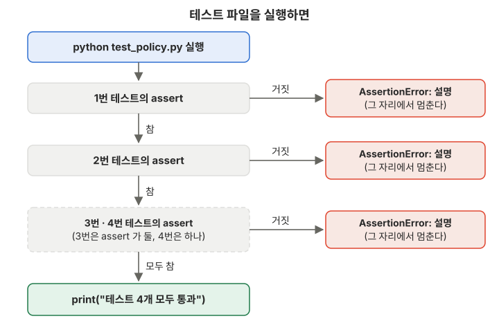

# 실습 3-2 · 90일 넘게 안 쓴 권한 찾기

## 목표: 미사용 권한 후보 목록

> **이번 실습에 들어온 일**
>
> A사 관제 담당이 보낸 메시지:
> 「규칙으로 걸러 낸 뒤에도 재직 중인 사람의 권한이 남습니다. 그중에는 받아 놓고 실제로는 쓰지 않는 권한이 있을 수 있습니다. 사용 기록을 모아 둔 사용 이력 파일이 있으니, 그것으로 90일 넘게 쓰지 않은 권한을 후보로 뽑아 주세요.
>
> 이번에는 뽑기만 하고 회수하지는 않습니다. 어떤 권한을 회수할지는 후보를 본 뒤에 정하겠습니다.」
> - **왜 중요한가**: 계정을 다른 사람이 가로채면, 그 계정이 가진 권한만큼 가로챈 사람이 할 수 있는 일이 생깁니다. 쓰지도 않는 권한이 많을수록 그 일만 늘어납니다. 사용 이력의 「마지막으로 쓴 시각」을 보면 90일 넘게 안 쓴 권한을 찾아 줄일 수 있습니다.

## 왜 안 쓰는 권한을 찾아야 하는가

1. 규칙(퇴사 · 만료)에 안 걸려도 필요 없는 권한이 있습니다. 부여 때는 필요했지만 일이 끝나서 이제 안 쓰는 권한입니다.
2. 이런 권한은 **마지막으로 쓴 시각**을 보면 알 수 있습니다. 권한은 있는데 오래 쓴 이력이 없으면 과다권한의 후보입니다.
3. 이번 실습에서는 **찾기만** 하고 회수하지 않습니다. 회수는 Unit 4에서 합니다.

## 3.1 사용 이력과 비교하는 방법

- 사용 이력 파일 `config/access_log.json` 의 한 건은 「누가 어떤 권한을 마지막으로 언제 썼나」입니다. 사용자와 권한마다 한 건만 있습니다.
- `load_last_used` 는 사용 이력 파일을 딕셔너리 하나로 바꿉니다. 이 딕셔너리의 키는 `user` 와 `permission` 을 `:` 로 이어 붙인 문자열(예: `"seoyeon:SALES:QUERY"`)이고, 값은 마지막으로 쓴 시각 문자열입니다. 현황의 권한 한 건에서도 같은 방법으로 키 문자열을 만들어 마지막 사용 시각을 찾습니다.

**키 문자열 `seoyeon:SALES:QUERY` 읽는 법** — `:` 가 두 개라 세 덩어리처럼 보이지만, 딕셔너리에는 **문자열 하나**가 키 한 개로 들어 있습니다.

| 조각 | 값 | 뜻 |
|---|---|---|
| 사용자 | `seoyeon` | `entry['user']` |
| 구분하는 문자열 | `:` | 사용자와 권한 이름을 나누려고 코드가 넣은 문자열 |
| 권한 이름 | `SALES:QUERY` | `entry['permission']` 전체입니다. 이 이름 안의 `:` 는 자원(`SALES`)과 행위(`QUERY`)를 나누는, 이름의 일부입니다. |

```python
user = "seoyeon"                                          # 사용자
permission = "SALES:QUERY"                                # 권한 이름(이름 안에 : 가 들어 있다)
key = f"{user}:{permission}"                              # 사용자 + 구분하는 문자열 : + 권한 이름을 이어 붙인다
print(key)                                                # 만들어진 키 문자열을 본다
last_used_map = {"seoyeon:SALES:QUERY": "2026-10-27 09:10"}   # 키 문자열 하나에 마지막 사용 시각 하나가 짝이다
print(last_used_map.get(key))                             # 키 문자열 전체로 찾는다
print(len(last_used_map))                                 # 딕셔너리의 키는 몇 개인가
```

실행 결과:

```
seoyeon:SALES:QUERY
2026-10-27 09:10
1
```

- 딕셔너리는 이 문자열 **전체**를 키 한 개로 봅니다. 그래서 `last_used_map.get("seoyeon:SALES:QUERY")` 처럼 통째로 찾고, `:` 로 쪼개서 쓰지 않습니다.
- 이 실습에서 「사용자:권한」 이라고 쓴 것은 `:` 앞이 사용자, 뒤가 권한 이름 **전체**라는 뜻입니다. 뒤쪽 권한 이름 안의 `:` 는 이름의 일부일 뿐입니다.

- 이름이 비슷한 두 가지를 구별합니다. `last_used_map` 은 사용 이력 딕셔너리(「사용자:권한」 문자열 → 마지막으로 쓴 시각 문자열)이고, `"last_used"` 는 후보에 추가하는 키(값은 마지막으로 쓴 시각 문자열, 이력이 없으면 `None`)입니다.

- 실행 파일은 `find_unused` 를 부르기 전에 준비 Lesson의 규칙 함수에 이미 걸린 권한(퇴사한 dami 포함)을 현황에서 뺍니다. 이때 권한 한 건마다 `user:permission:source` 를 이어 붙인 문자열(**식별 키**)을 만들어 서로 비교합니다. 식별 키는 같은 사용자에게 같은 권한이 역할과 예외로 각각 부여된 경우를 구분할 때 씁니다.

| 현황의 권한 한 건의 상태 | 판정 |
|---|---|
| 사용 이력이 없음 | 안 쓴 후보 (`last_used` 는 `None`) |
| 마지막 사용이 90일보다 오래됨 (91일째부터) | 안 쓴 후보 |
| 마지막 사용이 90일 이내 (90일째 포함) | 쓴 것 → 후보 아님 |

<figure class="page-figure"></figure>

<h2>문법 상자 — 안 쓴 일 수 구하기</h2>

<h2>① <code>.days</code> 는 시각 차이에서 「일」만 숫자로 알려 줍니다</h2>

```python
from datetime import datetime                                       # 시각을 다루는 모듈에서 datetime 을 불러온다

used_at = datetime.strptime("2026-07-31 10:00", "%Y-%m-%d %H:%M")   # 마지막으로 쓴 시각
now = datetime.strptime("2026-10-29 10:00", "%Y-%m-%d %H:%M")       # 지금 시각
gap = now - used_at                                                 # 시각에서 시각을 빼면 안 쓴 시간이 나온다
print(gap)                                                          # 「90 days, 0:00:00」 처럼 일과 시:분:초로 나온다

idle_days = gap.days                                                # .days 는 그중 「일」 부분만 숫자로 준다
print(idle_days)                                                    # 일 수를 출력한다
```

실행 결과:

```
90 days, 0:00:00
90
```

그 일 수를 기준과 비교합니다.

```python
idle_days = 90                                                      # 위에서 구한 안 쓴 일 수
is_within_limit = idle_days <= 90                                   # 90일째는 90 이하이므로 참이다
print(is_within_limit)                                              # 비교 결과를 출력한다
```

실행 결과:

```
True
```

- 시각에서 시각을 빼면 `90 days, 0:00:00` 처럼 일과 시:분:초가 함께 나옵니다. 일 수만 비교할 때는 `.days` 를 씁니다.
- 이 계산은 아래 `review_unused.py` 의 `days_since` 함수에 미리 채워 두었습니다. 직접 쓰지 않고, 읽고 이해만 합니다.

## 실습 3-2 · 90일 넘게 안 쓴 권한 후보 찾기

<h2>이런 상황이 있습니다</h2>

- **지금은**: 규칙에 안 걸린 재직자의 권한 일곱 건은 겉으로는 문제가 없어 보여서, 쓰는 권한인지 안 쓰는 권한인지 알 수 없습니다.
- **그래서 만드는 것**: `find_unused` 입니다. 현황 · 마지막 사용 시각 딕셔너리 · 지금 시각 · 기준 일 수를 받아, 마지막 사용이 기준 일 수보다 오래됐거나 사용 이력이 없는 권한을 복사해 `last_used` 키를 추가하고 리스트로 리턴합니다.
- **실행하면**: 단계 1은 규칙에 안 걸린 권한 일곱 건이 며칠째 안 쓰였는지 출력하고, 단계 2는 90일 넘게 안 쓴 후보를 출력합니다. 규칙에 이미 걸린 권한은 실행 파일이 미리 뺍니다.
- **현업에서는**: 접근 관리 도구도 「마지막 사용일」 기준(예: 90일)으로 안 쓰는 권한을 모아 담당자에게 확인을 요청합니다.

<h2>할 일</h2>

먼저 [핵심 실습 점검 함수 준비](__SITE__/exercises/module/3/unit/3/lesson/4/page/1)에서 `review_rules.py`를 만들어 둡니다.

1. `config/access_log.json` · `review_unused.py` · `exercise3-2_run.py` 세 파일을 만들고, `find_unused`의 ①·②를 채웁니다.
2. 실행해서 <mark>안 쓴 일 수</mark>(단계 1: 현황)와 <mark>90일 넘게 안 쓴 후보</mark>(단계 2: 판정)를 읽습니다.

<h3><code>config/access_log.json</code></h3>

그대로 붙여 넣습니다. 사용 이력입니다. `access_control` 안의 `config` 폴더에 만듭니다.

```json
[
  {"user": "seoyeon", "permission": "SALES:QUERY", "last_used": "2026-10-27 09:10"},
  {"user": "seoyeon", "permission": "SALES:CHANGE", "last_used": "2026-06-30 14:00"},
  {"user": "junho", "permission": "SALES:QUERY", "last_used": "2026-07-30 09:00"},
  {"user": "junho", "permission": "SETTLE:QUERY", "last_used": "2026-07-31 10:00"},
  {"user": "gaeun", "permission": "ACCOUNT:QUERY", "last_used": "2026-10-20 08:00"},
  {"user": "batch-night", "permission": "SETTLE:QUERY", "last_used": "2026-10-29 02:00"},
  {"user": "dami", "permission": "SALES:QUERY", "last_used": "2026-10-10 13:00"}
]
```

<h3><code>review_unused.py</code></h3>

```python exercise
from datetime import datetime                                    # 문자열을 시각으로 바꾸는 데 쓴다
from config_loader import load_json                              # Unit 1에서 만든 안전한 읽기 함수를 불러온다
from exception_policy import TIME_FORMAT                         # 시각 문자열의 형식("%Y-%m-%d %H:%M")을 불러온다


def load_last_used():                                            # 사용 이력 파일을 읽어 「마지막 사용 시각」 딕셔너리를 만드는 함수
    """「사용자:권한」을 키로, 마지막 사용 시각 문자열을 값으로 하는 딕셔너리를 리턴한다.
    안 쓰는 권한을 찾기 전에 사용 기록을 불러올 때 쓴다.
    """
    last_used_map = {}                                           # 빈 딕셔너리로 시작한다
    for log in load_json("config/access_log.json", []):          # 사용 이력을 한 건씩 꺼낸다(파일이 없으면 빈 리스트)
        user = log["user"]                                       # 그 기록의 사용자
        permission = log["permission"]                           # 그 기록의 권한
        key = f"{user}:{permission}"                             # 「사용자:권한」 문자열을 키로 만든다
        last_used_map[key] = log["last_used"]                    # 그 키의 값에 마지막 사용 시각 문자열을 담는다
    return last_used_map                                         # 딕셔너리를 리턴한다


def make_unused(entry, used_text):                               # 현황의 권한 한 건과 마지막 사용 시각 문자열을 받는 함수
    """권한 한 개를 복사해 "last_used" 키(마지막 사용 시각, 이력이 없으면 None)를 더한다.
    안 쓴 권한 후보를 만들 때 쓴다(원래 권한은 바꾸지 않음).
    """
    unused_entry = entry.copy()                                  # 원래 권한은 바꾸지 않고 복사한다
    unused_entry["last_used"] = used_text                        # 복사본에 마지막 사용 시각(없으면 None)을 적는다
    return unused_entry                                          # 복사본을 리턴한다


def days_since(used_text, now):                                  # 마지막 사용 시각 문자열과 지금 시각을 받는 함수
    """마지막 사용 시각부터 지금까지 안 쓴 일 수를 리턴한다.
    오래 안 쓴 권한을 점검할 때 쓴다.
    """
    used_at = datetime.strptime(used_text, TIME_FORMAT)          # 문자열을 시각으로 바꾼다
    return (now - used_at).days                                  # 지금 - 마지막 사용 시각의 일 수를 리턴한다


def find_unused(access_list, last_used_map, now, limit_days):    # 현황 · 마지막 사용 시각 딕셔너리 · 지금 시각 · 기준 일 수를 받는 함수
    """마지막 사용이 limit_days 일보다 오래됐거나 이력이 없는 권한을 리턴한다.
    후보마다 "last_used" 키에 마지막 사용 시각(없으면 None)을 적는다.
    안 쓰는 권한을 찾을 때 쓴다.
    """
    unused = []
    for entry in access_list:
        user = entry["user"]
        permission = entry["permission"]
        key = f"{user}:{permission}"
        # ① last_used_map에서 key로 시각을 꺼내 used_text에 담습니다.
#|         used_text = last_used_map.get(key)

        if used_text is None:
            unused_entry = make_unused(entry, None)
            unused.append(unused_entry)
        # ② 아래의 False를 기준 일 수를 넘었는지 확인하는 조건으로 바꿉니다.
        elif False:
#|=         elif days_since(used_text, now) > limit_days:
            unused_entry = make_unused(entry, used_text)
            unused.append(unused_entry)
    return unused
```

- ①은 주석 바로 아래에 공백 8칸을 두고 씁니다. `.get(key)`를 쓰면 사용 이력이 없을 때 `None`을 받습니다.
- ②는 `elif False:`에서 `False`를 바꿉니다. `days_since(used_text, now)`가 돌려준 일 수가 `limit_days`보다 큰지 `>`로 확인합니다. `elif`와 콜론은 그대로 둡니다.
- ①만 채우고 실행하면 사용 이력이 없는 후보 **1건**이 나옵니다. ②까지 채우면 후보 **3건**이 나옵니다. 후보가 **4건**이라면 `>=` 때문에 정확히 90일인 권한까지 들어갔는지 확인합니다.

<h3><code>exercise3-2_run.py</code></h3>

그대로 붙여 넣습니다. 현황을 만들고, `review_rules.py`의 `find_stale`에 걸린 권한을 뺀 뒤, 남은 권한이 며칠째 안 쓰였는지 출력하고 `find_unused`로 후보를 찾습니다.

```python
from datetime import datetime                                    # 지금 시각을 만드는 데 쓴다
from review_list import build_access_list                        # 실습 3-1에서 만든 현황 함수를 불러온다
from review_rules import find_stale                              # 핵심 준비 Lesson에서 만든 규칙 점검 함수를 불러온다
from review_unused import load_last_used, find_unused            # 방금 만든 미사용 점검 함수를 불러온다

NOW = datetime.strptime("2026-10-29 10:00", "%Y-%m-%d %H:%M")    # 이번 실습의 지금 시각(고정)
TIME_FORMAT = "%Y-%m-%d %H:%M"                                   # 시각 문자열의 형식

access_list = build_access_list()                                # 현황을 만든다
stale = find_stale(access_list, NOW)                             # 규칙에 이미 걸린 권한을 찾는다
stale_keys = []                                                  # 이미 걸린 권한의 식별 키(「사용자:권한:출처」 문자열)을 담을 빈 리스트
for entry in stale:                                              # 이미 걸린 권한을 한 건씩 꺼낸다
    stale_key = entry["user"] + ":" + entry["permission"]        # 사용자:권한 문자열을 만들고
    stale_key = stale_key + ":" + entry["source"]                # 받은 방식을 이어 붙여 식별 키를 만든다
    stale_keys.append(stale_key)                                 # 그 권한의 식별 키를 리스트에 추가한다
not_stale = []                                                   # 규칙에 안 걸린 권한을 담을 빈 리스트
for entry in access_list:                                        # 현황의 권한을 한 건씩 꺼낸다
    entry_text = entry["user"] + ":" + entry["permission"]       # 사용자:권한 문자열을 만들고
    entry_text = entry_text + ":" + entry["source"]              # 받은 방식을 이어 붙여 식별 키를 만든다
    if entry_text not in stale_keys:                             # 식별 키가 걸린 리스트에 없으면
        not_stale.append(entry)                                     # 규칙에 안 걸린 리스트에 추가한다

last_used_map = load_last_used()                                     # 마지막 사용 시각 딕셔너리를 읽는다
print("--- 단계 1: 현황 - 규칙에 안 걸린 권한", len(not_stale), "건의 안 쓴 일 수")   # 단계 1 시작을 알리는 줄
for entry in not_stale:                                             # 규칙에 안 걸린 권한을 한 건씩 꺼낸다
    key = entry["user"] + ":" + entry["permission"]              # 「사용자:권한」 문자열을 만들고
    used_text = last_used_map.get(key)                           # 마지막 사용 시각 문자열을 꺼낸다
    if used_text is None:                                        # 사용 이력이 없으면
        print(entry["user"], entry["permission"], "-> 사용 이력 없음")   # 이력이 없다고 출력한다
    else:                                                        # 기록이 있으면
        idle_days = (NOW - datetime.strptime(used_text, TIME_FORMAT)).days   # 안 쓴 일 수를 구해서
        print(entry["user"], entry["permission"], "->", idle_days, "일째 안 씀")   # 출력한다

unused = find_unused(not_stale, last_used_map, NOW, 90)                 # 90일보다 오래 안 쓴 권한을 찾는다
print("--- 단계 2: 판정 - 90일 넘게 안 쓴 후보", len(unused), "건")   # 단계 2 시작을 알리는 줄
for entry in unused:                                             # 후보를 한 건씩 꺼낸다
    print(entry["user"], entry["permission"], "<-", entry["source"])   # 사용자 · 권한 <- 출처를 출력한다
```

<h2>순서</h2>

1. **[VS Code]** 파일을 만들고 각각 붙여 넣습니다. 아래 순서를 각 파일에 적용합니다.
   - **VS Code 에서 만들기**: 파일마다 아래 네 가지를 반복합니다.
     1. VS Code 왼쪽 목록에서 `access_control` 폴더를 클릭해 선택합니다(선택하지 않으면 다른 폴더에 만들어집니다).
     2. 목록 위쪽의 **새 파일**(New File, 파일 모양에 `+`) 아이콘을 누릅니다.
     3. 이름 칸에 파일 이름을 입력하고 Enter 를 누릅니다. 이름은 차례로 `config/access_log.json` · `review_unused.py` · `exercise3-2_run.py` 입니다. `access_control` 폴더를 선택한 채로 `config/access_log.json` 을 입력하면 `config` 폴더 안에 만들어집니다.
     4. 열린 파일에 위 코드 상자의 내용을 복사해 붙여 넣고 저장합니다.
2. **[터미널]** 파일을 만든 뒤 `ls config` 를 쳐서 `access_log.json` 이 `users.json` 과 같은 `config` 폴더 안에 있는지 확인합니다.
   - `config` 안에 또 `config` 가 생겼다면 위치가 틀린 것이니 옮깁니다.
   - 붙여 넣은 내용이 맞는지 `python -m json.tool config/access_log.json` 으로 확인합니다(맥북은 `python3 -m json.tool …`). 여러 줄로 정리되어 출력되면 정상이고, 오류가 나면 붙여 넣을 때 글자가 빠진 것입니다. 깨진 채 두면 사용 이력을 못 읽어 모든 권한이 「이력 없음」으로 나옵니다.
3. **[VS Code]** 3.1의 표와 문법 예시를 참고해 `review_unused.py`의 ①·②를 채웁니다.
4. **[터미널]** `pwd` 의 결과가 `access_control` 로 끝나는지 확인하고 이어서 실행합니다.
   ```bash
   pwd
   python exercise3-2_run.py
   ```
   - 명령 풀이: `pwd` 지금 위치 확인 · `python` 파이썬으로 파일을 실행 · `exercise3-2_run.py` 실행할 파일
   - 맥북은 `python3 exercise3-2_run.py` 로 칩니다.
5. 출력은 두 단계입니다. 단계 1은 규칙에 안 걸린 권한 일곱 건의 안 쓴 일 수(일곱 줄), 단계 2는 90일 넘게 안 쓴 후보입니다.
6. 실행 결과에서 후보 수와 기준일을 확인합니다. 핵심 실습을 마친 뒤 블로그 기록 Lesson에서 선택한 기준과 이유를 정리합니다.
   - (가) 실행한 출력 전체를 붙여 넣고, 90일 넘게 안 쓴 후보가 몇 건인지와 후보마다 며칠째 안 쓰였는지 적어 주세요.
     - 며칠째인지는 단계 1 출력에서 후보와 같은 사용자 · 권한의 줄을 찾아 적습니다. 사용 이력이 없는 후보는 단계 1 에 「사용 이력 없음」으로 나옵니다.
   - (나) [핵심 질문] junho 의 `SETTLE:QUERY` 는 마지막 사용이 90일 전이라 후보에서 빠졌고, 같은 junho 의 `SALES:QUERY` 는 91일 전이라 후보에 들어갔습니다. 하루 차이로 나누는 기준은 합리적일까요? 경계 부근에서 담당자가 추가로 확인할 것도 적어 주세요.
   - (다) [핵심 질문] 사용 이력이 없는 권한을 바로 지우면 위험한 경우가 있습니다. 어떤 경우인지 예를 들고, 지우기 전에 무엇을 확인해야 하는지 적어 주세요.

<!-- answer: 08|실습 3-2 정답 -->

## 실습 3-2 정리

| 하려는 일 | 코드 · 말 |
|---|---|
| 마지막 사용 시각을 찾는 키 문자열 | `user = entry["user"]` · `permission = entry["permission"]` → `key = f"{user}:{permission}"` |
| 마지막 사용 시각 찾기 | `used_text = last_used_map.get(key)` (이력이 없으면 `None`) |
| 사용 이력이 없는지 | `if used_text is None:` |
| 사용 이력이 있고 기준을 넘었는지 | `elif days_since(used_text, now) > limit_days:` (`days_since` 는 미리 채움) |
| 후보 만들기 | `unused_entry = make_unused(entry, used_text)` (`make_unused` 는 미리 채움) |
| 후보에 추가하기 | `unused.append(unused_entry)` |

---
