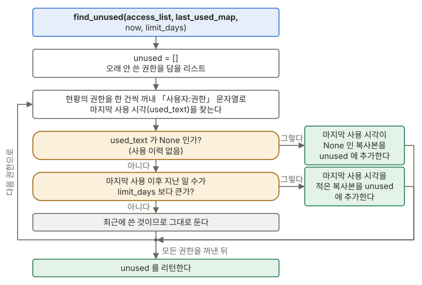

# 실습 3-2 · 90일 넘게 안 쓴 권한 찾기

## 목표: 미사용 권한 후보 목록

> **이번 실습에 들어온 일**
>
> A사 관제 담당이 보낸 메시지:
> 「규칙으로 걸러 낸 뒤에도 재직 중인 사람의 권한이 남습니다. 그중에는 받아 놓고 실제로는 쓰지 않는 권한이 있을 수 있습니다. 사용 기록을 모아 둔 사용 이력 파일이 있으니, 그것으로 90일 넘게 쓰지 않은 권한을 후보로 뽑아 주세요.
>
> 이번에는 뽑기만 하고 회수하지는 않습니다. 어떤 권한을 회수할지는 후보를 본 뒤에 정하겠습니다.」
> - **왜 중요한가**: 계정을 다른 사람이 가로채면, 그 계정이 가진 권한만큼 가로챈 사람이 할 수 있는 일이 생깁니다. 쓰지도 않는 권한이 많을수록 그 일만 늘어납니다. 사용 이력의 「마지막으로 쓴 시각」을 보면 90일 넘게 안 쓴 권한을 찾아 줄일 수 있습니다.
> - 이 실습에서 하는 일: 90일 넘게 안 쓴 권한을 찾는 함수 `find_unused` 를 `review_unused.py` 에 만듭니다. 대부분은 미리 채워 두었고, 마지막 사용 시각을 꺼내는 줄과 90일을 넘었는지 보는 조건 줄(①·②)만 직접 씁니다.
> - 끝나면 쓰는 것: 보고서 (가) 답. (나) · (다)는 여유가 되면 하는 응용입니다

## 왜 안 쓰는 권한을 찾아야 하는가

1. 규칙(퇴사 · 만료)에 안 걸려도 필요 없는 권한이 있습니다. 부여 때는 필요했지만 일이 끝나서 이제 안 쓰는 권한입니다.
2. 이런 권한은 **마지막으로 쓴 시각**을 보면 알 수 있습니다. 권한은 있는데 오래 쓴 이력이 없으면 과다권한의 후보입니다.
3. 이번 실습에서는 **찾기만** 하고 회수하지 않습니다. 회수는 다음 Unit 4(권한 거두기)에서 합니다.

## 3.1 사용 이력과 비교하는 방법

- 사용 이력 파일 `config/access_log.json` 의 한 건은 「누가 어떤 권한을 마지막으로 언제 썼나」입니다. 사용자와 권한마다 한 건만 있습니다.
- `load_last_used`(아래 `review_unused.py` 에 미리 채워 둔 함수)는 사용 이력 파일을 딕셔너리 하나로 바꿉니다. 이 딕셔너리의 키는 `user` 와 `permission` 을 `:` 로 이어 붙인 문자열(예: `"seoyeon:SALES:QUERY"`)이고, 값은 마지막으로 쓴 시각 문자열입니다. 현황의 권한 한 건에서도 같은 방법으로 키 문자열을 만들어 마지막 사용 시각을 찾습니다.

**키 문자열 `seoyeon:SALES:QUERY` 읽는 법** — `:` 가 두 개라 세 덩어리처럼 보이지만, 딕셔너리에는 **문자열 하나**가 키 한 개로 들어 있습니다.

| 조각 | 값 | 뜻 |
|---|---|---|
| 사용자 | `seoyeon` | `entry['user']` |
| 구분하는 문자열 | `:` | 사용자와 권한 이름을 나누려고 코드가 넣은 문자열 |
| 권한 이름 | `SALES:QUERY` | `entry['permission']` 전체 (안의 `:` 도 이름의 일부) |

```python
user = "seoyeon"                                          # 사용자
permission = "SALES:QUERY"                                # 권한 이름(이름 안에 : 가 들어 있다)
key = f"{user}:{permission}"                              # 사용자 + 구분하는 문자열 : + 권한 이름을 이어 붙인다
print(key)                                                # 만들어진 키 문자열을 본다
last_used_map = {"seoyeon:SALES:QUERY": "2026-10-27 09:10"}   # 키 문자열 하나에 마지막 사용 시각 하나가 짝이다
print(last_used_map.get(key))                             # 키 문자열 전체로 찾는다
print(len(last_used_map))                                 # 딕셔너리의 키는 몇 개인가
```

실행 결과:

```
seoyeon:SALES:QUERY
2026-10-27 09:10
1
```

- 딕셔너리는 이 문자열 **전체**를 키 한 개로 봅니다. 그래서 `last_used_map.get("seoyeon:SALES:QUERY")` 처럼 통째로 찾고, `:` 로 쪼개서 쓰지 않습니다.
- 이 실습에서 「사용자:권한」 이라고 쓴 것은 `:` 앞이 사용자, 뒤가 권한 이름 **전체**라는 뜻입니다. 뒤쪽 권한 이름 안의 `:` 는 이름의 일부일 뿐입니다.

- 이름이 비슷한 두 가지를 구별합니다.

| 이름 | 무엇 | 담긴 것 |
|---|---|---|
| `last_used_map` | 사용 이력 딕셔너리 | 「사용자:권한」 문자열 → 마지막으로 쓴 시각 문자열 |
| `"last_used"` | 후보에 추가하는 키 | 마지막으로 쓴 시각 문자열 (이력이 없으면 `None`) |

- 실행 파일은 `find_unused` 를 부르기 전에, 「제공 파일」 `review_rules.py` 의 `find_stale` 로 규칙(퇴사 · 만료)에 이미 걸린 권한 일곱 건(퇴사한 dami 포함)을 현황에서 뺍니다. 이때 권한 한 건마다 `user:permission:source` 를 이어 붙인 문자열(**식별 키**)을 만들어 서로 비교합니다. 실행 파일에 이미 적혀 있으니 지금은 붙여 넣기만 합니다(식별 키는 응용 3-2 에서 직접 써 볼 수 있습니다).

| 현황의 권한 한 건의 상태 | 판정 |
|---|---|
| 사용 이력이 없음 | 안 쓴 후보 (`last_used` 는 `None`) |
| 마지막 사용이 90일보다 오래됨 (91일째부터) | 안 쓴 후보 |
| 마지막 사용이 90일 이내 (90일째 포함) | 쓴 것 → 후보 아님 |

<figure class="page-figure"></figure>

**문법 상자 — 안 쓴 일 수 구하기**

**① `.days` 는 시각 차이에서 「일」만 숫자로 알려 줍니다**

```python
from datetime import datetime                                       # 시각을 다루는 모듈에서 datetime 을 불러온다

used_at = datetime.strptime("2026-07-31 10:00", "%Y-%m-%d %H:%M")   # 마지막으로 쓴 시각
now = datetime.strptime("2026-10-29 10:00", "%Y-%m-%d %H:%M")       # 지금 시각
gap = now - used_at                                                 # 시각에서 시각을 빼면 안 쓴 시간이 나온다
print(gap)                                                          # 「90 days, 0:00:00」 처럼 일과 시:분:초로 나온다

idle_days = gap.days                                                # .days 는 그중 「일」 부분만 숫자로 준다
print(idle_days)                                                    # 일 수를 출력한다
```

실행 결과:

```
90 days, 0:00:00
90
```

그 일 수를 기준과 비교합니다. 「기준보다 크다」는 `>` 입니다.

```python
print(91 > 90)                                                      # 91일째는 90보다 크므로 참(후보)
print(90 > 90)                                                      # 90일째는 90보다 크지 않으므로 거짓(후보 아님)
```

실행 결과:

```
True
False
```

- 시각에서 시각을 빼면 `90 days, 0:00:00` 처럼 일과 시:분:초가 함께 나옵니다. 일 수만 비교할 때는 `.days` 를 씁니다.
- 이 계산은 아래 `review_unused.py` 의 `days_since` 함수에 미리 채워 두었습니다. 직접 쓰지 않고, 읽고 이해만 합니다. ② 에서는 `days_since(used_text, now)` 가 돌려준 일 수를 `limit_days` 와 `>` 로 비교합니다.

## 실습 3-2 · 90일 넘게 안 쓴 권한 후보 찾기

**이런 상황이 있습니다**

- **지금은**: 규칙에 안 걸린 재직자의 권한 일곱 건은 겉으로는 문제가 없어 보여서, 쓰는 권한인지 안 쓰는 권한인지 알 수 없습니다.
- **그래서 만드는 것**: `find_unused` 입니다. 현황 · 마지막 사용 시각 딕셔너리 · 지금 시각 · 기준 일 수를 받아, 마지막 사용이 기준 일 수보다 오래됐거나 사용 이력이 없는 권한을 복사해 `last_used` 키를 추가하고 리스트로 리턴합니다. 키를 만들고 후보를 더하는 줄은 미리 써 두었고, 마지막 사용 시각을 꺼내는 줄과 기준을 넘었는지 보는 줄이 빠져 있습니다.
- **실행하면**: 단계 1은 규칙에 안 걸린 권한 일곱 건이 며칠째 안 쓰였는지 출력하고, 단계 2는 90일 넘게 안 쓴 후보를 출력합니다. 규칙에 이미 걸린 권한은 실행 파일이 미리 뺍니다.
- **현업에서는**: 접근 관리 도구도 「마지막 사용일」 기준(예: 90일)으로 안 쓰는 권한을 모아 담당자에게 확인을 요청합니다.

**할 일**

1. 「제공 파일」 레슨의 파일 네 개(`review_rules.py` · `overprivilege.py` · `report_exclude.py` · `config/exclude_list.json`)를 먼저 만듭니다. 이 실습은 그중 `review_rules.py` 를 씁니다.
2. `config/access_log.json` · `review_unused.py` · `exercise3-2_run.py` 세 파일을 만들고, `review_unused.py` 의 `# ←` 가 있는 <mark>두 곳</mark>(① · ②)을 한 줄씩 채웁니다.
3. 실행해서 <mark>안 쓴 일 수</mark>(단계 1: 현황)와 <mark>90일 넘게 안 쓴 후보</mark>(단계 2: 판정)를 읽습니다.

**준비** — 터미널이 `…/access_control` 위치인지 확인한 뒤 「제공 파일」이 있는지 봅니다.

```bash
ls
```

- `review_rules.py` 가 보이지 않으면 「제공 파일」 레슨에서 먼저 만듭니다. 없는 채로 실행하면 `ModuleNotFoundError: No module named 'review_rules'` 오류가 납니다.

**`config/access_log.json`** — 그대로 붙여 넣습니다. 사용 이력입니다. `access_control` 안의 `config` 폴더에 만듭니다.

<pre class="copyable"><code>[
  {"user": "seoyeon", "permission": "SALES:QUERY", "last_used": "2026-10-27 09:10"},
  {"user": "seoyeon", "permission": "SALES:CHANGE", "last_used": "2026-06-30 14:00"},
  {"user": "junho", "permission": "SALES:QUERY", "last_used": "2026-07-30 09:00"},
  {"user": "junho", "permission": "SETTLE:QUERY", "last_used": "2026-07-31 10:00"},
  {"user": "gaeun", "permission": "ACCOUNT:QUERY", "last_used": "2026-10-20 08:00"},
  {"user": "batch-night", "permission": "SETTLE:QUERY", "last_used": "2026-10-29 02:00"},
  {"user": "dami", "permission": "SALES:QUERY", "last_used": "2026-10-10 13:00"}
]</code></pre>

**`review_unused.py`**

```python
from datetime import datetime                                    # 문자열을 시각으로 바꾸는 데 쓴다
from config_loader import load_json                              # config_loader.py 의 안전한 읽기 함수를 불러온다
from exception_policy import TIME_FORMAT                         # 시각 문자열의 형식("%Y-%m-%d %H:%M")을 불러온다


def load_last_used():                                            # 사용 이력 파일을 읽어 「마지막 사용 시각」 딕셔너리를 만드는 함수
    """「사용자:권한」을 키로, 마지막 사용 시각 문자열을 값으로 하는 딕셔너리를 리턴한다.
    안 쓰는 권한을 찾기 전에 사용 기록을 불러올 때 쓴다.
    """
    last_used_map = {}                                           # 빈 딕셔너리로 시작한다
    for log in load_json("config/access_log.json", []):          # 사용 이력을 한 건씩 꺼낸다(파일이 없으면 빈 리스트)
        user = log["user"]                                       # 그 기록의 사용자
        permission = log["permission"]                           # 그 기록의 권한
        key = f"{user}:{permission}"                             # 「사용자:권한」 문자열을 키로 만든다
        last_used_map[key] = log["last_used"]                    # 그 키의 값에 마지막 사용 시각 문자열을 담는다
    return last_used_map                                         # 딕셔너리를 리턴한다


def make_unused(entry, used_text):                               # 현황의 권한 한 건과 마지막 사용 시각 문자열을 받는 함수
    """권한 한 개를 복사해 "last_used" 키(마지막 사용 시각, 이력이 없으면 None)를 더한다.
    안 쓴 권한 후보를 만들 때 쓴다(원래 권한은 바꾸지 않음).
    """
    unused_entry = entry.copy()                                  # 원래 권한은 바꾸지 않고 복사한다
    unused_entry["last_used"] = used_text                        # 복사본에 마지막 사용 시각(없으면 None)을 적는다
    return unused_entry                                          # 복사본을 리턴한다


def days_since(used_text, now):                                  # 마지막 사용 시각 문자열과 지금 시각을 받는 함수
    """마지막 사용 시각부터 지금까지 안 쓴 일 수를 리턴한다.
    오래 안 쓴 권한을 점검할 때 쓴다.
    """
    used_at = datetime.strptime(used_text, TIME_FORMAT)          # 문자열을 시각으로 바꾼다
    return (now - used_at).days                                  # 지금 - 마지막 사용 시각의 일 수를 리턴한다


def find_unused(access_list, last_used_map, now, limit_days):    # 현황 · 마지막 사용 시각 딕셔너리 · 지금 시각 · 기준 일 수를 받는 함수
    """마지막 사용이 limit_days 일보다 오래됐거나 이력이 없는 권한을 리턴한다.
    후보마다 "last_used" 키에 마지막 사용 시각(없으면 None)을 적는다.
    안 쓰는 권한을 찾을 때 쓴다.
    """
    unused = []                                                  # 후보를 담을 빈 리스트
    for entry in access_list:                                    # 현황의 권한을 한 건씩 꺼낸다
        user = entry["user"]                                     # 그 권한의 사용자
        permission = entry["permission"]                         # 그 권한의 권한 이름
        key = f"{user}:{permission}"                             # 그 권한의 「사용자:권한」 문자열을 만든다
        # ① last_used_map 에서 key 로 마지막 사용 시각을 꺼내 used_text 에 담는다 (.get, 이력이 없으면 None)   # ← 이 주석 바로 아래 줄에 씁니다 (8칸)

        if used_text is None:                                    # 사용 이력이 없으면
            unused_entry = make_unused(entry, None)              # 안 쓴 권한 한 건을 만든다
            unused.append(unused_entry)                          # 마지막 사용 시각을 None 으로 적은 복사본을 후보에 추가한다
        # ② 아니고(elif), days_since(used_text, now) 가 limit_days 보다 크면 (>)   # ← 이 주석 바로 아래 줄에 씁니다 (8칸)

            unused_entry = make_unused(entry, used_text)         # 안 쓴 권한 한 건을 만든다
            unused.append(unused_entry)                          # 마지막 사용 시각을 적은 복사본을 후보에 추가한다
    return unused                                                # 후보 리스트를 리턴한다
```

- 주석 줄은 그대로 두고, **각 주석 바로 아래 줄**에 씁니다. ① · ② 는 모두 `for` 안쪽 줄이라 8칸(Tab 키 두 번)에서 시작합니다. ② 는 위의 `if used_text is None:` 과 같은 8칸이고, 그 아래 12칸 두 줄이 ② 의 안쪽입니다. `load_last_used` · `make_unused` · `days_since` 와 나머지 줄은 미리 채워 두었으니 그대로 둡니다.

**직접 쓰는 곳**

| 빈칸 | 쓰는 줄 | 들여쓰기 |
|---|---|---|
| ① | 키로 마지막 사용 시각 꺼내기 (`.get`) | 8칸 |
| ② | 90일을 넘었는지 보는 조건 (`elif`) | 8칸 |

- ① 확인: ① 만 쓰고 실행하면 오류 없이 끝나지만 단계 2 가 `후보 2 건` 이고 `gaeun ACCOUNT:CHANGE` 가 두 번 나옵니다. ② 가 비어 있어서 그 아래 두 줄이 위 `if` 안쪽으로 붙었기 때문이니 정상입니다. 막히면: 3.1 의 `print(last_used_map.get(key))` 에서 `print( )` 를 빼고 앞에 `used_text =` 를 붙입니다.
- ② 확인: ② 까지 쓰고 실행하면 단계 2 가 `90일 넘게 안 쓴 후보 3 건` 이고 seoyeon · junho · gaeun 이 한 줄씩 나와야 합니다. 4 건이면 `>` 를 `>=` 로 쓴 것입니다. 막히면: 문법 상자의 `91 > 90` 에서 `91` 자리에 `days_since(used_text, now)`, `90` 자리에 `limit_days` 를 넣고, 앞에 `elif`, 끝에 `:` 를 붙입니다.
- 미리 채운 `make_unused` 의 `entry.copy()` 는 딕셔너리를 복사한 새 딕셔너리를 만듭니다. 복사본에만 `last_used` 키를 더하므로, 현황 리스트의 원래 권한은 그대로 남아 다른 점검에 다시 쓸 수 있습니다.
- `used_text is None` 은 「값이 `None` 인가」를 묻는 것입니다. `.get(key)` 는 키가 없으면 `None` 을 주므로 `None` 이면 사용 이력이 없다는 뜻입니다. 그 경우에는 일 수를 계산할 수 없으니, `days_since` 는 사용 이력이 있을 때(`elif`)만 부릅니다. `elif` 는 「앞의 `if` 가 아니고, 이 조건이면」이라는 뜻입니다.
- 채우기 전에 실행하면 단계 1 일곱 줄은 나오고, 그 뒤 `NameError: name 'used_text' is not defined` 오류로 멈춥니다. ① 이 비어 있어 `used_text` 를 만든 적이 없는데 `if used_text is None:` 에서 쓰려 했기 때문입니다.

**`exercise3-2_run.py`** — 그대로 붙여 넣습니다. 학생이 쓰는 줄은 없습니다. 현황을 만들고, 「제공 파일」의 `find_stale` 에 걸린 권한을 뺀 뒤, 남은 권한이 며칠째 안 쓰였는지 출력하고 `find_unused` 로 후보를 찾습니다.

```python
from datetime import datetime                                    # 지금 시각을 만드는 데 쓴다
from review_list import build_access_list                        # 실습 3-1에서 만든 현황 함수를 불러온다
from review_rules import find_stale                              # 제공 파일의 규칙 점검 함수를 불러온다
from review_unused import load_last_used, find_unused            # 방금 만든 미사용 점검 함수를 불러온다

NOW = datetime.strptime("2026-10-29 10:00", "%Y-%m-%d %H:%M")    # 이번 실습의 지금 시각(고정)
TIME_FORMAT = "%Y-%m-%d %H:%M"                                   # 시각 문자열의 형식

access_list = build_access_list()                                # 현황을 만든다
stale = find_stale(access_list, NOW)                             # 규칙에 이미 걸린 권한을 찾는다
stale_keys = []                                                  # 이미 걸린 권한의 식별 키(「사용자:권한:출처」 문자열)을 담을 빈 리스트
for entry in stale:                                              # 이미 걸린 권한을 한 건씩 꺼낸다
    stale_key = entry["user"] + ":" + entry["permission"]        # 사용자:권한 문자열을 만들고
    stale_key = stale_key + ":" + entry["source"]                # 받은 방식을 이어 붙여 식별 키를 만든다
    stale_keys.append(stale_key)                                 # 그 권한의 식별 키를 리스트에 추가한다
not_stale = []                                                   # 규칙에 안 걸린 권한을 담을 빈 리스트
for entry in access_list:                                        # 현황의 권한을 한 건씩 꺼낸다
    entry_text = entry["user"] + ":" + entry["permission"]       # 사용자:권한 문자열을 만들고
    entry_text = entry_text + ":" + entry["source"]              # 받은 방식을 이어 붙여 식별 키를 만든다
    if entry_text not in stale_keys:                             # 식별 키가 걸린 리스트에 없으면
        not_stale.append(entry)                                     # 규칙에 안 걸린 리스트에 추가한다

last_used_map = load_last_used()                                     # 마지막 사용 시각 딕셔너리를 읽는다
print("--- 단계 1: 현황 - 규칙에 안 걸린 권한", len(not_stale), "건의 안 쓴 일 수")   # 단계 1 시작을 알리는 줄
for entry in not_stale:                                             # 규칙에 안 걸린 권한을 한 건씩 꺼낸다
    key = entry["user"] + ":" + entry["permission"]              # 「사용자:권한」 문자열을 만들고
    used_text = last_used_map.get(key)                           # 마지막 사용 시각 문자열을 꺼낸다
    if used_text is None:                                        # 사용 이력이 없으면
        print(entry["user"], entry["permission"], "-> 사용 이력 없음")   # 이력이 없다고 출력한다
    else:                                                        # 기록이 있으면
        idle_days = (NOW - datetime.strptime(used_text, TIME_FORMAT)).days   # 안 쓴 일 수를 구해서
        print(entry["user"], entry["permission"], "->", idle_days, "일째 안 씀")   # 출력한다

unused = find_unused(not_stale, last_used_map, NOW, 90)                 # 90일보다 오래 안 쓴 권한을 찾는다
print("--- 단계 2: 판정 - 90일 넘게 안 쓴 후보", len(unused), "건")   # 단계 2 시작을 알리는 줄
for entry in unused:                                             # 후보를 한 건씩 꺼낸다
    print(entry["user"], entry["permission"], "<-", entry["source"])   # 사용자 · 권한 <- 출처를 출력한다
```

**순서**

1. **[VS Code]** 파일을 만들고 각각 붙여 넣습니다. 파일마다 아래 네 가지를 반복합니다.
   1. VS Code 왼쪽 목록에서 `access_control` 폴더를 클릭해 선택합니다(선택하지 않으면 다른 폴더에 만들어집니다).
   2. 목록 위쪽의 **새 파일**(New File, 파일 모양에 `+`) 아이콘을 누릅니다.
   3. 이름 칸에 파일 이름을 입력하고 Enter 를 누릅니다. 이름은 차례로 `config/access_log.json` · `review_unused.py` · `exercise3-2_run.py` 입니다. `access_control` 폴더를 선택한 채로 `config/access_log.json` 을 입력하면 `config` 폴더 안에 만들어집니다.
   4. 열린 파일에 위 코드 상자의 내용을 복사해 붙여 넣고 저장합니다.
2. **[터미널]** 파일을 만든 뒤 `ls config` 를 쳐서 `access_log.json` 이 `users.json` 과 같은 `config` 폴더 안에 있는지 확인합니다.
   - `config` 안에 또 `config` 가 생겼다면 위치가 틀린 것이니 옮깁니다.
   - 붙여 넣은 내용이 맞는지 `python -m json.tool config/access_log.json` 으로 확인합니다(맥북은 `python3 -m json.tool …`). 여러 줄로 정리되어 출력되면 정상이고, 오류가 나면 붙여 넣을 때 글자가 빠진 것입니다. 깨진 채 두면 사용 이력을 못 읽어 모든 권한이 「이력 없음」으로 나옵니다.
3. **[VS Code]** `review_unused.py` 의 `# ←` 두 곳(① · ②)을 채웁니다. 3.1 의 표와 그림, 문법 상자를 보고 씁니다.
4. **[터미널]** `pwd` 의 결과가 `access_control` 로 끝나는지 확인하고 이어서 실행합니다.
   ```bash
   pwd
   python exercise3-2_run.py
   ```
   - 명령 풀이: `pwd` 지금 위치 확인 · `python` 파이썬으로 파일을 실행 · `exercise3-2_run.py` 실행할 파일
   - 맥북은 `python3 exercise3-2_run.py` 로 칩니다.
5. 출력은 두 단계입니다. 단계 1은 규칙에 안 걸린 권한 일곱 건의 안 쓴 일 수(일곱 줄), 단계 2는 90일 넘게 안 쓴 후보입니다.
6. **[보고서]** `report_u3.md` 의 `## 실습 3-2` 아래를 채웁니다.
   - (가) [핵심 질문] 실행한 출력 전체를 붙여 넣고, 90일 넘게 안 쓴 후보가 몇 건인지와 후보마다 며칠째 안 쓰였는지 적어 주세요.
     - 며칠째인지는 단계 1 출력에서 후보와 같은 사용자 · 권한의 줄을 찾아 적습니다. 사용 이력이 없는 후보는 단계 1 에 「사용 이력 없음」으로 나옵니다.
   - (나) [응용] junho 의 `SETTLE:QUERY` 는 마지막 사용이 90일 전이라 후보에서 빠졌고, 같은 junho 의 `SALES:QUERY` 는 91일 전이라 후보에 들어갔습니다. 하루 차이로 나누는 기준은 합리적일까요? 경계 부근에서 담당자가 추가로 확인할 것도 적어 주세요.
   - (다) [응용] 사용 이력이 없는 권한을 바로 지우면 위험한 경우가 있습니다. 어떤 경우인지 예를 들고, 지우기 전에 무엇을 확인해야 하는지 적어 주세요.

**확인** — 실행했을 때 단계 1 이 일곱 줄이고, 단계 2 가 `90일 넘게 안 쓴 후보 3 건` 아래 `seoyeon SALES:CHANGE` · `junho SALES:QUERY` · `gaeun ACCOUNT:CHANGE` 세 줄이면 성공입니다. 안 나오면 「정답」 레슨의 실습 3-2 출력과 한 줄씩 맞춰 보고, 다른 줄이 있으면 위 「직접 쓰는 곳」의 확인을 다시 봅니다.

## 실습 3-2 정리

| 하려는 일 | 코드 · 말 |
|---|---|
| 사용자와 권한 꺼내기 | `user = entry["user"]` · `permission = entry["permission"]` |
| 마지막 사용 시각을 찾는 키 문자열 | `key = f"{user}:{permission}"` |
| 마지막 사용 시각 찾기 (①) | `used_text = last_used_map.get(key)` (이력이 없으면 `None`) |
| 사용 이력이 없는지 | `if used_text is None:` |
| 이력이 있고 기준을 넘었는지 (②) | `elif days_since(used_text, now) > limit_days:` |
| 후보 만들기 | `unused_entry = make_unused(entry, used_text)` (`make_unused` 는 미리 채움) |
| 후보에 추가하기 | `unused.append(unused_entry)` |

---


## 이번 Unit 마무리 · 깃허브에 올리기

하루를 닫는 마무리입니다(15분). 핵심 실습 두 개와 글쓰기를 끝낸 뒤 합니다.

**1. 오늘 한 일 확인**

1. 역할로 받은 권한과 예외로 받은 권한을 한 리스트로 모아 현황 14건을 만들었다 (실습 3-1)
2. 규칙에 안 걸린 권한 일곱 건 가운데 90일 넘게 안 썼거나 사용 이력이 없는 후보 3건을 찾았다 (실습 3-2)
3. 보고서 `report_u3.md` 의 실습 3-1 (가) · 실습 3-2 (가) 칸에 `답:` 뒤가 비어 있지 않다

**2. 파일 확인** — **[터미널]** `access_control` 폴더에서 확인합니다.

```bash
ls
ls config
```

- `review_list.py` · `exercise3-1_run.py` · `review_rules.py` · `overprivilege.py` · `report_exclude.py` · `review_unused.py` · `exercise3-2_run.py` · `report_u3.md` 가 보여야 합니다.
- `config` 안에는 `access_log.json` · `exclude_list.json` 이 새로 보여야 합니다.

**3. 깃허브에 올리기**

1. **[터미널]** `security-agent-toolkit` 폴더로 옮기고 위치를 확인합니다. 결과가 `…/security-agent-toolkit` 으로 끝나야 합니다.
   ```bash
   cd ..
   pwd
   ```
   - 명령 풀이: `cd ..` 한 단계 위 폴더로 이동 · `pwd` 지금 위치 확인
   - 결과가 다르면 VS Code 왼쪽 목록에서 `security-agent-toolkit` 폴더를 오른쪽 클릭 › **Open in Integrated Terminal** 로 터미널을 새로 엽니다.
2. **[터미널]** 무엇이 바뀌었는지 먼저 봅니다. 빨간 목록에 `.env` 나 `.venv` 가 보이면 올리지 않고 멈춥니다.
   ```bash
   git status
   ```
   - 명령 풀이: `git status` 올릴 파일의 상태를 봄
   - `.env` 가 보이면 VS Code 왼쪽 목록에서 `security-agent-toolkit` 바로 아래의 `.gitignore` 를 열어 맨 아래에 `.env` 한 줄을 적고 저장한 뒤 `git status` 를 다시 칩니다. `.venv` 도 같은 방법으로 합니다.
   - `access_control/__pycache__/` 는 파이썬이 실행하면서 자동으로 만든 임시 폴더입니다. 올릴 필요가 없으므로 `.gitignore` 맨 아래에 `__pycache__/` 한 줄을 더 적고 저장합니다.
   - `Untracked files:` 는 「아직 깃이 모르는 새 파일」 목록입니다. 이번 Unit 에서 만든 파일이 `access_control/review_list.py` 처럼 한 줄씩 보입니다.
3. **[보고서]** `report_u3.md` 의 `## 마무리` 아래 (가)를 채웁니다. 올리기 전에 채워야 깃허브에 빈칸 없이 올라갑니다. 못 적은 칸이 있으면 `모름 — 막힌 곳: …` 으로 적고 올립니다.
4. **[터미널]** 바뀐 파일을 모두 담고(`add`), 기록하고(`commit`), 올립니다(`push`).
   ```bash
   git add .
   git commit -m "Add access control unit 3 access review and unused permissions"
   git push
   ```
   - 명령 풀이: `git add .` 바뀐 파일을 올릴 목록에 담음 · `git commit -m "…"` 따옴표 안의 설명을 붙여 기록으로 저장 · `git push` 깃허브로 올림
   - `git push` 가 거절(`rejected`)되면 `git pull --no-rebase` 로 받아 와 합친 뒤 `git push` 를 다시 합니다. 그때 편집기 화면이 뜨면 `Esc` 를 누르고 `:wq` 를 입력한 뒤 `Enter` 를 누릅니다. 이 화면은 git 이 두 기록을 합친 기록에 붙일 메시지를 확인하라고 여는 편집기(vim)라서, 메시지는 고치지 않고 저장하고 닫기만 하면 됩니다.
5. **[브라우저]** 깃허브의 내 저장소를 새로 고쳐 `access_control` 폴더를 열고, 2번에서 본 파일이 모두 있는지 확인합니다.

- 시간이 남아 응용을 했다면 응용 파일까지 만든 뒤 1 ~ 4번을 한 번 더 하면 됩니다. 같은 날 여러 번 올려도 괜찮습니다.

**4. 이어지는 곳**

| Unit 4 에서 할 일 | 쓰는 파일 |
|---|---|
| 회수할 후보 다시 뽑기 | `review_list.py` · `review_rules.py` · `review_unused.py` (그대로 불러 씀) |
| 회수 계획 세우기 | `overprivilege.py` 의 리포트 · `report_exclude.py` 와 `config/exclude_list.json` 의 회수 제외 |

리포트와 회수 제외가 어떻게 동작하는지 직접 만들어 보려면 응용 3-2 · 3-3 을 합니다. 여유가 되면 해 보세요.

**확인** — 깃허브의 내 저장소 `access_control` 폴더에 `review_list.py` 와 `review_unused.py` 가 보이고, `.env` 가 보이지 않으면 성공입니다. 안 보이면 `git status` 를 다시 쳐서 빨간 목록에 남은 파일이 있는지 보고 4번을 한 번 더 합니다.

---

<!-- learn:answers -->
