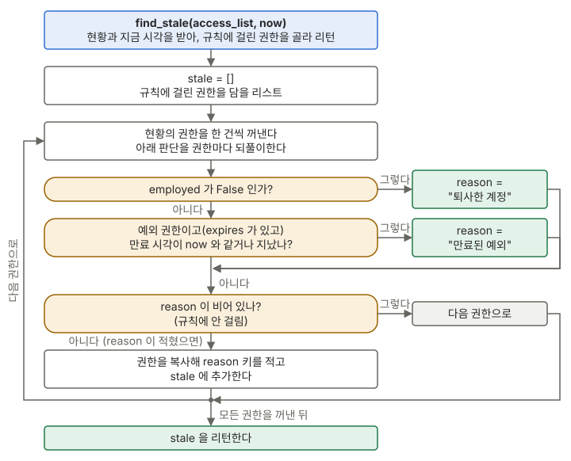

# 응용 3-1 · 규칙으로 필요 없어진 권한 찾기

## 목표: 퇴사·만료 권한 걸러 내기

> 여유가 되면 해 보세요. 핵심 준비 레슨에서 만든 `review_rules.py` 를 이번에는 직접 써 봅니다.

> **이번 실습에 들어온 일**
>
> A사 관제 담당이 보낸 메시지:
> 「현황 리스트를 뽑아 보니 퇴사로 표시된 사용자의 권한도 보이고, 예외 파일을 열어 보면 이미 기간이 끝난 예외도 있습니다. 지금은 열네 건이라 제가 건마다 확인하고 있습니다. 사용자 파일을 열어 퇴사 여부를 보고, 예외 파일을 열어 만료 시각을 봅니다. 그런데 오래 걸리고 한 건을 놓칠 수도 있습니다. 감사팀은 이 확인을 매주 하라고 합니다.
>
> 퇴사나 기간 만료처럼 파일에 적힌 사실만 보면 되는 것은 코드가 걸러 내 주세요. 걸러 낸 권한마다 왜 걸렸는지도 적어 주면, 저는 이유만 보고 정리할지 정할 수 있습니다.」
> - **왜 중요한가**: 퇴사 여부와 만료 시각을 사람이 건마다 확인하면 오래 걸리고 한 건을 놓칠 수 있는데, 이 확인은 매주 해야 합니다. 코드가 열네 건을 같은 기준으로 한 번에 검사하고 걸린 이유까지 붙여 주면, 담당자는 이유만 보고 정리할지 정하면 됩니다.

## 왜 규칙으로 먼저 걸러 내는가

1. 퇴사한 사람의 권한이나 기간이 끝난 예외는 사람이 판단할 것이 없습니다. 사실만 보고 바로 걸러 낼 수 있는 **규칙**입니다.
2. 규칙으로 걸러 낼 수 있는 것은 코드에 맡기고, 사람은 규칙으로 안 걸리는 것(실습 3-2 의 오래 안 쓴 권한)에 시간을 씁니다.

## 2.1 이번 실습의 두 규칙

- **stale**(스테일)은 「오래돼서 쓸모없어진」이라는 뜻입니다. 여기서는 퇴사한 사람의 권한이나 기간이 끝난 예외처럼, 시간이 지나 필요 없어진 권한을 말합니다. 그래서 `find_stale` 은 그런 권한을 찾는 함수이고, 변수 `stale` 은 그렇게 찾은 권한의 리스트입니다.

| 규칙 | 걸리는 조건 | 쓰는 키 | `reason` |
|---|---|---|---|
| 퇴사 | `employed` 가 `False` | `employed` | `"퇴사한 계정"` |
| 예외 만료 | 만료 시각이 지금과 같거나 이미 지남 | `expires` | `"만료된 예외"` |

- 권한 한 건이 두 규칙에 모두 걸릴 수도 있습니다(퇴사한 사람의 만료된 예외). 그때는 이유를 하나만 적도록 `if` 다음에 `elif` 를 씁니다. 이번 실습의 데이터에는 이런 권한이 없습니다.
- 지금까지는 요청이 올 때 예외 한 건씩 만료를 판정했습니다(`find_exception`). 이번에는 역할로 받은 권한까지 포함한 **현황 전체**를 한 함수로 점검합니다.
- 만료의 기준은 `exception_policy.py` 의 `find_exception` 과 같습니다. 지금이 만료 시각보다 앞이면 유효하고, 만료 시각이 지금과 같거나 이미 지났으면 만료입니다(`<= now`).

<figure class="page-figure"></figure>

## 응용 3-1 · 퇴사 계정과 만료 예외 찾기

**이런 상황이 있습니다**

- **지금은**: 현황 리스트에 열네 건이 있고, 관제 담당이 건마다 퇴사 여부를 보고 예외 파일을 열어 만료 시각을 눈으로 확인합니다. 시간이 걸리고 놓칠 수 있습니다.
- **그래서 만드는 것**: `find_stale` 입니다. 현황 리스트와 지금 시각을 받아, 규칙에 걸린 권한을 복사해 `reason` 키를 추가하고 리스트로 리턴합니다. 원래 현황 권한은 바꾸지 않습니다.
- **실행하면**: 단계 1은 규칙에 걸린 권한을 이유와 함께 출력하고, 단계 2는 이유별 건수를 출력합니다. 지금 시각은 `2026-10-29 10:00` 으로 고정합니다.
- **현업에서는**: 계정 관리 도구도 퇴사 처리(그만둔 사람의 계정과 권한을 닫는 일)가 안 된 계정과 기한이 지난 임시 권한을 정기 점검 리스트로 뽑아 담당자에게 보냅니다.

**할 일**

1. 핵심 준비 레슨에서 만든 `review_rules.py` 의 내용을 모두 지우고 아래 골격으로 바꾼 뒤, `find_stale` 본문을 직접 씁니다. `apply3-1_run.py` 는 새로 만듭니다.
2. 실행해서 <mark>규칙에 걸린 권한</mark>(단계 1: 판정)과 <mark>이유별 건수</mark>(단계 2: 점검)를 읽습니다.

**`review_rules.py`**

```python
from datetime import datetime                                    # 문자열을 시각으로 바꾸는 데 쓴다
from exception_policy import TIME_FORMAT                         # 시각 문자열의 형식("%Y-%m-%d %H:%M")을 불러온다


def find_stale(access_list, now):                                # 현황 리스트와 지금 시각(datetime)을 받는 함수
    """규칙에 걸려 필요 없어진 권한을 리턴하고 걸린 이유를 "reason" 키에 적는다.
    퇴사 · 만료로 남은 권한을 정리할 때 쓴다.
    """
    # ← 아래를 직접 씁니다 (주석은 두고 각 주석 바로 아래 줄에 씁니다)
    # 1. 걸린 권한을 담을 빈 리스트 stale 을 만든다
    # 2. access_list 에서 entry 를 하나씩 꺼낸다
    # 3.   entry.get("expires") 를 expires 에 담는다 (역할로 받은 권한에는 이 키가 없어 None 이 된다)
    # 4.   빈 문자열 ""를 reason 에 담는다
    # 5.   entry["employed"] 가 False 이면(재직이 아니면) reason 을 "퇴사한 계정" 으로 정한다
    # 6.   아니고(elif), expires 가 None 이 아니면 (is not None)
    # 7.     datetime.strptime(expires, TIME_FORMAT) 을 expires_at 에 담는다
    # 8.     expires_at 이 now 와 같거나 now 보다 이전이면 (<= now)
    # 9.       reason 을 "만료된 예외" 로 정한다
    # 10.  reason 이 빈 문자열이 아니면
    # 11.    entry.copy() 를 stale_entry 에 담는다
    # 12.    stale_entry["reason"] 을 reason 으로 정한다
    # 13.    stale 에 stale_entry 를 추가한다
    # 14. stale 을 리턴한다
```

- `find_stale` 본문의 들여쓰기는 아래와 같습니다. 공백 4개는 Tab 키 한 번입니다.

| 줄의 위치 | 앞 공백 |
|---|---|
| 본문 (함수 안) | 4개 |
| `for` 안쪽 | 8개 (4개 더) |
| `if` · `elif` 안쪽 | 12개 (또 4개 더) |
| `elif` 안의 `if` 안쪽 | 16개 (또 4개 더) |
| 마지막 `return` (`for` 밖) | 4개 |

- `expires` 가 `None` 인지는 `== None` 이 아니라 `is None`(아니면 `is not None`)으로 묻습니다. `expires is not None` 은 「`expires` 가 `None` 이 아니다」, 곧 만료 시각이 적혀 있다(예외로 받은 권한)는 뜻입니다.
- 순서는 「`expires` 가 `None` 이 아니다(6번) → 그러면 시각으로 바꾸고(7번) → 지금과 비교한다(8번)」입니다. `None` 일 때는 `strptime` 이 오류를 내므로, 6번 안쪽에서만 시각으로 바꿉니다.
- 채우기 전에 실행하면 `TypeError: object of type 'NoneType' has no len()` 오류가 납니다. `find_stale` 이 아무것도 리턴하지 않기 때문입니다. `return` 이 없는 함수는 `None`(값 없음)을 돌려주고, 실행 파일의 `len(stale)` 이 `None` 의 개수를 세려다 멈춥니다.

**`apply3-1_run.py`** — 그대로 붙여 넣습니다. 학생이 쓰는 줄은 없습니다. 실습 3-1의 `build_access_list` 로 현황을 만든 뒤 `find_stale` 로 규칙에 걸린 권한을 찾아 출력합니다.

```python
from datetime import datetime                                    # 지금 시각을 만드는 데 쓴다
from review_list import build_access_list                        # 실습 3-1에서 만든 현황 함수를 불러온다
from review_rules import find_stale                              # 방금 만든 규칙 점검 함수를 불러온다

NOW = datetime.strptime("2026-10-29 10:00", "%Y-%m-%d %H:%M")    # 이번 실습의 지금 시각(고정)

access_list = build_access_list()                                # 현황을 만든다
stale = find_stale(access_list, NOW)                             # 규칙에 걸린 권한을 찾는다

print("--- 단계 1: 판정 - 규칙에 걸린 권한", len(stale), "건 (전체", len(access_list), "건 중)")   # 단계 1 시작을 알리는 줄
for entry in stale:                                              # 걸린 권한을 한 건씩 꺼낸다
    print(entry["user"], entry["permission"], "<-", entry["source"], "|", entry["reason"])   # 사용자 · 권한 <- 출처 | 이유를 출력한다

print("--- 단계 2: 점검 - 이유별 건수")                           # 단계 2 시작을 알리는 줄
counts = {}                                                      # 이유 → 건수를 담을 빈 딕셔너리
for entry in stale:                                              # 걸린 권한을 한 건씩 꺼낸다
    count_key = entry["reason"]                                  # 세는 기준이 되는 키
    old_count = counts.get(count_key, 0)                         # 그 키의 지금까지 센 수(처음이면 0)
    counts[count_key] = old_count + 1                            # 1 늘려서 다시 적는다
print(counts)                                                    # 이유별 건수를 출력한다
```

**순서**

1. **[VS Code]** `review_rules.py` 를 열어 내용을 모두 지우고(`Ctrl + A` 뒤 `Delete`) 위 **`review_rules.py`** 코드 상자의 골격을 붙여 넣고 저장합니다. 이어서 `access_control` 폴더를 오른쪽 클릭 › **New File** 로 `apply3-1_run.py` 를 만들어 붙여 넣고 저장합니다.

<!-- checklist optional -->
- [ ] `access_control` 폴더에 `apply3-1_run.py` 를 만들고 코드 상자 내용을 붙여 넣은 뒤 저장했다
<!-- /checklist -->

2. **[VS Code]** `review_rules.py` 의 `find_stale` 본문을 직접 씁니다. 2.1 의 표와 그림을 보고 씁니다.

<!-- checklist optional -->
- [ ] `review_rules.py` 의 내용을 골격으로 바꾸고 `find_stale` 본문을 직접 쓰고 저장했다
<!-- /checklist -->

3. **[터미널]** `pwd` 의 결과가 `access_control` 로 끝나는지 확인하고 이어서 실행합니다.
   ```bash
   pwd
   python apply3-1_run.py
   ```
   - 명령 풀이: `pwd` 지금 위치 확인 · `python` 파이썬으로 파일을 실행 · `apply3-1_run.py` 실행할 파일
4. 출력은 두 단계입니다. 단계 1은 `규칙에 걸린 권한 N 건` 한 줄과 걸린 권한, 단계 2는 이유별 건수 딕셔너리 한 줄입니다.

<!-- checklist optional -->
- [ ] `python apply3-1_run.py` 를 실행해 `규칙에 걸린 권한 7 건` 이 나왔다
<!-- /checklist -->

5. 선택 응용의 출력은 문제 해결 블로그 글에 추가할 수 있습니다.
   - (가) 실행한 출력 전체를 붙여 넣고, 규칙에 걸린 권한이 이유별로 몇 건인지 적어 주세요.
   - (나) [핵심 질문] 퇴사한 계정과 만료된 예외는 파일에 적힌 사실로 걸러 냈습니다. 이 규칙으로는 걸러 낼 수 없지만 필요 없을 수 있는 권한의 예를 하나 들고, 그것을 찾으려면 어떤 정보가 더 필요한지 적어 주세요.
   - (다) [핵심 질문] 규칙에 걸린 7건을 회수한다면(회수는 다음 Unit 4 권한 거두기에서 합니다) 어떤 것부터 회수할까요? 출력의 이유(퇴사한 계정 · 만료된 예외)를 보고 기준을 하나 정해, 그 기준으로 이유를 적어 주세요.

<!-- checklist optional -->
- [ ] 응용 3-1 결과와 판단 근거를 문제 해결 기록에 추가했다
<!-- /checklist -->

<!-- answer: 08|응용 3-1 정답 -->

## 응용 3-1 정리

| 하려는 일 | 코드 · 말 |
|---|---|
| 없을 수도 있는 키 꺼내기 | `expires = entry.get("expires")` |
| 퇴사 규칙 | `if not entry["employed"]: reason = "퇴사한 계정"` |
| 예외로 받은 권한인지 | `elif expires is not None:` |
| 만료 시각을 시각으로 바꾸기 | `expires_at = datetime.strptime(expires, TIME_FORMAT)` |
| 예외 만료 규칙 | `if expires_at <= now:` |
| 걸린 권한에 이유 적기 | `stale_entry = entry.copy()` → `stale_entry["reason"] = reason` |

---
