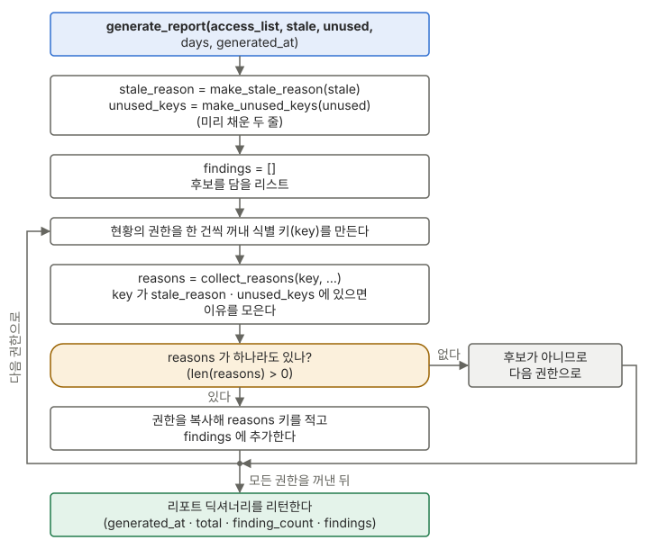

# 응용 3-2 · 점검 결과 한 장 리포트로 합치기

## 목표: 과다권한 후보 리포트

> 여유가 되면 해 보세요. 「제공 파일」로 받은 `overprivilege.py` 를 이번에는 직접 써 봅니다.

> **이번 실습에 들어온 일**
>
> A사 관제 담당이 보낸 메시지:
> 「지난 보안 회의에서 팀장님이 "점검 결과는 한 장만 보면 되게 해 주세요"라고 하셨습니다. 지금은 규칙으로 걸린 리스트와 90일 넘게 안 쓴 리스트가 따로 나옵니다. 같은 권한이 두 리스트에 모두 나올 수도 있어서, 합치면 후보가 몇 건인지 저도 바로 말하지 못합니다.
>
> 후보 권한마다 어떤 이유로 걸렸는지를 권한 한 건에 모은, 한 장짜리 리포트를 만들어 주세요.」
> - **왜 중요한가**: 리스트가 둘로 나뉘어 있으면 같은 권한이 양쪽에 있어도 알아보기 어려워서, 후보가 몇 건인지 말할 수 없습니다. 이유까지 권한 한 건에 모은 리포트 한 장이 있으면, 그 한 장만 보고 어떤 권한을 회수할지 정할 수 있습니다.

## 왜 점검 결과를 한 장으로 합치는가

1. 규칙으로 찾은 결과와 90일 넘게 안 쓴 권한을 찾은 결과가 따로 나오면, 담당자가 같은 권한이 두 곳에 나오는지 직접 맞춰 봐야 합니다. 두 결과를 합쳐 모은 것이 **후보**입니다. 후보는 **과다권한**(over-privilege · 오버 프리빌리지), 곧 업무에 필요한 것보다 많이 가진 권한일 수 있는 권한입니다.
2. 후보 하나에 걸린 **이유**를 붙여 한곳에 모읍니다.
3. 이번 실습의 리포트는 **리포트 한 장 = 딕셔너리 하나**입니다. 여기서 「리포트」는 프로그램이 만드는 점검 결과이고, 「보고서」는 내가 답을 적는 `report_u3.md` 입니다.
4. 실습 3-2에서는 규칙에 걸린 권한을 빼고 안 쓴 권한을 찾았지만, 이번에는 **전체 현황**에 두 점검을 따로 돌립니다. 그래서 권한 한 건이 두 이유에 모두 걸릴 수 있고, 안 쓴 권한도 실습 3-2보다 더 많이 나옵니다. 코드가 틀려서가 아니라 규칙에 걸린 권한도 함께 검사하기 때문입니다.

## 1.1 리포트의 모양

| 리포트의 키 | 뜻 | 값의 예 |
|---|---|---|
| `generated_at` | 리포트를 만든 시각 | `"2026-10-29 14:00"` |
| `total` | 점검한 권한 수 (현황의 권한 수) | `14` |
| `finding_count` | 후보 수 | `10` |
| `findings` | 후보 리스트. 후보 한 건 = 현황의 권한 한 건 + `reasons` 키 | `[{…}, {…}]` |

- 「90일 넘게 안 씀(이력 없음 포함)」은 사용 이력이 아예 없는 권한도 이 이유에 넣는다는 뜻입니다.
- `reasons` 는 이유 문자열의 **리스트**입니다.
  - 규칙에 걸렸으면 그 이유(`"퇴사한 계정"` 등)가, 오래 안 썼으면 `"90일 넘게 안 씀(이력 없음 포함)"` 이 들어갑니다.
  - 이유가 하나도 없는 권한은 후보가 아니므로 `findings` 에 넣지 않습니다.
- 「90일 넘게」는 실습 3-2 와 같은 기준입니다. 마지막으로 쓴 뒤 지난 일 수가 91일 이상이거나 사용 이력이 없으면 해당합니다.
- `stale`(스테일)은 「오래돼서 쓸모없어진」이라는 뜻으로, 퇴사 · 만료로 필요 없어진 권한을 말합니다.
  - 변수 `stale` 은 `review_rules.py` 의 `find_stale` 이 리턴한 「규칙에 걸린 권한」 리스트이고(여기서 「걸렸다」는 퇴사 · 만료 규칙에 해당한다는 뜻), `unused` 는 실습 3-2의 `find_unused` 가 리턴한 「90일 넘게 안 쓴 권한」 리스트입니다.
- 이번에 새로 하는 것은 두 점검 결과를 권한 한 건마다 하나의 `reasons` 리스트로 합치는 것입니다.
  - 복사해서 키를 추가하는 `entry.copy()` 와 문자열로 이어 붙인 키로 찾는 방법은 실습 3-2 의 `review_unused.py` 와 같습니다.

**식별 키**

- 현황의 **권한 한 건**(`entry`)은 사용자 한 명의 권한 하나입니다.
  - `stale` 과 `unused` 의 권한은 현황의 권한을 **복사해서 `reason` 이나 `last_used` 키를 추가한 것**이라, 현황의 원래 권한과 `==` 로 비교하면 서로 다르다고 나옵니다.
  - `user` · `permission` · `source` 세 값을 하나씩 비교해도 되지만, 세 값을 `:` 로 이어 붙여 문자열 하나로 만들면 딕셔너리의 키로 쓸 수 있어서 `key in stale_reason` 한 번으로 찾을 수 있습니다.
  - 이 문자열을 **식별 키**(identification key · 아이덴티피케이션 키)라고 부릅니다.
  - 현황의 권한 한 건을 다른 권한과 구별하는 문자열입니다.
  - 실습 3-2의 실행 파일에서도 같은 방법으로 규칙에 걸린 권한을 뺐습니다.
- 현황에서 dami 의 `SALES:QUERY` 는 역할로도, 예외로도 부여돼 있어서 서로 다른 두 건이고, 식별 키도 서로 달라야 합니다.

| 현황의 권한 한 건 (`entry`) | 식별 키 (`entry_key(entry)` 가 리턴하는 문자열) |
|---|---|
| `user` dami · `permission` SALES:QUERY · `source` 역할 sales | `"dami:SALES:QUERY:역할 sales"` |
| `user` dami · `permission` SALES:QUERY · `source` 예외 3번 | `"dami:SALES:QUERY:예외 3번"` |

- 이번 실습의 데이터에서는 이 두 건의 점검 결과가 같아서(둘 다 「퇴사한 계정」) `source` 가 없어도 출력은 같습니다.
  - 하지만 한쪽 권한만 만료되는 날처럼 두 건의 결과가 다르면, `source` 가 없을 때 한쪽 이유가 다른 쪽 권한에도 붙어 후보가 잘못 나옵니다.

**미리 채워 둔 함수와 리포트의 이름들**

`reason` 과 `reasons` 는 한 글자 차이입니다. 후보에는 `reasons` 를 씁니다.

| 이름 | 무엇 |
|---|---|
| `reason` | 문자열 하나, 규칙 결과에 있는 이유 |
| `reasons` | 리스트, 이번 실습에서 후보에 적는 이유들 |
| `findings`(파인딩스) | 「찾아낸 것들」, 곧 후보 리스트 |

함수 다섯 개는 아래와 같습니다. 번호는 골격에서 직접 쓰는 줄의 번호입니다.

| 함수 | 하는 일 | 직접 쓰는 줄 |
|---|---|---|
| `entry_key` | 식별 키를 만듦 (받은 방식까지 이어 붙임) | 1번 |
| `make_stale_reason` (메이크 스테일 리즌) | 규칙에 걸린 권한의 「식별 키 → 걸린 이유」 딕셔너리를 리턴 | 2번 한 줄 |
| `make_unused_keys` (메이크 언유즈드 키즈) | 90일 넘게 안 쓴 권한의 식별 키 리스트를 리턴 | 3번 한 줄 |
| `collect_reasons` | 권한 하나의 식별 키로 이유를 모아 리스트로 리턴 | 4 ~ 7번 |
| `generate_report` | `collect_reasons` 가 모은 이유가 있는 권한만 후보로 만들어 모음 | 8 ~ 11번 |

- `make_stale_reason` 이 리턴하는 딕셔너리의 예: `{"dami:SALES:QUERY:역할 sales": "퇴사한 계정", "dami:SALES:CHANGE:역할 sales": "퇴사한 계정", …}`
- `make_unused_keys` 가 리턴하는 리스트의 예: `["seoyeon:SALES:CHANGE:역할 sales", "junho:SALES:QUERY:역할 finance", …]`
- 이 두 함수를 부르는 줄은 `generate_report` 의 처음 두 줄에 미리 채워 두었습니다. `generate_report` 의 리포트 딕셔너리 만들기와 `return` 도 미리 채웠습니다.
- 실행 파일은 이유 리스트를 한 줄로 출력할 때 `", ".join(리스트)` 을 씁니다. 리스트의 문자열들을 쉼표로 이어 붙여 하나의 문자열로 만드는 것입니다.

<figure class="page-figure"></figure>

## 응용 3-2 · 과다권한 후보 리포트 만들기

**이런 상황이 있습니다**

- **지금은**: 규칙에 걸린 권한과 90일 넘게 안 쓴 권한이 따로 출력됩니다.
  - 같은 권한이 두 점검에 모두 걸릴 수도 있어서, 담당자가 둘을 합쳐 「후보가 모두 몇 건이고 왜 걸렸나」를 직접 정리해야 합니다.
- **그래서 만드는 것**: `generate_report` 입니다.
  - 현황의 권한을 하나씩 보면서, 규칙에 걸렸거나 안 쓴 권한이면 이유를 `reasons` 리스트에 담아 후보로 모으고, 리포트 딕셔너리로 리턴합니다.
- **실행하면**: 단계 1은 리포트 요약 한 줄과 후보를 이유와 함께 한 줄씩 출력하고, 단계 2는 후보가 아닌 권한을 출력합니다.
  - 실행 파일은 현황 전체에 규칙 점검과 안 쓴 권한 점검을 따로 돌립니다.
  - 지금 시각은 `2026-10-29 14:00` 으로 고정합니다.
- **현업에서는**: 접근 점검 도구도 여러 점검 결과를 한 장의 리포트로 합쳐 담당자에게 보냅니다.

**할 일**

1. 「제공 파일」로 만든 `overprivilege.py` 의 내용을 모두 지우고 아래 골격으로 바꾼 뒤, `apply3-2_run.py` 를 새로 만듭니다. 그다음 `entry_key` · `make_stale_reason` · `make_unused_keys` · `collect_reasons` · `generate_report` 에서 직접 쓰는 곳 다섯 군데를 씁니다.
2. 실행해서 <mark>리포트 요약과 후보</mark>(단계 1: 요약)와 <mark>후보가 아닌 권한</mark>(단계 2: 확인)을 읽습니다.

**`overprivilege.py`**

```python
def entry_key(entry):                                            # 현황의 권한 한 건의 식별 키를 만드는 함수
    """현황의 권한 한 개의 식별 키를 리턴한다.
    키는 user:permission:source 를 이어 붙인 문자열이다.
    같은 권한을 찾아 비교할 때 쓴다.
    """
    key = entry["user"] + ":" + entry["permission"]              # 사용자와 권한을 : 로 이어 붙이고
    # ← 아래를 직접 씁니다 (주석은 두고 각 주석 바로 아래 줄에 씁니다)
    # 1. key 뒤에 ":" 와 entry["source"] 를 이어 붙인 문자열을 key 에 다시 담는다 (받은 방식까지 넣어 식별 키를 만든다)
    return key                                                   # 식별 키를 리턴한다


def make_stale_reason(stale):                                    # 규칙에 걸린 권한 리스트를 받는 함수
    """규칙에 걸린 권한의 식별 키를 키로, 걸린 이유를 값으로 하는 딕셔너리를 리턴한다.
    필요 없어진 권한에 이유를 붙일 때 쓴다.
    """
    stale_reason = {}                                            # 식별 키 → 걸린 이유를 담을 빈 딕셔너리
    for item in stale:                                           # 규칙에 걸린 권한을 하나씩 꺼낸다
        item_key = entry_key(item)                               # 그 권한의 식별 키를 만든다
        # ← 아래를 직접 씁니다 (주석은 두고 각 주석 바로 아래 줄에 씁니다)
        # 2. stale_reason 의 item_key 키에 item["reason"] 을 담는다 (식별 키로 걸린 이유를 찾을 수 있게)
    return stale_reason                                          # 딕셔너리를 리턴한다


def make_unused_keys(unused):                                    # 안 쓴 권한 리스트를 받는 함수
    """안 쓴 권한의 식별 키 리스트를 리턴한다.
    안 쓴 권한을 다른 점검 결과와 비교할 때 쓴다.
    """
    unused_keys = []                                             # 안 쓴 권한의 식별 키를 담을 빈 리스트
    for item in unused:                                          # 안 쓴 권한을 하나씩 꺼낸다
        item_key = entry_key(item)                               # 식별 키를 만든다
        # ← 아래를 직접 씁니다 (주석은 두고 각 주석 바로 아래 줄에 씁니다)
        # 3. unused_keys 에 item_key 를 추가한다 (.append)
    return unused_keys                                           # 리스트를 리턴한다


def collect_reasons(key, stale_reason, unused_keys, days):       # 식별 키 · 걸린 이유 딕셔너리 · 안 쓴 권한의 식별 키 리스트 · 기준 일 수를 받는 함수
    """그 권한에 해당하는 과다권한 이유를 모아 리스트로 리턴한다(없으면 빈 리스트).
    후보마다 왜 걸렸는지 적을 때 쓴다.
    """
    reasons = []                                                 # 이유를 담을 빈 리스트
    # ← 아래를 직접 씁니다 (주석은 두고 각 주석 바로 아래 줄에 씁니다)
    # 4. key 가 stale_reason 에 있으면 (in)
    # 5.   reasons 에 stale_reason[key] 를 추가한다
    # 6. key 가 unused_keys 에 있으면 (in)
    # 7.   reasons 에 f"{days}일 넘게 안 씀(이력 없음 포함)" 을 추가한다
    return reasons                                               # 이유 리스트를 리턴한다


def generate_report(access_list, stale, unused, days, generated_at):   # 현황 · 규칙 결과 · 안 쓴 결과 · 기준 일 수 · 만든 시각 문자열을 받는 함수
    """과다권한 후보 리포트(딕셔너리)를 리턴하고 후보마다 "reasons" 키에 이유 리스트를 적는다.
    점검 결과를 한눈에 정리해 보고할 때 쓴다.
    """
    stale_reason = make_stale_reason(stale)                      # 규칙에 걸린 권한의 식별 키 → 걸린 이유 딕셔너리를 만든다(미리 채움)
    unused_keys = make_unused_keys(unused)                       # 안 쓴 권한의 식별 키 리스트를 만든다(미리 채움)
    findings = []                                                # 후보를 담을 빈 리스트
    for entry in access_list:                                    # 현황의 권한을 한 건씩 꺼낸다
        key = entry_key(entry)                                   # 그 권한의 식별 키를 만든다
        reasons = collect_reasons(key, stale_reason, unused_keys, days)   # 그 권한에 해당하는 이유를 모은다
        # ← 아래를 직접 씁니다 (주석은 두고 각 주석 바로 아래 줄에 씁니다)
        # 8. reasons 의 개수가 0 보다 크면 (len(reasons) > 0)
        # 9.   entry.copy() 를 finding 에 담는다
        # 10.  finding["reasons"] 를 reasons 로 정한다
        # 11.  findings 에 finding 을 추가한다
    report = {                                                   # 리포트 딕셔너리를 만든다
        "generated_at": generated_at,                            # 리포트를 만든 시각
        "total": len(access_list),                               # 점검한 전체 권한 수
        "finding_count": len(findings),                          # 후보 수
        "findings": findings,                                    # 후보 리스트
    }
    return report                                                # 리포트를 리턴한다

```

- **직접 쓰는 곳은 다섯 함수**입니다. 판단이 필요한 함수마다 1 ~ 4줄만 쓰고, 나머지는 미리 채웠습니다.
  - `entry_key`(1번) · `make_stale_reason`(2번) · `make_unused_keys`(3번): 한 줄씩입니다.
  - `collect_reasons`(4 ~ 7번): 규칙에 걸린 이유와 안 쓴 이유를 모읍니다.
  - `generate_report`(8 ~ 11번): 이유가 있는 권한만 후보로 모읍니다.
- 들여쓰기는 미리 채운 줄에 맞춥니다.

| 쓰는 곳 | 앞 공백 | 까닭 |
|---|---|---|
| `entry_key` · `collect_reasons` 안 | 4개 (5 · 7번은 8개) | 함수 안 (5 · 7번은 4개 더) |
| `make_stale_reason` · `make_unused_keys` 안 | 8개 | 미리 채운 `for` 안쪽 |
| `generate_report` 의 8번 `if` | 8개 | 미리 채운 `for` 안쪽 |
| `generate_report` 의 9 ~ 11번 | 12개 | 8번 `if` 안쪽 (4개 더) |

- 채우기 전에 실행해도 오류는 나지 않고 후보가 `0 건` 으로 나옵니다. 아직 이유를 모으지 않았기 때문입니다.

**`apply3-2_run.py`** — 그대로 붙여 넣습니다. 학생이 쓰는 줄은 없습니다. 실습 3-1 · 3-2 와 `review_rules.py` 의 함수로 현황과 규칙 결과, 안 쓴 결과를 만든 뒤 `generate_report` 로 리포트를 만들어 출력합니다. 실행 파일의 `NOW.strftime(TIME_FORMAT)` 은 `strptime` 과 반대로, 시각을 `"2026-10-29 14:00"` 같은 문자열로 바꿉니다.

```python
from datetime import datetime                                    # 지금 시각을 만드는 데 쓴다
from review_list import build_access_list                        # 실습 3-1에서 만든 현황 함수를 불러온다
from review_rules import find_stale                              # review_rules.py 의 규칙 점검 함수를 불러온다
from review_unused import load_last_used, find_unused            # 실습 3-2에서 만든 안 쓴 권한 점검 함수를 불러온다
from overprivilege import generate_report, entry_key             # 방금 만든 리포트 함수와 식별 키 함수를 불러온다

NOW = datetime.strptime("2026-10-29 14:00", "%Y-%m-%d %H:%M")    # 이번 실습의 지금 시각(고정)
TIME_FORMAT = "%Y-%m-%d %H:%M"                                   # 시각 문자열의 형식

access_list = build_access_list()                                # 현황을 만든다
stale = find_stale(access_list, NOW)                             # 규칙에 걸린 권한을 찾는다
last_used_map = load_last_used()                                 # 마지막 사용 시각 딕셔너리를 읽는다
unused = find_unused(access_list, last_used_map, NOW, 90)        # 같은 현황에서 90일 넘게 안 쓴 권한을 찾는다(규칙에 걸린 권한도 빼지 않고 전부 넣는다)

generated_at = NOW.strftime(TIME_FORMAT)                         # 리포트를 만든 시각을 문자열로 바꾼다
report = generate_report(access_list, stale, unused, 90, generated_at)  # 과다권한 후보 리포트를 만든다

print("--- 단계 1: 요약 - 점검", report["total"], "건 중 후보", report["finding_count"], "건 (", report["generated_at"], ")")   # 단계 1 시작을 알리는 줄
for finding in report["findings"]:                               # 후보를 한 건씩 꺼낸다
    reasons_text = ", ".join(finding["reasons"])                 # 이유 리스트를 쉼표로 이어 붙인 문자열로 만든다
    print(finding["user"], finding["permission"], "<-", finding["source"], "|", reasons_text)  # 사용자 · 권한 <- 출처 | 이유들을 출력한다

print("--- 단계 2: 확인 - 후보가 아닌 권한")                       # 단계 2 시작을 알리는 줄
finding_keys = []                                                # 후보의 식별 키를 담을 빈 리스트
for finding in report["findings"]:                               # 후보를 하나씩 꺼내
    finding_key = entry_key(finding)                             # 식별 키를 만든다
    finding_keys.append(finding_key)                             # 그 식별 키를 리스트에 추가한다
names = []                                                       # 후보가 아닌 권한(「사용자 권한」 문자열)을 담을 빈 리스트
for entry in access_list:                                        # 현황의 권한을 한 건씩 꺼낸다
    if entry_key(entry) not in finding_keys:                     # 식별 키가 후보 리스트에 없으면
        names.append(entry["user"] + " " + entry["permission"])  # 사용자와 권한을 리스트에 추가한다
print(names)                                                     # 후보가 아닌 권한을 출력한다
```

**순서**

1. **[VS Code]** `overprivilege.py` 를 열어 내용을 모두 지우고 위 골격을 붙여 넣고 저장합니다. 이어서 `access_control` 폴더를 선택하고 **새 파일**(New File) 아이콘으로 `apply3-2_run.py` 를 만들어 붙여 넣고 저장합니다.
2. **[VS Code]** `overprivilege.py` 에서 직접 쓰는 곳 다섯 군데(`entry_key` · `make_stale_reason` · `make_unused_keys` · `collect_reasons` · `generate_report`)를 씁니다. 1.1 의 표와 그림을 보고 씁니다.
3. **[터미널]** `pwd` 의 결과가 `access_control` 로 끝나는지 확인하고 실행합니다(맥북은 `python3`).
   ```bash
   pwd
   python apply3-2_run.py
   ```
4. 출력은 두 단계입니다. 단계 1은 요약 한 줄과 후보 한 줄씩, 단계 2는 후보가 아닌 권한 리스트 한 줄입니다.
5. **[보고서]** `report_u3.md` 의 `## 응용 3-2` 아래를 채웁니다(보고서 파일은 「보고서 쓰기」 레슨에서 만듭니다).
   - (가) 실행한 출력 전체를 붙여 넣고, 후보가 모두 몇 건인지, 이유가 둘인 후보가 몇 건인지, 후보가 아닌 권한은 무엇인지 적어 주세요.
   - (나) [핵심 질문] 출력에서 이유가 둘인 후보를 하나 고르고, 이유가 둘이라는 것이 담당자가 처리 순서를 정할 때 어떤 도움이 되는지 적어 주세요. 이유를 문자열 하나가 아니라 리스트(`reasons`)로 담으면 어떤 점이 좋은지도 적어 주세요.
   - (다) [핵심 질문] 프로그램이 만든 리포트에는 후보만 담고, 후보가 아닌 권한은 전체 건수(`total`)로만 남겼습니다. 후보가 아닌 권한까지 모두 담는 방법과 비교해 담당자 입장에서 어느 쪽이 나은지 이유와 함께 적어 주세요.

## 응용 3-2 정리

| 하려는 일 | 코드 · 말 | 쓰는 곳 |
|---|---|---|
| 권한의 식별 키 만들기 | `key = key + ":" + entry["source"]` | `entry_key` |
| 걸린 이유 딕셔너리에 담기 | `stale_reason[item_key] = item["reason"]` | `make_stale_reason` |
| 안 쓴 권한의 식별 키 리스트에 담기 | `unused_keys.append(item_key)` | `make_unused_keys` |
| 규칙에 걸렸는지 (딕셔너리의 키로 찾기) | `if key in stale_reason:` → `reasons.append(stale_reason[key])` | `collect_reasons` |
| 90일 넘게 안 썼는지 (리스트에서 찾기) | `if key in unused_keys:` → `reasons.append(…)` | `collect_reasons` |
| 이유가 하나라도 있는지 | `if len(reasons) > 0:` | `generate_report` |
| 후보 만들기 | `finding = entry.copy()` → `finding["reasons"] = reasons` | `generate_report` |

---
