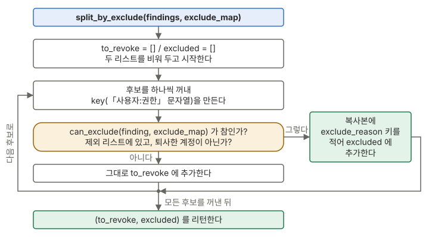

# 도전 3-3 · 회수 제외 권한 가려내기

## 목표: 회수 제외 리스트

> 선택입니다. 시간이 남을 때 합니다. 「제공 파일」로 받은 `report_exclude.py` 를 이번에는 직접 써 봅니다.

> **이번 실습에 들어온 일**
>
> A사 관제 담당이 보낸 메시지:
> 「점검 결과 후보 10건 가운데 평소에 안 쓰는 것이 정상인 권한이 두 개 있습니다.
> - 가은의 `ACCOUNT:CHANGE`(계정 설정을 바꾸는 권한): 계정에 사고가 났을 때만 씁니다.
> - 서연의 `SALES:CHANGE`(영업 자료를 바꾸는 권한): 6월 말과 12월 말, 반년에 한 번 결산 때만 씁니다.
>
> 다음에 권한을 회수할 때 이 두 권한까지 없어지면 필요한 날 일을 못 합니다. 회수하지 않을 권한은 파일에 적어 둘 테니, 후보를 「회수 대상」과 「회수 제외」로 나눠 주세요.」
> - **왜 중요한가**: 후보를 전부 회수하면, 가은은 계정에 사고가 난 날 서연은 결산하는 날 필요한 권한이 없어 일을 못 합니다. 그래서 회수하기 전에 「회수 제외」를 먼저 가려냅니다.

## 왜 회수 제외 리스트가 필요한가

1. 과다권한 후보 리포트(`overprivilege.py` 의 `generate_report`)에 나온 후보 10건은 「바로 회수할 권한」이 아니라 「확인이 필요한 권한」입니다.
2. 후보 중에는 평소에 안 써도 되는 권한이 있습니다. 담당자가 이런 권한을 **회수 제외 리스트**(exclude list · 익스클루드 리스트, 줄여서 제외 리스트)에 적어 두면, 프로그램이 후보를 「회수 대상」과 「회수 제외」로 나눕니다.
3. 단, 퇴사한 사람의 권한은 제외 리스트에 있어도 제외하지 않습니다. 이미 회사에 없는 사람의 계정에 권한이 열려 있으면 다른 사람이 몰래 쓸 수 있어 위험하기 때문입니다.
4. 제외 리스트는 사람이 적기 때문에 잘못 적을 수 있습니다. 리스트에 있다는 이유만으로 무조건 믿으면, 퇴사한 사람의 권한처럼 제외하면 안 되는 것까지 남게 됩니다.

## 2.1 회수 제외 리스트의 모양

`config/exclude_list.json` 의 한 건은 아래 세 키로 이루어집니다. 제외하는 기간을 적는 키는 없습니다.

| 키 | 뜻 | 값의 예 |
|---|---|---|
| `user` | 사용자 | `"gaeun"` |
| `permission` | 권한 | `"ACCOUNT:CHANGE"` |
| `reason` | 제외하는 이유 | `"계정에 사고가 났을 때만 쓰는 권한이라 평소에는 쓰지 않음"` |

- 이번 리스트에는 권한이 세 건 있습니다.
  - 가은(`gaeun`) `ACCOUNT:CHANGE`, 서연(`seoyeon`) `SALES:CHANGE`, 다미(`dami`) `SALES:QUERY` 입니다.
  - 메시지에는 두 개만 나왔고, 세 번째 다미 권한은 문제 (나)에서 다룹니다.
- 제외 리스트와 후보는 「사용자:권한」 문자열(예: `"gaeun:ACCOUNT:CHANGE"`)이 같은지 비교합니다.
  - `overprivilege.py` 의 식별 키와 달리 `source`(역할인지 예외인지)는 붙이지 않습니다.
  - 제외 리스트는 어떻게 받은 권한이든 그 사람의 그 권한을 기준으로 적기 때문입니다.
- 함수 네 개를 씁니다. `make_excluded` 는 판단이 없는 복사라 미리 채웠습니다.

| 함수 | 직접 쓰는 줄 | 하는 일 |
|---|---|---|
| `exclude_key` | 1번 | 「사용자:권한」 문자열을 만듦 (`source` 는 넣지 않음) |
| `load_exclude_map` | 2번 한 줄 | 파일을 읽어 딕셔너리 `exclude_map` 을 만듦 |
| `can_exclude` | 3 ~ 6번 | 후보를 회수 제외해도 되는지 `True` · `False` 로 알려 줌 |
| `split_by_exclude` | 7 ~ 12번 | `can_exclude` 의 결과로 후보를 둘로 나눔 |
| `make_excluded` | 미리 채움 | 후보를 복사해 `exclude_reason` 키(제외 이유)를 적은 복사본을 리턴 |

- `exclude_map` 은 `{"gaeun:ACCOUNT:CHANGE": "계정에 사고가 …", …}` 모양입니다.
- 이름이 비슷한 것을 헷갈리지 마세요. `reason` 과 `reasons` 는 한 글자 차이입니다.

| 이름 | 무엇 |
|---|---|
| `reason` | 제외 리스트 파일에 적힌 제외 이유 문자열 |
| `reasons` | 리포트 후보에 붙은 이유 리스트 |
| `to_revoke`(투 리보크) | 회수 대상 리스트 |
| `excluded`(익스클루디드) | 제외된 후보 리스트 |

- 두 리스트는 `return to_revoke, excluded` 로 한꺼번에 리턴하고, 받는 쪽은 `to_revoke, excluded = …` 로 두 이름에 나눠 받습니다(리턴한 두 값이 차례로 두 이름에 들어갑니다).

<figure class="page-figure"></figure>

## 도전 3-3 · 회수 대상과 회수 제외 나누기

**이런 상황이 있습니다**

- **지금은**: 과다권한 후보 리포트의 후보 10건이 한 리스트에 섞여 있습니다. 회수하지 않을 권한을 담당자가 눈으로 골라야 합니다.
- **그래서 만드는 것**: `split_by_exclude` 입니다.
  - 제외 리스트에 있는 후보는 `exclude_reason` 키를 붙여 「회수 제외」로, 나머지는 「회수 대상」으로 나눕니다.
  - 후보에 붙은 이유(`reasons`)에 「퇴사한 계정」이 있으면 제외 리스트에 있어도 제외하지 않습니다.
- **실행하면**: 단계 1은 분류 건수, 단계 2는 회수 제외한 후보와 이유, 단계 3은 제외 리스트에 있지만 회수 대상으로 남은 후보를 출력합니다.
- **현업에서는**: 자동 점검 도구도 회수 제외 리스트를 두고, 비상용 권한이나 사람이 아닌 프로그램용 계정의 권한을 회수 대상에서 뺍니다.

**할 일**

1. `config/exclude_list.json` 은 「제공 파일」에서 이미 만들었으니 그대로 둡니다. 「제공 파일」로 만든 `report_exclude.py` 의 내용을 모두 지우고 아래 골격으로 바꾼 뒤, `challenge3-3_run.py` 를 새로 만듭니다. 그다음 `exclude_key` · `load_exclude_map` · `can_exclude` · `split_by_exclude` 에서 직접 쓰는 곳 네 군데를 씁니다.
2. 실행해서 <mark>분류 건수</mark>(단계 1: 분류), <mark>회수 제외한 후보</mark>(단계 2: 제외), <mark>회수 대상으로 남은 후보</mark>(단계 3: 확인)를 읽습니다.

**`config/exclude_list.json`** — 「제공 파일」에서 만든 회수 제외 리스트입니다. 다시 만들지 않고, 내 파일이 아래와 같은지만 봅니다. 없으면 「제공 파일」 레슨에서 만듭니다.

```json
[
  {"user": "gaeun", "permission": "ACCOUNT:CHANGE", "reason": "계정에 사고가 났을 때만 쓰는 권한이라 평소에는 쓰지 않음"},
  {"user": "seoyeon", "permission": "SALES:CHANGE", "reason": "6월 말 · 12월 말 결산 때만 쓰는 권한"},
  {"user": "dami", "permission": "SALES:QUERY", "reason": "일을 넘겨받을 사람이 정해질 때까지 필요"}
]
```

**`report_exclude.py`**

```python
from config_loader import load_json                              # config_loader.py 의 안전한 읽기 함수를 불러온다


def exclude_key(entry):                                          # 사용자와 권한이 든 딕셔너리(후보 또는 제외 리스트의 한 건)를 받는 함수
    """「사용자:권한」 문자열을 리턴한다.
    제외 리스트와 점검 후보를 비교하는 키로 쓴다.
    """
    user = entry["user"]                                         # 그 권한의 사용자
    permission = entry["permission"]                             # 그 권한의 권한 이름
    # ← 아래를 직접 씁니다 (주석은 두고 각 주석 바로 아래 줄에 씁니다)
    # 1. f"{user}:{permission}" 을 리턴한다 (사용자와 권한을 : 로 이어 붙인 문자열. 받은 방식 source 는 넣지 않는다)


def make_excluded(finding, reason):                              # 후보 한 건과 제외 이유 문자열을 받는 함수
    """후보를 복사해 "exclude_reason" 키(제외 이유)를 적는다.
    회수에서 뺀 후보에 이유를 남길 때 쓴다(원래 후보는 바꾸지 않음).
    """
    item = finding.copy()                                        # 원래 후보는 바꾸지 않고 복사한다
    item["exclude_reason"] = reason                              # 복사본에 제외 이유를 적는다
    return item                                                  # 복사본을 리턴한다


def load_exclude_map(path):                                      # 회수 제외 리스트 파일 경로를 받는 함수
    """회수 제외 리스트 파일을 읽어 「사용자:권한」을 키로, 제외 이유를 값으로 하는 딕셔너리를 리턴한다.
    계속 필요한 권한을 가려낼 준비를 할 때 쓴다.
    """
    exclude_map = {}                                             # 빈 딕셔너리로 시작한다
    for item in load_json(path, []):                             # 제외 리스트의 권한을 한 건씩 꺼낸다(파일이 없으면 빈 리스트)
        item_key = exclude_key(item)                             # 그 권한의 「사용자:권한」 문자열을 만든다
        # ← 아래를 직접 씁니다 (주석은 두고 각 주석 바로 아래 줄에 씁니다)
        # 2. exclude_map 의 item_key 키에 item["reason"] 을 담는다 (제외 이유)
    return exclude_map                                           # 딕셔너리를 리턴한다


def can_exclude(finding, exclude_map):                           # 후보 한 건과 제외 이유 딕셔너리를 받는 함수
    """후보를 회수 제외해도 되는지 알려 준다.
    계속 필요한 권한을 가려낼 때 쓰며, 퇴사한 계정은 제외하지 않는다.
    """
    # ← 아래를 직접 씁니다 (주석은 두고 각 주석 바로 아래 줄에 씁니다)
    # 3. exclude_key(finding) 을 key 에 담는다
    # 4. key 가 exclude_map 에 있는지 (in) 를 in_exclude_list 에 담는다
    # 5. "퇴사한 계정" 이 finding["reasons"] 에 있는지 (in) 를 is_resigned 에 담는다
    # 6. in_exclude_list 이고 is_resigned 가 아니면 True 가 되도록 리턴한다 (and not)


def split_by_exclude(findings, exclude_map):                     # 후보 리스트와 제외 이유 딕셔너리를 받는 함수
    """후보를 (회수 대상 후보 리스트, 회수 제외 후보 리스트)로 나눠 리턴한다.
    이유에 「퇴사한 계정」이 있으면 제외하지 않으며, 회수할 것과 남길 것을 가를 때 쓴다.
    """
    to_revoke = []                                               # 회수 대상을 담을 빈 리스트
    excluded = []                                                # 회수 제외를 담을 빈 리스트
    for finding in findings:                                     # 후보를 하나씩 꺼낸다
        key = exclude_key(finding)                               # 「사용자:권한」 문자열을 만든다
        # ← 아래를 직접 씁니다 (주석은 두고 각 주석 바로 아래 줄에 씁니다)
        # 7. can_exclude(finding, exclude_map) 가 참이면
        # 8.   exclude_map[key] 를 reason 에 담는다
        # 9.   make_excluded(finding, reason) 을 excluded_entry 에 담는다
        # 10.  excluded_entry 를 excluded 에 추가한다
        # 11. 그렇지 않으면 (else)
        # 12.   to_revoke 에 finding 을 추가한다
    return to_revoke, excluded                                   # 두 리스트를 함께 리턴한다
```

- 4 · 5번의 `key in exclude_map` 같은 `in` 검사는 그 자체가 `True` 나 `False` 값이라, `in_exclude_list = key in exclude_map` 처럼 변수에 담을 수 있습니다.
- 들여쓰기는 미리 채운 줄에 맞춥니다.

| 쓰는 곳 | 앞 공백 | 까닭 |
|---|---|---|
| `exclude_key` · `can_exclude` 안 | 4개 | 함수 안 |
| `load_exclude_map` 안 | 8개 | 미리 채운 `for` 안쪽 |
| `split_by_exclude` 의 `if` · `else` | 8개 | 미리 채운 `for` 안쪽 |
| `split_by_exclude` 의 8 ~ 10번, 12번 | 12개 | `if` · `else` 안쪽 (4개 더) |

- 채우기 전에 실행하면 회수 대상도 회수 제외도 `0 건` 으로 나옵니다. `split_by_exclude` 의 7 ~ 12번을 아직 쓰지 않아 후보가 어느 리스트에도 들어가지 않기 때문입니다.

**`challenge3-3_run.py`** — 그대로 붙여 넣습니다. 학생이 쓰는 줄은 없습니다. `overprivilege.py` 의 `generate_report` 로 리포트를 만든 뒤, 회수 제외 리스트를 읽어 후보를 나누고 세 단계로 출력합니다.

```python
from datetime import datetime                                    # 지금 시각을 만드는 데 쓴다
from review_list import build_access_list                        # 실습 3-1에서 만든 현황 함수를 불러온다
from review_rules import find_stale                              # review_rules.py 의 규칙 점검 함수를 불러온다
from review_unused import load_last_used, find_unused            # 실습 3-2에서 만든 안 쓴 권한 점검 함수를 불러온다
from overprivilege import generate_report                        # overprivilege.py 의 리포트 함수를 불러온다
from report_exclude import load_exclude_map, split_by_exclude   # 방금 만든 회수 제외 함수를 불러온다

NOW = datetime.strptime("2026-10-29 14:00", "%Y-%m-%d %H:%M")    # 이번 실습의 지금 시각(고정)
TIME_FORMAT = "%Y-%m-%d %H:%M"                                   # 시각 문자열의 형식

access_list = build_access_list()                                # 현황을 만든다
stale = find_stale(access_list, NOW)                             # 규칙에 걸린 권한을 찾는다
last_used_map = load_last_used()                                 # 마지막 사용 시각 딕셔너리를 읽는다
unused = find_unused(access_list, last_used_map, NOW, 90)        # 같은 현황에서 90일 넘게 안 쓴 권한을 찾는다(규칙에 걸린 권한도 빼지 않고 전부 넣는다)
generated_at = NOW.strftime(TIME_FORMAT)                         # 리포트를 만든 시각을 문자열로 바꾼다
report = generate_report(access_list, stale, unused, 90, generated_at)  # 과다권한 후보 리포트를 만든다

exclude_map = load_exclude_map("config/exclude_list.json")   # 회수 제외 리스트를 읽는다
to_revoke, excluded = split_by_exclude(report["findings"], exclude_map)   # 후보를 회수 대상과 회수 제외로 나눈다

print("--- 단계 1: 분류 - 후보", report["finding_count"], "건 중 회수 대상", len(to_revoke), "건, 회수 제외", len(excluded), "건")   # 단계 1 시작을 알리는 줄
print("--- 단계 2: 제외 - 회수 제외한 후보와 제외 이유")              # 단계 2 시작을 알리는 줄
for item in excluded:                                            # 회수 제외한 후보를 하나씩 꺼낸다
    print(item["user"], item["permission"], "<-", item["source"], "|", item["exclude_reason"])   # 사용자 · 권한 <- 출처 | 제외 이유를 출력한다

print("--- 단계 3: 확인 - 제외 리스트에 있지만 회수 대상으로 남은 후보")        # 단계 3 시작을 알리는 줄
for item in to_revoke:                                           # 회수 대상을 하나씩 꺼낸다
    item_key = item["user"] + ":" + item["permission"]           # 「사용자:권한」 문자열을 만들고
    if item_key in exclude_map:                                  # 제외 리스트에 있는 권한이면
        reasons_text = ", ".join(item["reasons"])                # 이유 리스트를 쉼표로 이어 붙인 문자열로 만든다
        print(item["user"], item["permission"], "<-", item["source"], "|", reasons_text)  # 사용자 · 권한 <- 출처 | 이유들을 출력한다
```

**순서**

1. **[VS Code]** `report_exclude.py` 를 열어 내용을 모두 지우고 위 골격을 붙여 넣고 저장합니다. 이어서 `access_control` 폴더를 선택하고 **새 파일**(New File) 아이콘으로 `challenge3-3_run.py` 를 만들어 붙여 넣고 저장합니다.
2. **[터미널]** `ls config` 로 `exclude_list.json` 이 `access_log.json` 과 같은 `config` 폴더에 있는지 보고, `python -m json.tool config/exclude_list.json`(맥북은 `python3`)로 내용이 정상인지 확인합니다.
   - 깨진 채 두면 제외 리스트를 읽지 못해 아무것도 제외되지 않습니다.
3. **[VS Code]** `report_exclude.py` 에서 직접 쓰는 곳 네 군데(`exclude_key` · `load_exclude_map` · `can_exclude` · `split_by_exclude`)를 씁니다. 2.1 의 표와 그림을 보고 씁니다.
4. **[터미널]** `pwd` 의 결과가 `access_control` 로 끝나는지 확인하고 실행합니다(맥북은 `python3`).
   ```bash
   pwd
   python challenge3-3_run.py
   ```
5. 출력은 세 단계입니다. 단계 1은 분류 건수 한 줄, 단계 2는 회수 제외한 후보와 이유, 단계 3은 제외 리스트에 있지만 회수 대상으로 남은 후보입니다.
6. **[보고서]** `report_u3.md` 의 `## 도전 3-3` 아래를 채웁니다.
   - (가) 실행한 출력 전체를 붙여 넣고, 회수 대상과 회수 제외가 각각 몇 건인지, 회수 제외된 후보와 제외한 이유를 적어 주세요.
   - (나) [핵심 질문] 단계 3 출력을 보면 다미의 `SALES:QUERY` 는 제외 리스트에 있는데 회수 대상으로 남았습니다. 왜 제외하지 않게 만들었을까요? 제외했다면 어떤 위험이 있을지도 적어 주세요.
   - (다) [핵심 질문] 제외 리스트에는 제외하는 기간을 적는 키가 없습니다. 한 번 적은 권한을 아무도 다시 확인하지 않으면 어떤 문제가 생길까요? 리스트에 권한을 추가할 때 누가 확인하면 좋을까요?

## 도전 3-3 정리

| 하려는 일 | 코드 · 말 | 쓰는 곳 |
|---|---|---|
| 「사용자:권한」 문자열 만들기 | `return f"{user}:{permission}"` | `exclude_key` |
| 제외 이유 딕셔너리에 담기 | `exclude_map[item_key] = item["reason"]` | `load_exclude_map` |
| 제외 리스트에 있는지 | `in_exclude_list = key in exclude_map` | `can_exclude` |
| 이유에 퇴사가 있는지 | `is_resigned = "퇴사한 계정" in finding["reasons"]` | `can_exclude` |
| 제외해도 되는지 | `return in_exclude_list and not is_resigned` | `can_exclude` |
| 제외 이유 꺼내기 | `reason = exclude_map[key]` | `split_by_exclude` |
| 제외된 후보 만들기 | `excluded_entry = make_excluded(finding, reason)` | `split_by_exclude` |
| 제외된 후보 담기 | `excluded.append(excluded_entry)` | `split_by_exclude` |
| 둘로 나눠 리턴 | `return to_revoke, excluded` | `split_by_exclude` |

- 도전을 마쳤으면 실습 3-2 끝의 「이번 Unit 마무리」 3번으로 바뀐 파일을 다시 올립니다.

---

<!-- learn:answers -->
