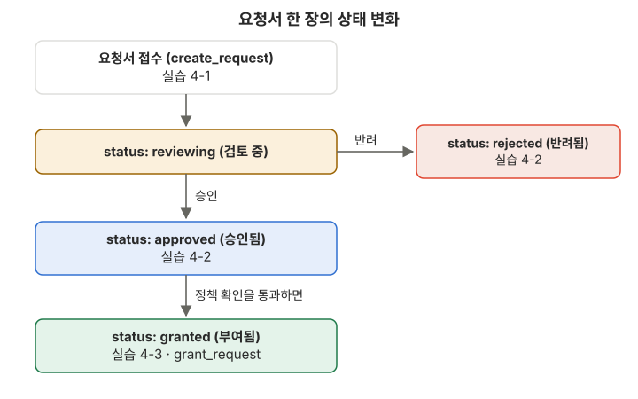

# 실습 4-1 · 승인이 필요한 회수 계획 가려내기

## 목표: 승인 상태가 적힌 회수 계획

> **이번 실습에 들어온 일**
>
> A사 관제 담당이 보낸 메시지:
> 「회수할 8건 가운데에는 데이터를 바꾸는 쓰기 권한(`CHANGE`)도 있습니다. 쓰기 권한은 잘못 없애면 영향이 크니 보안 책임자의 승인을 받고 회수하고 싶습니다. 조회 같은 일반 권한 한 건은 바로 회수해도 됩니다.
>
> 다만 퇴사한 사람의 역할을 비우면 그 사람이 역할로 받던 권한이 모두 없어집니다. 이렇게 권한이 2개 이상 사라지는 회수는 조회 권한이어도 승인을 받아 주세요. 8건 가운데 어느 것이 승인 대상인지 가려서, 계획마다 승인 상태를 적어 주세요. 보안 책임자가 승인한 것과 아직 기다리는 것도 구분해 주세요.」
> - **왜 중요한가**: 중요한 권한을 한 사람이 혼자 정하면 실수나 부정이 생길 수 있습니다. 승인 상태가 적혀 있으면 어느 회수가 승인을 받았고 어느 회수가 아직 기다리는지 바로 알 수 있습니다.

## 왜 승인이 필요한가

1. 준비 Lesson의 계획은 8건 모두 같은 방식으로 다룹니다. 하지만 권한마다 중요도가 다릅니다. 데이터를 바꾸는 권한(`CHANGE`)은 잘못 없애면 그 권한으로 일하던 사람의 업무가 멈추고 실제 서비스에서는 되돌리기도 어렵습니다.
2. 그래서 승인이 필요한 경우를 둘로 정합니다. ① **민감한 권한**(sensitive · 센서티브, 잘못 없애면 피해가 큰 권한)인 경우입니다. ② 한 번의 회수로 권한이 2개 이상 사라지는 경우(영향 2건 이상)입니다. 예를 들어 퇴사한 dami 의 역할을 비우면 dami 가 그 역할로 받던 권한 2개가 모두 없어집니다. 이런 경우에는 보안 책임자의 승인을 받고, 그 밖의 일반 권한 한 건은 바로 회수합니다.
3. 이 실습에서는 계획마다 승인이 필요한지, 필요하다면 승인됐는지를 **승인 상태**로 적습니다. 실제로 지우는 일은 실습 4-2에서 합니다.

## 2.1 승인이 필요한 경우와 승인 상태

- 승인이 필요한 계획은 둘 중 하나입니다.
  - ① `config/sensitive.json` 에 적힌 민감한 권한: junho 의 `SALES:CHANGE`(예외 2번), dami 의 `SALES:CHANGE`(역할 해제) 두 건입니다.
  - ② 영향(`impact`)이 2건 이상: dami 의 역할 해제 두 건(영향 2건)입니다.
  - 겹치는 것을 한 번만 세면 승인이 필요한 계획은 모두 3건입니다.
- 민감한 권한 리스트는 「자원:행위」 문자열의 리스트입니다.
  - 쓰기 권한인 `SALES:CHANGE` · `ACCOUNT:CHANGE` · `SETTLE:CHANGE` 세 개를 적었습니다.
  - `QUERY` 는 조회, `CHANGE` 는 변경(쓰기)입니다.
- 예외 1 · 2 · 4 · 5번은 만료 시각이 이미 지났습니다(Unit 3의 점검 결과에 「만료된 예외」로 나왔습니다).
  - 접근은 이미 막혀 있지만 예외 기록이 남아 있어서 회수 대상입니다.
  - 3번은 아직 유효하지만 dami 가 퇴사해서 쓸 수 없습니다.
- 승인 요청서는 따로 만들지 않고, 계획 한 건마다 `approval` 키에 **승인 상태**를 적습니다. 값은 아래 세 가지 중 하나입니다.

| `approval` 값 | 뜻 |
|---|---|
| `승인 불필요` | 승인 없이 바로 회수할 수 있는 계획 |
| `승인됨` | 승인이 필요한데 보안 책임자가 승인함 |
| `승인 대기` | 승인이 필요한데 아직 결정이 없음 |

- 보안 책임자가 승인할지는 사람이 정하고, 그 결정은 `decisions` 딕셔너리로 주어집니다.
  - 예: `{"dami:SALES:QUERY": "승인"}` 처럼 키는 「사용자:권한」 문자열입니다. 여기에 없는 계획은 아직 결정하지 않은 것입니다.
  - dami 의 `SALES:QUERY` 계획은 둘(역할 해제, 예외 3번 삭제)이지만 결정 키 `dami:SALES:QUERY` 는 같습니다.
  - 이 키는 승인이 필요한 계획에서만 찾는데, 이번 데이터에서는 역할 해제 쪽만 승인이 필요합니다.
- 직접 쓰는 부분은 두 곳입니다. ①은 민감한 권한 또는 영향이 큰 계획을 가려내는 조건이고, ②는 해당 계획의 승인 결정을 찾는 줄입니다.
- `plan_key`는 「사용자:권한」 키를 만듭니다. `mark_approvals`는 조건과 승인 결정을 보고 각 계획에 상태를 적습니다.

<figure class="page-figure"></figure>

## 실습 4-1 · 승인 필요 여부와 승인 상태 적기

**이런 상황이 있습니다**

- **지금은**: 준비 Lesson의 계획 8건이 모두 같은 리스트에 섞여 있습니다. 쓰기 권한처럼 승인이 필요한 것과 바로 회수해도 되는 것을 담당자가 눈으로 가려야 합니다.
- **그래서 만드는 것**: `mark_approvals` 입니다.
  - 승인이 필요 없는 계획은 「승인 불필요」, 승인이 필요하고 보안 책임자가 승인하기로 한 계획은 「승인됨」, 승인이 필요한데 아직 결정이 없는 계획은 「승인 대기」로 `approval` 키에 적습니다.
- **실행하면**: 단계 1은 계획 8건의 승인 상태를 출력하고, 단계 2는 승인 상태별 건수를 출력합니다.
- **현업에서는**: 접근 관리 도구도 중요한 권한의 변경은 승인자를 거치고, 승인 여부를 기록으로 남깁니다.

**할 일**

1. `config/sensitive.json`, `revoke_approve.py`, `exercise4-1_run.py`를 만들고 `revoke_approve.py`의 ①·②를 채웁니다.
2. 실행해서 <mark>승인 상태</mark>(단계 1: 승인 상태)와 <mark>승인 상태별 건수</mark>(단계 2: 집계)를 읽습니다.

**`config/sensitive.json`** — 그대로 붙여 넣습니다. 민감한 권한 리스트입니다. `access_control` 안의 `config` 폴더에 만듭니다.

```json
["SALES:CHANGE", "ACCOUNT:CHANGE", "SETTLE:CHANGE"]
```

**`revoke_approve.py`**

```python
from config_loader import load_json


def load_sensitive(path):
    """민감한 권한 파일을 읽어 「자원:행위」 리스트로 리턴하고, 없거나 깨졌으면 빈 리스트를 리턴한다.
    승인이 필요한 회수를 가릴 때 쓴다.
    """
    return load_json(path, [])


def plan_key(plan):
    """「사용자:권한」 문자열(예: "dami:SALES:CHANGE")을 리턴한다.
    계획에 맞는 승인 결정을 찾는 키로 쓴다.
    """
    user = plan["user"]
    permission = plan["permission"]
    return f"{user}:{permission}"


def needs_approval(plan, sensitive):
    """민감한 권한이거나 영향이 2개 이상이면 True, 아니면 False 를 리턴한다.
    승인이 필요한 회수를 가려낼 때 쓴다.
    """
    is_sensitive = plan["permission"] in sensitive
    is_big_impact = plan["impact"] >= 2
    # ① True를 민감한 권한 또는 영향이 큰지를 확인하는 식으로 바꿉니다.
    return True


def mark_approvals(plans, sensitive, decisions):
    """계획마다 "approval" 키(승인 불필요 · 승인됨 · 승인 대기)를 적은 복사본 리스트를 리턴한다.
    어떤 회수가 보안 책임자의 승인을 기다려야 하는지 가를 때 쓴다.
    """
    results = []
    for plan in plans:
        item = plan.copy()
        key = plan_key(plan)
        # ② None을 이 계획의 승인 결정을 꺼내는 식으로 바꿉니다.
        decision = None
        needs = needs_approval(plan, sensitive)
        if not needs:
            item["approval"] = "승인 불필요"
        elif decision == "승인":
            item["approval"] = "승인됨"
        else:
            item["approval"] = "승인 대기"
        results.append(item)
    return results

```

- ①에서는 `return True`의 `True`를 `is_sensitive`와 `is_big_impact`를 `or`로 이은 식으로 바꿉니다.
- ②에서는 `decision = None`의 `None`을 바꿉니다. `decisions.get(key)`는 아직 결정이 없는 경우 `None`을 돌려줍니다.
- 시작 코드 그대로 실행하면 **8건 모두 승인 대기**입니다. ①만 채우면 **승인 불필요 5건, 승인 대기 3건**입니다. ②까지 채우면 **승인 불필요 5건, 승인됨 2건, 승인 대기 1건**이 나와야 합니다.

**`exercise4-1_run.py`** — 그대로 붙여 넣습니다. 학생이 쓰는 줄은 없습니다. 준비 Lesson의 계획을 만든 뒤 `mark_approvals` 로 승인 상태를 정하고 두 단계로 출력합니다.

```python
from rbac import USERS, ROLES                                    # Unit 1에서 만든 사용자 · 역할 딕셔너리를 불러온다
from revoke_input import load_to_revoke                          # Unit 3의 점검 결과(회수 대상)를 만드는 함수를 불러온다
from revoke_plan import plan_revocation                          # 준비 Lesson에서 만든 회수 계획 함수를 불러온다
from revoke_approve import load_sensitive, mark_approvals        # 방금 만든 승인 함수를 불러온다

DECISIONS = {"dami:SALES:QUERY": "승인", "dami:SALES:CHANGE": "승인"}  # 보안 책임자의 결정. 여기 없는 계획은 아직 결정하지 않은 것이다

to_revoke = load_to_revoke()                                     # Unit 3에서 점검한 회수 대상을 만든다
plans = plan_revocation(to_revoke, USERS, ROLES)                 # 준비 Lesson에서 익힌 방법으로 회수 계획을 세운다
sensitive = load_sensitive("config/sensitive.json")              # 민감한 권한 리스트를 읽는다
results = mark_approvals(plans, sensitive, DECISIONS)            # 계획마다 승인 상태를 적는다

print("--- 단계 1: 승인 상태 - 계획 8건")                        # 단계 1 시작을 알리는 줄
for item in results:                                             # 결과를 하나씩 꺼낸다
    print(                                                         # 계획 한 건의 승인 상태를 출력한다
        item["user"], item["permission"], "<-", item["source"],
        "|", item["method"], "| 영향", item["impact"], "건 |", item["approval"]
    )

print("--- 단계 2: 집계 - 승인 상태별 건수")                     # 단계 2 시작을 알리는 줄
counts = {}                                                      # 승인 상태 → 건수를 담을 빈 딕셔너리
for item in results:                                             # 결과를 하나씩 꺼낸다
    count_key = item["approval"]                                 # 세는 기준이 되는 키
    old_count = counts.get(count_key, 0)                         # 그 키의 지금까지 센 수(처음이면 0)
    counts[count_key] = old_count + 1                            # 1 늘려서 다시 적는다
print(counts)                                                    # 승인 상태별 건수를 출력한다
```

**순서**

1. **[VS Code]** 파일 `config/sensitive.json` · `revoke_approve.py` · `exercise4-1_run.py` 를 만들어 위 코드를 붙여 넣습니다. 
   - VS Code: `access_control` 폴더를 선택하고 **새 파일**(New File) 아이콘을 눌러 이름을 입력합니다(`config/…` 이름은 이 폴더를 선택한 채 입력하면 `config` 폴더 안에 만들어집니다).
2. **[터미널]** `ls config` 로 `sensitive.json` 이 `users.json` 과 같은 `config` 폴더에 있는지 보고, `python -m json.tool config/sensitive.json`(맥북은 `python3`)로 내용이 정상인지 확인합니다.
   - 깨진 채 두면 민감한 권한 리스트를 읽지 못해 junho 의 `SALES:CHANGE` 가 「승인 불필요」로 나오고, 승인이 필요한 계획이 3건에서 2건으로 줄어듭니다.
3. **[VS Code]** `revoke_approve.py`의 ①·②를 채웁니다. 아래 명령을 실행해 단계 2의 건수를 위 안내와 비교합니다.
4. **[터미널]** `pwd` 의 결과가 `access_control` 로 끝나는지 확인하고 실행합니다(맥북은 `python3`).
   ```bash
   pwd
   python exercise4-1_run.py
   ```
5. 출력은 두 단계입니다. 단계 1은 `계획 8건` 제목 줄과 계획 여덟 줄(줄마다 승인 상태), 단계 2는 승인 상태별 건수 딕셔너리 한 줄입니다.
6. **핵심 작업 기록**: 실습 4-2까지 마친 뒤 「문제 해결 과정을 블로그에 기록하기」에서 이 결과와 판단 근거를 정리합니다.


<!-- answer: 08|실습 4-1 정답 -->

## 실습 4-1 정리

| 하려는 일 | 코드 · 말 |
|---|---|
| 결정을 찾는 키 | `return f"{user}:{permission}"` (`plan_key` 안) |
| 승인이 필요한지 | `is_sensitive = plan["permission"] in sensitive` · `is_big_impact = plan["impact"] >= 2` → `return is_sensitive or is_big_impact` (`needs_approval` 안) |
| 승인이 필요 없을 때 | `if not needs:` → `item["approval"] = "승인 불필요"` |
| 결정이 「승인」인지 | `elif decision == "승인":` → `item["approval"] = "승인됨"` |
| 그 밖(결정 없음) | `else:` → `item["approval"] = "승인 대기"` |

---
