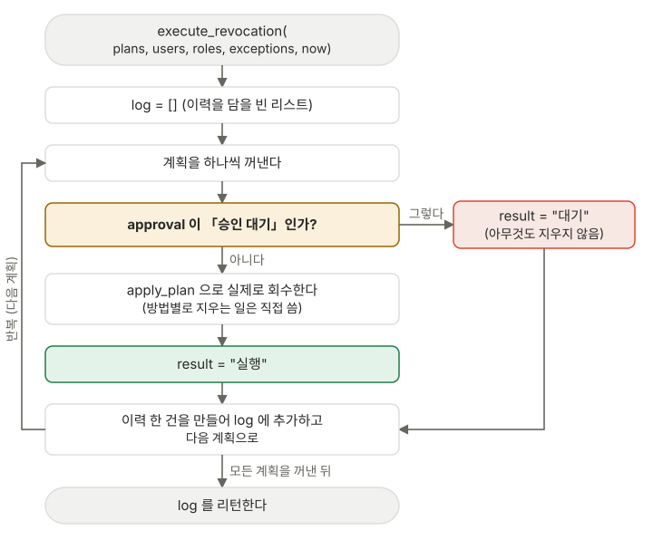

# 실습 4-1 · 승인이 필요한 회수 계획 가려내기

## 목표: 승인 상태가 적힌 회수 계획

> **이번 실습에 들어온 일**
>
> A사 관제 담당(회사 시스템과 기록을 지켜보며 이상한 일을 찾는 사람)이 보낸 메시지:
> 「회수할 8건 가운데에는 데이터를 바꾸는 쓰기 권한(`CHANGE`)도 있습니다. 쓰기 권한은 잘못 없애면 영향이 크니 보안 책임자의 승인을 받고 회수하고 싶습니다. 조회 같은 일반 권한 한 건은 바로 회수해도 됩니다.
>
> 다만 퇴사한 사람의 역할을 비우면 그 사람이 역할로 받던 권한이 모두 없어집니다. 이렇게 권한이 2개 이상 사라지는 회수는 조회 권한이어도 승인을 받아 주세요. 8건 가운데 어느 것이 승인 대상인지 가려서, 계획마다 승인 상태를 적어 주세요. 보안 책임자가 승인한 것과 아직 기다리는 것도 구분해 주세요.」
> - **왜 중요한가**: 중요한 권한을 한 사람이 혼자 정하면 실수하거나 일부러 나쁘게 쓸 수 있습니다. 승인 상태가 적혀 있으면 어느 회수가 승인을 받았고 어느 회수가 아직 기다리는지 바로 알 수 있습니다.
> - 이 실습에서 하는 일: 대부분은 미리 채워 두었고, 빈칸 두 곳(① · ②)만 한 줄씩 직접 씁니다.
> - 끝나면 쓰는 것: 보고서 (가) · (나) 답. (다)는 여유가 되면 하는 응용입니다

## 왜 승인이 필요한가

1. 제공 파일 `revoke_plan.py` 의 `plan_revocation` 이 만든 회수 계획은 8건 모두 같은 방식으로 다룹니다. 하지만 권한마다 중요도가 다릅니다. 데이터를 바꾸는 권한(`CHANGE`)은 잘못 없애면 그 권한으로 일하던 사람의 업무가 멈추고 실제 서비스에서는 되돌리기도 어렵습니다.
2. 그래서 승인이 필요한 경우를 둘로 정합니다. ① **민감한 권한**(sensitive · 센서티브, 잘못 없애면 피해가 큰 권한)인 경우입니다. ② 한 번의 회수로 권한이 2개 이상 사라지는 경우(영향 2건 이상)입니다. 예를 들어 퇴사한 dami 의 역할을 비우면 dami 가 그 역할로 받던 권한 2개가 모두 없어집니다.
   - 이런 경우에는 보안 책임자의 승인을 받고, 그 밖의 일반 권한 한 건은 바로 회수합니다. **보안 책임자**는 회사의 보안 규칙을 맡아 최종 결정을 내리는 사람입니다.
   - 학교에서 작은 일은 반장이 바로 처리해도, 반 전체에 영향이 큰 일은 담임 선생님께 허락을 받는 것과 비슷합니다.
3. 이 실습에서는 계획마다 승인이 필요한지, 필요하다면 승인됐는지를 **승인 상태**로 적습니다. 실제로 지우는 일은 실습 4-2에서 합니다.

## 1.1 승인이 필요한 경우와 승인 상태

- 출발점은 회수 계획 8건입니다. 계획 한 건은 회수 대상(`user` · `permission` · `source`)에 `method`(회수 방법) · `target`(지울 대상) · `impact`(영향: 이 회수로 사라지는 권한 수) 키를 더한 딕셔너리입니다. 자세한 모양은 「제공 파일」 레슨의 `revoke_plan.py` 설명에 있습니다.
- 승인이 필요한 계획은 아래 둘 중 하나입니다. 겹치는 것을 한 번만 세면 승인이 필요한 계획은 모두 3건입니다.

| 승인이 필요한 경우 | 이번 데이터의 계획 |
|---|---|
| ① `config/sensitive.json` 에 적힌 민감한 권한 | junho 의 `SALES:CHANGE`(예외 2번), dami 의 `SALES:CHANGE`(역할 해제) 두 건 |
| ② 영향(`impact`)이 2건 이상 | dami 의 역할 해제 두 건(영향 2건) |

- 민감한 권한 리스트는 「자원:행위」 문자열의 리스트입니다.
  - 쓰기 권한인 `SALES:CHANGE` · `ACCOUNT:CHANGE` · `SETTLE:CHANGE` 세 개를 적었습니다.
  - `QUERY` 는 조회, `CHANGE` 는 변경(쓰기)입니다.
- 회수 대상인 예외의 상태는 이렇습니다.

| 예외 | 상태 | 회수 대상인 까닭 |
|---|---|---|
| 1 · 2 · 4 · 5번 | 만료 시각이 이미 지남(Unit 3 점검 결과의 「만료된 예외」) | 접근은 이미 막혀 있지만 예외 기록이 남아 있음 |
| 3번 | 아직 유효함 | dami 가 퇴사해서 쓸 수 없음 |

- 승인 요청서는 따로 만들지 않고, 계획 한 건마다 `approval` 키에 **승인 상태**를 적습니다. 값은 아래 세 가지 중 하나입니다.

| `approval` 값 | 뜻 |
|---|---|
| `승인 불필요` | 승인 없이 바로 회수할 수 있는 계획 |
| `승인됨` | 승인이 필요한데 보안 책임자가 승인함 |
| `승인 대기` | 승인이 필요한데 아직 결정이 없음 |

- 승인할지는 프로그램이 아니라 보안 책임자(사람)가 정합니다. 이 실습에서는 그 결정을 미리 적어 둔 `decisions` 딕셔너리로 줍니다.
  - 예: `{"dami:SALES:QUERY": "승인"}` 처럼 키는 「사용자:권한」 문자열입니다. 여기에 없는 계획은 아직 결정하지 않은 것입니다.
  - dami 의 `SALES:QUERY` 계획은 둘(역할 해제, 예외 3번 삭제)이지만 결정 키 `dami:SALES:QUERY` 는 같습니다.
  - 다만 결정은 승인이 필요한 계획에서만 봅니다. 예외 3번 삭제는 조회 권한 한 건(영향 1)이라 승인이 필요 없으므로, 결정이 있어도 「승인 불필요」가 됩니다.
- **직접 쓰는 곳은 빈칸 두 곳**(① · ②)입니다. 두 곳 모두 한 줄이고, 나머지는 미리 채웠습니다.

| 함수 | 직접 쓰는 곳 | 하는 일 |
|---|---|---|
| `load_sensitive` | 미리 채움 | 민감한 권한 파일을 읽음 |
| `plan_key` | 미리 채움 | 「사용자:권한」 문자열(결정을 찾는 키)을 만듦 |
| `needs_approval` | ① 리턴 한 줄 | 민감하거나 영향 2건 이상이면 `True` |
| `mark_approvals` | ② 결정을 꺼내는 한 줄 | 계획마다 승인 상태(`approval`)를 정함 |

<figure class="page-figure"></figure>

## 실습 4-1 · 승인 필요 여부와 승인 상태 적기

**이런 상황이 있습니다**

- **지금은**: 회수 계획 8건이 모두 같은 리스트에 섞여 있습니다. 쓰기 권한처럼 승인이 필요한 것과 바로 회수해도 되는 것을 담당자가 눈으로 가려야 합니다.
- **그래서 만드는 것**: `mark_approvals` 입니다.
  - 승인이 필요 없는 계획은 「승인 불필요」, 승인이 필요하고 보안 책임자가 승인하기로 한 계획은 「승인됨」, 승인이 필요한데 아직 결정이 없는 계획은 「승인 대기」로 `approval` 키에 적습니다.
- **실행하면**: 단계 1은 계획 8건의 승인 상태를 출력하고, 단계 2는 승인 상태별 건수를 출력합니다.
- **현업에서는**: 접근 관리 도구도 중요한 권한의 변경은 승인자를 거치고, 승인 여부를 기록으로 남깁니다.

**할 일**

1. 작업 폴더 `network-study-notes/access_control` 안에 `config/sensitive.json` · `revoke_approve.py` · `exercise4-1_run.py` 세 파일을 만들고, `revoke_approve.py` 의 `# ←` 가 있는 <mark>두 곳</mark>(① · ②)을 한 줄씩 채웁니다.
2. 채우기 <mark>전과 후</mark>에 실행해서 승인 상태(단계 1)와 승인 상태별 건수(단계 2)를 비교합니다.

**`config/sensitive.json`** — 그대로 붙여 넣습니다. 민감한 권한 리스트입니다. `access_control` 안의 `config` 폴더에 만듭니다.

<pre class="copyable"><code>["SALES:CHANGE", "ACCOUNT:CHANGE", "SETTLE:CHANGE"]
</code></pre>

**`revoke_approve.py`**

```python
from config_loader import load_json                              # Unit 1 제공 파일의 안전한 읽기 함수를 불러온다


def load_sensitive(path):                                        # 민감한 권한 파일 경로를 받는 함수
    """민감한 권한 파일을 읽어 「자원:행위」 리스트로 리턴하고, 없거나 깨졌으면 빈 리스트를 리턴한다.
    승인이 필요한 회수를 가릴 때 쓴다.
    """
    return load_json(path, [])                                   # 안전하게 읽어 그대로 리턴한다


def plan_key(plan):                                              # 계획 한 건을 받는 함수
    """「사용자:권한」 문자열(예: "dami:SALES:CHANGE")을 리턴한다.
    계획에 맞는 승인 결정을 찾는 키로 쓴다.
    """
    user = plan["user"]                                          # 계획의 사용자
    permission = plan["permission"]                              # 계획의 권한
    return f"{user}:{permission}"                                # 사용자와 권한을 : 로 이어 붙인다


def needs_approval(plan, sensitive):                             # 계획 한 건과 민감한 권한 리스트를 받는 함수
    """민감한 권한이거나 영향이 2개 이상이면 True, 아니면 False 를 리턴한다.
    승인이 필요한 회수를 가려낼 때 쓴다.
    """
    is_sensitive = plan["permission"] in sensitive               # 권한이 민감한 권한 리스트에 있는지(True 또는 False)
    is_big_impact = plan["impact"] >= 2                          # 영향이 2건 이상인지(True 또는 False)
    # ① is_sensitive 이거나 is_big_impact 이면 True 가 되도록 리턴한다 (or)   # ← 이 주석 바로 아래 줄에 씁니다 (4칸)


def mark_approvals(plans, sensitive, decisions):                 # 계획 리스트 · 민감한 권한 리스트 · 승인 결정 딕셔너리를 받는 함수
    """계획마다 "approval" 키(승인 불필요 · 승인됨 · 승인 대기)를 적은 복사본 리스트를 리턴한다.
    어떤 회수가 보안 책임자의 승인을 기다려야 하는지 가를 때 쓴다.
    """
    results = []                                                 # 결과를 담을 빈 리스트
    for plan in plans:                                           # 계획을 하나씩 꺼낸다
        item = plan.copy()                                       # 원래 계획은 바꾸지 않고 복사한다
        key = plan_key(plan)                                     # 승인 결정을 찾는 「사용자:권한」 문자열을 만든다
        # ② decisions 에서 key 의 결정을 꺼내 decision 에 담는다 (.get · 없으면 None)   # ← 이 주석 바로 아래 줄에 씁니다 (8칸)
        needs = needs_approval(plan, sensitive)                  # 승인이 필요한 계획인지 알아본다(True 또는 False)
        if not needs:                                            # 승인이 필요하지 않으면
            item["approval"] = "승인 불필요"                     # 바로 회수할 수 있다
        elif decision == "승인":                                  # 승인이 필요한데 보안 책임자가 승인했으면
            item["approval"] = "승인됨"                          # 회수할 수 있다
        else:                                                    # 승인이 필요한데 아직 결정이 없으면
            item["approval"] = "승인 대기"                       # 결정이 날 때까지 기다린다
        results.append(item)                                     # 승인 상태를 적은 복사본을 결과 리스트에 추가한다
    return results                                               # 결과 리스트를 리턴한다

```

- 주석 줄은 그대로 두고, **각 주석 바로 아래 줄**에 씁니다. ① 은 함수 바로 안쪽이라 4칸, ② 는 `for` 안쪽이라 8칸에서 시작합니다.

**직접 쓰는 곳**

| 빈칸 | 쓰는 줄 | 들여쓰기 |
|---|---|---|
| ① | 둘 중 하나라도 참이면 `True` 를 리턴 (`return … or …`) | 4칸 |
| ② | `decisions` 에서 결정을 꺼내 `decision` 에 담기 (`.get`) | 8칸 |

#### 문법 상자 · 직접 쓰는 곳의 모양 (예시 값 · 읽기만 합니다)

```python
print(True or False)                      # True  · 둘 중 하나라도 참이면 참
print(False or False)                     # False · 둘 다 거짓일 때만 거짓

decisions = {"dami:SALES:QUERY": "승인"}  # 예시 값
print(decisions.get("dami:SALES:QUERY"))  # 승인
print(decisions.get("junho:SALES:CHANGE")) # None · 키가 없으면 오류 대신 None
```

- `딕셔너리.get(키)` 는 키가 없을 때 `KeyError` 로 멈추지 않고 `None`(「값 없음」을 뜻하는 파이썬의 특별한 값)을 돌려줍니다. 결정이 아직 없는 계획이 있어서 `[ ]` 대신 `.get` 을 씁니다.
- 미리 채운 `plan["permission"] in sensitive` 의 `in` 은 값이 리스트 안에 있는지 묻습니다. 예: `"SALES:CHANGE" in ["SALES:CHANGE", "SETTLE:CHANGE"]` 는 `True` 입니다.

**채우기 전에 실행하면** 오류 없이 돌아가지만 8건 모두 「승인 불필요」로 나오고, 단계 2가 `{'승인 불필요': 8}` 입니다. ① 이 비어 있으면 `needs_approval` 이 아무것도 리턴하지 않아(`None`, 거짓으로 봄) 모든 계획이 승인 없이 회수될 뻔한 것입니다. 승인 검사가 빠지면 쓰기 권한도 그대로 지워진다는 것을 보여 주는 결과입니다.

- ① 확인: ① 만 쓰고 실행하면 `NameError: name 'decision' is not defined` 가 나옵니다(파이썬 버전에 따라 뒤에 `Did you mean: 'decisions'?` 가 붙습니다). ② 를 아직 안 써서 나는 오류이니 정상입니다. 막히면: 바로 위 두 줄이 만든 `is_sensitive` 와 `is_big_impact` 를 `or` 로 잇고 앞에 `return` 을 붙입니다.
- ② 확인: ② 까지 쓰고 실행하면 단계 2가 `{'승인 불필요': 5, '승인됨': 2, '승인 대기': 1}` 이면 성공입니다. `KeyError: 'junho:SALES:QUERY'` 가 나오면 `decisions[key]` 로 쓴 것이니 `.get` 으로 바꿉니다. 막히면: 위 문법 상자의 `decisions.get("dami:SALES:QUERY")` 에서 따옴표 문자열 자리에 `key` 를 넣고, 앞에 `decision = ` 을 붙입니다.

**`exercise4-1_run.py`** — 그대로 붙여 넣습니다. 학생이 쓰는 줄은 없습니다. 제공 파일로 회수 계획을 만든 뒤 `mark_approvals` 로 승인 상태를 정하고 두 단계로 출력합니다.

```python
from rbac import USERS, ROLES                                    # 실습 1-2의 사용자 · 역할 딕셔너리를 불러온다
from revoke_input import load_to_revoke                          # 제공 파일의 회수 대상 함수를 불러온다
from revoke_plan import plan_revocation                          # 제공 파일의 회수 계획 함수를 불러온다
from revoke_approve import load_sensitive, mark_approvals        # 방금 만든 승인 함수를 불러온다

DECISIONS = {"dami:SALES:QUERY": "승인", "dami:SALES:CHANGE": "승인"}  # 보안 책임자의 결정. 여기 없는 계획은 아직 결정하지 않은 것이다

to_revoke = load_to_revoke()                                     # Unit 3 점검 결과인 회수 대상 8건을 만든다
plans = plan_revocation(to_revoke, USERS, ROLES)                 # 회수 계획을 세운다(실제로는 지우지 않는다)
sensitive = load_sensitive("config/sensitive.json")              # 민감한 권한 리스트를 읽는다
results = mark_approvals(plans, sensitive, DECISIONS)            # 계획마다 승인 상태를 적는다

print("--- 단계 1: 승인 상태 - 계획 8건")                        # 단계 1 시작을 알리는 줄
for item in results:                                             # 결과를 하나씩 꺼낸다
    print(item["user"], item["permission"], "<-", item["source"], "|", item["method"], "| 영향", item["impact"], "건 |", item["approval"])  # 사용자 · 권한 <- 출처 | 방법 | 영향 | 승인 상태를 출력한다

print("--- 단계 2: 집계 - 승인 상태별 건수")                     # 단계 2 시작을 알리는 줄
counts = {}                                                      # 승인 상태 → 건수를 담을 빈 딕셔너리
for item in results:                                             # 결과를 하나씩 꺼낸다
    count_key = item["approval"]                                 # 세는 기준이 되는 키
    old_count = counts.get(count_key, 0)                         # 그 키의 지금까지 센 수(처음이면 0)
    counts[count_key] = old_count + 1                            # 1 늘려서 다시 적는다
print(counts)                                                    # 승인 상태별 건수를 출력한다
```

**순서**

1. **[터미널]** 「제공 파일」 레슨의 `revoke_input.py` · `revoke_plan.py` 가 있는지 `ls` 로 봅니다. 없으면 그 레슨에서 먼저 만듭니다.
2. **[VS Code]** 파일 `config/sensitive.json` · `revoke_approve.py` · `exercise4-1_run.py` 를 만들고, 위에서 같은 이름이 붙은 코드 상자의 내용을 붙여 넣어 저장합니다.
   - `sensitive.json` 은 `access_control` 폴더 안의 `config` 폴더를 오른쪽 클릭 › **New File** 로 만듭니다.
   - `revoke_approve.py` · `exercise4-1_run.py` 는 `access_control` 폴더를 오른쪽 클릭 › **New File** 로 만듭니다.
3. **[터미널]** `ls config` 로 `sensitive.json` 이 `users.json` 과 같은 `config` 폴더에 있는지 보고, `python -m json.tool config/sensitive.json`(맥북은 `python3`)로 내용이 정상인지 확인합니다.
   - 깨진 채 두면 민감한 권한 리스트를 읽지 못해 junho 의 `SALES:CHANGE` 가 「승인 불필요」로 나오고, 승인이 필요한 계획이 3건에서 2건으로 줄어듭니다.
4. **[터미널]** `pwd` 의 결과가 `access_control` 로 끝나는지 확인하고, **채우기 전에** 한 번 실행해서 8건이 모두 「승인 불필요」로 나오는지 봅니다(맥북은 `python3`).
   ```bash
   pwd
   python exercise4-1_run.py
   ```
5. **[VS Code]** `revoke_approve.py` 의 `# ←` 두 곳(① · ②)을 채웁니다. 1.1 의 표와 그림을 보고 씁니다.
6. **[터미널]** 다시 실행합니다. 출력은 두 단계입니다. 단계 1은 `계획 8건` 제목 줄과 계획 여덟 줄(줄마다 승인 상태), 단계 2는 승인 상태별 건수 딕셔너리 한 줄입니다.
   ```bash
   python exercise4-1_run.py
   ```
7. **[보고서]** `access_control/report_u4.md` 의 `## 실습 4-1` 아래를 채웁니다(보고서 파일은 「보고서 쓰기」 레슨에서 만듭니다).
   - (가) [핵심 질문] 채운 뒤 실행한 출력 전체를 붙여 넣고, 「승인 불필요」 · 「승인됨」 · 「승인 대기」가 각각 몇 건인지, 승인 대기인 계획이 무엇인지 적어 주세요.
   - (나) [핵심 질문] 권한을 없애는 일인데 왜 쓰기 권한 같은 민감한 권한은 승인을 받게 할까요? 조회 같은 일반 권한 한 건은 바로 회수해도 되는 이유도 적어 주세요.
   - (다) [응용] junho 의 `SALES:CHANGE`(예외 2번) 계획은 승인 대기입니다. 실습 4-2에서 이 계획은 어떻게 처리될지 예상해서 적고, 승인이 오래 나지 않으면 어떤 문제가 생길지도 적어 주세요.

**확인** — 다시 실행했을 때 단계 2가 `{'승인 불필요': 5, '승인됨': 2, '승인 대기': 1}` 이고, 「승인 대기」 줄이 `junho SALES:CHANGE <- 예외 2번` 이면 성공입니다. 안 나오면 「정답」 레슨의 실습 4-1 출력과 한 줄씩 맞춰 보고, 다른 줄이 있으면 위 「직접 쓰는 곳」의 확인을 다시 봅니다.

<!-- checklist -->
- [ ] `config/sensitive.json` 을 만들어 붙여 넣고 `python -m json.tool config/sensitive.json` 으로 정상인지 확인했다
- [ ] `revoke_approve.py` · `exercise4-1_run.py` 를 만들어 붙여 넣고, 채우기 전에 실행해 8건 모두 「승인 불필요」인 것을 봤다
- [ ] `revoke_approve.py` 의 빈칸 ① · ② 를 채웠다
- [ ] `python exercise4-1_run.py` 를 다시 실행해 단계 2가 `{'승인 불필요': 5, '승인됨': 2, '승인 대기': 1}` 로 나왔다
- [ ] `report_u4.md` 의 `## 실습 4-1` (가) · (나) 답을 적었다
<!-- /checklist -->

## 실습 4-1 정리

| 하려는 일 | 코드 · 말 |
|---|---|
| 결정을 찾는 키 | `return f"{user}:{permission}"` (`plan_key` 안) |
| 결정 꺼내기(없으면 `None`) | `decision = decisions.get(key)` (`mark_approvals` 안) |
| 민감한 권한인지 | `is_sensitive = plan["permission"] in sensitive` (`needs_approval` 안) |
| 영향이 2건 이상인지 | `is_big_impact = plan["impact"] >= 2` (`needs_approval` 안) |
| 승인이 필요한지 | `return is_sensitive or is_big_impact` (`needs_approval` 안) |
| 승인이 필요 없을 때 | `if not needs:` → `item["approval"] = "승인 불필요"` |
| 결정이 「승인」인지 | `elif decision == "승인":` → `item["approval"] = "승인됨"` |
| 그 밖(결정 없음) | `else:` → `item["approval"] = "승인 대기"` |

---
