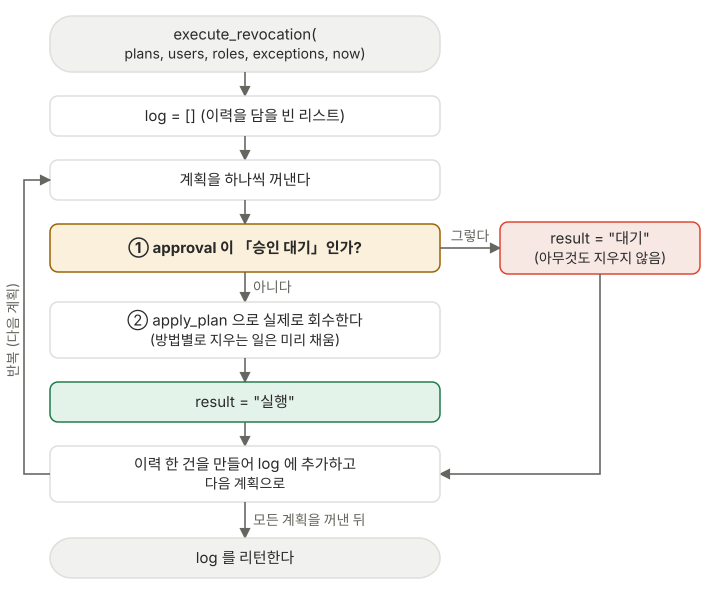

# 실습 4-2 · 회수 실행하고 이력 남기기

## 목표: 회수 실행과 회수 이력

> **이번 실습에 들어온 일**
>
> A사 관제 담당이 보낸 메시지:
> 「승인이 필요 없거나 승인된 것만 실제로 회수하고, 회수한 내용을 이력 파일로 남겨 주세요. 아직 승인되지 않은 것은 실행하지 말고 「대기」로 남겨 주세요.
>
> 회수한 뒤에는 같은 사용자 · 권한으로 접근을 다시 판정해서 정말 막혔는지 확인해 주세요. 회수했다고 적어 놓고 여전히 접근이 허용되면 안 됩니다.」
> - **왜 중요한가**: 회수했다는 기록만으로는 부족합니다. 다시 판정해 보아야 정말 막혔는지 알 수 있고, 이력이 있어야 나중에 누가 언제 왜 없앴는지 설명할 수 있습니다. 예를 들어 junho 가 「어제까지 되던 조회가 왜 막혔죠?」라고 물으면 이력을 보고 답합니다.
> - 이 실습에서 하는 일: 대부분은 미리 채워 두었고, `execute_revocation` 의 빈칸 두 곳(① · ②)만 한 줄씩 직접 씁니다.
> - 끝나면 쓰는 것: 보고서 (가) · (나) 답. (다)는 여유가 되면 하는 응용입니다

## 왜 전후 판정과 이력이 필요한가

1. 승인 상태까지 정해진 계획을 이제 실행합니다. 승인 상태가 「승인 불필요」 또는 「승인됨」인 계획만 실행하고, 「승인 대기」인 계획은 실행하지 않습니다.
2. 실행한 뒤에는 **같은 사용자 · 권한을 다시 판정**합니다. 실습 1-3의 `evaluate_access` 가 회수 전과 후에 같은 요청을 어떻게 판정하는지 비교하면 회수가 정말 효과가 있었는지 알 수 있습니다.
3. 실행한 내용은 **회수 이력**(`revocation_log.json`)으로 남깁니다. Unit 3 실습 3-2의 「사용 이력」(권한을 마지막으로 쓴 시각의 기록)과 다른 것입니다. 회수 이력은 오늘 무엇을 회수했는지의 기록입니다.

## 2.1 실행 방법과 이력

| 방법 | 실제로 하는 일 |
|---|---|
| 예외 삭제 | 예외 리스트(`EXCEPTIONS`)에서 번호가 `target` 인 예외 한 건을 지움 |
| 역할 해제 | `users[target]["role"]` 을 빈 문자열(`""`)로 바꿈 |
| 역할에서 권한 빼기 | `roles[target]` 권한 리스트에서 그 권한을 지움 |

- 역할 해제를 하면 그 사용자는 어떤 역할의 권한도 받지 않게 됩니다.

이력 한 건은 여섯 키로 이루어집니다.

| 키 | 뜻 |
|---|---|
| `time` | 회수 시각 |
| `user` | 사용자 |
| `permission` | 권한 |
| `method` | 회수 방법 |
| `approval` | 승인 상태 |
| `result` | 「실행」 또는 「대기」 |

- `result` 의 「대기」는 `approval` 이 「승인 대기」라서 실행하지 않았다는 뜻입니다.
- **직접 쓰는 곳은 `execute_revocation` 의 빈칸 두 곳**(① · ②)입니다. 두 곳 모두 한 줄이고, 나머지는 미리 채웠습니다.

| 함수 | 직접 쓰는 곳 | 하는 일 |
|---|---|---|
| `remove_exception` | 미리 채움 | 번호가 같은 예외를 찾아 지움 |
| `apply_plan` | 미리 채움 | 회수 방법별로 실제로 지움 |
| `save_log` | 미리 채움 | 이력을 JSON 파일로 저장함 |
| `execute_revocation` | ① 조건 한 줄 · ② 호출 한 줄 | 「대기」인지 「실행」인지 정함 |

- `remove_exception` 의 `리스트.remove(값)` 은 리스트에서 그 값을 지웁니다.
  - 지운 뒤에는 바로 `return True` 로 함수를 끝냅니다. 지금 `for` 로 돌고 있는 리스트에서 값을 지운 채 반복을 계속하면 다음 항목을 건너뛸 수 있기 때문입니다. 줄 선 사람 중 한 명이 빠지면 뒷사람이 한 칸씩 당겨져 한 사람을 건너뛰게 되는 것과 같습니다.
- 회수한 뒤에 다시 판정하면 결과가 달라질 수 있습니다.
  - `evaluate_access` 도 `execute_revocation` 이 바꾼 바로 그 `USERS` · `ROLES` · `EXCEPTIONS` 를 읽기 때문입니다.
  - `evaluate_access(사용자, 자원, 행위, 시각)` 는 `(허용 여부, 이유)` 두 값을 리턴합니다(Unit 1).
- `apply_plan` 은 승인 상태를 보지 않습니다. 승인 상태를 보고 실행할지 정하는 것은 `execute_revocation` 이 하는 일입니다.
- `exercise4-2_run.py` 는 회수 전과 후에 계획마다 `evaluate_access` 로 같은 사용자 · 권한을 판정해 「허용(이유)」 또는 「거부(이유)」 문자열로 비교합니다.

<figure class="page-figure"></figure>

## 실습 4-2 · 회수 실행 후 판정과 이력 남기기

**이런 상황이 있습니다**

- **지금은**: 회수 계획과 승인 상태만 있고 실제로는 아무것도 지워지지 않았습니다. 지운 뒤에 정말 막혔는지 확인하는 방법도, 지운 기록도 없습니다.
- **그래서 만드는 것**: `execute_revocation` 입니다.
  - 승인 상태가 「승인 대기」인 계획은 실행하지 않고 「대기」로 남깁니다.
  - 나머지 계획은 `apply_plan` 으로 실행하고 「실행」으로 남깁니다.
  - 마지막에 이력 리스트를 리턴합니다.
- **실행하면**: 단계 1은 계획별 실행 결과, 단계 2는 회수 전후의 판정 비교, 단계 3은 `revocation_log.json` 저장과 다시 읽은 건수를 출력합니다.
- **현업에서는**: 회수 도구도 실행한 뒤 다시 판정해 막혔는지 확인하고, 이력을 지우지 않고 보관합니다.

**할 일**

1. `revoke.py` 와 `exercise4-2_run.py` 두 파일을 만들고, `revoke.py` 의 `# ←` 가 있는 <mark>두 곳</mark>(① · ②)을 한 줄씩 채웁니다.
2. 실행해서 <mark>회수 결과</mark>(단계 1: 실행), <mark>회수 전후의 판정</mark>(단계 2: 확인), <mark>저장한 이력</mark>(단계 3: 저장)을 읽고, 새로 생긴 `revocation_log.json` 파일도 열어 봅니다.

**`revoke.py`**

```python
import json                                                      # JSON 파일을 쓰는 모듈을 불러온다


def remove_exception(exceptions, target_id):                     # 예외 리스트와 지울 예외 번호를 받는 함수
    """예외 리스트에서 번호가 target_id 인 예외를 지운다.
    지웠으면 True, 못 찾았으면 False 를 리턴한다.
    지원이 끝난 예외를 회수할 때 쓴다.
    """
    for exception in exceptions:                                       # 예외를 하나씩 꺼낸다
        if exception["id"] == target_id:                               # 번호가 같으면
            exceptions.remove(exception)                               # 리스트에서 그 예외를 지운다
            return True                                          # 지웠다고 알리고 함수를 끝낸다
    return False                                                 # 끝까지 못 찾았으면 False 를 리턴한다


def apply_plan(plan, users, roles, exceptions):                  # 계획 한 건 · 사용자 · 역할 · 예외 리스트를 받는 함수
    """계획 한 개의 방법대로 프로그램 안의 데이터를 바꾼다.
    승인된 회수를 실행할 때 쓰며, 승인 확인은 부르는 쪽이 한다.
    """
    if plan["method"] == "예외 삭제":                            # 방법이 예외 삭제이면
        remove_exception(exceptions, plan["target"])             # 예외 리스트에서 그 번호의 예외를 지운다
    elif plan["method"] == "역할 해제":                          # 방법이 역할 해제이면
        user_info = users[plan["target"]]                        # 그 사용자의 정보 딕셔너리를 꺼낸다
        user_info["role"] = ""                                   # 역할을 빈 문자열로 바꾼다(어떤 역할의 권한도 받지 않게 된다)
    else:                                                        # 방법이 역할에서 권한 빼기이면
        role_permissions = roles[plan["target"]]                 # 그 역할의 권한 리스트를 꺼낸다
        role_permissions.remove(plan["permission"])              # 그 리스트에서 그 권한을 지운다


def save_log(log, path):                                         # 이력 리스트와 저장할 파일 경로를 받는 함수
    """이력 리스트를 JSON 파일로 저장하고 저장한 개수를 리턴한다(한글은 그대로).
    회수 이력을 나중에 확인할 수 있게 남길 때 쓴다.
    """
    with open(path, "w", encoding="utf-8") as log_file:                 # 파일을 쓰기 모드("w")로 연다
        json.dump(log, log_file, ensure_ascii=False, indent=2)          # 이력을 파일에 JSON 으로 쓴다
    return len(log)                                              # 저장한 건수를 리턴한다


def execute_revocation(plans, users, roles, exceptions, now):    # 계획 · 사용자 · 역할 · 예외 리스트 · 지금 시각 문자열을 받는 함수
    """승인 불필요이거나 승인된 계획만 실행하고 이력 리스트를 리턴한다.
    승인 대기는 「대기」로 남기며, 회수를 집행할 때 쓴다.
    """
    log = []                                                     # 이력을 담을 빈 리스트
    for plan in plans:                                           # 계획을 하나씩 꺼낸다
        # ① plan["approval"] 이 "승인 대기" 이면 (==)   # ← 이 주석 바로 아래 줄에 씁니다 (8칸)
            result = "대기"                                      # 실행하지 않고 대기로 남긴다
        else:                                                    # 승인 불필요이거나 승인됨이면
            # ② apply_plan 에 plan, users, roles, exceptions 를 넘겨 호출한다   # ← 이 주석 바로 아래 줄에 씁니다 (12칸)
            result = "실행"                                      # 실행했다고 남긴다
        entry = {                                                 # 회수 이력 한 개의 값을 묶는다(여러 줄)
            "time": now,                                         # 시각
            "user": plan["user"],                                # 사용자
            "permission": plan["permission"],                    # 권한
            "method": plan["method"],                            # 회수 방법
            "approval": plan["approval"],                        # 승인 상태
            "result": result,                                    # 결과(실행 또는 대기)
        }
        log.append(entry)                                        # 이력 한 건을 만들어 이력 리스트에 추가한다
    return log                                                   # 이력 리스트를 리턴한다

```

- 주석 줄은 그대로 두고, **각 주석 바로 아래 줄**에 씁니다. ① 은 `for` 안쪽의 `if` 줄이라 8칸, ② 는 `else` 안쪽이라 12칸에서 시작합니다.
- 미리 채운 `save_log` 의 `json.dump(log, log_file, …)` 는 리스트를 JSON 글자로 바꿔 파일에 씁니다. `ensure_ascii=False` 는 한글을 `\uXXXX` 같은 기호로 바꾸지 않고 그대로 쓰게 하고, `indent=2` 는 사람이 읽기 좋게 두 칸씩 들여 씁니다.

**직접 쓰는 곳**

| 빈칸 | 쓰는 줄 | 들여쓰기 |
|---|---|---|
| ① | 승인 상태가 「승인 대기」이면 (`if … == …:`) | 8칸 |
| ② | `apply_plan` 을 불러 실제로 회수 | 12칸 |

#### 문법 상자 · 직접 쓰는 곳의 모양 (예시 값 · 읽기만 합니다)

```python
plan = {"user": "junho", "approval": "승인 대기"}  # 예시 값
print(plan["approval"] == "승인 대기")              # True  · 두 값이 같으면 참
print(plan["approval"] == "대기")                   # False · 글자가 하나라도 다르면 거짓
```

- ② 는 함수를 부르는 한 줄입니다. 리턴 값은 쓰지 않으므로 `=` 없이 `함수이름(값1, 값2, …)` 만 씁니다. 넘길 값은 `apply_plan` 의 `def` 줄에 적힌 순서대로입니다.

**채우기 전에 실행하면** `else:` 줄에서 `IndentationError: unindent does not match any outer indentation level` 오류가 납니다. ① 자리의 `if` 줄이 없어서 `else:` 와 짝이 되는 줄도, 같은 들여쓰기(8칸)의 줄도 없기 때문입니다. ① 을 쓰면 사라집니다.

- ① 확인: ① 만 쓰고 실행하면 오류 없이 돌아가고 `실행 7 건, 대기 1 건` 이 나옵니다. 그런데 단계 2의 여덟 줄이 모두 `그대로` 이고 junho 의 `SALES:QUERY` 도 `허용(역할 권한) -> 허용(역할 권한)` 입니다. 이력에는 「실행」이라고 적혔지만 실제로는 아무것도 지우지 않은 것입니다. 막히면: 위 문법 상자의 `plan["approval"] == "승인 대기"` 앞에 `if`, 끝에 `:` 를 붙입니다.
- ② 확인: ② 까지 쓰고 실행하면 단계 2의 첫 줄이 `junho SALES:QUERY | 허용(역할 권한) -> 거부(권한 없음) | 바뀜` 이면 성공입니다. `NameError` 가 나오면 함수 이름이나 넘기는 값의 이름에 오타가 있는 것입니다. 막히면: `revoke.py` 의 `def apply_plan(…)` 줄을 보고 괄호 안의 이름 네 개를 그대로 옮깁니다.

**`exercise4-2_run.py`** — 그대로 붙여 넣습니다. 학생이 쓰는 줄은 없습니다. 실습 4-1까지의 계획과 승인 상태를 만든 뒤 회수 전 판정을 모으고, `execute_revocation` 으로 회수하고, 회수 후 판정을 모아 비교하고, 이력을 저장합니다.

```python
from datetime import datetime                                    # 문자열을 시각으로 바꾸는 데 쓴다
from rbac import USERS, ROLES                                    # 실습 1-2의 사용자 · 역할 딕셔너리를 불러온다
from exception_policy import EXCEPTIONS, TIME_FORMAT             # Unit 1 제공 파일의 예외 리스트와 시각 형식을 불러온다
from policy import evaluate_access                               # 실습 1-3의 최종 판정 함수를 불러온다
from config_loader import load_json                              # Unit 1 제공 파일의 안전한 읽기 함수를 불러온다
from revoke_input import load_to_revoke                          # 제공 파일의 회수 대상 함수를 불러온다
from revoke_plan import plan_revocation                          # 제공 파일의 회수 계획 함수를 불러온다
from revoke_approve import load_sensitive, mark_approvals        # 실습 4-1에서 만든 승인 함수를 불러온다
from revoke import execute_revocation, save_log                  # 방금 만든 회수 실행 함수와 이력 저장 함수를 불러온다

NOW_TEXT = "2026-10-30 10:00"                                    # 이번 실습의 지금 시각 문자열(고정)
NOW = datetime.strptime(NOW_TEXT, TIME_FORMAT)                   # 같은 시각을 시각으로 바꾼다. 판정 함수가 쓴다
DECISIONS = {"dami:SALES:QUERY": "승인", "dami:SALES:CHANGE": "승인"}  # 보안 책임자의 결정(실습 4-1과 같다)

to_revoke = load_to_revoke()                                     # Unit 3 점검 결과인 회수 대상 8건을 만든다
plans = plan_revocation(to_revoke, USERS, ROLES)                 # 회수 계획을 세운다
sensitive = load_sensitive("config/sensitive.json")              # 민감한 권한 리스트를 읽는다
plans = mark_approvals(plans, sensitive, DECISIONS)              # 계획마다 승인 상태를 적는다

def judge(plan):                                                 # 계획 한 건을 받는 함수
    """계획의 사용자 · 권한을 지금 판정해 「허용(이유)」 또는 「거부(이유)」 문자열을 리턴한다.
    회수 전후의 판정을 비교할 때 쓴다.
    """
    resource, action = plan["permission"].split(":")             # "SALES:QUERY" 를 자원과 행위로 나눈다
    is_allowed, reason = evaluate_access(plan["user"], resource, action, NOW)  # 최종 판정을 한다
    if is_allowed:                                                       # 허용이면
        return "허용(" + reason + ")"                            # 허용과 이유를 하나의 문자열로 합친다
    return "거부(" + reason + ")"                                # 거부와 이유를 하나의 문자열로 합친다


def judge_all(plans):                                            # 계획 리스트를 받는 함수
    """계획마다 judge 로 판정한 문자열을 같은 순서의 리스트로 리턴한다.
    회수 전후의 판정을 한꺼번에 비교할 때 쓴다.
    """
    results = []                                                 # 판정을 담을 빈 리스트
    for plan in plans:                                           # 계획을 하나씩 꺼낸다
        verdict = judge(plan)                                    # 계획 한 건을 판정한다
        results.append(verdict)                                  # 판정해서 추가한다
    return results                                               # 판정 리스트를 리턴한다


before = judge_all(plans)                                        # 회수하기 전의 판정을 모두 구해 둔다
log = execute_revocation(plans, USERS, ROLES, EXCEPTIONS, NOW_TEXT)  # 회수를 실행한다
after = judge_all(plans)                                         # 회수한 뒤의 판정을 모두 구한다

print("--- 단계 1: 실행 - 회수 결과")                            # 단계 1 시작을 알리는 줄
executed_count = 0                                                         # 실행한 건수를 0 으로 시작한다
for entry in log:                                                # 이력을 하나씩 꺼낸다
    print(entry["user"], entry["permission"], "|", entry["method"], "|", entry["result"])  # 사용자 · 권한 | 방법 | 결과를 출력한다
    if entry["result"] == "실행":                                # 실행한 건이면
        executed_count = executed_count + 1                                          # 건수를 1 늘린다
print("실행", executed_count, "건, 대기", len(log) - executed_count, "건")           # 실행과 대기 건수를 출력한다

print("--- 단계 2: 확인 - 회수 전후의 판정")                     # 단계 2 시작을 알리는 줄
plan_count = len(plans)                                          # 개수를 먼저 구한다
for index in range(plan_count):                                  # 번호 index 로 회수 전 리스트와 회수 후 리스트를 짝지어 꺼낸다
    mark = "그대로"                                              # 표시를 그대로로 시작한다
    if before[index] != after[index]:                                    # 회수 전후의 판정이 다르면
        mark = "바뀜"                                            # 바뀜으로 고친다
    print(plans[index]["user"], plans[index]["permission"], "|", before[index], "->", after[index], "|", mark)  # 전후 판정과 표시를 출력한다

print("--- 단계 3: 저장 - 회수 이력")                            # 단계 3 시작을 알리는 줄
count = save_log(log, "revocation_log.json")                     # 이력을 파일로 저장한다
saved = load_json("revocation_log.json", [])                     # 저장한 파일을 다시 읽어
print("저장", count, "건, 다시 읽은 건수", len(saved), "건, 첫 이력:", saved[0]["user"], saved[0]["permission"], saved[0]["result"])  # 건수와 첫 이력을 출력한다
```

- `judge` 의 `plan["permission"].split(":")` 는 문자열을 `:` 자리에서 잘라 리스트로 만듭니다. `"SALES:QUERY"` 는 `["SALES", "QUERY"]` 가 되고, 그 두 값을 `resource, action` 두 이름으로 한꺼번에 받습니다.
- 단계 2의 `range(plan_count)` 는 0부터 `plan_count - 1` 까지의 번호를 차례로 만듭니다(계획이 8건이면 0 ~ 7). 리스트 번호도 0부터 시작하므로 `before[index]` 와 `after[index]` 는 같은 계획의 회수 전 판정과 회수 후 판정입니다.

**순서**

1. **[VS Code]** 파일 `revoke.py` · `exercise4-2_run.py` 를 만들어 위 코드를 붙여 넣습니다. 
   - VS Code: `access_control` 폴더를 선택하고 **새 파일**(New File) 아이콘을 눌러 이름을 입력합니다.
2. **[터미널]** `pwd` 의 결과가 `access_control` 로 끝나는지 확인하고, **채우기 전에** 한 번 실행해서 `IndentationError` 가 나는지 봅니다(맥북은 `python3`).
   ```bash
   pwd
   python exercise4-2_run.py
   ```
3. **[VS Code]** `revoke.py` 의 `# ←` 두 곳(① · ②)을 차례로 채웁니다. 하나 쓸 때마다 다시 실행해 위 「직접 쓰는 곳」의 확인과 같은지 봅니다. 2.1 의 그림을 보고 씁니다.
4. **[터미널]** 다 채운 뒤 다시 실행합니다. 출력은 세 단계입니다. 단계 1은 계획 여덟 줄과 `실행 N 건, 대기 N 건`, 단계 2는 판정 비교 여덟 줄, 단계 3은 저장 한 줄입니다.
5. **[VS Code]** 왼쪽 목록에 새로 생긴 `revocation_log.json` 을 열어 한글이 그대로 저장됐는지 봅니다.
6. **[보고서]** `report_u4.md` 의 `## 실습 4-2` 아래를 채웁니다.
   - (가) [핵심 질문] 출력 전체를 붙여 넣고, 이력의 결과가 「실행」인 건수와 「대기」인 건수, 회수 전후 판정이 바뀐 권한, 저장한 이력 건수를 적어 주세요.
   - (나) [핵심 질문] 회수를 실행한 7건 가운데 회수 전후 판정이 바뀐 것은 일부입니다. 바뀌지 않은 권한이 그대로인 이유와, 그래도 회수하고 이력을 남기는 이유를 적어 주세요.
   - (다) [응용] 회수 이력에는 시각 · 사용자 · 권한 · 방법 · 승인 상태 · 결과가 들어 있습니다. 반년 뒤 감사(점검 기록을 검토받는 일)에서 「이 권한이 왜 없어졌나요?」라고 물으면 이 이력만으로 답할 수 있을까요? 이력에 없는 정보가 있다면 무엇인지, 어떤 키를 추가하면 되는지 적어 주세요.

**확인** — 다 채운 뒤 실행했을 때 `실행 7 건, 대기 1 건`, 단계 2의 `바뀜` 이 junho 의 `SALES:QUERY` 한 줄, 마지막 줄이 `저장 8 건, 다시 읽은 건수 8 건, 첫 이력: junho SALES:QUERY 실행` 이면 성공입니다. 안 나오면 「정답」 레슨의 실습 4-2 출력과 한 줄씩 맞춰 보고, 다른 줄이 있으면 위 「직접 쓰는 곳」의 확인을 다시 봅니다.

## 실습 4-2 정리

| 하려는 일 | 코드 · 말 |
|---|---|
| ① 아직 승인을 기다리는 계획인지 | `if plan["approval"] == "승인 대기":` |
| ② 실제로 회수하기 | `apply_plan(plan, users, roles, exceptions)` |
| 번호가 같은 예외 찾기 | `if exception["id"] == target_id:` (`remove_exception` 안) |
| 찾은 예외 지우고 끝내기 | `exceptions.remove(exception)` → `return True` |
| 예외 삭제 | `remove_exception(exceptions, plan["target"])` |
| 역할 해제: 사용자 정보 꺼내기 | `user_info = users[plan["target"]]` |
| 역할 해제: 역할 비우기 | `user_info["role"] = ""` |
| 역할에서 권한 빼기: 권한 리스트 꺼내기 | `role_permissions = roles[plan["target"]]` |
| 역할에서 권한 빼기: 그 권한 지우기 | `role_permissions.remove(plan["permission"])` |
| 이력 한 건 | `{"time": now, "user": …, "result": result}` 딕셔너리를 `log.append(…)` |

- 방법별로 지우는 일(예외 삭제 · 역할 해제 · 역할에서 권한 빼기)은 미리 채운 `apply_plan` 안에 있습니다.

---

## 이번 Unit 마무리 · 깃허브에 올리기

하루를 닫는 마무리입니다(15분). 핵심 실습 두 개를 끝낸 뒤 합니다.

**1. 오늘 한 일 확인**

1. 민감한 권한이거나 영향이 2건 이상인 계획을 가려 승인 상태를 적었다 (실습 4-1)
2. 승인 대기가 아닌 계획만 실행하고, 회수 전후의 판정을 비교했다 (실습 4-2)
3. 회수 이력 `revocation_log.json` 을 저장하고 다시 읽어 건수를 확인했다 (실습 4-2)
4. 보고서 `report_u4.md` 의 실습 4-1 · 4-2 칸에 `답:` 뒤가 비어 있는 질문이 없다

**2. 파일 확인** — **[터미널]** `access_control` 폴더에서 확인합니다.

```bash
ls
ls config
```

- `revoke_input.py` · `revoke_plan.py` · `revoke_approve.py` · `revoke.py` · `exercise4-1_run.py` · `exercise4-2_run.py` · `revocation_log.json` · `report_u4.md` 가 보여야 합니다.
- `config` 안에는 `sensitive.json` 이 새로 보여야 합니다.

**3. 깃허브에 올리기**

1. **[터미널]** `network-study-notes` 폴더로 옮기고 위치를 확인합니다. 결과가 `…/network-study-notes` 으로 끝나야 합니다.
   ```bash
   cd ..
   pwd
   ```
   - 명령 풀이: `cd ..` 한 단계 위 폴더로 이동 · `pwd` 지금 위치 확인
   - 결과가 다르면 VS Code 왼쪽 목록에서 `network-study-notes` 폴더를 오른쪽 클릭 › **Open in Integrated Terminal** 로 터미널을 새로 엽니다.
2. **[터미널]** 무엇이 바뀌었는지 먼저 봅니다. 빨간 목록에 `.env` 나 `.venv` 가 보이면 올리지 않고 멈춥니다.
   ```bash
   git status
   ```
   - 명령 풀이: `git status` 올릴 파일의 상태를 봄
   - `.env` 가 보이면 VS Code 왼쪽 목록에서 `network-study-notes` 바로 아래의 `.gitignore` 를 열어 맨 아래에 `.env` 한 줄을 적고 저장한 뒤 `git status` 를 다시 칩니다. `.venv` 도 같은 방법으로 합니다.
   - `access_control/__pycache__/` 는 파이썬이 실행하면서 자동으로 만든 임시 폴더입니다. 보이면 `.gitignore` 맨 아래에 `__pycache__/` 한 줄을 적고 저장합니다.
   - `access_control/revocation_log.json` 은 실습 4-2에서 프로그램이 만든 회수 이력입니다. 이것도 올라갑니다.
3. **[보고서]** `report_u4.md` 의 `## 마무리` 아래 (가)를 채웁니다. 올리기 전에 채워야 깃허브에 빈칸 없이 올라갑니다. 못 적은 칸이 있으면 `모름 — 막힌 곳: …` 으로 적고 올립니다.
4. **[터미널]** 바뀐 파일을 모두 담고(`add`), 기록하고(`commit`), 올립니다(`push`).
   ```bash
   git add .
   git commit -m "Add access control unit 4 revocation approval, execution and log"
   git push
   ```
   - 명령 풀이: `git add .` 바뀐 파일을 올릴 목록에 담음 · `git commit -m "…"` 따옴표 안의 설명을 붙여 기록으로 저장 · `git push` 깃허브로 올림
   - `git push` 가 거절(`rejected`)되면 `git pull --no-rebase` 로 받아 와 합친 뒤 `git push` 를 다시 합니다. 그때 편집기 화면이 뜨면 `Esc` 를 누르고 `:wq` 를 입력한 뒤 `Enter` 를 누릅니다. 이 화면은 git 이 두 기록을 합친 기록에 붙일 메시지를 확인하라고 여는 편집기(vim)라서, 메시지는 고치지 않고 저장하고 닫기만 하면 됩니다.
5. **[브라우저]** 깃허브의 내 저장소를 새로 고쳐 `access_control` 폴더를 열고, 2번에서 본 파일이 모두 있는지 확인합니다.

- 시간이 남아 응용을 했다면 응용 파일까지 만든 뒤 2 ~ 4번을 한 번 더 하면 됩니다. 같은 날 여러 번 올려도 괜찮습니다.

> **확인** — 깃허브의 `access_control` 폴더에 `revoke_approve.py` · `revoke.py` · `revocation_log.json` · `report_u4.md` 가 보이면 성공입니다. 안 보이면 `git status` 를 다시 쳐서 빨간 목록이 남았는지 보고, 남았으면 4번을 다시 합니다.

**4. 이어지는 곳**

1. 다음 Unit 5(결과 보고하기)에서는 점검 체크리스트로 어긋난 곳을 찾고, 상황별 원인과 해결법을 정리합니다.
2. 오늘 만든 `revoke_approve.py` · `revoke.py` 와 `revocation_log.json` 은 Unit 5 실습 5-2(상황별 원인과 해결법)에서 다시 봅니다.

---

<!-- learn:answers -->
