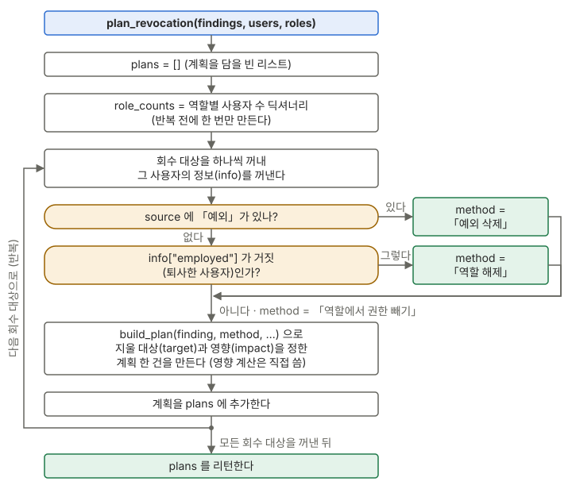

# 응용 4-1 · 회수 대상의 회수 계획 세우기

## 목표: 회수 계획

> **여유가 되면 해 보세요.** 핵심 실습 4-1 · 4-2와 글쓰기를 먼저 마칩니다. 이 응용에서는 핵심 준비 레슨에서 만든 `revoke_plan.py` 를 직접 써 봅니다. 하지 않아도 다음 Unit을 따라가는 데 문제가 없습니다.

> **이번 실습에 들어온 일**
>
> A사 관제 담당이 보낸 메시지:
> 「Unit 3 점검 결과에서 회수할 권한이 8건 나왔습니다. 그런데 바로 지워도 되는지 걱정됩니다. 예외로 받은 권한은 그 예외만 지우면 되지만, 역할로 받은 권한은 같은 역할을 가진 다른 사람에게도 영향이 갈 수 있기 때문입니다.
>
> 지우기 전에 8건을 어떤 방법으로 회수할지, 그 회수로 몇 건의 권한이 사라지는지를 먼저 리스트로 보여 주세요.」
> - **왜 중요한가**: 권한을 잘못 지우면 일하던 사람이 갑자기 접근하지 못합니다. 지우기 전에 방법과 영향을 먼저 확인하면 실수를 줄일 수 있습니다.

## 회수 대상 8건이 나오기까지

회수 대상 8건은 이렇게 나왔습니다.

| 단계 | 한 일 | 남은 건수 |
|---|---|---|
| **Unit 3 점검** | 권한 현황 14건에서 규칙(퇴사 · 만료)과 사용 이력(90일 기준)으로 후보를 찾음 | 후보 10건 |
| **회수 제외** | 회수 제외 2건(gaeun 의 `ACCOUNT:CHANGE` · seoyeon 의 `SALES:CHANGE`)을 뺌 | 8건 |

- 사용 이력은 권한을 마지막으로 쓴 시각의 기록입니다.
- 제외 리스트에는 3건이 있지만 dami 의 권한은 「퇴사한 계정」이라 제외하지 않습니다.
- **남은 8건**은 핵심 준비 레슨의 `revoke_input.py` 의 `load_to_revoke` 가 리턴하는 리스트입니다. 코드에서는 `findings` 라고 부릅니다.
- **판정 함수**: 실습 1-3의 `evaluate_access` 는 실습 4-2에서 회수 전후를 비교할 때 썼습니다.

## 왜 회수 계획이 필요한가

1. 점검에서 찾은 8건은 「회수해야 할 권한」입니다. 하지만 권한을 받은 방식에 따라 회수 방법이 다르고, 방법에 따라 영향받는 사람이 다릅니다.
2. 권한을 받은 방식에 따라 지우는 대상이 다릅니다.
   - **예외로 받은 권한**은 그 예외 한 건만 지우면 됩니다.
   - **역할로 받은 권한**은 사용자의 역할을 해제하거나, 역할 자체에서 그 권한을 빼야 합니다.
     - 역할에서 권한을 빼면 그 역할을 가진 **모든 사용자**가 권한을 잃습니다.
3. 그래서 지우기 전에 방법과 영향을 정리한 **회수 계획**을 먼저 만듭니다. 계획은 실제로는 아무것도 지우지 않는 미리보기(dry-run · 드라이 런)입니다. 이삿짐을 싸기 전에 버릴 물건 목록부터 적어 보는 것과 비슷합니다.

## 1.1 회수 방법과 영향 범위

- **회수 방법**은 권한을 없애려고 **어느 데이터를 고칠지**입니다.
  - 권한은 두 길로 받습니다. 예외(`EXCEPTIONS`)로 받거나, 사용자의 역할(`USERS` 의 `role` 이 가리키는 `ROLES`)로 받습니다.
  - 그래서 방법은 **예외 삭제 · 역할 해제 · 역할에서 권한 빼기** 세 가지입니다.
- **영향**(impact · 임팩트)은 이 회수로 사용자들이 잃는 권한을 하나씩 센 수입니다(예: dami 가 권한 2개를 잃으면 2).
- **이번 실습에서 쓰는 데이터의 모양**
  - `USERS`: `{"seoyeon": {"role": "sales", "employed": True}, "junho": {"role": "finance", "employed": True}, "dami": {"role": "sales", "employed": False}, …}`
  - `ROLES`: `{"sales": ["SALES:QUERY", "SALES:CHANGE"], "finance": ["SALES:QUERY", "SETTLE:QUERY"], …}` (역할 이름 → 권한 리스트)
  - `EXCEPTIONS`: 예외 한 건은 `{"id": 3, "user": "dami", "permission": "SALES:QUERY", …}` 모양입니다.
  - `findings`: 회수 대상 8건의 리스트이고, `finding` 은 그 한 건입니다.
    - `finding` 한 건에는 `user` · `permission` · `source`(권한을 받은 경로: 「예외 3번」 또는 「역할 sales」) · `reasons`(Unit 3 점검에서 나온 이유의 리스트)가 들어 있습니다.
    - 회수 대상은 사용자 · 권한 · 받은 경로 가운데 하나라도 다르면 따로 한 건입니다. 그래서 같은 방법의 계획이 여러 건 나올 수 있습니다(dami 의 역할 해제 2건).

**방법 ① 예외 삭제 — 예외로 받은 권한**

- **상황**: dami 가 예외 3번으로 `SALES:QUERY` 를 받았습니다.
- **하는 일**: `EXCEPTIONS` 리스트에서 번호가 3인 예외를 지웁니다.
- **사라지는 것**: 예외로 받은 그 권한 1개라서 **영향 1**입니다. dami 는 같은 권한을 `sales` 역할로도 받지만, 그쪽은 방법 ②에서 따로 회수합니다.
- **지울 대상**(`target`): 예외 번호 3
- **왜 이 방법인가**: 예외 한 건에만 들어 있는 권한이라 그 예외만 지우면 됩니다.

**방법 ② 역할 해제 — 퇴사한 사용자가 역할로 받은 권한**

- **상황**: dami 는 퇴사했고, 역할 `sales` 로 `SALES:QUERY` · `SALES:CHANGE` 를 받았습니다.
- **하는 일**: `USERS` 에서 dami 의 `role` 을 빈 문자열(`""`)로 바꿉니다. dami 는 어떤 역할의 권한도 받지 않게 됩니다.
- **사라지는 것**: dami 가 `sales` 로 받던 권한 2개가 모두 사라져서 **영향 2**입니다.
- **지울 대상**(`target`): 사용자 이름 dami
- **왜 이 방법인가**: 퇴사한 사람은 어떤 권한도 필요 없어서 역할째로 끊습니다. `sales` 역할에서 권한을 빼면 재직 중인 seoyeon 도 그 권한을 잃으므로, 역할이 아니라 dami 의 `role` 만 비웁니다.

**방법 ③ 역할에서 권한 빼기 — 재직 중인 사용자가 역할로 받은 권한**

- **상황**: 재직 중인 junho 가 역할 `finance` 로 `SALES:QUERY` 를 받았습니다.
- **하는 일**: `ROLES` 의 `finance` 권한 리스트에서 `SALES:QUERY` 를 뺍니다.
- **사라지는 것**: `finance` 역할을 가진 사용자 모두가 그 권한을 잃습니다. 이 데이터에서는 junho 1명이라 **영향 1**입니다.
- **지울 대상**(`target`): 역할 이름 finance
- **왜 이 방법인가**: junho 의 `role` 을 비우면 `finance` 의 다른 권한(`SETTLE:QUERY`)까지 모두 사라지므로, 그 권한만 뺍니다.

- **참고**(응용 1-2를 안 했으면 건너뜁니다): Unit 1 응용 1-2의 `revoke_access` 는 `employed` 만 `False` 로 바꾸고 `role` 은 그대로 두었습니다. 이번의 역할 해제는 `role` 을 비웁니다.

**어떤 방법을 고르나**

아래 「`plan_revocation` 의 흐름」 그림의 두 갈림길로 정합니다.

| 묻는 것 | 그렇다면 |
|---|---|
| 예외로 받았나? | ① 예외 삭제 |
| 아니고, 퇴사한 사용자인가? | ② 역할 해제 |
| 그 밖(재직 중인 사용자의 역할 권한) | ③ 역할에서 권한 빼기 |

**한 장 정리**

| 받은 방식 | 쓰는 방법 | 지울 대상(`target`) | 사라지는 권한 수(`impact`) |
|---|---|---|---|
| 예외로 받음(`source` 가 「예외 N번」) | 예외 삭제 | 예외 번호 N | 1건 |
| 역할로 받음 + 퇴사한 사용자(`employed` 가 `False`) | 역할 해제 | 그 사용자의 이름 | 그 역할에 든 권한 수(dami 의 `sales` 는 2건) |
| 역할로 받음 + 재직 중인 사용자 | 역할에서 권한 빼기 | 역할 이름 | 그 역할을 가진 사용자 수(사용자마다 그 권한 1건) |

- **계획**(`plan`) 한 건: 회수 대상 한 건에 `method`(회수 방법) · `target`(지울 대상) · `impact`(영향) 키를 추가한 딕셔너리입니다.

**`plan_revocation` 의 흐름**

<figure class="page-figure"></figure>

## 응용 4-1 · 회수 방법과 영향 범위 정하기

**이런 상황이 있습니다**

- **지금은**: Unit 3 점검에서 찾은 회수 대상 8건이 리스트로만 있습니다. 각각 어떤 방법으로 지워야 하는지, 지우면 누가 영향을 받는지는 담당자가 파일을 열어 따져야 합니다.
- **그래서 만드는 것**: `plan_revocation` 입니다.
  - 회수 대상을 하나씩 보고 회수 방법을 정합니다.
  - 예외로 받은 것은 「예외 삭제」, 퇴사한 사용자의 역할 권한은 「역할 해제」, 재직 중인 사용자의 역할 권한은 「역할에서 권한 빼기」입니다.
  - 지울 대상과 영향(사라지는 권한 건수)은 `build_plan` 이 계획에 적습니다.
- **실행하면**: 단계 1은 8건의 회수 방법과 영향을 출력하고, 단계 2는 방법별 건수, 단계 3은 `finance` · `sales` 역할의 사용자 수와 이름을 출력합니다.
- **현업에서는**: 권한 회수 도구도 실제로 지우기 전에 「무엇을 어떻게 지울지」 계획을 먼저 보여 줍니다.

**할 일**

1. 핵심 준비 레슨에서 만든 `revoke_plan.py` 의 내용을 아래 골격으로 바꾸고, `exception_id` · `count_users_by_role` · `build_plan` · `plan_revocation` 에서 직접 쓰는 곳 다섯 군데를 씁니다. 실행 파일 `apply4-1_run.py` 도 만듭니다.
2. 실행해서 <mark>회수 방법과 영향</mark>(단계 1: 계획), <mark>방법별 건수</mark>(단계 2: 집계), <mark>역할별 사용자 수와 이름</mark>(단계 3: 확인)를 읽습니다.

**`revoke_plan.py`** — 핵심 준비 레슨에서 만든 내용을 지우고 아래 골격을 붙여 넣습니다.

```python
def exception_id(source):                                        # "예외 3번" 모양 문자열을 받는 함수
    """문자열 「예외 3번」에서 예외 번호(3)를 숫자로 꺼낸다.
    회수 대상의 받은 방식(「예외 3번」)에서 지울 예외 번호를 꺼낼 때 쓴다.
    """
    number_text = source.replace("예외 ", "")                      # "예외 3번" 에서 "예외 " 를 지워 "3번" 으로 만든다 (미리 채움)
    # ← 아래를 직접 씁니다 (주석은 두고 각 주석 바로 아래 줄에 씁니다)
    # 1. number_text 에서 "번" 을 지운 문자열을 number_text 에 다시 담는다 (.replace("번", ""))
    # 2. number_text 를 숫자로 바꿔 리턴한다 (int)


def count_users_by_role(users):                                  # 사용자 딕셔너리를 받는 함수
    """역할마다 사용자가 몇 명인지 센다(재직 여부와 상관없이).
    역할을 회수하기 전에 영향을 볼 때 쓴다.
    예: {"finance": 1, "sales": 2}
    """
    counts = {}                                                  # 역할 → 사용자 수를 담을 빈 딕셔너리
    for info in users.values():                                  # 사용자 정보를 하나씩 꺼낸다(.values() 는 딕셔너리의 값만 꺼낸다)
        role = info["role"]                                      # 그 사용자의 역할
        # ← 아래를 직접 씁니다 (주석은 두고 각 주석 바로 아래 줄에 씁니다)
        # 3. counts.get(role, 0) 을 old_count 에 담는다 (처음이면 0)
        # 4. counts[role] 를 old_count + 1 로 정한다
    return counts                                                # 역할별 사용자 수를 리턴한다


def make_plan(finding, method, target, impact):                  # 회수 대상 · 방법 · 대상 · 영향 범위를 받는 함수
    """회수 대상을 복사해 method · target · impact 키를 더한 계획 한 개를 만든다.
    impact 는 이 회수로 사라지는 (사용자, 권한)의 수이고, 회수 전에 영향을 가늠할 때 쓴다.
    """
    plan = finding.copy()                                        # 원래 권한은 바꾸지 않고 복사한다
    plan["method"] = method                                      # 회수 방법을 적는다
    plan["target"] = target                                      # 실제로 지울 대상(예외 번호 · 사용자 · 역할)을 적는다
    plan["impact"] = impact                                      # 사라지는 (사용자, 권한)의 수를 적는다
    return plan                                                  # 계획 한 건을 리턴한다


def build_plan(finding, method, users, roles, role_counts):      # 회수 대상 한 건 · 회수 방법 · 사용자 · 역할 · 역할별 사용자 수를 받는 함수
    """회수 방법에 맞게 지울 대상과 영향을 정해 계획 한 개를 만든다.
    회수 계획을 세울 때 쓴다.
    """
    info = users[finding["user"]]                                # 그 사용자의 정보를 꺼낸다
    if method == "예외 삭제":                                    # 방법이 예외 삭제이면
        target = exception_id(finding["source"])                 # 지울 대상은 예외 번호
        return make_plan(finding, method, target, 1)             # 영향은 권한 1건
    if method == "역할 해제":                                    # 방법이 역할 해제이면
        # ← 아래를 직접 씁니다 (주석은 두고 각 주석 바로 아래 줄에 씁니다)
        # 5. roles[info["role"]] 를 role_permissions 에 담는다 (그 사용자의 역할에 든 권한 리스트)
        # 6. len(role_permissions) 를 impact 에 담는다 (영향은 그 역할에 든 권한 수)
        return make_plan(finding, method, finding["user"], impact)  # 지울 대상은 그 사용자의 이름 (미리 채움)
    # ← 아래를 직접 씁니다 (주석은 두고 각 주석 바로 아래 줄에 씁니다)
    # 7. role_counts[info["role"]] 를 impact 에 담는다 (역할에서 권한 빼기: 영향은 그 역할을 가진 사용자 수)
    return make_plan(finding, method, info["role"], impact)      # 지울 대상은 역할 이름 (미리 채움)


def plan_revocation(findings, users, roles):                     # 회수 대상 리스트 · 사용자 딕셔너리 · 역할 딕셔너리를 받는 함수
    """회수 대상마다 회수 방법을 정해 계획 리스트를 리턴한다.
    실제로는 아무것도 지우지 않으며, 회수하기 전에 계획부터 세울 때 쓴다.
    """
    role_counts = count_users_by_role(users)                     # 역할마다 사용자가 몇 명인지 센다(반복 전에 한 번만)
    plans = []                                                   # 계획을 담을 빈 리스트
    for finding in findings:                                     # 회수 대상을 하나씩 꺼낸다
        info = users[finding["user"]]                            # 그 사용자의 정보를 꺼낸다
        # ← 아래를 직접 씁니다 (주석은 두고 각 주석 바로 아래 줄에 씁니다)
        # 8. finding["source"] 안에 "예외" 가 있으면 (in)
        # 9.   method 를 "예외 삭제" 로 정한다
        # 10. 그렇지 않고 info["employed"] 가 거짓이면 (elif not)
        # 11.  method 를 "역할 해제" 로 정한다
        # 12. 그렇지 않으면 (else)
        # 13.  method 를 "역할에서 권한 빼기" 로 정한다
        plan = build_plan(finding, method, users, roles, role_counts)  # 계획 한 건을 만든다
        plans.append(plan)                                       # 방법에 맞는 계획을 만들어 계획 리스트에 추가한다
    return plans                                                 # 계획 리스트를 리턴한다
```

- **직접 쓰는 곳은 네 함수의 다섯 군데**입니다. 판단이 필요한 함수마다 1 ~ 6줄만 쓰고, 나머지는 미리 채웠습니다.

| 함수 | 직접 쓰는 번호 | 하는 일 |
|---|---|---|
| `exception_id` | 1 · 2번 | 「번」을 지우고 숫자로 바꿈 |
| `count_users_by_role` | 3 · 4번 | 역할마다 사용자 수를 1 늘려 적음 |
| `build_plan` | 5 · 6번, 7번 | 역할 해제와 역할에서 권한 빼기의 영향을 정함 |
| `plan_revocation` | 8 ~ 13번 | 회수 대상마다 **어떤 방법으로 회수할지**(`method`)를 정함 |

- `문자열.replace("번", "")` 은 문자열 안의 「번」을 빈 문자열로 바꾼 **새 문자열**을 돌려줍니다. 원래 문자열은 그대로라서 결과를 `number_text` 에 다시 담아야 합니다.
- `int("3")` 은 글자 `"3"` 을 계산할 수 있는 숫자 `3` 으로 바꿉니다. 예외의 `id` 가 숫자라서 숫자로 바꿔야 비교할 수 있습니다.
- 들여쓰기는 미리 채운 줄에 맞춥니다.

| 함수 | 쓰는 줄 | 앞의 공백 |
|---|---|---|
| `exception_id` | 1 · 2번(함수 안) | 4개 |
| `count_users_by_role` | 3 · 4번(`for` 안쪽) | 8개 |
| `build_plan` | `if method == "역할 해제":` 안쪽(5 · 6번) | 8개 |
| `build_plan` | 7번(`if` 밖) | 4개 |
| `plan_revocation` | `if` · `elif` · `else`(미리 채운 `for` 안쪽) | 8개 |
| `plan_revocation` | 그 안쪽 `method = …` | 12개(4개 더) |

- **미리 채운 함수**
  - `make_plan`: 회수 대상을 복사해 세 키를 추가한 계획을 만듭니다(판단이 없는 복사라 미리 채움).
  - `count_users_by_role` 의 `for info in users.values():` 에서 `.values()` 는 딕셔너리의 값만 하나씩 꺼냅니다.
- **`load_to_revoke`**: 핵심 준비 레슨의 `revoke_input.py` 에 들어 있고, 회수 대상 8건을 리턴합니다. 그대로 둡니다.
- 이번 실습의 데이터에서 영향이 2건 이상인 계획은 dami 의 역할 해제 두 건(영향 2)이고, 실습 4-1에서 승인 대상이 된 것도 이 때문입니다.
- 10번의 `elif not info["employed"]` 는 「재직 여부(`employed`)가 `False` 이면」입니다.
  - 주석 목록의 10번이 `elif` 입니다.
  - `not` 은 참과 거짓을 뒤집습니다.
- 채우기 전에 실행하면 `NameError: name 'method' is not defined` 오류가 납니다.
  - 회수 방법(`method`)을 아직 정하지 않았는데 `build_plan` 에 전달하려 하기 때문입니다. 위의 `exception_id` · `count_users_by_role` · `build_plan` 은 채우기 전에도 오류가 나지 않습니다.

**`apply4-1_run.py`** — 그대로 붙여 넣습니다. 학생이 쓰는 줄은 없습니다. 회수 대상 8건을 만들고 `plan_revocation` 으로 계획을 세워 세 단계로 출력합니다.

```python
from rbac import USERS, ROLES                                    # 실습 1-2의 사용자 · 역할 딕셔너리를 불러온다
from revoke_input import load_to_revoke                          # 핵심 준비의 고정 회수 대상 함수를 불러온다
from revoke_plan import plan_revocation                          # 방금 만든 회수 계획 함수를 불러온다

to_revoke = load_to_revoke()                                     # Unit 3 점검 결과인 회수 대상 8건을 만든다
plans = plan_revocation(to_revoke, USERS, ROLES)                 # 회수 계획을 세운다(실제로는 지우지 않는다)

print("--- 단계 1: 계획 - 회수 대상", len(to_revoke), "건의 회수 방법")   # 단계 1 시작을 알리는 줄
for plan in plans:                                               # 계획을 하나씩 꺼낸다
    print(plan["user"], plan["permission"], "<-", plan["source"], "|", plan["method"], "| 영향", plan["impact"], "건")   # 사용자 · 권한 <- 출처 | 방법 | 영향을 출력한다

print("--- 단계 2: 집계 - 방법별 건수")                           # 단계 2 시작을 알리는 줄
counts = {}                                                      # 방법 → 건수를 담을 빈 딕셔너리
for plan in plans:                                               # 계획을 하나씩 꺼낸다
    count_key = plan["method"]                                   # 세는 기준이 되는 키
    old_count = counts.get(count_key, 0)                         # 그 키의 지금까지 센 수(처음이면 0)
    counts[count_key] = old_count + 1                            # 1 늘려서 다시 적는다
print(counts)                                                    # 방법별 건수를 출력한다

print("--- 단계 3: 확인 - 역할별 사용자 수와 이름")                    # 단계 3 시작을 알리는 줄
names_by_role = {"finance": [], "sales": []}                     # 역할 → 그 역할을 가진 사용자 이름 리스트
for name, info in USERS.items():                                 # 사용자를 하나씩 꺼낸다
    if info["role"] in names_by_role:                            # finance 나 sales 역할이면
        names_by_role[info["role"]].append(name)                 # 그 역할의 이름 리스트에 이름을 추가한다
for role in names_by_role:                                       # 두 역할을 하나씩 꺼낸다
    names = names_by_role[role]                                  # 그 역할의 이름 리스트
    print(role, len(names), "명", names)                         # 역할 · 사용자 수 · 이름을 출력한다
```

**순서**

1. **[VS Code]** 작업 폴더 `network-study-notes/access_control` 의 `revoke_plan.py` 를 열어 내용을 모두 지우고 위 `revoke_plan.py` 골격을 붙여 넣습니다. 실행 파일 `apply4-1_run.py` 도 만들어 위 `apply4-1_run.py` 코드 상자의 내용을 붙여 넣습니다.
   - `apply4-1_run.py` 는 `access_control` 폴더를 오른쪽 클릭 › **New File** 로 만듭니다.
   - 다 채울 때까지 실습 4-1 · 4-2의 실행 파일은 오류가 납니다. 막히면 핵심 준비 레슨의 코드을 다시 붙여 넣으면 됩니다.

<!-- checklist optional -->
- [ ] `revoke_plan.py` 의 내용을 골격으로 바꿔 붙여 넣고, `apply4-1_run.py` 를 만들어 붙여 넣었다
<!-- /checklist -->

2. **[VS Code]** `revoke_plan.py` 에서 직접 쓰는 곳 다섯 군데(`exception_id` · `count_users_by_role` · `build_plan` · `plan_revocation`)를 씁니다. 1.1 의 카드와 표, 흐름 그림을 보고 씁니다.

<!-- checklist optional -->
- [ ] `revoke_plan.py` 의 직접 쓰는 곳 다섯 군데를 채웠다
<!-- /checklist -->

3. **[터미널]** `pwd` 의 결과가 `access_control` 로 끝나는지 확인하고 실행합니다. 다르면 `cd access_control` 을 먼저 칩니다.
   ```bash
   pwd
   python apply4-1_run.py
   ```
4. 출력은 세 단계입니다. 단계 1은 `회수 대상 8 건의 회수 방법` 줄과 계획 여덟 줄, 단계 2는 방법별 건수 딕셔너리 한 줄, 단계 3은 역할 두 줄(사용자 수와 이름)입니다.

<!-- checklist optional -->
- [ ] `python apply4-1_run.py` 를 실행해 세 단계 출력이 나왔다
<!-- /checklist -->

5. **[터미널]** 실습 4-2의 실행 파일을 다시 실행해, 내가 쓴 `revoke_plan.py` 로도 실습 4-2 정답과 같은 출력이 나오는지 확인합니다.
   ```bash
   python exercise4-2_run.py
   ```

<!-- checklist optional -->
- [ ] `python exercise4-2_run.py` 를 다시 실행해 실습 4-2 정답과 같은 출력이 나왔다
<!-- /checklist -->

선택 응용의 결과와 판단 근거는 원하면 [문제 해결 과정을 블로그에 기록하기](__SITE__/exercises/module/3/unit/4/lesson/10/page/1)에 덧붙일 수 있습니다.

<!-- answer: 08|응용 4-1 정답 -->


## 응용 4-1 정리

| 하려는 일 | 코드 · 말 |
|---|---|
| 예외로 받은 권한인지 | `if "예외" in finding["source"]:` |
| 퇴사한 사용자인지 | `elif not info["employed"]:` |
| 회수 방법 정하기: 예외 삭제 | `method = "예외 삭제"` |
| 회수 방법 정하기: 역할 해제 | `method = "역할 해제"` |
| 회수 방법 정하기: 역할에서 권한 빼기 | `method = "역할에서 권한 빼기"` |
| 계획 한 건 만들기 | `build_plan(finding, method, users, roles, role_counts)` |
| 예외 번호에서 「번」 지우기 | `number_text = number_text.replace("번", "")` |
| 예외 번호를 숫자로 리턴 | `return int(number_text)` |
| 역할의 지금까지 센 수 | `old_count = counts.get(role, 0)` |
| 1 늘려 다시 적기 | `counts[role] = old_count + 1` |
| 역할 해제: 역할의 권한 리스트 | `role_permissions = roles[info["role"]]` |
| 역할 해제의 영향 | `impact = len(role_permissions)` |
| 역할에서 권한 빼기의 영향 | `impact = role_counts[info["role"]]` |

- `build_plan` 은 지울 대상과 영향을 정합니다. 역할 두 경우의 영향은 직접 씁니다.

---
