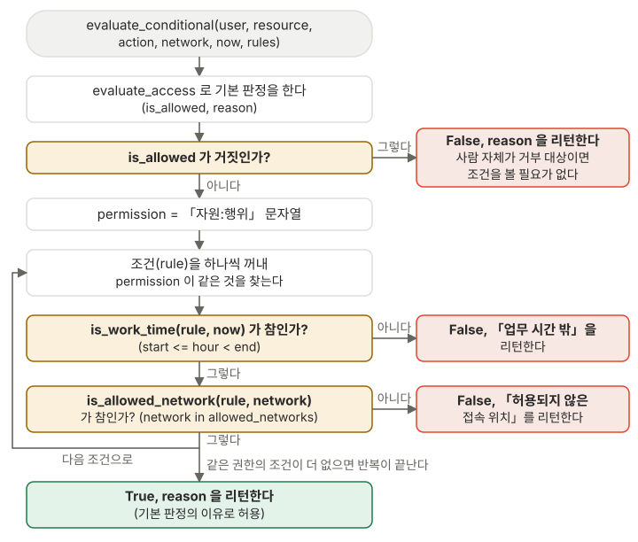

# 응용 4-2 · 시간·위치 조건으로 판정하기

## 목표: 조건기반 판정

> **여유가 되면 해 보세요.** 핵심 실습 4-1 · 4-2와 글쓰기를 먼저 마칩니다. 이 응용은 실습 4-1 · 4-2의 파일을 쓰지 않으므로 응용 4-1을 건너뛰고 바로 해도 됩니다.

> **이번 실습에 들어온 일**
>
> A사 관제 담당이 보낸 메시지:
> 「정산(회사가 주고받은 돈을 계산해 맞춰 보는 일)을 조회할 권한이 있는 직원이 새벽에 집 밖의 공용 와이파이에서 접속해도 지금은 그대로 허용됩니다. 권한이 있어도 업무 시간이 아니거나 회사 밖에서 접속하면 막고 싶습니다. 특히 데이터를 바꾸는 권한과 계정을 관리하는 권한은 더 엄격하게요.
>
> 권한마다 허용하는 시간대와 접속 위치(사내망 · VPN · 외부)를 파일에 적어 둘 테니, 판정할 때 함께 확인해 주세요.」
> - **왜 중요한가**: 권한이 있어도 평소와 다른 시간이나 장소에서 온 요청은 위험할 수 있습니다. 판정할 때 시간과 접속 위치를 함께 확인하면 그런 요청을 가려낼 수 있습니다.

## 왜 시간과 위치까지 보는가

1. 지금까지의 판정(`evaluate_access`)은 **누가 어떤 권한을 갖고 있나**만 봤습니다. 권한이 있으면 새벽이든 외부든 허용합니다.
2. 이번에는 **언제, 어디서 요청했나**도 함께 봅니다. 기본 판정이 허용이어도 그 권한에 걸린 조건(업무 시간, 접속 위치)에 어긋나면 거부합니다. 이것을 **조건기반 정책**이라고 부릅니다. 학교 컴퓨터실 출입증이 있어도 밤에는 문이 잠겨 들어갈 수 없는 것과 같습니다.
3. 조건은 코드 안이 아니라 `config/conditions.json` 파일에 적습니다.

## 1.1 조건 파일과 판정 순서

`config/conditions.json` 의 한 조건은 아래 세 키로 이루어집니다.

| 키 | 뜻 | 값의 예 |
|---|---|---|
| `permission` | 조건이 걸린 권한 | `"SALES:CHANGE"` |
| `hours` | 허용 시간대 `[시작 시, 끝 시]`. 끝 시각은 **포함하지 않음** | `[9, 18]` (9시부터 18시 **전까지**) |
| `networks` | 허용하는 접속 위치 | `["office", "vpn"]` |

접속 위치는 세 가지입니다.

| 값 | 뜻 |
|---|---|
| `office` | 사내망(회사 건물 안에서 쓰는 네트워크) |
| `vpn` | VPN으로 회사에 연결한 상태 |
| `external` | 그 밖의 외부 |

- VPN(가상 사설망 · 브이피엔)은 회사 밖에서도 암호로 보호한 통로를 거쳐 회사망에 들어오는 방법입니다. 더 알고 싶으면 AI 에게 「VPN 을 중학생에게 설명하듯 알려 줘」라고 물어보세요.

이번 실습의 조건은 세 권한에만 걸려 있습니다.

| 권한 | 허용 시간대 | 허용 접속 위치 |
|---|---|---|
| `SALES:CHANGE` | 9시부터 18시 전까지 | 사내망 · VPN |
| `SETTLE:QUERY` | 8시부터 20시 전까지 | 사내망 · VPN |
| `ACCOUNT:CHANGE` | 9시부터 18시 전까지 | 사내망만 |

- 조건이 없는 권한(예: `SALES:QUERY`)은 기본 판정 그대로입니다.
- 판정 순서는 **기본 판정 → 조건**입니다.
  - 퇴사한 사용자처럼 사람 자체가 거부 대상이면 조건을 볼 필요 없이 그 이유로 거부합니다.
- 요청에는 접속 위치(`network`)가 추가되었습니다. 시각(`now`)에서 시(`now.hour`)를 꺼내 판정에 씁니다(예: 19시 30분이면 `now.hour` 는 `19`).
- `start_hour, end_hour = rule["hours"]` 는 리스트의 두 값을 두 이름으로 한꺼번에 받습니다.
  - 함수가 리턴한 두 값을 `is_allowed, reason = …` 로 받던 것과 같은 모양입니다.
  - 실행 파일의 `number += 1` 은 `number = number + 1` 과 같은 뜻입니다.
- **직접 쓰는 곳은 세 함수**입니다. 판단이 필요한 함수마다 2 ~ 4줄만 쓰고, 나머지는 미리 채웠습니다.

| 함수 | 직접 쓰는 번호 | 하는 일 |
|---|---|---|
| `is_work_time` | 1 ~ 3번 | 요청 시각이 허용 시간대 안인지 알려 줌 |
| `is_allowed_network` | 4 · 5번 | 접속 위치가 허용 리스트에 있는지 알려 줌 |
| `evaluate_conditional` | 6 ~ 9번 | 두 확인이 거짓이면 이유와 함께 거부함 |

- **미리 채운 것**: `load_rules` 와 `evaluate_conditional` 의 기본 판정 · 조건 찾기 반복 · 마지막 `return` 입니다.

**문법 상자 — 범위 비교**

**① `a <= x < b` 는 x 가 a 이상이고 b 미만인지 한 번에 묻습니다**

```python
hour = 10                                                            # 요청 시각의 시
print(9 <= hour < 18)                                                # 9시 이상이고 18시 미만인가
```

실행 결과:

```
True
```

```python
hour = 18                                                            # 요청 시각의 시
print(9 <= hour < 18)                                                # 9시 이상이고 18시 미만인가
```

실행 결과:

```
False
```

- `9 <= hour < 18` 은 `9 <= hour and hour < 18` 과 같은 뜻입니다. 끝 값(18)은 포함하지 않아서 18시 정각은 `False` 입니다.
- 이 비교의 결과(`True` 또는 `False`)를 그대로 `return` 하면 「업무 시간 안인가」를 알려 주는 함수가 됩니다.

<figure class="page-figure"></figure>

## 응용 4-2 · 기본 판정 뒤 조건 확인하기

**이런 상황이 있습니다**

- **지금은**: 권한이 있는 사용자는 새벽이든 외부든 모두 허용됩니다. 비밀번호가 새어 나가 남이 쓰는 계정이 한밤중에 외부에서 들어와도 판정 함수로는 막을 수 없습니다.
- **그래서 만드는 것**: `evaluate_conditional` 입니다.
  - 먼저 실습 1-3의 `evaluate_access` 로 기본 판정을 하고, 허용이면 그 권한의 조건(업무 시간, 접속 위치)에 어긋나는지 확인합니다.
  - 어긋나면 이유와 함께 거부합니다.
- **실행하면**: 단계 1은 요청 여덟 건의 판정, 단계 2는 조건 파일에 적힌 조건을 출력합니다.
- **현업에서는**: 접근 제어 도구도 누구인지만 보지 않고 접속 시간, 위치, 기기 같은 조건을 함께 확인합니다.

**할 일**

1. 작업 폴더 `network-study-notes/access_control` 안에 `config/conditions.json` · `conditional.py` · `apply4-2_run.py` 세 파일을 만들고, `is_work_time` · `is_allowed_network` · `evaluate_conditional` 에서 직접 쓰는 곳 세 군데를 씁니다.
2. 실행해서 <mark>요청 여덟 건의 판정</mark>(단계 1: 판정)과 <mark>조건 파일에 적힌 조건</mark>(단계 2: 확인)을 읽습니다.

**`config/conditions.json`** — 그대로 붙여 넣습니다. 권한별 조건입니다. `access_control` 안의 `config` 폴더에 만듭니다.

<pre class="copyable"><code>[
  {"permission": "SALES:CHANGE", "hours": [9, 18], "networks": ["office", "vpn"]},
  {"permission": "SETTLE:QUERY", "hours": [8, 20], "networks": ["office", "vpn"]},
  {"permission": "ACCOUNT:CHANGE", "hours": [9, 18], "networks": ["office"]}
]
</code></pre>

**`conditional.py`**

```python
from config_loader import load_json                              # M3 Unit 1에서 만든 안전한 설정 읽기 함수를 불러온다
from policy import evaluate_access                               # 실습 1-3의 기본 판정 함수를 불러온다


def load_rules(path):                                            # 조건 파일 경로를 받는 함수
    """조건 파일을 읽어 조건 딕셔너리 리스트를 리턴하고, 파일이 없거나 깨졌으면 빈 리스트를 리턴한다.
    판정 서버가 시작할 때 업무 시간 · 접속 위치 조건을 불러오는 데 쓴다.
    """
    return load_json(path, [])                                   # 안전하게 읽는다(못 읽으면 두 번째 값인 빈 리스트를 리턴한다)


def is_work_time(rule, now):                                     # 조건 한 건과 요청 시각(datetime)을 받는 함수
    """요청 시각의 시가 허용 시간대 안이면 True, 밖이면 False 를 리턴한다.
    끝 시각은 포함하지 않는다.
    업무 시간 밖의 요청을 막을 때 쓴다.
    """
    # ← 아래를 직접 씁니다 (주석은 두고 각 주석 바로 아래 줄에 씁니다)
    # 1. rule["hours"] 를 start_hour, end_hour 두 이름으로 받는다
    # 2. now.hour 를 hour 에 담는다
    # 3. start_hour <= hour < end_hour 의 결과(True 또는 False)를 리턴한다


def is_allowed_network(rule, network):                           # 조건 한 건과 접속 위치를 받는 함수
    """접속 위치가 조건의 허용 위치에 들어 있으면 True, 아니면 False 를 리턴한다.
    사내망 · VPN 에서 온 요청만 허용할 때 쓴다.
    """
    # ← 아래를 직접 씁니다 (주석은 두고 각 주석 바로 아래 줄에 씁니다)
    # 4. rule["networks"] 를 allowed_networks 에 담는다
    # 5. network 가 allowed_networks 안에 있는지(in)의 결과(True 또는 False)를 리턴한다


def evaluate_conditional(user, resource, action, network, now, rules):   # 사용자 · 자원 · 행위 · 접속 위치 · 요청 시각(datetime) · 조건 리스트를 받는 함수
    """(허용 여부, 이유)를 리턴한다.
    기본 판정이 허용이어도 업무 시간 · 접속 위치 조건에 어긋나면 거부한다.
    새벽 · 외부 접속을 막을 때 쓴다.
    """
    is_allowed, reason = evaluate_access(user, resource, action, now)    # 먼저 실습 1-3의 기본 판정을 한다 (미리 채움)
    if not is_allowed:                                                   # 기본 판정이 거부이면
        return False, reason                                     # 그 이유로 바로 거부한다
    permission = f"{resource}:{action}"                          # "자원:행위" 모양 문자열로 합친다
    for rule in rules:                                           # 조건을 하나씩 꺼낸다
        if rule["permission"] == permission:                     # 이 권한에 걸린 조건이면
            # ← 아래를 직접 씁니다 (주석은 두고 각 주석 바로 아래 줄에 씁니다)
            # 6. is_work_time(rule, now) 가 거짓이면 (if not …)
            # 7.   False, "업무 시간 밖" 을 리턴한다
            # 8. is_allowed_network(rule, network) 가 거짓이면 (if not …)
            # 9.   False, "허용되지 않은 접속 위치" 를 리턴한다
    return True, reason                                          # 어긋나는 조건이 없으면 기본 판정의 이유로 허용한다
```

- 들여쓰기는 미리 채운 줄에 맞춥니다.

| 함수 | 쓰는 줄 | 앞의 공백 |
|---|---|---|
| `is_work_time` · `is_allowed_network` | 1 ~ 5번(함수 안) | 4개 |
| `evaluate_conditional` | 6번 · 8번(미리 채운 `if` 안쪽) | 12개 |
| `evaluate_conditional` | `if` 안쪽 `return`(7번 · 9번) | 16개(4개 더) |

- `evaluate_conditional` 의 6번 · 8번은 미리 채운 `if rule["permission"] == permission:` 의 안쪽에 씁니다.
- 나머지 줄은 미리 채워 두었으니 그대로 둡니다.
- 3번의 `start_hour <= hour < end_hour` 는 start 이상이고 end 미만인지의 참 · 거짓입니다. 이 결과를 그대로 `return` 하므로 `if` 가 필요 없습니다.
- 6번 · 8번의 `not` 은 함수가 리턴한 참과 거짓을 뒤집습니다.
- 채우기 전에 실행하면 `IndentationError: expected an indented block` 오류가 납니다(파이썬 버전에 따라 뒤에 `after 'if' statement on line …` 가 붙습니다). `evaluate_conditional` 의 `if` 아래에 실행할 줄이 아직 없기 때문입니다. `is_work_time` · `is_allowed_network` 는 채우기 전에 아무것도 리턴하지 않습니다.

**`apply4-2_run.py`** — 그대로 붙여 넣습니다. 학생이 쓰는 줄은 없습니다. 요청 여덟 건을 시각까지 정해 판정하고, 조건 파일의 조건을 출력합니다.

```python
from datetime import datetime                                    # 문자열을 시각으로 바꾸는 데 쓴다
from conditional import load_rules, evaluate_conditional         # 방금 만든 조건 판정 함수를 불러온다

TIME_FORMAT = "%Y-%m-%d %H:%M"                                   # 시각 문자열의 형식
RULES = load_rules("config/conditions.json")                     # 조건 파일을 읽는다

CASES = [                                                        # 시험할 요청 여덟 건. (사용자, 자원, 행위, 접속 위치, 시각)
    ("seoyeon", "SALES", "QUERY", "office", "2026-10-30 10:00"),     # 1. 조건이 없는 조회 권한
    ("seoyeon", "SALES", "CHANGE", "office", "2026-10-30 09:00"),    # 2. 시작 시각 정각, 사내망
    ("seoyeon", "SALES", "CHANGE", "office", "2026-10-30 18:00"),    # 3. 끝 시각 정각
    ("seoyeon", "SALES", "CHANGE", "external", "2026-10-30 10:00"),  # 4. 업무 시간 안, 외부 접속
    ("seoyeon", "SALES", "CHANGE", "external", "2026-10-30 22:00"),  # 5. 시간도 위치도 어긋남
    ("junho", "SETTLE", "QUERY", "vpn", "2026-10-30 19:30"),         # 6. 정산 조회는 20시까지
    ("gaeun", "ACCOUNT", "CHANGE", "vpn", "2026-10-30 10:00"),       # 7. 계정 변경은 사내망만
    ("dami", "SALES", "QUERY", "office", "2026-10-30 10:00"),        # 8. 퇴사한 사용자
]

print("--- 단계 1: 판정 - 요청", len(CASES), "건")                  # 단계 1 시작을 알리는 줄
number = 0                                                       # 요청 번호를 0 으로 시작한다
for user, resource, action, network, time_text in CASES:         # 요청을 하나씩 꺼낸다
    number += 1                                                  # 요청 번호를 1 늘린다
    now = datetime.strptime(time_text, TIME_FORMAT)              # 시각 문자열을 시각으로 바꾼다
    is_allowed, reason = evaluate_conditional(user, resource, action, network, now, RULES)   # 조건까지 판정한다
    if is_allowed:                                                       # 허용이면
        result = "허용"                                           # 허용이라고 적는다
    else:                                                        # 거부이면
        result = "거부"                                           # 거부라고 적는다
    permission = f"{resource}:{action}"                          # 권한 문자열을 만든다
    time_text = now.strftime("%H:%M")                            # 시각을 「시:분」 문자열로 바꾼다
    verdict = f"{result}({reason})"                              # 결과와 이유를 합친다
    print(number, user, permission, network, time_text, "->", verdict)  # 번호 · 요청과 결과를 출력한다

print("--- 단계 2: 확인 - 조건 파일에 적힌 조건")                      # 단계 2 시작을 알리는 줄
for rule in RULES:                                               # 조건을 하나씩 꺼낸다
    hours = rule["hours"]                                        # 허용 시간대 [시작 시, 끝 시]
    hours_text = f"{hours[0]}시부터 {hours[1]}시 전까지"                # 시간대를 문자열로 만든다
    networks_text = ", ".join(rule["networks"])                  # 허용 접속 위치를 쉼표로 이어 붙인다
    print(rule["permission"], "|", hours_text, "|", networks_text)  # 권한 | 시간대 | 허용 접속 위치를 출력한다
```

**순서**

1. **[VS Code]** 파일 `config/conditions.json` · `conditional.py` · `apply4-2_run.py` 를 만들고, 위에서 같은 이름이 붙은 코드 상자의 내용을 붙여 넣어 저장합니다.
   - `conditions.json` 은 `access_control` 폴더 안의 `config` 폴더를 오른쪽 클릭 › **New File** 로 만듭니다.
   - `conditional.py` · `apply4-2_run.py` 는 `access_control` 폴더를 오른쪽 클릭 › **New File** 로 만듭니다.

<!-- checklist optional -->
- [ ] `conditional.py` · `apply4-2_run.py` 를 만들어 붙여 넣었다
<!-- /checklist -->

2. **[터미널]** `ls config` 로 `conditions.json` 이 `users.json` 과 같은 `config` 폴더에 있는지 보고, `python -m json.tool config/conditions.json` 으로 내용이 정상인지 확인합니다.
   - 깨진 채 두면 `[경고] 설정 파일 깨짐: config/conditions.json` 이 찍히고, 조건을 읽지 못해 조건 없이 허용됩니다.

<!-- checklist optional -->
- [ ] `config/conditions.json` 을 만들어 붙여 넣고 `python -m json.tool config/conditions.json` 으로 정상인지 확인했다
<!-- /checklist -->

3. **[VS Code]** `conditional.py` 의 `is_work_time` · `is_allowed_network` · `evaluate_conditional` 에서 직접 쓰는 곳 세 군데를 씁니다. 1.1 의 표와 그림, 문법 상자를 보고 씁니다.

<!-- checklist optional -->
- [ ] `conditional.py` 의 직접 쓰는 곳 세 군데를 채웠다
<!-- /checklist -->

4. **[터미널]** `pwd` 의 결과가 `access_control` 로 끝나는지 확인하고 실행합니다. 다르면 `cd access_control` 을 먼저 칩니다.
   ```bash
   pwd
   python apply4-2_run.py
   ```
5. 출력은 두 단계입니다. 단계 1은 `요청 8 건` 줄과 판정 여덟 줄, 단계 2는 조건 세 줄입니다.

<!-- checklist optional -->
- [ ] `python apply4-2_run.py` 를 실행해 판정 여덟 줄과 조건 세 줄이 나왔다
<!-- /checklist -->

선택 응용의 결과와 판단 근거는 원하면 [문제 해결 과정을 블로그에 기록하기](__SITE__/exercises/module/3/unit/4/lesson/10/page/1)에 덧붙일 수 있습니다.

<!-- answer: 08|응용 4-2 정답 -->


## 응용 4-2 정리

| 하려는 일 | 코드 · 말 |
|---|---|
| 기본 판정 먼저 | `is_allowed, reason = evaluate_access(user, resource, action, now)` (미리 채움) |
| 기본 판정이 거부이면 | `if not is_allowed:` → `return False, reason` (미리 채움) |
| 요청 시각의 시 | `hour = now.hour` (`is_work_time` 안) |
| 시간대 안인지 | `return start_hour <= hour < end_hour` (끝 시각은 포함하지 않음) |
| 허용 접속 위치 리스트 | `allowed_networks = rule["networks"]` (`is_allowed_network` 안) |
| 접속 위치가 리스트에 있는지 | `return network in allowed_networks` |
| 업무 시간 밖이면 거부 | `if not is_work_time(rule, now):` → `return False, …` |
| 허용되지 않은 위치면 거부 | `if not is_allowed_network(rule, network):` → `return False, …` |

---
