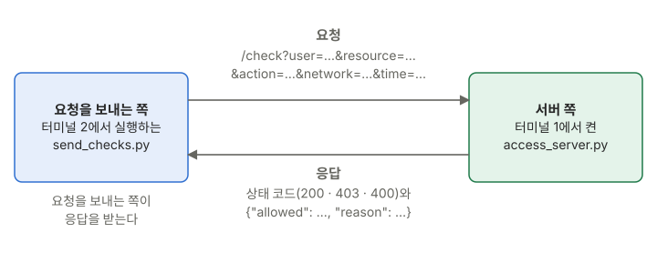

# 응용 4-3 · 판정 서버와 요청 로그 만들기

## 목표: 판정 서버와 요청 로그

> **여유가 되면 해 보세요.** 핵심 실습 4-1 · 4-2와 글쓰기를 먼저 마칩니다. 이 응용은 응용 4-2의 `conditional.py` 와 `config/conditions.json` 을 쓰므로 응용 4-2를 먼저 합니다.

> **이번 실습에 들어온 일**
>
> A사 관제 담당이 보낸 메시지:
> 「지금은 판정 함수를 파이썬 파일 안에서만 쓸 수 있습니다. 사내의 다른 프로그램이 「이 사용자가 지금 이 권한을 쓸 수 있나」를 물으려면 주소로 물을 수 있어야 합니다.
>
> 판정을 주소로 요청해 받을 수 있는 서버로 만들어 주세요. 허용이면 200, 거부면 403, 요청에 빠진 값이 있으면 400으로 답하고(처리 결과를 알리는 숫자를 상태 코드라고 합니다), 요청마다 로그를 한 줄씩 남겨 주세요.」
> - **왜 중요한가**: 판정을 한곳에 두고 여러 프로그램이 같은 주소로 물으면 규칙이 한 군데에만 있어서 서로 어긋나지 않습니다. 로그가 있으면 누가 언제 무엇을 요청했는지 나중에 볼 수 있습니다.

## 왜 판정을 서버로 만드는가

1. 판정 함수를 `import` 해서 쓰면 그 파일을 가진 프로그램만 쓸 수 있습니다. **서버**로 만들면 주소만 알면 어떤 프로그램이든 같은 규칙으로 물을 수 있습니다.
   - 브라우저에 GitHub Pages 주소를 치면 그 사이트가 화면을 돌려주는 것과 같습니다. 여기서는 프로그램이 주소로 「허용인가요?」를 묻고, 서버가 답을 돌려줍니다.
   - 서버와 주소 요청이 낯설면 AI 에게 「웹 서버와 HTTP 요청을 중학생에게 설명하듯 알려 줘」라고 물어보세요. 여기서 **HTTP** 는 브라우저나 프로그램이 서버와 주고받을 때 지키는 약속입니다.
2. 서버는 켜 두고 요청을 기다리는 프로그램입니다.
   - 서버를 켠 터미널(터미널 1)은 계속 실행 중이라 다른 일을 못 하므로, 요청은 다른 터미널(터미널 2)에서 보냅니다.
   - VS Code 터미널 창 오른쪽의 터미널 리스트에서 이름을 누르면 그 터미널 화면으로 바뀝니다.
3. 서버를 **파일**(`access_server.py`)로 만들어 터미널에서 켭니다.
   - 서버는 Flask(플라스크)로 만듭니다. Flask 는 파이썬으로 간단한 웹 서버를 만들게 해 주는 도구입니다.
   - 요청은 requests(리퀘스츠)라는 도구로 보냅니다. 두 도구는 파이썬에 처음부터 들어 있지 않아서 아래 순서 3번에서 설치합니다.

## 2.1 서버와 요청의 구조

<figure class="page-figure"></figure>

**주소**(URL · 유알엘)는 서버의 위치를 적은 문자열입니다. 요청 주소는 세 부분을 차례로 이어 만듭니다.

| 순서 | 부분 | 적는 것 |
|---|---|---|
| 1 | 서버 주소 | `http://127.0.0.1:5001` |
| 2 | 경로(서버 안의 위치) | `/check` |
| 3 | 값 다섯 개 | `?` 뒤에 `이름=값` 모양으로 적고, 값과 값 사이는 `&` 로 이음 |

예: `http://127.0.0.1:5001/check?user=seoyeon&resource=SALES&action=CHANGE&network=office&time=2026-10-30T10:00`. 이렇게 만든 전체를 **요청 주소**라고 부릅니다.

| 주소의 이름 | 뜻 | 값의 예 |
|---|---|---|
| `user` | 사용자 | `seoyeon` |
| `resource` · `action` | 자원 · 행위 | `SALES` · `CHANGE` |
| `network` | 접속 위치 | `office` |
| `time` | 요청 시각 | `2026-10-30T10:00` |

- `time` 은 같은 결과가 나오도록 실습에서 직접 넣습니다. 응용 4-2 실행 파일의 `2026-10-30 10:00` 과 달리 주소에서는 공백 대신 `T` 를 씁니다.

응답의 **상태 코드**는 요청이 어떻게 처리됐는지를 숫자로 알려 줍니다. 앞자리 `2` 는 성공, `4` 는 **요청을 보낸 쪽에서 고치거나 받아들여야 하는 경우**입니다.

| 상태 코드 | 뜻 | 이 서버에서 |
|---|---|---|
| 200 | 성공 | 판정이 **허용** |
| 403 | 인가에서 막힘 | 판정이 **거부** |
| 400 | 요청이 잘못됨 | 값이 빠졌거나 시각 형식이 틀림 |

1. 403 은 요청은 올바르게 도착했지만 **인가**(이 일을 해도 되나)에서 막혔다는 뜻입니다. 이 서버에서는 퇴사한 계정 · 권한 없음 · 업무 시간 밖 · 허용되지 않은 접속 위치로 거부할 때 씁니다.
2. 400 은 보낸 쪽 잘못입니다. 값이 빠졌거나 시각 형식이 틀리면 둘 다 「입력이 잘못됨」으로 답합니다.

403 은 `401` 과 다릅니다.

| 상태 코드 | 뜻 | 막힌 곳 |
|---|---|---|
| `403` | 「누구인지는 알겠는데 안 된다」 | 인가 |
| `401` | 「당신이 누구인지 모르겠다」 | 인증 |

- 이 서버는 비밀번호나 토큰(로그인한 사람에게 주는 확인용 문자열)으로 사용자를 확인하는 단계(인증)가 없고 요청에 적힌 사용자 이름을 그대로 믿으므로 `401` 은 쓰지 않습니다.
- **직접 쓰는 곳은 세 함수**입니다. 판단이 필요한 함수마다 1 ~ 4줄만 쓰고, 나머지는 미리 채웠습니다.

| 함수 | 직접 쓰는 번호 | 하는 일 |
|---|---|---|
| `parse_time` | 1 · 2번 | 시각 문자열을 시각으로 바꾸고, 모양이 틀리면 `None` 을 리턴함 |
| `write_log` | 3번 | 로그 파일을 여는 모드를 정함(덧붙이기 `"a"`) |
| `check` | 4 ~ 7번 | 응용 4-2의 `evaluate_conditional` 로 판정하고 200 · 403 으로 답함 |

- **미리 채운 것**
  - `parse_time` 의 `if text is None:` 과 `try` · `except` 틀, `write_log` 의 파일 열기와 쓰기 줄
  - `check` 안의 주소에서 값 다섯 개를 꺼내는 다섯 줄, 값이 빠졌을 때 400 으로 답하는 두 줄, 요청 로그를 남기는 `log_entry` 와 `write_log` 줄
  - 서버를 켜는 맨 아래 두 줄
- **로그**(log)는 요청마다 한 줄씩 남기는 기록 파일(`server_log.jsonl`)입니다.
  - `.jsonl` 은 한 줄에 JSON 한 건씩 적은 파일입니다(JSON Lines · 제이슨 라인즈).
  - 400 으로 답한 요청은 판정을 하지 않아 로그에 남기지 않으므로, 로그 줄 수가 보낸 요청 수보다 적을 수 있습니다.
- `write_log` 는 로그 파일을 `"a"`(덧붙이기) 모드로 엽니다. 로그는 쌓아 두어야 해서 `"a"` 를 씁니다.

| 모드 | 이름 | 하는 일 |
|---|---|---|
| `"a"` | 덧붙이기 | 기존 내용 뒤에 씀 |
| `"w"` | 쓰기 | 열 때마다 내용을 지움 |

- `write_log` 가 남기는 `time` 은 시각으로 바꾼 `now` 가 아니라 주소에 적혀 온 글자 그대로입니다.
- **포트**(port)는 서버가 요청을 기다리는 번호입니다.
  - 서버는 `5001` 번 포트로 켜고, 주소는 `http://127.0.0.1:5001` 입니다(`127.0.0.1` 처럼 점으로 나눈 숫자 주소를 IP 주소(아이피 주소)라고 하고, `127.0.0.1` 은 내 PC 자신을 가리킵니다).
- 이 실습에서는 `network` 와 `time` 을 요청하는 쪽이 주소에 적어 보냅니다.
  - 요청하는 쪽이 적은 값은 거짓으로 적을 수 있습니다. 실제 서비스에서는 서버가 접속 위치와 시각을 직접 알아내야 합니다.
- **요청을 보내는 쪽** `send_checks.py` 가 하는 일
  - 요청 아홉 건을 `requests.get(주소, params=딕셔너리)` 로 서버에 보냅니다. 딕셔너리의 키와 값이 주소의 `?user=…&resource=…` 가 됩니다.
  - 응답에서 `response.status_code`(상태 코드)와 `response.json()`(내용)을 꺼냅니다.
  - 서버가 남긴 로그 파일을 한 줄씩 읽어 `json.loads(line)` 으로 딕셔너리로 바꿉니다(로그는 한 줄에 JSON 한 건).
  - 9번 요청은 일부러 `network` 를 빠뜨려 400 이 나오고 로그에는 남지 않습니다.
  - 시작할 때 이전 로그 파일을 지웁니다(이번 요청 로그만 보려는 시험용이고, 실제 서비스에서는 로그를 보관합니다).

<h2>문법 상자 — 주소에서 값 꺼내기</h2>

**`request.args.get("이름")` 은 주소의 `?이름=값` 에서 값을 꺼냅니다**

| 주소 | 코드 | 값 |
|---|---|---|
| `/check?user=seoyeon&network=office` | `request.args.get("user")` | `"seoyeon"` |
| `/check?user=seoyeon&network=office` | `request.args.get("network")` | `"office"` |
| `/check?user=seoyeon&network=office` | `request.args.get("time")` | `None` (주소에 없음) |

- 주소에 없는 이름은 오류가 아니라 `None` 이 나옵니다. 딕셔너리의 `.get` 과 같습니다.

## 응용 4-3 · 서버 만들고 요청 로그 남기기

<h2>이런 상황이 있습니다</h2>

- **지금은**: 판정 함수는 파이썬 파일 안에서만 부를 수 있습니다. 다른 프로그램은 쓸 수 없고, 누가 언제 물었는지 로그도 없습니다.
- **그래서 만드는 것**: `access_server.py` 의 `check` 함수입니다.
  - 주소에서 꺼낸 다섯 값에 빠진 것이 있으면 400, 없으면 응용 4-2의 `evaluate_conditional` 로 판정하고, 요청 로그를 한 줄 남기고, 허용이면 200 · 거부면 403 으로 답합니다.
- **실행하면**: 서버가 켜지고 터미널 1이 요청을 기다립니다. 터미널 2에서 `send_checks.py` 를 실행하면 요청 아홉 건을 보내고, 응답과 서버가 남긴 로그를 세 단계로 출력합니다.
- **현업에서는**: 접근 제어 서비스도 판정을 주소로 받을 수 있게 하고, 요청마다 로그를 남깁니다.

<h2>할 일</h2>

1. 작업 폴더 `network-study-notes/access_control` 안에 `access_server.py` 와 `send_checks.py` 두 파일을 만들고, `parse_time` · `write_log` · `check` 에서 직접 쓰는 곳 다섯 군데를 씁니다. 응용 4-2의 `conditional.py` 와 `config/conditions.json` 이 필요합니다.
2. 터미널 1에서 서버를 켜고, 터미널 2에서 `send_checks.py` 를 실행해 <mark>응답</mark>(단계 1: 응답), <mark>서버 로그</mark>(단계 2: 로그), <mark>대조 결과</mark>(단계 3: 대조)를 읽습니다.

<h3><code>access_server.py</code></h3>

```python
import json                                                      # JSON 문자열을 만드는 모듈을 불러온다
from datetime import datetime                                    # 문자열을 시각으로 바꾸는 데 쓴다
from flask import Flask, request                                 # 서버를 만드는 Flask 와 요청 정보를 담은 request 를 불러온다
from conditional import load_rules, evaluate_conditional         # 응용 4-2에서 만든 조건 판정 함수를 불러온다

app = Flask(__name__)                                            # 서버 프로그램을 만든다
app.json.ensure_ascii = False                                    # 응답의 한글이 \uXXXX 로 깨지지 않게 한다
RULES = load_rules("config/conditions.json")                     # 조건 파일을 서버를 켤 때 한 번 읽는다
LOG_PATH = "server_log.jsonl"                                    # 요청 로그를 남길 파일 이름
TIME_FORMAT = "%Y-%m-%dT%H:%M"                                   # 주소로 받는 시각 문자열의 형식(예: 2026-10-30T10:00)


def parse_time(text):                                            # 시각 문자열을 받는 함수
    """2026-10-30T10:00 모양 문자열을 시각으로 바꾼다.
    없거나 모양이 틀리면 None 을 리턴한다.
    판정 서버가 요청 시각을 읽을 때 쓴다.
    """
    if text is None:                                             # 시각 문자열이 아예 없으면
        return None                                              # 없다고 알린다
    try:                                                         # 아래를 시도한다 (미리 채움)
        # ← 아래를 직접 씁니다 (주석은 두고 각 주석 바로 아래 줄에 씁니다)
        # 1. datetime.strptime(text, TIME_FORMAT) 의 결과(시각)를 리턴한다
    except ValueError:                                           # 모양이 틀렸으면 (미리 채움)
        # ← 아래를 직접 씁니다 (주석은 두고 각 주석 바로 아래 줄에 씁니다)
        # 2. None 을 리턴한다 (없다고 알린다)


def write_log(entry):                                            # 로그에 쓸 딕셔너리를 받는 함수
    """딕셔너리 한 개를 JSON 한 줄로 만들어 로그 파일 끝에 덧붙인다.
    판정 서버가 요청마다 기록을 남길 때 쓴다.
    """
    # ← 아래를 직접 씁니다 (주석은 두고 각 주석 바로 아래 줄에 씁니다)
    # 3. 파일을 여는 모드 "a"(덧붙이기: 기존 내용 뒤에 쓴다)를 mode 에 담는다
    with open(LOG_PATH, mode, encoding="utf-8") as log_file:            # 파일을 mode(덧붙이기 모드)로 연다
        text = json.dumps(entry, ensure_ascii=False)             # 딕셔너리를 JSON 문자열로 만든다(한글은 그대로)
        log_file.write(text + "\n")                                     # 한 줄로 파일 끝에 쓴다


@app.route("/check")                                             # 주소 /check 로 오는 요청을 아래 함수가 받는다
def check():                                                     # 요청 한 건을 처리하는 함수
    """주소의 값으로 판정해 허용이면 200, 거부이면 403, 값이 빠졌으면 400 으로 답한다.
    판정 서버가 요청을 받을 때마다 쓴다.
    """
    user = request.args.get("user")                              # 요청 주소에서 user 값을 꺼낸다(주소에 없으면 None)
    resource = request.args.get("resource")                      # 요청 주소에서 resource 값을 꺼낸다
    action = request.args.get("action")                          # 요청 주소에서 action 값을 꺼낸다
    network = request.args.get("network")                        # 요청 주소에서 network 값을 꺼낸다
    time_text = request.args.get("time")                         # 요청 주소에서 time 값을 꺼낸다(없으면 None)
    now = parse_time(time_text)                                  # 시각으로 바꾼다(없거나 모양이 틀리면 None)
    if None in (user, resource, action, network, now):           # 빠졌거나 모양이 틀린 값이 하나라도 있으면 (미리 채움)
        return {"allowed": False, "reason": "입력이 잘못됨"}, 400   # 요청이 잘못됐다는 상태 코드 400 으로 답한다
    # ← 아래를 직접 씁니다 (주석은 두고 각 주석 바로 아래 줄에 씁니다)
    # 4. evaluate_conditional(user, resource, action, network, now, RULES) 의 결과를 allowed, reason 으로 받는다
    log_entry = {                                                 # 로그 한 줄에 담을 값을 묶는다(여러 줄)
        "time": request.args.get("time"),                        # 시각
        "user": user,                                            # 사용자
        "permission": f"{resource}:{action}",                    # 권한
        "network": network,                                      # 접속 위치
        "allowed": allowed,                                      # 허용 여부
        "reason": reason,                                        # 이유
    }
    write_log(log_entry)                                         # 요청 로그를 한 줄 덧붙인다 (미리 채움)
    # ← 아래를 직접 씁니다 (주석은 두고 각 주석 바로 아래 줄에 씁니다)
    # 5. allowed 가 참이면
    # 6.   {"allowed": True, "reason": reason} 과 상태 코드 200 을 함께 리턴한다
    # 7. {"allowed": False, "reason": reason} 과 상태 코드 403 을 함께 리턴한다 (if 밖, 함수 안쪽 줄에 맞춘다)

if __name__ == "__main__":                                       # 이 파일을 직접 실행했을 때만
    app.run(port=5001)                                           # 5001번 포트로 서버를 켠다
```

- 들여쓰기는 미리 채운 줄에 맞춥니다.

| 함수 | 쓰는 줄 | 앞의 공백 |
|---|---|---|
| `parse_time` | 1 · 2번(미리 채운 `try` · `except` 안쪽) | 8개 |
| `write_log` | 3번(함수 안) | 4개 |
| `check` | 4번, 5번 `if allowed:`(함수 안) | 4개 |
| `check` | `if` 안쪽 `return`(6번) | 8개(4개 더) |
| `check` | 7번 `return`(`if` 밖) | 4개 |

- 400 으로 답하는 `if None in …` 과 `log_entry` · `write_log` 줄은 미리 채워 두었으니 그대로 둡니다.
- `check` 는 내가 직접 부르지 않습니다.
  - 바로 위의 `@app.route("/check")` 처럼 `@` 로 시작하는 줄은 아래 함수에 붙이는 표시입니다.
  - 주소 `/check` 로 요청이 오면 Flask 가 `check` 를 대신 부르고, 함수가 리턴한 값을 응답으로 돌려보냅니다.
- 6번 · 7번의 `return` 은 `return 딕셔너리, 상태코드` 로 두 값을 함께 리턴합니다.
  - 상태 코드가 응답의 숫자가 됩니다.
  - 딕셔너리는 Flask 가 JSON 으로 바꿔 응답 내용으로 보냅니다.
- `write_log` 의 `json.dumps` 는 파일에 바로 쓰는 `json.dump` 와 달리 JSON **문자열**을 만들어 돌려줍니다. 그 문자열 끝에 줄바꿈(`"\n"`)을 붙여 써야 한 줄에 한 건이 됩니다.
- `parse_time` 의 `try:` 는 Unit 1 `load_json` 에서 본 모양입니다. `try:` 안에서 오류가 나면 멈추지 않고 `except ValueError:` 아래로 넘어갑니다. `ValueError` 는 `"10시"` 처럼 모양이 틀린 글자를 시각으로 바꾸려 할 때 나는 오류입니다.
- 맨 아래 `if __name__ == "__main__":` 은 이 파일을 `python access_server.py` 로 직접 실행했을 때만 서버를 켜라는 뜻입니다. 다른 파일이 `import` 할 때는 서버가 켜지지 않습니다.
- 미리 채운 `None in (…)` 는 괄호 안 값 중 `None` 이 하나라도 있으면 참입니다.
  - 예: `None in ("seoyeon", None)` 는 `True`, `None in ("seoyeon", "office")` 는 `False` 입니다.
- 채우기 전에 서버를 켜면 `IndentationError: expected an indented block` 오류가 납니다.
  - `parse_time` 의 `try` 아래에 실행할 줄이 아직 없기 때문입니다.

<h3><code>send_checks.py</code></h3>

그대로 붙여 넣습니다. 학생이 쓰는 줄은 없습니다. 서버에 요청 아홉 건을 보내 응답을 출력하고, 서버가 남긴 로그를 읽어 출력하고, 둘을 대조합니다.

```python
import json                                                      # JSON 문자열을 읽는 모듈을 불러온다
import os                                                        # 파일이 있는지 보고 지우는 데 쓴다
import requests                                                  # 서버에 요청을 보내는 모듈을 불러온다

BASE_URL = "http://127.0.0.1:5001"                               # 서버 주소
LOG_PATH = "server_log.jsonl"                                    # 서버가 남기는 로그 파일 이름
CASES = [                                                        # 서버에 보낼 요청 아홉 건. 주소의 ?user=… 로 들어가는 값이다
    {"user": "seoyeon", "resource": "SALES", "action": "CHANGE", "network": "office", "time": "2026-10-30T09:00"},     # 1. 시작 시각 정각, 사내망
    {"user": "seoyeon", "resource": "SALES", "action": "CHANGE", "network": "office", "time": "2026-10-30T18:00"},     # 2. 끝 시각 정각
    {"user": "seoyeon", "resource": "SALES", "action": "CHANGE", "network": "external", "time": "2026-10-30T10:00"},   # 3. 외부 접속
    {"user": "seoyeon", "resource": "SALES", "action": "QUERY", "network": "external", "time": "2026-10-30T23:00"},    # 4. 조건이 없는 조회
    {"user": "junho", "resource": "SETTLE", "action": "QUERY", "network": "vpn", "time": "2026-10-30T19:30"},          # 5. 정산 조회는 20시까지
    {"user": "junho", "resource": "SETTLE", "action": "QUERY", "network": "external", "time": "2026-10-30T10:00"},     # 6. 외부 접속
    {"user": "gaeun", "resource": "ACCOUNT", "action": "CHANGE", "network": "vpn", "time": "2026-10-30T10:00"},        # 7. 계정 변경은 사내망만
    {"user": "dami", "resource": "SALES", "action": "QUERY", "network": "office", "time": "2026-10-30T10:00"},         # 8. 퇴사한 사용자
    {"user": "seoyeon", "resource": "SALES", "action": "CHANGE", "time": "2026-10-30T10:00"},                          # 9. 접속 위치(network)를 빠뜨린 요청
]

if os.path.exists(LOG_PATH):                                     # 이전에 남은 로그 파일이 있으면
    os.remove(LOG_PATH)                                          # 지운다(이번 요청 로그만 보려고. 실제 서비스에서는 로그를 지우지 않고 보관한다)

print("--- 단계 1: 응답 - 요청", len(CASES), "건")               # 단계 1 시작을 알리는 줄
results = []                                                     # 서버의 응답을 담을 빈 리스트
case_count = len(CASES)                                          # 개수를 먼저 구한다
for index in range(case_count):                                  # 번호 index 로 요청을 하나씩 꺼낸다
    case = CASES[index]                                          # index 번째 요청
    response = requests.get(BASE_URL + "/check", params=case)    # 서버의 /check 에 요청을 보낸다(params 의 값이 주소의 ?user=… 가 된다)
    body = response.json()                                       # 응답의 JSON 문자열을 딕셔너리로 바꾼다
    result = {                                                    # 응답 한 개의 값을 묶는다(여러 줄)
        "status": response.status_code,                          # 응답 상태 코드
        "allowed": body["allowed"],                              # 허용 여부
        "reason": body["reason"],                                # 이유
    }
    results.append(result)                                       # 상태 코드 · 허용 여부 · 이유를 응답 리스트에 추가한다
    permission = case["resource"] + ":" + case["action"]         # 자원과 행위를 : 로 이어 붙여 권한 문자열을 만든다
    print(index + 1, case["user"], permission, "->", response.status_code, body["reason"])  # 번호 · 사용자 · 권한 -> 상태 코드 · 이유를 출력한다

entries = []                                                     # 로그에서 읽은 기록을 담을 빈 리스트
with open(LOG_PATH, encoding="utf-8") as log_file:                      # 로그 파일을 읽기 모드로 연다
    for line in log_file:                                               # 파일에서 한 줄씩 꺼낸다
        entry = json.loads(line)                                 # JSON 한 줄을 딕셔너리로 바꾼다
        entries.append(entry)                                    # 그 줄의 JSON 문자열을 딕셔너리로 바꿔 추가한다
print("--- 단계 2: 로그 - 서버가 남긴", len(entries), "줄")      # 단계 2 시작을 알리는 줄
for entry in entries:                                            # 로그의 기록을 하나씩 꺼낸다
    print(entry["user"], entry["permission"], entry["network"], entry["time"], "->", entry["allowed"], entry["reason"])  # 사용자 · 권한 · 접속 위치 · 시각 -> 결과를 출력한다

answered = 0                                                     # 판정까지 간 응답 수를 0 으로 시작한다
for result in results:                                           # 응답을 하나씩 꺼낸다
    if result["status"] != 400:                                  # 입력 부족(400)이 아니면 서버가 판정까지 한 것이다
        answered = answered + 1                                  # 판정까지 간 응답 수를 1 늘린다
print("--- 단계 3: 대조 - 판정까지 간 응답과 로그")              # 단계 3 시작을 알리는 줄
print("판정까지 간 응답", answered, "건 / 로그에 남은 줄", len(entries), "줄")  # 두 수가 같은지 출력한다
```

<h2>순서</h2>

1. **[VS Code]** 파일 `access_server.py` · `send_checks.py` 를 만들고, 위에서 같은 이름이 붙은 코드 상자의 내용을 붙여 넣어 저장합니다.
   - 두 파일 모두 `access_control` 폴더를 오른쪽 클릭 › **New File** 로 만듭니다.
2. **[VS Code]** `access_server.py` 의 `parse_time` · `write_log` · `check` 에서 직접 쓰는 곳 다섯 군데를 씁니다. 2.1 의 표와 그림을 보고 씁니다.

<!-- checklist optional -->
- [ ] `access_server.py` · `send_checks.py` 를 만들어 붙여 넣고, `access_server.py` 의 직접 쓰는 곳 다섯 군데를 채웠다
<!-- /checklist -->

3. **[터미널 1]** 먼저 서버와 요청에 쓰는 도구(Flask · requests)를 설치합니다. 이미 설치했다면 바로 다음 줄로 갑니다.
   ```bash
   python -m pip install flask requests
   ```
   - 명령 풀이: `python -m pip` 파이썬의 설치 도구 pip(핍)을 실행 · `install flask requests` 두 도구를 설치. 마지막에 `Successfully installed …` 가 나오면 됩니다(이미 설치돼 있으면 `Requirement already satisfied` 가 나옵니다). 중간에 노란 `WARNING: The script … is not on PATH` 줄이 보여도 끝에 `Successfully installed` 가 있으면 설치된 것이니 무시합니다.

   그다음 서버를 켭니다.
   ```bash
   pwd
   python access_server.py
   ```
   - `pwd` 가 `access_control` 로 끝나지 않으면 `cd access_control` 을 먼저 칩니다.
   - `Running on …` 바로 앞의 빨간 `WARNING: This is a development server. …` 줄은 연습용 서버라는 안내이니 무시합니다.
   - `Running on http://127.0.0.1:5001` 이 나온 뒤 명령을 치는 줄이 다시 나오지 않고 멈춘 듯 보이면 정상입니다. 서버가 요청을 기다리는 중입니다. 이 터미널은 켠 채로 두고 다른 명령을 치지 않습니다.
   - `Address already in use` 가 나오면 이미 켜진 서버가 있는 것이니, 그 터미널에서 `Ctrl + C` 로 끄고 다시 켭니다.
   - 코드나 `config/conditions.json` 을 고쳤으면 `Ctrl + C` 로 끄고 다시 켭니다(서버는 켤 때 한 번만 읽습니다).
   - 켤 때 `[경고] 설정 파일 …` 줄이 나오면 응용 4-2의 `config/conditions.json` 을 확인합니다.

<!-- checklist optional -->
- [ ] **터미널 1**에서 `python -m pip install flask requests` 로 두 도구를 설치했다
- [ ] **터미널 1**에서 `python access_server.py` 로 서버를 켜고 `Running on http://127.0.0.1:5001` 이 나온 것을 봤다
<!-- /checklist -->

4. **[터미널 2]** VS Code 터미널 창 오른쪽 위의 `+` 단추로 새 터미널을 엽니다(서버를 켠 터미널은 그대로 둡니다).
   ```bash
   cd access_control
   pwd
   python send_checks.py
   ```
   - 새 터미널이 이미 `access_control` 에서 열렸다면 `cd access_control` 은 건너뜁니다.
   - `Connection refused` 가 나오면 터미널 1에서 서버가 켜져 있는지 확인합니다.
   - `No module named 'requests'` 가 나오면 3번의 설치 명령을 다시 칩니다.

<!-- checklist optional -->
- [ ] **터미널 2**를 새로 열어 `access_control` 에서 `python send_checks.py` 를 실행해 세 단계 출력이 나왔다
<!-- /checklist -->

5. 출력은 세 단계입니다. 단계 1은 `요청 9 건` 제목 줄과 응답 아홉 줄, 단계 2는 `서버가 남긴 8 줄` 제목 줄과 로그 여덟 줄, 단계 3은 대조 두 줄입니다.
6. **[터미널 1]** 서버를 켠 터미널(오른쪽 터미널 리스트에서 선택)에는 요청마다 `"GET /check?… HTTP/1.1" 200 -` 같은 줄이 찍혔습니다(요청 9건 가운데 200 이 3줄, 403 이 5줄, 400 이 1줄입니다). `HTTP` 는 브라우저나 프로그램이 서버와 주고받을 때 지키는 약속이고, `GET` 은 그 약속에서 「이 주소의 내용을 달라」는 요청 방식입니다. 끝의 숫자가 상태 코드입니다.
   - 확인한 뒤 그 터미널에서 `Ctrl + C` 로 서버를 끕니다(Windows 에서 안 꺼지면 한 번 더 누릅니다).

<!-- checklist optional -->
- [ ] **터미널 1**에서 요청 줄(200 · 403 · 400)을 확인하고 `Ctrl + C` 로 서버를 껐다
<!-- /checklist -->

선택 응용의 결과와 판단 근거는 원하면 [문제 해결 과정을 블로그에 기록하기](__SITE__/exercises/module/3/unit/4/lesson/10/page/1)에 덧붙일 수 있습니다.

<!-- answer: 08|응용 4-3 정답 -->


## 응용 4-3 정리

| 하려는 일 | 코드 · 말 |
|---|---|
| 주소에서 값 꺼내기 | `user = request.args.get("user")` (미리 채움) |
| 값이 하나라도 빠졌는지 | `if None in (user, resource, action, network, now):` (미리 채움) |
| 상태 코드와 함께 답하기 | `return {"allowed": True, "reason": reason}, 200` |
| 요청 로그 한 줄 남기기 | `write_log(log_entry)` (이 줄은 미리 채움) |
| 로그 파일 여는 모드 | `mode = "a"` (`write_log` 안. 덧붙이기) |
| 시각 문자열 바꾸기 | `try:` → `return datetime.strptime(text, TIME_FORMAT)` (`parse_time` 안) |
| 모양이 틀리면 없다고 알리기 | `except ValueError:` → `return None` |
| 서버 켜기 · 끄기 | `python access_server.py` · `Ctrl + C` |
| 요청 보내기 | `python send_checks.py` (다른 터미널) |

---

## 응용 파일 올리기

응용 4-2 · 4-3을 했다면 그 파일도 깃허브에 올립니다. 서버는 `Ctrl + C` 로 끈 뒤에 합니다.

1. **[터미널]** [블로그 기록 레슨의 공개 전 점검 안내](__SITE__/exercises/module/3/unit/4/lesson/10/page/4)를 따라 응용 파일을 추가로 올립니다. 커밋 메시지는 아래처럼 씁니다.
   ```bash
   git add .
   git commit -m "Add access control unit 4 conditional policy and check server"
   git push
   ```

<!-- checklist optional -->
- [ ] 서버를 끈 뒤 `network-study-notes` 폴더에서 응용 파일을 `git add` · `git commit` · `git push` 로 올렸다
<!-- /checklist -->

2. `git status` 에는 `conditional.py` · `apply4-2_run.py` · `access_server.py` · `send_checks.py` · `config/conditions.json` 과 서버가 만든 요청 로그 `server_log.jsonl` 이 보입니다. 요청 로그도 올라갑니다.
3. **[브라우저]** 깃허브의 내 저장소를 새로 고쳐 `access_control` 폴더에 위 파일이 보이는지 확인합니다. `__pycache__` 폴더는 없어도 됩니다.

<!-- checklist optional -->
- [ ] 깃허브의 `access_control` 폴더에서 응용 파일과 `server_log.jsonl` 을 확인했다
<!-- /checklist -->

다음 Unit 5(결과 보고하기)는 판정 서버가 남기는 것과 같은 모양의 일주일 치 요청 로그를 읽어 점검 결과를 보고서로 만듭니다. 그 로그는 샘플 파일로 주어지므로 이 응용을 하지 않았어도 괜찮습니다.

---

<!-- learn:answers -->
