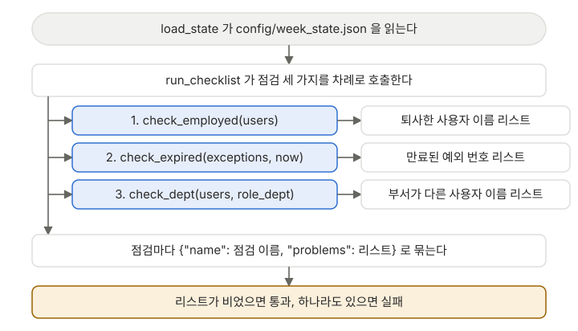

# 실습 5-1 · 점검 체크리스트로 어긋난 곳 찾기

## 목표: 점검 체크리스트 결과

> **이번 실습에 들어온 일**
>
> A사 보안 팀장이 보낸 메시지:
> 「앞서 회수를 마쳤는데, 시간이 지나면 다시 불안합니다. 그 사이에 퇴사 처리가 된 사람이 있는지, 만료 시각이 지났는데 남아 있는 예외가 있는지, 부서를 옮겼는데 역할은 그대로인 사람이 있는지가 궁금합니다. 저는 이것을 사용자 파일과 예외 파일을 열어 눈으로 맞춰 봅니다. 사용자가 여섯 명, 예외가 네 개뿐인데도 오래 걸립니다. 지난달에는 부서를 옮긴 사람의 역할 확인을 빠뜨려 감사팀(규칙대로 일했는지 기록으로 확인하는 팀)에서 지적을 받았고, 회사가 커지면 이 방식은 쓸 수 없습니다.
>
> 퇴사자 계정 · 만료 예외 · 부서와 역할, 이 세 가지를 매주 같은 순서로 점검해서 걸린 사용자 이름이나 예외 번호를 알려 주세요. 점검은 찾기만 하고, 권한을 바로 지우지는 않습니다.」
> - **낱말 풀이**: 회수는 필요 없어진 권한을 거두는 일이고, 예외는 역할에 없는 권한을 만료 시각(쓸 수 있는 마지막 시각)까지만 잠시 준 것입니다.
> - **왜 중요한가**: 회수를 한 번 해도 사람은 계속 퇴사하고 부서를 옮깁니다. 눈으로 맞추면 오래 걸리고 한 명을 빠뜨릴 수 있는데, 코드가 같은 기준으로 한 번에 점검하면 걸린 대상의 이름이 바로 나옵니다. 이 결과는 「제공 파일」 레슨에서 만드는 주간 보고서에 그대로 들어갑니다.
> - **이 실습에서 하는 일**: 점검 세 가지가 들어 있는 `checklist.py` 를 만듭니다. 대부분은 미리 채워 두었고, 함수마다 한 줄씩 세 줄(① · ② · ③)만 직접 씁니다.
> - **끝나면 쓰는 것**: 보고서 (가) · (나). (다)는 여유가 되면 하는 응용입니다.

## Unit 1 ~ Unit 4 흐름 복습

이번 점검은 앞 Unit에서 다룬 데이터와 일을 이어받습니다.

| Unit | 한 일 | 이번 점검과 이어지는 곳 |
|---|---|---|
| **Unit 1 · 권한 정하기** | 사용자 · 역할 파일과 판정 함수를 만들고, 기간을 정한 예외도 함께 판정함 | 이번 점검이 읽는 사용자 · 역할 · 예외가 이 모양 그대로임 |
| **Unit 2 · 권한 주기** | 요청서를 승인한 뒤에 예외 권한을 줌 | 이렇게 생긴 예외도 만료 시각이 지나면 점검 대상임 |
| **Unit 3 · 권한 점검하기** | 권한 현황을 만들고 90일 넘게 안 쓴 권한을 찾음 | 퇴사자 · 만료 예외 점검이 여기서 출발함 |
| **Unit 4 · 권한 거두기** | 회수할 권한을 계획 → 승인 → 실행 순서로 거두고 이력을 남김 | 회수한 뒤에도 생기는 어긋남을 이번에는 매주 다시 점검함 |

- Unit 3에서 퇴사한 계정과 만료된 예외를 규칙으로 걸러 내는 일은 제공 파일 `review_rules.py` 가 맡았습니다.
- Unit 4의 응용 4-2 · 4-3에서는 시간 · 접속 위치 조건과 요청마다 로그를 남기는 판정 서버도 만들었습니다. 그 로그와 같은 모양의 일주일 치 샘플 40줄이 주간 보고서의 입력이 됩니다.

## 왜 같은 기준으로 반복 점검하는가

1. 권한 점검은 한 번 하고 끝내는 일이 아니라 **정해 둔 때마다(예: 매주 월요일) 같은 기준으로 반복**하는 일입니다.
2. 반복하려면 점검할 것을 미리 정해 둡니다. 이것을 **점검 체크리스트**라고 부릅니다. 여행 전마다 「여권 · 지갑 · 충전기」를 같은 목록으로 확인하는 것과 비슷합니다.
   - 점검 한 가지는 문제가 있는 사용자나 예외를 **리스트로 모읍니다.**
   - 리스트가 비어 있으면 **통과**, 하나라도 있으면 **실패**입니다.
   - 실패로 나온 이름은 담당자(이 일을 맡은 사람, 여기서는 보안 팀장)가 보고 어떻게 처리할지 정합니다.
3. 이번 실습에서는 점검 세 가지를 함수로 만듭니다. 점검할 데이터는 `config/week_state.json` 하나에 모아 두었습니다.

## 1.1 점검할 데이터와 세 가지 점검

`config/week_state.json` 은 세 부분으로 이루어집니다. 아래 표의 **키**는 딕셔너리에서 값을 찾을 때 쓰는 이름표입니다(`state["users"]` 처럼 씁니다).

| 키 | 담긴 것 | 값의 예 |
|---|---|---|
| `users` | 사용자 이름 → 사용자 정보(부서 · 역할 · 재직 여부) | `"dami": {…}` |
| `role_dept` | 역할 → 그 역할이 속해야 하는 부서 | `"finance": "재무"` |
| `exceptions` | 예외 리스트(번호 · 사용자 · 권한 · 만료 시각) | `{"id": 3, …}` |

`users` 와 `exceptions` 의 값은 길어서 표 밖에 씁니다.

- `users` 의 예: `"dami": {"dept": "영업", "role": "sales", "employed": false}`
- `exceptions` 의 예: `{"id": 3, "user": "dami", "permission": "SALES:QUERY", "expires": "2026-11-03 18:00"}`

점검 세 가지는 아래와 같습니다.

| 점검 | 문제로 보는 경우 | 모으는 것 |
|---|---|---|
| 퇴사자 계정 점검 | `employed` 가 `false`(퇴사)인데 `users` 에 계정이 남아 있다 | 사용자 이름 |
| 만료 예외 점검 | 만료 시각이 지금과 같거나 지났는데 예외가 남아 있다 | 예외 번호(`id`) |
| 부서와 역할 점검 | 사용자의 부서가 그 사용자 역할이 속해야 하는 부서와 다르다(부서를 옮겼는데 예전 일의 역할이 남은 경우 등) | 사용자 이름 |

**한 장 정리**

| 함수 | 받는 것 | 리턴하는 것 | 직접 쓰는 곳 |
|---|---|---|---|
| `load_state` | 파일 경로 | 파일에서 읽은 데이터 딕셔너리 | 미리 채움 |
| `check_employed` | 사용자 딕셔너리 | 퇴사한(`employed` 가 `false`) 사용자 이름의 리스트 | ① 조건 한 줄 |
| `check_expired` | 예외 리스트, 지금 시각 | 만료 시각이 지금과 같거나 지난 예외 번호의 리스트 | ② 조건 한 줄 |
| `check_dept` | 사용자 딕셔너리, 역할별 부서 딕셔너리 | 부서가 역할의 부서와 다른 사용자 이름의 리스트 | ③ 값을 꺼내는 한 줄 |
| `run_checklist` | 읽은 데이터, 지금 시각 | 점검 이름과 문제 리스트를 묶은 딕셔너리의 리스트 | 미리 채움(세 점검을 묶기) |

- **직접 쓰는 곳은 세 함수에 한 줄씩**(① ~ ③)입니다. 나머지 줄은 미리 채웠고, 주석에 하는 일을 적어 두었습니다.
- 점검하는 시각은 `2026-11-02 10:00` 으로 고정합니다.
- `for name, info in users.items():` 는 딕셔너리의 키(사용자 이름)와 값(사용자 정보)을 한꺼번에 꺼냅니다.
- JSON 의 `true` · `false` 는 파이썬으로 읽으면 `True` · `False` 가 됩니다.

<figure class="page-figure"></figure>

## 실습 5-1 · 세 점검으로 통과·실패 가리기

**이런 상황이 있습니다**

- **지금은**: 점검은 사람이 `config/week_state.json` 같은 데이터 파일을 눈으로 읽어야 합니다. 사용자가 늘면 놓치기 쉽고, 지난주와 같은 기준으로 봤는지도 알 수 없습니다.
- **그래서 만드는 것**: `checklist.py` 입니다.
  - 점검 세 가지를 함수로 만들고, 문제가 있는 사용자 이름이나 예외 번호를 리스트로 모읍니다.
  - 예를 들어 dami 는 퇴사했는데 계정이 남아 있으므로 첫째 점검에서 걸립니다.
- **실행하면**: 단계 1은 점검 대상의 수, 단계 2는 점검 세 가지의 통과와 실패, 그리고 문제 리스트를 출력합니다.
- **현업에서는**: 접근 권한 점검도 점검할 것을 정해 두고 주기마다 반복하며, 결과(통과 · 실패와 대상)를 보고서에 남깁니다.

**할 일**

1. `checklist.py` · `exercise5-1_run.py` 두 파일을 만들고, `checklist.py` 에서 `# ←` 가 있는 <mark>세 곳</mark>(① · ② · ③)을 한 줄씩 채웁니다.
2. 실행해서 <mark>점검 대상의 수</mark>(단계 1: 점검 대상)와 <mark>점검 세 가지의 결과</mark>(단계 2: 점검 결과)를 읽습니다.

**`checklist.py`**

```python
import json                                                      # JSON 파일을 읽는 모듈을 불러온다
from datetime import datetime                                    # 문자열을 시각으로 바꾸는 데 쓴다

TIME_FORMAT = "%Y-%m-%d %H:%M"                                   # 만료 시각 문자열의 형식 (예: 2026-11-03 18:00)


def load_state(path):                                            # 파일 경로를 받는 함수
    """점검할 데이터(사용자 · 역할의 부서 · 예외)를 읽어 딕셔너리로 리턴한다.
    정기 점검을 시작할 때 쓴다.
    """
    with open(path, encoding="utf-8") as json_file:                      # 파일을 연다
        return json.load(json_file)                                      # 읽은 내용을 바로 리턴한다


def check_employed(users):                                       # 사용자 딕셔너리를 받는 함수
    """퇴사했는데 계정이 남아 있는 사용자 이름 리스트를 리턴한다.
    정기 점검에서 퇴사자 계정을 찾을 때 쓴다.
    """
    problems = []                                                # 문제가 있는 사용자 이름을 모을 리스트
    for name, info in users.items():                             # 사용자 이름과 사용자 정보를 하나씩 꺼낸다
        # ① info["employed"] 가 거짓이면 (if not …)   # ← 이 주석 바로 아래 줄에 씁니다 (8칸)
            problems.append(name)                                # 이름을 문제 리스트에 추가한다
    return problems                                              # 문제가 있는 사용자 이름을 리턴한다


def check_expired(exceptions, now):                              # 예외 리스트와 지금 시각(datetime)을 받는 함수
    """만료 시각이 지났는데 남아 있는 예외의 번호 리스트를 리턴한다.
    정기 점검에서 기간이 끝난 예외를 찾을 때 쓴다.
    """
    problems = []                                                # 문제가 있는 예외 번호를 모을 리스트
    for exception in exceptions:                                       # 예외를 하나씩 꺼낸다
        expires_at = datetime.strptime(exception["expires"], TIME_FORMAT)   # 만료 시각 문자열을 시각으로 바꾼다
        # ② expires_at 이 now 보다 이르거나 같으면 (<=)   # ← 이 주석 바로 아래 줄에 씁니다 (8칸)
            problems.append(exception["id"])                           # 예외 번호를 문제 리스트에 추가한다
    return problems                                              # 문제가 있는 예외 번호를 리턴한다


def check_dept(users, role_dept):                                # 사용자 딕셔너리와 역할별 부서 딕셔너리를 받는 함수
    """부서가 역할의 부서와 다른 사용자 이름 리스트를 리턴한다.
    정기 점검에서 엉뚱한 부서에 역할이 남은 사람을 찾을 때 쓴다.
    """
    problems = []                                                # 문제가 있는 사용자 이름을 모을 리스트
    for name, info in users.items():                             # 사용자 이름과 사용자 정보를 하나씩 꺼낸다
        # ③ role_dept 에서 info["role"] 의 부서를 찾아 expected_dept 에 담는다   # ← 이 주석 바로 아래 줄에 씁니다 (8칸)
        if expected_dept != info["dept"]:                        # 사용자의 부서와 다르면
            problems.append(name)                                # 이름을 문제 리스트에 추가한다
    return problems                                              # 문제가 있는 사용자 이름을 리턴한다


def run_checklist(state, now):                                   # 읽은 데이터와 지금 시각을 받는 함수
    """점검 세 가지를 실행한다.
    점검 이름과 문제 리스트를 담은 딕셔너리의 리스트를 리턴한다.
    매주 어긋난 곳을 한 번에 찾을 때 쓴다.
    """
    users = state["users"]                                       # 사용자 딕셔너리를 꺼낸다
    exceptions = state["exceptions"]                             # 예외 리스트를 꺼낸다
    role_dept = state["role_dept"]                               # 역할별 부서 딕셔너리를 꺼낸다
    results = []                                                 # 점검 결과를 모을 리스트
    results.append({"name": "퇴사자 계정 점검", "problems": check_employed(users)})            # 첫째 점검 결과를 추가한다
    results.append({"name": "만료 예외 점검", "problems": check_expired(exceptions, now)})     # 둘째 점검 결과를 추가한다
    results.append({"name": "부서와 역할 점검", "problems": check_dept(users, role_dept)})     # 셋째 점검 결과를 추가한다
    return results                                               # 점검 결과 리스트를 리턴한다
```

- 주석 줄은 그대로 두고, **각 주석 바로 아래 줄**에 씁니다. 세 곳 모두 `for` 안쪽이라 앞에 공백 8칸으로 시작합니다. 바로 아래의 미리 채운 줄과 들여쓰기를 헷갈리지 않게 합니다.
- ① · ② 는 `if` 줄이라 끝에 `:` 를 붙입니다. 그 아래 `problems.append(…)` 줄(12칸)은 미리 채워 두었습니다.
- ② 의 `<=` 는 「같거나 이전」입니다. 만료 시각 정각도 만료로 봅니다. 바로 위 `expires_at = datetime.strptime(…)` 줄이 만료 시각 문자열을 시각 값으로 바꿔 두었습니다. 시각 값으로 바꿔야 `<=` 로 어느 쪽이 이른지 비교할 수 있습니다. Unit 1 제공 파일 `exception_policy.py` 의 `find_exception` 이 예외의 만료 시각을 읽을 때와 같은 방법입니다.
- ③ 의 `role_dept[info["role"]]` 는 키가 `info["role"]` 인 값을 찾습니다. 사용자의 역할이 `finance` 이면 `"재무"` 가 나옵니다.

#### 문법 상자 · 직접 쓰는 곳의 모양 (예시 값 · 읽기만 합니다)

```python
info = {"dept": "영업", "role": "finance", "employed": True}   # 예시 값 (junho)
role_dept = {"sales": "영업", "finance": "재무"}                  # 예시 값

print(not info["employed"])            # False  · 재직 중이라 not 을 붙이면 거짓
print(role_dept[info["role"]])         # 재무   · 역할 finance 가 속해야 하는 부서
print(5 <= 5, 6 <= 5)                  # True False  · <= 는 같아도 참
```

**직접 쓰는 곳**

| 빈칸 | 쓰는 줄 | 들여쓰기 |
|---|---|---|
| ① | 퇴사했으면 (`if not …:`) | 8칸 |
| ② | 만료 시각이 지금과 같거나 지났으면 (`if … <= …:`) | 8칸 |
| ③ | 역할의 부서를 `expected_dept` 에 담기 | 8칸 |

- 채우기 전에 실행하면 `IndentationError: unexpected indent` 가 나고, 오류 위치는 `problems.append(exception["id"])` 줄입니다. ② 자리가 비어서 그 아래 12칸 줄이 갑자기 들여 써진 것으로 보이기 때문이니 정상입니다.
- ① 확인: ① 만 쓰고 실행하면 같은 `IndentationError: unexpected indent` 가 그대로 나옵니다. ② 를 아직 안 써서 나는 오류이니 정상입니다. 막히면: 위 문법 상자의 `not info["employed"]` 앞에 `if`, 끝에 `:` 를 붙입니다.
- ② 확인: ② 까지 쓰고 실행하면 단계 1 줄이 나온 뒤 `NameError: name 'expected_dept' is not defined` 가 납니다. ③ 을 아직 안 써서 나는 오류이니 정상입니다. 막히면: ① 과 같은 `if` 모양이고, 비교하는 두 값은 `expires_at` 과 `now` 입니다.
- ③ 확인: ③ 까지 쓰고 실행하면 단계 2에 `부서와 역할 점검 | 실패 | ['junho']` 가 나오면 성공입니다. `KeyError: '영업'` 이 나오면 `info["role"]` 자리에 `info["dept"]` 를 쓴 것입니다. 막히면: 문법 상자의 `role_dept[info["role"]]` 를 `expected_dept = ` 뒤에 씁니다.

**`exercise5-1_run.py`** — 그대로 붙여 넣습니다. 학생이 쓰는 줄은 없습니다. 데이터 파일을 읽고 점검을 실행해 결과를 출력합니다.

```python
from datetime import datetime                                    # 문자열을 시각으로 바꾸는 데 쓴다
from checklist import TIME_FORMAT, load_state, run_checklist     # 방금 만든 점검 함수를 불러온다

NOW = datetime.strptime("2026-11-02 10:00", TIME_FORMAT)         # 점검하는 시각을 2026-11-02 10:00 으로 고정한다
state = load_state("config/week_state.json")                     # 점검할 데이터 파일을 읽는다
users = state["users"]                                           # 사용자 딕셔너리를 꺼낸다
exceptions = state["exceptions"]                                 # 예외 리스트를 꺼낸다

user_count = len(users)                                          # 사용자가 몇 명인지 센다
exception_count = len(exceptions)                                # 예외가 몇 개인지 센다
print("--- 단계 1: 점검 대상 - 사용자", user_count, "명 · 예외", exception_count, "개")  # 단계 1 시작을 알리는 줄
results = run_checklist(state, NOW)                              # 점검 세 가지를 실행한다
print("--- 단계 2: 점검 결과")                                      # 단계 2 시작을 알리는 줄
for result in results:                                           # 점검 결과를 하나씩 꺼낸다
    name = result["name"]                                        # 점검 이름을 꺼낸다
    problems = result["problems"]                                # 문제가 있는 사용자 · 예외 리스트를 꺼낸다
    if len(problems) == 0:                                       # 문제가 하나도 없으면
        status = "통과"                                           # 통과라고 적는다
    else:                                                        # 문제가 있으면
        status = "실패"                                           # 실패라고 적는다
    print(name, "|", status, "|", problems)                      # 점검 이름 | 결과 | 문제 리스트를 출력한다
```

**순서**

1. **[VS Code]** 파일 `checklist.py` · `exercise5-1_run.py` 를 만들어 위 코드를 붙여 넣습니다.
2. **[VS Code]** `checklist.py` 의 `# ←` 세 곳(① · ② · ③)을 채웁니다. 1.1 의 표와 그림, 위 「직접 쓰는 곳」을 보고 씁니다.
3. **[터미널]** `pwd` 의 결과가 `access_control` 로 끝나는지 확인하고 실행합니다(맥북은 `python3`).
   ```bash
   pwd
   python exercise5-1_run.py
   ```
4. 출력은 두 단계입니다. 단계 1은 한 줄, 단계 2는 점검 이름 세 줄입니다.
5. **[보고서]** `report_u5.md` 의 `## 실습 5-1` 아래를 채웁니다(보고서 파일은 「보고서 쓰기」 레슨에서 만듭니다).
   - (가) [핵심 질문] 실행한 출력 전체를 붙여 넣고, 통과한 점검과 실패한 점검, 실패한 점검에서 나온 사용자 이름이나 예외 번호를 적어 주세요.
   - (나) [핵심 질문] 만료 예외 점검은 「통과」인데, 예외 3번은 퇴사한 dami 의 예외입니다. 「통과」를 「문제 없음」으로만 읽으면 안 되는 이유와, 이 예외를 볼 때 함께 읽어야 하는 다른 점검을 적어 주세요.
   - (다) [응용] 점검은 junho 가 영업 부서인데 역할은 `finance` 라고 알려 줍니다. 점검 코드가 알려 주는 것과 알려 주지 못하는 것을 구분해 주세요. 그리고 이 결과를 받은 담당자가 무엇을 확인해야 하는지, 코드가 바로 권한을 회수하면 안 되는 이유가 무엇인지 적어 주세요.

**확인** — 단계 1에 `사용자 6 명 · 예외 4 개`, 단계 2에 실패 두 줄(`['dami']` · `['junho']`)과 통과 한 줄(만료 예외 점검)이 나오면 성공입니다. 안 나오면 「정답」 레슨의 실습 5-1 출력과 한 줄씩 맞춰 보고, 다른 줄이 있으면 위 「직접 쓰는 곳」의 확인을 다시 봅니다. 퇴사자 계정 점검에 여섯 명이 모두 나오면 ① 이 빠진 것이고, dami 만 빼고 다섯 명이 나오면 ① 에서 `not` 이 빠진 것입니다.

## 실습 5-1 정리

| 하려는 일 | 코드 · 말 |
|---|---|
| 점검할 데이터 읽기 | `state = load_state("config/week_state.json")` (미리 채움) |
| 사용자 이름과 정보 꺼내기 | `for name, info in users.items():` (미리 채움) |
| 퇴사자 찾기 (①) | `if not info["employed"]:` → `problems.append(name)` |
| 만료 시각 읽기 | `datetime.strptime(exception["expires"], TIME_FORMAT)` (미리 채움) |
| 만료 예외 찾기 (②) | `if expires_at <= now:` → `problems.append(exception["id"])` |
| 역할의 부서 찾기 (③) | `expected_dept = role_dept[info["role"]]` |
| 부서가 다른 사용자 찾기 | `if expected_dept != info["dept"]:` (미리 채움) |
| 통과 · 실패 | 문제 리스트가 비었으면 통과, 아니면 실패 |

---
