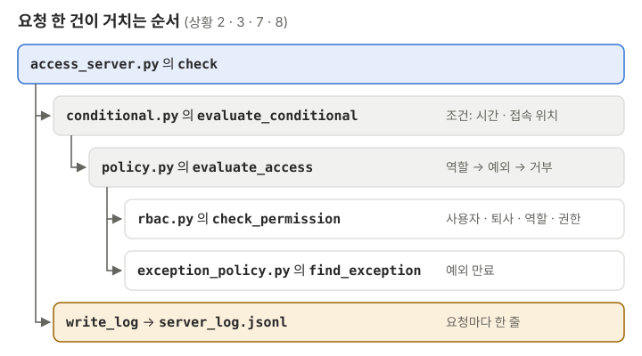
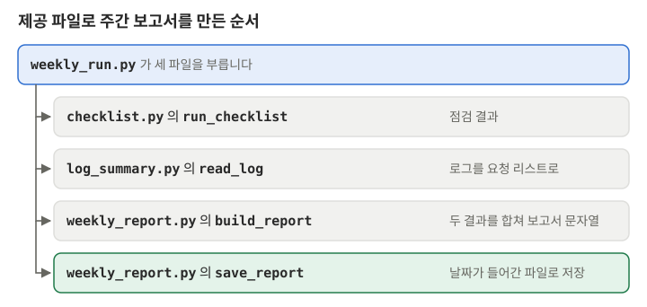

# 실습 5-2 · 상황별 원인과 해결법 정리하기

## 이번 실습: Module 3 상황 되짚기

> **이번 실습은 새로 배우는 것이 없습니다.** Module 3에서 만든 파일과 함수를 **상황별로 되짚으면서**, 각 상황의 원인과 고치는 방법을 내 말로 정리합니다. 정리한 글이 Module 3의 총정리가 되고, 보고서의 실습 5-2 칸에 씁니다.
>
> - 끝나면 쓰는 것: 상황 3 ~ 8 중 2개의 정리와 질문 (가). 나머지 상황과 (나) · (다)는 여유가 되면 하는 응용입니다.

## 상황을 풀 때 쓰는 틀

상황이 생기면 같은 네 단계로 생각합니다.

| 단계 | 하는 일 |
|---|---|
| **확인** | 로그나 점검 결과로 무슨 일인지 알아봅니다 |
| **원인** | 왜 이런 일이 생겼는지 가립니다(보통 아래 셋 중 하나) |
| **고치기** | 어느 파일을 열어서 어떻게 고칠지 정합니다(아래 세 방법 중 하나) |
| **다시 확인** | 고친 뒤 무엇을 다시 실행하거나 어떤 출력을 보면 고쳐진 것을 알 수 있는지 정합니다 |

**원인 세 가지**

| 원인 | 뜻 |
|---|---|
| 사람의 일 | 입사 · 퇴사 · 부서 이동 · 업무 지원처럼 사람에게 방금 생긴 일 때문에 지금 파일을 고쳐야 함 |
| 데이터 문제 | 파일에 있어야 할 것이 없거나 틀려 있음. 고쳤어야 할 때를 놓쳐 정리가 안 된 채 남아 있는 것도 여기에 넣음 |
| 규칙 문제 | 정해 둔 기준이 비어 있거나 현실과 맞지 않음(너무 느슨하거나 너무 엄격함) |

- 사람의 일과 데이터 문제가 헷갈리면 이렇게 가립니다. 사람에게 일이 생겨서 **지금** 파일을 고치면 사람의 일(예: 오늘 입사한 hana 를 적음), 그 일이 있었는데 파일을 제때 고치지 않아 **틀리거나 남아 있으면** 데이터 문제(예: 퇴사한 dami 의 정보가 그대로 남음)입니다.

규칙은 「무엇을 허용하고 무엇에 경고할지」 정해 둔 기준입니다. 이 수업에서 기준을 적어 둔 곳은 네 군데입니다.

| 기준을 적어 둔 곳 | 정해 둔 것 |
|---|---|
| `conditions.json` | 권한마다 몇 시에 어디서 접속하면 허용하는지 |
| `alert.json` | 거부율이 얼마 이상이면 경고하는지 |
| 점검의 90일 기준 | 며칠 안 쓴 권한을 후보로 뽑는지 |
| `sla.json` | 요청을 몇 시간 안에 처리해야 하는지 |

**고치는 방법 세 가지**

| 방법 | 뜻 | Module 3에서 한 예 |
|---|---|---|
| 새로 넣는다(추가) | 없던 것을 파일에 적어 넣음 | `users.json` 에 새 직원 정보, `exceptions.json` 에 만료 시각이 있는 예외를 적음 |
| 값을 바꾼다(수정) | 있는 정보의 값을 다른 값으로 고침 | `"employed": true` 를 `false` 로 바꿈, 허용 접속 위치에 `"vpn"` 을 넣음(`conditions.json`) |
| 지운다(삭제) | 있던 정보를 파일에서 없앰 | 퇴사자 정보는 `users.json` 에서, 만료된 예외는 `exceptions.json` 에서 지움 |

## 3.1 상황 8개와 읽을 핵심 코드

> 실습 5-2는 코드를 실행하지 않고 읽고 글로 씁니다. 상황 표의 `users.json` · `exceptions.json` 은 Module 3에서 쓰던 파일이고, 이번 Unit의 점검(실습 5-1)은 같은 내용을 한 파일에 모은 `config/week_state.json` 을 읽습니다. 상황의 값은 앞 Unit 때를 되짚은 것이라 이번 `week_state.json` 과 다를 수 있습니다(예: 상황 3의 예외 번호).
>
> 상황 표의 파일 중 `role_admin.py`(응용 1-2), `req_sla.py`(응용 2-2), `conditional.py` · `access_server.py`(응용 4-2 · 4-3)는 응용에서 만드는 파일이라 내 폴더에 없을 수 있습니다. 내 폴더에 없는 파일은 이 페이지의 코드 조각만 읽고 답하면 됩니다.

| # | 상황 (이렇게 알게 됐습니다) | 읽을 핵심 코드 |
|---|---|---|
| 1 | 새 직원 hana 가 입사했는데, hana 의 요청이 「등록되지 않은 사용자」로 거부된다 | `role_admin.py` 의 `assign_role`, `config/users.json` 의 사용자 정보 |
| 2 | 퇴사한 dami 가 보고서에 거부 4번으로 나오고, 퇴사자 계정 점검이 실패한다 | `rbac.py` 의 `check_permission` 판정 순서, `config/users.json` |
| 3 | seoyeon 이 월말 정산 대조를 지원하게 되어 `SETTLE:QUERY` 가 잠시 필요한데 「권한 없음」으로 거부된다 | `exception_policy.py` 의 `find_exception`, `policy.py` 의 `evaluate_access` 순서, `config/exceptions.json` |
| 4 | junho 가 영업 실적 정정을 위해 `SALES:CHANGE` 를 달라고 하는데, 누가 언제까지 처리할지 정해진 방법이 없다 | `req_create.py` · `req_review.py` · `req_grant.py` · `req_sla.py` |
| 5 | 정기 점검에서 seoyeon 의 `SALES:CHANGE` 는 마지막 사용이 120일 전이고, gaeun 의 `ACCOUNT:CHANGE` 는 사용 이력이 없다 | `review_rules.py` 의 `find_stale`, `review_unused.py` 의 `find_unused`, `config/exclude_list.json` |
| 6 | 회수 대상에 쓰기 권한이 섞여 있고, 퇴사자의 역할을 비우면 권한 여러 개가 한꺼번에 사라진다 | `revoke_plan.py` · `revoke_approve.py` · `revoke.py`, `revocation_log.json` |
| 7 | 새벽에 밖에서 접속해도 요청이 허용되는데, gaeun 은 VPN 으로 계정 변경을 하다가 3번 거부됐다 | `config/conditions.json`, `conditional.py` 의 `evaluate_conditional` |
| 8 | 사람이 로그를 눈으로 세는 데 오래 걸리고, 기준이 사람마다 다르다 | `access_server.py` 의 `check`, `server_log.jsonl`, `checklist.py`, `log_summary.py`, `weekly_report.py` |

- 파일들은 서로를 부릅니다. 상황 2 · 3 · 7 · 8은 요청 한 건이 같은 순서로 함수를 거칩니다.
- 아래 그림에서 A 에서 B 로 가는 화살표는 「A 가 B 를 부른다」는 뜻입니다. 불린 B 가 먼저 판정을 내고, A 는 그 결과에 조건을 더 얹습니다. 예를 들어 `evaluate_conditional` 은 `evaluate_access` 가 허용이라고 한 요청만 시간 · 접속 위치를 더 봅니다.
- 함수가 함수를 부르는 흐름이 헷갈리면 AI 에게 「파이썬에서 함수 안에서 다른 함수를 부르면 어떤 순서로 실행되는지 중학생에게 설명하듯 알려 줘」라고 물어보세요.

<figure class="page-figure"></figure>

그림 밖의 상황은 이렇게 이어집니다.

| 상황 | 이어지는 방식 |
|---|---|
| 4 → 3 | `req_grant.py` 의 `grant_request` 가 추가한 예외를 `find_exception` 이 읽음 |
| 5 → 6 | 점검이 찾은 회수 대상으로 `plan_revocation` 이 계획을 세우고, `mark_approvals` · `execute_revocation` 이 이어 처리함 |
| 1 · 4 | 함수가 함수를 부르지 않고, 같은 데이터(사용자 딕셔너리, 예외 리스트)를 읽고 씀 |

아래는 상황마다 관련된 코드입니다. 각 코드 앞의 문장은 **이 코드를 왜 읽는지**를 알려 줍니다. 답을 알려 주는 것은 아니고, 코드에서 어디를 볼지만 짚어 줍니다. 읽고 나서 보고서의 실습 5-2 상황 정리를 쓸 때 참고합니다.

#### 상황 1 · 새 직원이 들어옴

hana 를 시스템에 등록하는 일과 관련된 코드입니다.

`role_admin.py` 의 `assign_role` 은 사용자에게 역할을 주는 함수입니다. 역할을 먼저 확인하는지, 사용자 정보를 어떻게 만드는지 읽습니다.

```python
def assign_role(users, name, role):                              # 사용자 딕셔너리 · 이름 · 역할을 받는 함수
    """사용자에게 역할을 부여한다.
    신입이 입사하거나 부서를 옮겼을 때 쓰고 (성공 여부, 이유)를 리턴한다.
    """
    if role not in ROLES:                                        # 역할 파일에 없는 역할이면
        return False, "없는 역할"                                 # 부여하지 않고 거부한다
    users[name] = {"role": role, "employed": True}               # 사용자 정보를 새로 만들거나 덮어쓴다
    return True, "부여"                                           # 부여했다고 알린다
```

#### 상황 2 · 퇴사자 계정으로 요청이 계속 들어옴

퇴사한 dami 의 요청이 왜 거부되는지와 관련된 코드입니다.

`rbac.py` 의 `check_permission` 은 요청이 들어오면 허용할지 가리는 첫 함수입니다. 검사가 어떤 순서로 이루어지는지, 퇴사한 사용자는 어느 단계에서 걸리는지 읽습니다.

```python
def check_permission(user, resource, action):                    # 사용자 · 자원 · 행위를 받는 함수
    """요청을 허용할지 (허용 여부, 이유)로 리턴한다. 요청이 들어올 때 가장 먼저 쓰는 판정이고, 허용 리스트에 없으면 모두 거부한다."""   # 함수 첫 줄의 """ … """ 는 함수 설명 글이고 실행에는 영향이 없다
    if user not in USERS:                                        # 사용자 파일에 없는 계정이면
        return False, "등록되지 않은 사용자"                       # 바로 거부하고 함수를 끝낸다
    if not USERS[user]["employed"]:                              # 재직 중이 아니면
        return False, "퇴사한 계정"                                # 거부하고 함수를 끝낸다
    role = USERS[user]["role"]                                   # 이 사용자의 역할을 꺼낸다
    if role not in ROLES:                                        # 역할 파일에 없는 역할이면
        return False, "역할이 없음"                                # 거부하고 함수를 끝낸다
    permission = f"{resource}:{action}"                          # "자원:행위" 모양 문자열로 합친다
    if permission not in ROLES[role]:                            # 그 역할의 권한 리스트에 없으면
        return False, "권한 없음"                                  # 거부하고 함수를 끝낸다

    return True, "허용"                                          # 모든 검사를 지나면 허용한다
```

#### 상황 3 · 다른 팀 업무를 잠시 지원함

역할에 없는 권한을 잠시만 허용하는 일과 관련된 코드입니다. 월말 정산 대조는 한 달 동안 들어오고 나간 돈이 장부와 맞는지 맞춰 보는 재무 일이라, 영업 역할인 seoyeon 에게는 원래 정산 조회 권한이 없습니다.

`config/exceptions.json` 은 예외를 적어 두는 파일입니다. 예외 한 개가 어떤 값으로 이루어져 있는지 읽습니다.

```json
{"id": 1, "user": "seoyeon", "permission": "SETTLE:QUERY", "expires": "2026-10-22 18:00", "reason": "월말 정산 대조 지원"}
```

`policy.py` 의 `evaluate_access` 는 역할 판정과 예외 확인을 이어 붙인 함수입니다. 예외를 언제 확인하고 언제 확인하지 않는지 읽습니다.

```python
def evaluate_access(user, resource, action, now):                # 사용자 · 자원 · 행위 · 지금 시각을 받는 함수
    """(허용 여부, 이유)를 리턴한다.
    역할 권한 → 유효한 예외 → 거부 순서로 보며, 임시 예외까지 포함해 요청을 판정할 때 쓴다.
    """
    is_allowed, reason = check_permission(user, resource, action)        # 역할 판정을 먼저 한다
    if is_allowed:                                                       # 역할로 허용되면
        return True, "역할 권한"                                   # 역할 권한으로 허용한다
    if reason != "권한 없음":                                     # 사용자 자체가 거부 대상이면(없음 · 퇴사 · 역할이 없음)
        return False, reason                                     # 예외를 보지 않고 그 이유로 거부한다
    found, found_exception_id = find_exception(user, f"{resource}:{action}", now)   # 유효한 예외를 찾는다
    if found:                                                    # 있으면
        return True, f"예외 {found_exception_id}번"                            # 예외 번호와 함께 허용한다
    return False, "권한 없음"                                      # 둘 다 없으면 거부한다
```

`exception_policy.py` 의 `find_exception` 은 유효한 예외를 찾는 함수입니다. 예외가 언제까지 유효한지 어떻게 가리는지 읽습니다.

```python
def find_exception(user, permission, now):                       # 사용자 · "자원:행위" · 지금 시각을 받는 함수
    """now 시각에 유효한 예외가 있으면 (True, 예외 번호)를 리턴한다.
    없으면 (False, None)을 리턴한다.
    역할에 없는 권한을 임시로 허용해도 되는지 확인할 때 쓴다.
    """
    for exception in EXCEPTIONS:                                       # 예외를 하나씩 꺼낸다
        if exception["user"] == user and exception["permission"] == permission:   # 사람과 권한이 같으면
            expires = datetime.strptime(exception["expires"], TIME_FORMAT)  # 만료 시각을 시각으로 바꾸고
            if now < expires:                                    # 아직 만료 전이면
                return True, exception["id"]                           # 유효한 예외와 그 번호를 리턴한다
    return False, None                                           # 못 찾았으면 없다고 리턴한다
```

#### 상황 4 · 새 권한이 필요함

권한을 요청하고, 승인하고, 부여하는 절차와 관련된 코드입니다. 영업 실적 정정은 잘못 적힌 판매 기록을 고치는 일이라, 기록을 바꾸는 권한(`SALES:CHANGE`)이 필요합니다.

`req_review.py` 의 `approve_request` 는 요청서를 승인하는 함수입니다. 승인하지 않는 경우가 무엇인지, 승인하면 무엇이 바뀌는지 읽습니다.

```python
def approve_request(request, approver):                          # 요청서와 승인자 이름을 받는 함수
    """검토 중인 요청서를 승인한다.
    보안 담당자가 권한 요청을 처리할 때 쓰고 (성공 여부, 이유)를 리턴한다.
    """
    if request["status"] != "reviewing":                         # 검토 중이 아니면(이미 처리됐으면)
        return False, "검토 중이 아님"                             # 바꾸지 않고 이유를 알린다
    if request["user"] == approver:                              # 요청한 사람이 스스로 처리하려고 하면
        return False, "본인 요청은 처리할 수 없음"                  # 바꾸지 않고 이유를 알린다
    request["status"] = "approved"                               # 상태를 승인됨으로 바꾼다
    request["approver"] = approver                               # 누가 승인했는지 적어 둔다
    return True, "승인"                                          # 승인했다고 알린다
```

- 요청서의 상태(`status`)는 `reviewing`(검토 중) → `approved`(승인됨) → `granted`(부여됨) 순서로 바뀌고, 거절하면 `rejected`(거절됨)입니다. 처리 기한(요청을 받으면 몇 시간 안에 처리하겠다고 정한 약속)은 `config/sla.json` 의 `hours`(4시간)이고 `req_sla.py` 의 `check_sla_breach` 가 기한을 넘긴 요청서를 찾습니다.
- 이 세 함수(`approve_request`, `grant_request`, `check_sla_breach`)는 서로 부르지 않습니다. 요청서 딕셔너리를 순서대로 넘겨 받으며 `status` 만 바꿉니다.

#### 상황 5 · 안 쓰는 권한이 쌓임

(Unit 3 점검 실습의 샘플 데이터 기준이고, 이번 Unit의 주간 로그와는 별개입니다.) 오래 안 쓴 권한을 찾아내는 일과 관련된 코드입니다.

`review_unused.py` 의 `find_unused` 는 권한을 마지막으로 쓴 시각을 보고 후보를 뽑는 함수입니다. 기준 일수와 비교하는 줄이 어디인지, 사용 이력이 없을 때는 어떻게 하는지 읽습니다.

```python
        used_text = last_used_map.get(key)                       # 마지막 사용 시각 문자열을 꺼낸다(이력이 없으면 None)
        if used_text is None:                                    # 사용 이력이 없으면
            unused_entry = make_unused(entry, None)              # 안 쓴 권한 한 건을 만든다
            unused.append(unused_entry)                          # 마지막 사용 시각을 None 으로 적은 복사본을 후보에 추가한다
        elif days_since(used_text, now) > limit_days:            # 사용 이력이 있고 기준 일 수보다 오래 안 썼으면
            unused_entry = make_unused(entry, used_text)         # 안 쓴 권한 한 건을 만든다
            unused.append(unused_entry)                          # 마지막 사용 시각을 적은 복사본을 후보에 추가한다
```

`config/exclude_list.json` 은 점검에 걸려도 회수하지 않을 권한을 적어 두는 파일입니다. 제외 대상마다 이유를 왜 함께 적는지 생각하며 읽습니다.

```json
{"user": "gaeun", "permission": "ACCOUNT:CHANGE", "reason": "계정에 사고가 났을 때만 쓰는 권한이라 평소에는 쓰지 않음"}
```

#### 상황 6 · 민감한 권한을 회수해야 함

(Unit 4 회수 실습의 샘플 데이터 기준이고, 이번 Unit의 주간 로그와는 별개입니다.) 권한을 안전하게 없애는 절차와 관련된 코드입니다. 민감한 권한은 잘못 쓰이거나 잘못 없애면 피해가 큰 권한으로, 데이터를 바꾸는 쓰기 권한(`CHANGE`)이 대표적입니다.

`revoke_approve.py` 의 `needs_approval` 은 회수 계획 중 승인이 필요한 것을 가르는 함수입니다. 어떤 조건이 승인 대상이 되는지 읽습니다.

```python
def needs_approval(plan, sensitive):                             # 계획 한 건과 민감한 권한 리스트를 받는 함수
    """민감한 권한이거나 영향이 2개 이상이면 True, 아니면 False 를 리턴한다.
    승인이 필요한 회수를 가려낼 때 쓴다.
    """
    is_sensitive = plan["permission"] in sensitive               # 권한이 민감한 권한 리스트에 있는지(True 또는 False)
    is_big_impact = plan["impact"] >= 2                          # 영향이 2건 이상인지(True 또는 False)
    return is_sensitive or is_big_impact                         # 둘 중 하나라도 참이면 True 를 리턴한다
```

`revoke_plan.py` 의 `plan_revocation` 은 회수 대상마다 회수 방법을 정하는 함수입니다. 세 가지 방법이 어떤 조건에서 나뉘는지 읽습니다.

```python
        if "예외" in finding["source"]:                          # 예외로 받은 권한이면
            method = "예외 삭제"                                 # 그 예외를 지운다
        elif not info["employed"]:                               # 퇴사한 사용자의 역할 권한이면
            method = "역할 해제"                                 # 그 사용자의 역할을 해제한다
        else:                                                    # 재직 중인 사용자의 역할 권한이면
            method = "역할에서 권한 빼기"                        # 역할에서 그 권한을 뺀다
```

`revoke.py` 의 `execute_revocation` 은 계획을 실제로 실행하는 함수입니다. 승인 상태에 따라 실행하는 것과 하지 않는 것이 어떻게 나뉘는지, 결과를 어떻게 남기는지 읽습니다.

```python
        if plan["approval"] == "승인 대기":                      # 승인을 기다리는 계획이면
            result = "대기"                                      # 실행하지 않고 대기로 남긴다
        else:                                                    # 승인 불필요이거나 승인됨이면
            apply_plan(plan, users, roles, exceptions)           # 실제로 회수한다
            result = "실행"                                      # 실행했다고 남긴다
```

#### 상황 7 · 새벽 외부 접속, 그리고 정상 직원이 계속 거부됨

권한이 있어도 시간이나 접속 위치에 따라 막는 규칙과 관련된 코드입니다.

`config/conditions.json` 은 권한마다 허용하는 시간대와 접속 위치를 적어 둔 파일입니다. 어떤 권한에 어떤 조건이 걸려 있고, 조건이 없는 권한은 무엇인지 읽습니다.

| 키 · 값 | 뜻 |
|---|---|
| `"hours": [9, 18]` | 9시부터 18시 전까지 허용 |
| `networks` 의 `office` | 사내망 |
| `networks` 의 `vpn` | 밖에서 VPN 으로 회사망에 연결한 상태 |
| `networks` 의 `external` | 그 밖의 외부 |

```json
[
  {"permission": "SALES:CHANGE", "hours": [9, 18], "networks": ["office", "vpn"]},
  {"permission": "SETTLE:QUERY", "hours": [8, 20], "networks": ["office", "vpn"]},
  {"permission": "ACCOUNT:CHANGE", "hours": [9, 18], "networks": ["office"]}
]
```

`conditional.py` 의 `evaluate_conditional` 은 기본 판정이 허용일 때 위 조건을 적용하는 함수입니다. 조건에 어긋나면 어떤 이유로 거부하는지 읽습니다.

```python
    for rule in rules:                                           # 조건을 하나씩 꺼낸다
        if rule["permission"] == permission:                     # 이 권한에 걸린 조건이면
            if not is_work_time(rule, now):                      # 업무 시간 안이 아니면
                return False, "업무 시간 밖"                       # 거부한다
            if not is_allowed_network(rule, network):            # 허용된 접속 위치가 아니면
                return False, "허용되지 않은 접속 위치"            # 거부한다
    return True, reason                                          # 어긋나는 조건이 없으면 기본 판정의 이유로 허용한다
```

#### 상황 8 · 매주 어긋남을 확인해야 함

점검과 집계를 매주 같은 기준으로 하는 일과 관련된 코드입니다.

`access_server.py` 의 `check` 는 서버가 요청 한 건을 받아 판정하고 로그를 남기는 함수입니다. 값이 빠졌을 때, 허용일 때, 거부일 때 각각 어떤 숫자(상태 코드)로 답하는지 읽습니다. 코드의 `request.args.get("time")` 은 서버가 받은 요청 주소에서 `time` 값을 꺼냅니다.

```python
    now = parse_time(time_text)                                  # 시각으로 바꾼다(없거나 모양이 틀리면 None)
    if None in (user, resource, action, network, now):           # 빠졌거나 모양이 틀린 값이 하나라도 있으면
        return {"allowed": False, "reason": "입력이 잘못됨"}, 400   # 요청이 잘못됐다는 상태 코드 400 으로 답한다
    allowed, reason = evaluate_conditional(user, resource, action, network, now, RULES)   # 조건까지 판정한다
    log_entry = {                                                 # 로그 한 줄에 담을 값을 묶는다(여러 줄)
        "time": request.args.get("time"),                        # 시각
        "user": user,                                            # 사용자
        "permission": f"{resource}:{action}",                    # 권한
        "network": network,                                      # 접속 위치
        "allowed": allowed,                                      # 허용 여부
        "reason": reason,                                        # 이유
    }
    write_log(log_entry)                                         # 요청 로그를 한 줄 덧붙인다
    if allowed:                                                  # 허용이면
        return {"allowed": True, "reason": reason}, 200          # 상태 코드 200 으로 답한다
    return {"allowed": False, "reason": reason}, 403             # 거부이면 상태 코드 403 으로 답한다
```

아래 그림은 「제공 파일」 레슨에서 만든 주간 보고서가 어떤 파일의 어떤 함수에서 만들어지는지 보여 줍니다.

<figure class="page-figure"></figure>

## 실습 5-2 · 상황 8개 원인과 해결법 정리하기

**이런 상황이 있습니다**

- **지금은**: Module 3에서 파일과 함수를 하나씩 만들었지만, 상황이 생겼을 때 「무엇이 문제이고 어디를 어떻게 고치는지」를 한 번에 말하기는 어렵습니다.
- **그래서 하는 것**: 상황 8개마다 원인, 고칠 파일, 어떻게 고치는지, 고친 뒤 확인을 내 말로 정리합니다.
  - 상황 1 · 2 는 본보기가 있습니다. 먼저 읽고, 상황 3 ~ 8 중에서 내가 약하다고 느끼는 것부터 **2개**를 씁니다. 여유가 되면 더 써도 됩니다.
  - 분량은 정하지 않습니다. 짧게 써도 되고, 더 공부하고 싶으면 깊게 써도 됩니다.
- **끝나면**: 보고서의 실습 5-2 상황 정리가 Module 3 총정리가 됩니다.
- **현업에서는**: 인수인계 문서(맡던 일을 다른 사람에게 넘길 때 남기는 안내서)는 「이런 일이 생기면 여기를 이렇게 고친다」를 상황별로 적어 둡니다.

**할 일**

1. `report_u5.md` 의 `## 실습 5-2` 아래 `### 상황 3` ~ `### 상황 8` 칸을 엽니다. 상황 1 · 2 의 본보기는 「보고서 쓰기」 레슨에 있으니 먼저 읽습니다.
2. 상황 3 ~ 8 중 <mark>2개</mark>를 골라 `-` 뒤를 채웁니다. Module 3에서 만든 내 파일을 열어 보면서 써도 됩니다.

칸마다 쓰는 것은 아래와 같습니다.

| 칸 | 쓰는 것 |
|---|---|
| **원인** | 사람의 일 · 데이터 문제 · 규칙 문제 중 하나를 고르고 이유 |
| **고칠 파일** | 어느 파일을 열어서 고치는지 |
| **어떻게 고치나요** | 새로 넣기 · 값 바꾸기 · 지우기 중 하나를 고르고, 정확히 무엇을 넣거나 바꾸거나 지우는지 |
| **고친 뒤 확인** | 무엇을 다시 실행하거나 어떤 출력을 보면 고쳐진 것을 알 수 있는지 |

- 상황 하나에서 답이 여러 개일 수 있습니다(예: 상황 7은 규칙을 추가하는 경우와 고치는 경우). 떠오르는 대로 모두 씁니다. 같은 칸에 케이스 A · B 를 쓸 때는 줄을 나눠 「케이스 A: …」 처럼 적습니다.

**순서**

1. **[VS Code]** `access_control` 폴더의 `report_u5.md` 를 열고 `## 실습 5-2` 아래 `### 상황 3` ~ `### 상황 8` 칸을 찾습니다. 본보기(상황 1 · 2)는 「보고서 쓰기」 레슨에서 먼저 읽습니다.
2. **[VS Code]** 3.1 의 상황 표와 코드를 보면서 상황 3 ~ 8 중 2개의 `-` 뒤를 채웁니다. 상황 하나에 10분쯤이면 됩니다. 막히면 Module 3에서 만든 내 파일을 열어서 읽습니다.
3. **[보고서]** 같은 `## 실습 5-2` 아래 `### 질문` 의 `- (가) 답:` 을 채웁니다. (나) · (다)는 여유가 되면 `## 실습 응용 질문` 칸에 씁니다.
   - (가) [핵심 질문] 상황 8개를 「데이터를 고친 상황」과 「규칙을 고친 상황」으로 나눠 보면 각각 어떤 상황인가요? 둘 다 아닌 상황(예: 파일이 아니라 절차를 새로 만든 상황)이 있으면 따로 적습니다. 어느 쪽에서 실수하면 더 위험한지 이유와 함께 적어 주세요.
   - (나) [응용] Module 3에서 가장 헷갈렸던 로직 하나와, 어떻게 이해했는지 적어 주세요.
   - (다) [응용] LLM(대규모 언어 모델 · 엘엘엠, ChatGPT 처럼 글을 읽고 써 주는 AI) 호출이나 알림과 이어 붙일 수 있는 곳을 적어 주세요. 예를 들어 `log_summary.py` 의 `read_log` 가 만든 요청 리스트를 LLM 호출에 넘겨 요약하는 것입니다.

**확인** — 고른 상황 2개의 네 칸(원인 · 고칠 파일 · 어떻게 고치나요 · 고친 뒤 확인)이 모두 차 있고, 원인 칸에 「사람의 일 · 데이터 문제 · 규칙 문제」 중 하나가 적혀 있으면 성공입니다. 원인이 헷갈리면 「상황을 풀 때 쓰는 틀」 페이지의 원인 세 가지 표로 돌아가고, 다 쓴 뒤 정답 레슨 「실습 5-2 정답」의 같은 상황과 비교합니다.

## 실습 5-2 정리

| 하려는 일 | 코드 · 말 |
|---|---|
| 상황이 생기면 | 확인 → 원인 → 고치기(추가 · 수정 · 삭제) → 다시 확인 |
| 원인 | 사람의 일 · 데이터 문제 · 규칙 문제 |
| 고칠 파일(데이터) | `users.json` · `exceptions.json` · `exclude_list.json` |
| 고칠 파일(규칙) | `conditions.json` · `alert.json` · `sla.json` · 점검의 90일 기준 |
| 퇴사자 | `employed` 수정 · 계정 삭제 |
| 일시 지원 | 만료 시각이 있는 예외 추가 |
| 새 권한 | 요청 → 승인 → 부여 |
| 안 쓰는 권한 | 점검 후 회수 또는 회수 제외 |
| 회수 | 계획 → 승인 → 실행 → 이력 |
| 조건 | 시간 · 접속 위치 조건 |
| 매주 확인 | 점검 + 집계 + 보고서 |
---

<!-- learn:answers -->
