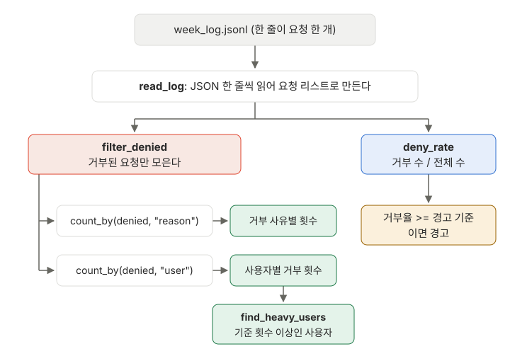

# 실습 10-2 · 로그 집계와 주간 보고서 만들기

## 목표: 로그 집계와 주간 보고서

> **이번 실습에 들어온 일**
>
> A사 보안 팀장이 보낸 메시지:
> 「점검 결과 말고 하나 더 있습니다. 판정 서버는 요청마다 로그를 한 줄 남기는데, 그 로그를 제대로 읽어 본 사람이 없습니다. 지난주에 한 직원이 "자꾸 접근이 거부된다"고 문의했을 때 로그 파일을 열어 그 직원의 거부 횟수를 세는 데만 오래 걸렸습니다. 실제 서버의 일주일 치는 수천 줄이고, 이번에 쓰는 샘플은 40줄입니다.
>
> 일주일 동안 요청이 몇 번 허용되고 몇 번 거부됐는지, 거부 사유는 무엇이 많은지, 같은 사람이 반복해서 거부됐는지를 숫자로 알려 주세요. 거부 비율이 평소보다 높으면 먼저 알 수 있게 기준(예: 30%)을 정해 두고, 기준을 넘으면 「경고」라고 표시해 주세요. 점검 결과와 이 숫자를 합쳐 주간 회의에 낼 한 장짜리 보고서까지 만들어 주세요.」
> - **왜 중요한가**: 거부가 갑자기 늘면 퇴사자 계정이나 밖에서 들어오는 시도가 늘었다는 신호일 수 있습니다. 로그를 사람이 세면 오래 걸리고 기준이 사람마다 달라집니다. 코드가 같은 기준으로 세고 경고를 붙이면 담당자는 경고가 붙은 곳부터 볼 수 있습니다. 경고는 공격이 확정됐다는 뜻이 아니라 먼저 살펴볼 곳이라는 뜻입니다.

> **읽을거리 — 문제가 아닙니다.** 이 아래부터 첫 「문제」 전까지는 이 실습의 배경지식입니다. 답할 질문도 따라 칠 명령도 없으니 읽고 이해만 합니다.

## 왜 로그를 집계하는가

> **읽을거리 — 읽기만 합니다.** 문제가 아닙니다. 답할 질문도, 따라 칠 명령도 없습니다.

1. 서버 로그는 한 줄씩 쌓이기만 하고, 그대로는 「이번 주에 무슨 일이 있었나」를 알 수 없습니다.
2. 그래서 로그를 읽어 **세고(집계), 비율을 구하고, 기준과 비교**합니다.
   - 거부율 = 거부된 요청 수 ÷ 전체 요청 수
   - 거부율이 **경고 기준** 이상이면 경고입니다. 기준은 코드가 아니라 `config/alert.json` 에 둡니다.
3. 경고는 「살펴볼 필요가 있다」는 표시이고, 공격이 있었다는 뜻이 아닙니다.

## 2.1 로그 한 줄과 집계 함수

> **읽을거리 — 읽기만 합니다.** 문제가 아닙니다. 답할 질문도, 따라 칠 명령도 없습니다.

`week_log.jsonl` 의 한 줄은 요청 한 개이고, 아래 여섯 키로 이루어집니다.

| 키 | 뜻 | 값의 예 |
|---|---|---|
| `time` | 요청한 시각 | `"2026-10-26T09:10"` |
| `user` | 요청한 사용자 | `"seoyeon"` |
| `permission` | 요청한 권한(자원:행위) | `"SALES:QUERY"` |
| `network` | 접속 위치 | `"office"` |
| `allowed` | 허용 여부 | `true` · `false` |
| `reason` | 허용 또는 거부 이유 | `"퇴사한 계정"` |

- 이 샘플 로그의 허용 이유는 `역할 권한` 하나이고, 거부 이유는 네 가지입니다.
  - `퇴사한 계정` · `역할이 없음`(사용자의 역할이 역할 파일에 없음) · `업무 시간 밖` · `허용되지 않은 접속 위치`

**한 장 정리**

| 함수 | 받는 것 | 리턴하는 것 |
|---|---|---|
| `read_log` | 로그 파일 경로 | 요청 딕셔너리의 리스트 |
| `count_by` | 요청 리스트, 센 기준(키 이름) | `{값: 횟수}` 딕셔너리 |
| `filter_denied` | 요청 리스트 | 거부된 요청의 리스트 |
| `deny_rate` | 요청 리스트 | 거부율(0 ~ 1). 요청이 0개이면 0.0 |
| `find_heavy_users` | 사용자별 거부 횟수 딕셔너리, 기준 횟수 | 기준 이상 거부된 사용자 이름의 리스트 |

- **직접 쓰는 곳은 다섯 함수**(번호 1 ~ 11)입니다. 판단이 필요한 함수마다 2 ~ 3줄만 쓰고, 나머지는 미리 채웠습니다.
  - `read_log`(1 · 2번): 로그 파일의 JSON 한 줄을 딕셔너리로 바꿔 리스트에 추가합니다.
  - `count_by`(3 ~ 5번): 키의 값별로 횟수를 셉니다. 예를 들어 사용자별 · 사유별 횟수입니다.
  - `filter_denied`(6 · 7번): 거부된 요청만 모읍니다.
  - `deny_rate`(8 · 9번): 거부율을 구합니다. 요청이 하나도 없는 경우를 먼저 처리합니다.
  - `find_heavy_users`(10 · 11번): 거부 횟수가 기준 이상인 사용자를 찾습니다.
- **미리 채운 것**: 반복 구조, `deny_rate` 의 나눗셈 줄, 마지막 `return` 입니다.

<figure class="page-figure"></figure>

**문법 상자 — JSON 한 줄 읽기 · 퍼센트 만들기 · 값별로 세기**

**① `json.loads` 는 JSON 문자열을 딕셔너리로 바꿉니다**

```python
import json                                                      # JSON 문자열을 딕셔너리로 바꾸는 모듈을 불러온다

line = '{"user": "dami", "allowed": false}\n'                     # 로그 파일에서 읽은 한 줄(끝에 줄바꿈 문자가 붙어 있다)
entry = json.loads(line)                                         # JSON 문자열을 딕셔너리로 바꾼다
print(entry["user"], entry["allowed"])                           # 사용자와 허용 여부를 출력한다
```

실행 결과:

```
dami False
```

- JSON 의 `false` 가 파이썬에서는 `False` 가 됩니다.
- 로그 파일을 `for line in log_file:` 로 읽으면 한 줄씩 꺼내지고, 각 줄을 `json.loads(line)` 으로 바꾸면 요청 한 개가 딕셔너리가 됩니다.

**② `round(숫자)` 는 소수를 가장 가까운 정수로 반올림합니다**

```python
rate = 16 / 40                                                   # 거부 16개를 전체 40개로 나눈 비율
print(rate)                                                      # 비율 그대로 출력한다

percent = round(rate * 100)                                      # 100 을 곱해 가까운 정수로 반올림한다
print(percent)                                                   # 퍼센트 숫자를 출력한다
```

실행 결과:

```
0.4
40
```

`round(숫자)` 는 정수로 반올림하고, 소수 첫째 자리까지 남기고 싶으면 `round(숫자, 1)` 처럼 뒤에 자리 수를 적습니다(2.43 → 2.4).

숫자 뒤에 `%` 를 붙여 문자열로 만들려면 f-문자열을 씁니다.

```python
percent = 40                                                     # 위에서 구한 퍼센트 숫자
percent_text = f"{percent}%"                                     # 숫자 뒤에 % 를 붙인 문자열을 만든다
print(percent_text)                                              # 만든 문자열을 출력한다
```

실행 결과:

```
40%
```

- 거부율은 0 ~ 1 사이 소수로 계산하고, 보여 줄 때만 100 을 곱해 퍼센트로 바꿉니다.
- 경고 기준과 비교할 때는 퍼센트가 아니라 소수(`rate >= limit`)를 그대로 비교합니다.

**③ `counts.get(값, 0)` 으로 값별 횟수를 셉니다**

```python
names = ["dami", "gaeun", "dami"]                               # 거부된 사용자 이름 리스트
counts = {}                                                      # 값별 횟수를 담을 딕셔너리

for name in names:                                               # 이름을 하나씩 꺼낸다
    old_count = counts.get(name, 0)                              # 지금까지 센 횟수를 꺼낸다(처음이면 0)
    counts[name] = old_count + 1                                 # 횟수를 1 늘려 넣는다

print(counts)                                                    # 이름별 횟수를 출력한다
junho_count = counts.get("junho", 0)                             # 없는 이름은 0 을 준다
print(junho_count)                                               # 없는 이름의 횟수를 출력한다
```

실행 결과:

```
{'dami': 2, 'gaeun': 1}
0
```

- `counts.get(name, 0)` 은 `name` 키의 값을 꺼내고, 키가 아직 없으면 0 을 줍니다. 처음 나온 이름도 같은 두 줄로 셀 수 있습니다.
- `count_by` 는 이 두 줄을 `entry[key]` 로 꺼낸 값에 그대로 씁니다.

**④ `"\n".join(리스트)` 는 리스트의 문자열을 줄바꿈으로 이어 붙입니다**

```python
lines = ["# 제목", "- 첫째 줄", "- 둘째 줄"]                          # 보고서 줄을 모은 리스트
text = "\n".join(lines)                                          # 줄바꿈 문자로 이어 붙여 문자열 하나로 만든다
print(text)                                                      # 이어 붙인 문자열을 출력한다
```

실행 결과:

```
# 제목
- 첫째 줄
- 둘째 줄
```

- `"\n"` 은 줄바꿈 문자 하나이고, 출력하면 다음 줄로 넘어갑니다.
- `weekly_report.py` 는 마지막에 `"\n".join(lines) + "\n"` 을 리턴합니다. 뒤의 `+ "\n"` 은 파일 맨 끝도 줄바꿈으로 끝나게 하려고 붙입니다.

> **여기부터 문제입니다.** 위는 읽을거리였고, 아래에서 직접 합니다.

## 실습 10-2 · 거부율과 경고 여부 구하기

**이런 상황이 있습니다**

- **지금은**: 로그 40줄을 사람이 하나씩 읽고 세야 합니다. 거부가 늘었는지, 누가 반복해서 거부됐는지 확인하려면 시간이 오래 걸립니다.
- **그래서 만드는 것**: `log_summary.py` 입니다.
  - 로그를 읽고, 거부된 요청을 모으고, 사유별 · 사용자별로 세고, 거부율을 구합니다.
  - 거부율이 경고 기준 이상이면 경고로 표시합니다.
  - 이어서 실습 10-1 점검 결과와 합친 주간 보고서를 만듭니다. 보고서를 만드는 `weekly_report.py` 는 붙여 넣고 실행만 합니다.
- **실행하면**: 단계 1은 허용 · 거부 · 거부율, 단계 2는 거부 사유별 횟수, 단계 3은 경고 여부와 거부가 많은 사용자를 출력합니다. 보고서 실행은 모은 양, 저장한 파일 이름, 보고서 내용을 출력합니다.
- **현업에서는**: 로그를 집계하는 일은 관제의 기본이고, 경고 기준은 코드에 직접 적지 않고 설정 파일에 두어 운영하면서 바꿉니다.

**할 일**

1. `log_summary.py` · `exercise10-2_run.py` 두 파일을 만들고, `log_summary.py` 의 `read_log` · `count_by` · `filter_denied` · `deny_rate` · `find_heavy_users` 에서 직접 쓰는 곳 다섯 군데를 씁니다.
2. 실행해서 <mark>허용 · 거부 · 거부율</mark>(단계 1: 집계), <mark>거부 사유별 횟수</mark>(단계 2), <mark>경고 여부</mark>(단계 3: 경고 기준)를 읽습니다.
3. `weekly_report.py` · `exercise10-2-2_run.py` 를 붙여 넣어 실행하고, 실습 10-1 점검 결과와 합친 <mark>주간 보고서</mark>(단계 3: 저장한 보고서 내용)를 읽습니다. 이 두 파일은 직접 쓰는 곳이 없습니다. 실습 10-2 는 문제가 하나뿐이고, `exercise10-2-2_run.py` 는 그 문제의 두 번째 실행 파일입니다. 보고서 (가)의 「단계 3」은 `exercise10-2_run.py` 에서는 경고 여부, `exercise10-2-2_run.py` 에서는 저장한 보고서 내용입니다.

**`log_summary.py`**

```python
import json                                                      # JSON 문자열을 딕셔너리로 바꾸는 모듈을 불러온다


def read_log(path):                                              # 로그 파일 경로를 받는 함수
    """서버 로그 파일을 한 줄씩 읽어 요청 딕셔너리 리스트로 만든다.
    주간 로그를 집계하기 전에 파일을 읽을 때 쓴다.
    """
    entries = []                                                 # 요청 딕셔너리를 모을 리스트
    with open(path, encoding="utf-8") as log_file:                      # 파일을 연다
        for line in log_file:                                           # 파일에서 한 줄씩 꺼낸다
            # ← 아래를 직접 씁니다 (주석은 두고 각 주석 바로 아래 줄에 씁니다)
            # 1. line 의 JSON 문자열을 json.loads 로 딕셔너리 entry 로 바꾼다
            # 2. entry 를 entries 에 추가한다
    return entries                                               # 요청 리스트를 리턴한다


def count_by(entries, key):                                      # 요청 리스트와 센 기준(키 이름)을 받는 함수
    """요청을 key 의 값별로 세어 {값: 횟수} 딕셔너리를 리턴한다.
    사용자별 · 이유별로 몇 번인지 알고 싶을 때 쓴다.
    예: count_by(entries, "user")
    """
    counts = {}                                                  # 값별 횟수를 담을 딕셔너리
    for entry in entries:                                        # 요청을 하나씩 꺼낸다
        # ← 아래를 직접 씁니다 (주석은 두고 각 주석 바로 아래 줄에 씁니다)
        # 3. entry[key] 를 value 에 담는다
        # 4. counts 에서 value 의 지금 횟수를 old_count 에 담는다 (없으면 0: counts.get(value, 0))
        # 5. counts[value] 에 old_count + 1 을 넣는다
    return counts                                                # 값별 횟수를 리턴한다


def filter_denied(entries):                                      # 요청 리스트를 받는 함수
    """거부된 요청만 모아 리스트로 리턴한다.
    거부 사유와 사용자를 따로 볼 때 쓴다.
    """
    denied = []                                                  # 거부된 요청을 모을 리스트
    for entry in entries:                                        # 요청을 하나씩 꺼낸다
        # ← 아래를 직접 씁니다 (주석은 두고 각 주석 바로 아래 줄에 씁니다)
        # 6. entry["allowed"] 가 거짓이면 (if not …)
        # 7.   entry 를 denied 에 추가한다
    return denied                                                # 거부된 요청 리스트를 리턴한다


def deny_rate(entries):                                          # 요청 리스트를 받는 함수
    """전체 요청 중 거부된 요청의 비율(0 ~ 1)을 리턴한다.
    주간 보고서에서 거부율을 구할 때 쓰며, 요청이 없으면 0.0 이다.
    """
    total = len(entries)                                         # 전체 요청 수
    # ← 아래를 직접 씁니다 (주석은 두고 각 주석 바로 아래 줄에 씁니다)
    # 8. total 이 0 이면 (==)
    # 9.   0.0 을 리턴한다 (0 으로 나눌 수 없으므로)
    denied_entries = filter_denied(entries)                      # 거부된 요청 리스트
    denied = len(denied_entries)                                 # 거부된 요청 수
    return denied / total                                        # 거부 수를 전체 수로 나눈 비율을 리턴한다


def find_heavy_users(denied_counts, limit):                      # 사용자별 거부 횟수 딕셔너리와 기준 횟수를 받는 함수
    """거부 횟수가 limit 이상인 사용자 이름 리스트를 리턴한다.
    거부가 한 사람에게 몰렸는지 확인할 때 쓴다.
    """
    heavy = []                                                   # 기준에 걸린 사용자 이름을 모을 리스트
    for user, count in denied_counts.items():                    # 사용자 이름과 거부 횟수를 하나씩 꺼낸다
        # ← 아래를 직접 씁니다 (주석은 두고 각 주석 바로 아래 줄에 씁니다)
        # 10. count 가 limit 이상이면 (>=)
        # 11.   user 를 heavy 에 추가한다
    return heavy                                                 # 기준에 걸린 사용자 이름을 리턴한다
```

- 들여쓰기는 미리 채운 줄에 맞춥니다.
  - `read_log`(1 · 2번): `for line in log_file:` 안쪽이라 앞에 공백 12개입니다.
  - `count_by`(3 ~ 5번) · `filter_denied`(6번) · `find_heavy_users`(10번): `for` 안쪽이라 공백 8개이고, `if` 안쪽(7번 · 11번)은 4개 더(12개)입니다.
  - `deny_rate`(8 · 9번): 함수 안이라 공백 4개이고, `if` 안쪽 `return`(9번)은 8개입니다.
- 4번의 `counts.get(value, 0)` 은 문법 상자 ③의 `get` 과 같습니다. 처음 나온 값은 0 에서 시작합니다.
- 8 · 9번은 요청이 하나도 없을 때 0 으로 나누는 오류를 막는 줄입니다. 로그가 비는 경우의 결과는 문제 아래 정답에서 읽습니다.
- 채우기 전에 실행하면 `IndentationError: expected an indented block` 오류가 납니다. 다만 `deny_rate` 의 8 · 9번만 비워 두면 오류가 나지 않습니다. 이번 로그는 비어 있지 않아서 그렇고, 로그가 빈 날에만 문제가 드러납니다.

**`exercise10-2_run.py`** — 그대로 붙여 넣습니다. 학생이 쓰는 줄은 없습니다. 샘플 로그를 집계해 세 단계로 출력합니다.

```python
import json                                                      # 경고 기준 파일을 읽는 데 쓴다
from log_summary import read_log, count_by, filter_denied, deny_rate, find_heavy_users   # 방금 만든 집계 함수를 불러온다

LOG_PATH = "week_log.jsonl"                                      # 집계할 로그 파일 이름
with open("config/alert.json", encoding="utf-8") as alert_file:           # 경고 기준 파일을 연다
    ALERT = json.load(alert_file)                                         # 경고 기준 딕셔너리로 읽는다

entries = read_log(LOG_PATH)                                     # 로그를 읽어 요청 리스트로 만든다
denied = filter_denied(entries)                                  # 거부된 요청만 모은다
rate = deny_rate(entries)                                        # 거부율(0 ~ 1)을 구한다
percent = round(rate * 100)                                      # 거부율을 퍼센트 숫자로 바꾼다
limit = ALERT["deny_rate_limit"]                                 # 거부율 경고 기준(0 ~ 1)
limit_percent = round(limit * 100)                               # 경고 기준을 퍼센트 숫자로 바꾼다
user_limit = ALERT["user_denied_limit"]                          # 사용자별 거부 횟수 기준

entry_count = len(entries)                                       # 요청이 모두 몇 건인지 센다
print("--- 단계 1: 집계 - 요청", entry_count, "건")              # 단계 1 시작을 알리는 줄
denied_count = len(denied)                                       # 거부된 요청이 몇 건인지 센다
allowed_count = entry_count - denied_count                       # 허용된 요청 수
print("허용", allowed_count, "· 거부", denied_count, "· 거부율", f"{percent}%")  # 허용 · 거부 · 거부율을 출력한다
print("--- 단계 2: 거부 사유별")                                    # 단계 2 시작을 알리는 줄
reason_counts = count_by(denied, "reason")                       # 거부된 요청을 사유별로 센다
for reason, count in reason_counts.items():                      # 사유와 횟수를 하나씩 꺼낸다
    print(reason, count)                                         # 거부 사유와 횟수를 출력한다
print("--- 단계 3: 경고 기준")                                      # 단계 3 시작을 알리는 줄
if rate >= limit:                                                # 거부율이 기준 이상이면
    print(f"거부율 {percent}% >= 기준 {limit_percent}% -> 경고")    # 경고라고 출력한다
else:                                                            # 기준보다 낮으면
    print(f"거부율 {percent}% < 기준 {limit_percent}% -> 경고 없음")   # 경고 없음이라고 출력한다
user_counts = count_by(denied, "user")                           # 거부된 요청을 사용자별로 센다
heavy = find_heavy_users(user_counts, user_limit)                # 기준 이상 거부된 사용자를 찾는다
print("거부", user_limit, "번 이상 사용자:", heavy)                  # 사용자 이름을 출력한다
```

**`weekly_report.py`** — 그대로 붙여 넣습니다. 학생이 쓰는 줄은 없습니다. 점검 결과와 로그 집계를 합쳐 네 절의 보고서 문자열을 만들고, 날짜가 들어간 `.md` 파일로 저장합니다.

```python
from log_summary import count_by, filter_denied, deny_rate, find_heavy_users   # 실습 10-2에서 만든 집계 함수를 불러온다


def build_report(results, entries, alert, today):                # 점검 결과 · 요청 리스트 · 경고 기준 · 날짜 문자열을 받는 함수
    """점검 결과와 로그 집계를 합쳐 주간 보고서 문자열을 만든다.
    매주 정기 보고서를 만들 때 쓴다.
    """
    denied = filter_denied(entries)                              # 거부된 요청만 모은다
    total = len(entries)                                         # 전체 요청 수
    denied_count = len(denied)                                   # 거부된 요청 수
    allowed_count = total - denied_count                         # 허용된 요청 수
    rate = deny_rate(entries)                                    # 거부율(0 ~ 1)을 구한다
    percent = round(rate * 100)                                  # 거부율을 퍼센트 숫자로 바꾼다
    limit = alert["deny_rate_limit"]                             # 거부율 경고 기준(0 ~ 1)
    limit_percent = round(limit * 100)                           # 경고 기준을 퍼센트 숫자로 바꾼다
    status = "경고 없음"                                          # 먼저 경고 없음으로 둔다
    if rate >= limit:                                            # 거부율이 기준 이상이면
        status = "경고"                                           # 경고로 바꾼다
    user_limit = alert["user_denied_limit"]                      # 사용자별 거부 횟수 기준
    user_counts = count_by(denied, "user")                       # 거부된 요청을 사용자별로 센다
    heavy = find_heavy_users(user_counts, user_limit)            # 기준 이상 거부된 사용자를 찾는다

    lines = [f"# 접근통제 주간 보고서 ({today})", ""]            # 보고서 줄을 모을 리스트(제목과 빈 줄로 시작)
    lines.append("## 1. 요청 현황")                                # 첫째 절 제목
    lines.append(f"- 전체 요청: {total}건 (허용 {allowed_count}건 · 거부 {denied_count}건)")   # 요청 수
    lines.append(f"- 거부율: {percent}% (경고 기준 {limit_percent}%) -> {status}")             # 거부율과 경고 여부
    lines.append("")                                             # 빈 줄
    lines.append("## 2. 거부 사유")                                # 둘째 절 제목
    reason_counts = count_by(denied, "reason")                   # 거부된 요청을 사유별로 센다
    for reason, count in reason_counts.items():                  # 사유와 횟수를 하나씩 꺼낸다
        lines.append(f"- {reason}: {count}건")                    # 사유별 횟수를 추가한다
    lines.append("")                                             # 빈 줄
    lines.append("## 3. 점검 결과")                                # 셋째 절 제목
    for result in results:                                       # 점검 결과를 하나씩 꺼낸다
        name = result["name"]                                    # 점검 이름
        problems = result["problems"]                            # 문제가 있는 사용자 · 예외 리스트
        if len(problems) == 0:                                   # 문제가 없으면
            lines.append(f"- {name}: 통과")                       # 통과라고 추가한다
        else:                                                    # 문제가 있으면
            lines.append(f"- {name}: 실패 {problems}")            # 실패와 문제 리스트를 추가한다
    lines.append("")                                             # 빈 줄
    lines.append("## 4. 조치가 필요한 것")                          # 넷째 절 제목
    lines.append(f"- 거부 {user_limit}번 이상 사용자: {heavy}")     # 기준 이상 거부된 사용자
    for result in results:                                       # 점검 결과를 하나씩 꺼낸다
        name = result["name"]                                    # 점검 이름
        problems = result["problems"]                            # 문제가 있는 사용자 · 예외 리스트
        if len(problems) > 0:                                    # 문제가 있으면
            lines.append(f"- 확인: {name} -> {problems}")         # 확인할 것을 추가한다
    return "\n".join(lines) + "\n"                               # 줄들을 줄바꿈으로 이어 붙인 문자열을 리턴한다


def save_report(text, today):                                    # 보고서 문자열과 날짜 문자열을 받는 함수
    """보고서를 날짜가 들어간 .md 파일로 저장하고 파일 이름을 리턴한다.
    주간 보고서를 파일로 남길 때 쓴다.
    """
    file_name = f"access_control_weekly_report_{today}.md"       # 날짜가 들어간 파일 이름을 만든다
    with open(file_name, "w", encoding="utf-8") as report_file:            # 파일을 쓰기 모드("w")로 연다
        report_file.write(text)                                            # 보고서 문자열을 파일에 쓴다
    return file_name                                             # 저장한 파일 이름을 리턴한다
```

- 읽을 곳은 세 곳입니다.
  - `if rate >= limit:` 는 위의 경고 판단과 같은 비교입니다. 거부율은 0 ~ 1 사이 소수이고, 경고 기준도 같은 소수입니다.
  - 보고서 줄은 `lines.append(…)` 로 하나씩 모으고, 마지막에 `"\n".join(lines)` 로 한 문자열로 만듭니다(문법 상자 ④).
  - `save_report` 는 `"w"` 로 열어 새로 씁니다. 로그처럼 계속 덧붙이는 파일은 `"a"` 이고, 매주 새로 만드는 보고서는 `"w"` 입니다. 파일 이름에는 `f"…{today}.md"` 로 날짜를 넣습니다.

**`exercise10-2-2_run.py`** — 그대로 붙여 넣습니다. 학생이 쓰는 줄은 없습니다. 실습 10-1의 점검 함수와 실습 10-2의 로그 읽기 함수로 데이터를 모아 보고서를 만들고 저장합니다.

```python
import json                                                      # 경고 기준 파일을 읽는 데 쓴다
from datetime import datetime                                    # 문자열을 시각으로 바꾸는 데 쓴다
from checklist import TIME_FORMAT, load_state, run_checklist     # 실습 10-1에서 만든 점검 함수를 불러온다
from log_summary import read_log                                 # 실습 10-2에서 만든 로그 읽기 함수를 불러온다
from weekly_report import build_report, save_report             # 붙여 넣은 보고서 함수를 불러온다

TODAY = "2026-11-02"                                             # 보고서 날짜
NOW = datetime.strptime(TODAY + " 10:00", TIME_FORMAT)           # 점검하는 시각
with open("config/alert.json", encoding="utf-8") as alert_file:           # 경고 기준 파일을 연다
    ALERT = json.load(alert_file)                                         # 경고 기준 딕셔너리로 읽는다

print("--- 단계 1: 모으기 - 점검 결과와 요청 로그")                    # 단계 1 시작을 알리는 줄
state = load_state("config/week_state.json")                     # 점검할 데이터 파일을 읽는다
results = run_checklist(state, NOW)                              # 점검 세 가지를 실행한다
entries = read_log("week_log.jsonl")                             # 요청 로그를 읽는다
result_count = len(results)                                      # 점검이 몇 가지인지 센다
entry_count = len(entries)                                       # 요청이 몇 건인지 센다
print("점검", result_count, "가지 · 요청", entry_count, "건")    # 모은 양을 출력한다
print("--- 단계 2: 보고서 만들기와 저장")                              # 단계 2 시작을 알리는 줄
text = build_report(results, entries, ALERT, TODAY)              # 보고서 문자열을 만든다
file_name = save_report(text, TODAY)                             # 파일로 저장한다
print("저장한 파일:", file_name)                                    # 저장한 파일 이름을 출력한다
print("--- 단계 3: 저장한 보고서 내용")                                # 단계 3 시작을 알리는 줄
print(text)                                                      # 보고서 내용을 출력한다
```

**순서**

1. **[VS Code]** 파일 `log_summary.py` · `exercise10-2_run.py` 를 만들어 위 코드를 붙여 넣습니다.
2. **[VS Code]** `log_summary.py` 에서 직접 쓰는 곳 다섯 군데를 씁니다. 2.1 의 표와 그림, 문법 상자를 보고 씁니다.
3. **[터미널]** `pwd` 의 결과가 `access_control` 로 끝나는지 확인하고 실행합니다(맥북은 `python3`).
   ```bash
   pwd
   python exercise10-2_run.py
   ```
4. 출력은 세 단계입니다. 단계 1은 한 줄, 단계 2는 거부 사유 네 줄, 단계 3은 두 줄입니다.
5. **[VS Code]** 파일 `weekly_report.py` · `exercise10-2-2_run.py` 를 만들어 위 코드를 붙여 넣고 실행합니다. 실습 10-1의 `checklist.py` 를 불러오므로 파일이 없으면 「정답」 레슨 맨 아래 「앞 실습 파일 완성본」으로 먼저 만듭니다.
   ```bash
   python exercise10-2-2_run.py
   ls
   ```
   - 단계 3의 보고서가 네 절로 출력되고, `ls` 에 `access_control_weekly_report_2026-11-02.md` 가 보여야 합니다.
6. **[터미널]** 보고서 4절에 나온 거부가 많은 사용자의 요청을 로그에서 직접 찾아 봅니다.
   ```bash
   grep gaeun week_log.jsonl
   grep dami week_log.jsonl
   ```
   - 명령 풀이: `grep 단어 파일` 파일에서 그 단어가 들어간 줄만 보여 줌
7. **[보고서]** `report_u10.md` 의 `## 실습 10-2` 아래를 채웁니다.
   - (가) `exercise10-2_run.py` 의 출력과 `exercise10-2-2_run.py` 의 보고서 내용을 붙여 넣고, 허용 · 거부 · 거부율, 경고 여부, 거부 사유 중 가장 많은 것을 적어 주세요.
   - (나) [핵심 질문] 보고서 4절에 거부가 4번 이상인 사용자로 gaeun 과 dami 가 나왔습니다. 6번에서 찾은 두 사람의 요청을 비교해 주세요. 그리고 두 사람에게 같은 조치를 하면 안 되는 이유와, 각각 무엇부터 확인해야 하는지 적어 주세요.
   - (다) [핵심 질문] 서버가 멈춰서 로그가 빈 주에는 `deny_rate` 가 0.0 을 리턴해 보고서에 「거부율 0%」가 나옵니다. 이 보고서만 보고 「이번 주는 안전했다」고 판단해도 되는지 적어 주세요. 그리고 보고서에서 함께 확인해야 하는 정보와 그 이유도 적어 주세요.

## 실습 10-2 정리

| 하려는 일 | 코드 · 말 |
|---|---|
| 로그 한 줄을 딕셔너리로 | `entry = json.loads(line)` → `entries.append(entry)` (`read_log` 안) |
| 값별로 세기 | `value = entry[key]` → `old_count = counts.get(value, 0)` → `counts[value] = old_count + 1` |
| 거부된 요청만 모으기 | `if not entry["allowed"]:` → `denied.append(entry)` |
| 거부율 | `if total == 0:` → `return 0.0` 뒤에 `denied / total` |
| 거부가 많은 사용자 | `if count >= limit:` → `heavy.append(user)` |
| 경고 여부 | `rate >= limit` 이면 경고 (소수끼리 비교) |
| 퍼센트로 보여 주기 | `round(rate * 100)` |
| 보고서 줄 모으기 | `lines.append("…")` → `"\n".join(lines)` (`weekly_report.py`, 미리 채움) |
| 파일로 저장 | `open(file_name, "w", encoding="utf-8")` → `report_file.write(text)` (미리 채움) |

## Module 3 폴더 구조 정리

> **읽을거리 — 읽기만 합니다.** 문제가 아닙니다. 답할 질문도, 따라 칠 명령도 없습니다.

Module 3이 끝나면 `access_control` 폴더는 아래 모양이어야 합니다. 파일을 어디에 저장했는지 헷갈리면 내 VS Code 왼쪽 목록과 비교합니다.

- **`config/` 안에는 JSON 설정 파일만** 둡니다. 이름이 `config/…` 로 시작하는 파일입니다.
- **그 밖의 파일은 모두 `access_control/` 바로 아래**에 둡니다. 코드(`.py`), 실행 파일(`exerciseN-M_run.py`), Unit마다 직접 만든 보고서(`report_uN.md`), 실행하면 생기는 파일이 모두 해당합니다.
- 하위 폴더를 따로 만들지 않습니다. 터미널은 항상 `…/access_control` 에서 실행합니다(`pwd` 로 확인).

```
security-agent-toolkit/
  .env
  .gitignore
  agent_core/
  network_zt/
  access_control/ (바로 아래 파일 66개 + config 11개 = 77개)    Module 3  ← 여기서 작업
    config/ (11개)           ← JSON 설정만
      access_log.json
      alert.json
      conditions.json
      exceptions.json
      exclude_list.json
      roles.json
      sensitive.json
      sla.json
      users.json
      users_broken.json
      week_state.json
    __pycache__/             ← 파이썬이 자동으로 만듦
    access_control_weekly_report_2026-11-02.md
    access_log.py
    access_server.py
    checklist.py
    conditional.py
    config_loader.py
    exercise1-2_run.py
    exercise1-3_audit.py
    report_u1.md
    exercise2-1_run.py
    exercise2-2_run.py
    exercise2-3_run.py
    exercise3-1_broken.py
    report_u2.md
    report_u3.md
    exercise4-1_run.py
    exercise4-2_run.py
    exercise4-3_run.py
    exercise5-1_run.py
    exercise5-2_run.py
    report_u4.md
    report_u5.md
    exercise6-1_run.py
    exercise6-2_run.py
    exercise6-3_run.py
    exercise7-1_run.py
    exercise7-2_run.py
    report_u6.md
    report_u7.md
    exercise8-1_run.py
    exercise8-2_run.py
    exercise8-3_run.py
    exercise9-1_run.py
    report_u8.md
    report_u9.md
    exercise10-1_run.py
    exercise10-2_run.py
    exercise10-2-2_run.py
    report_u10.md
    exception_policy.py
    log_summary.py
    overprivilege.py
    policy.py
    rbac.py
    report_exclude.py
    req_create.py
    req_grant.py
    req_review.py
    req_sla.py
    request_flow.py
    requests.json
    review_list.py
    review_rules.py
    review_unused.py
    revocation_log.json
    revoke.py
    revoke_approve.py
    revoke_input.py
    revoke_plan.py
    role_admin.py
    send_checks.py
    server_log.jsonl
    test_policy.py
    test_policy_extra.py
    week_log.jsonl
    weekly_report.py
  anomaly_detection/         Module 4 (다음 Unit부터)
```

- 개수는 보고서(`report_u1.md` ~ `report_u10.md`)를 포함해 세었습니다. 실행해야 생기는 파일(`requests.json` · `revocation_log.json` · `server_log.jsonl` · 주간 보고서)은 그 파일을 만드는 실행 파일을 돌리지 않았다면 내 폴더에 없을 수 있습니다.
- `__pycache__/` 는 파이썬이 만드는 임시 폴더라서 신경 쓰지 않고 깃허브에도 올리지 않습니다.
- 다른 Module 폴더는 일부만 적었습니다. 내 폴더에 `.venv`, `docs/` 같은 폴더가 더 있어도 괜찮습니다.

---
