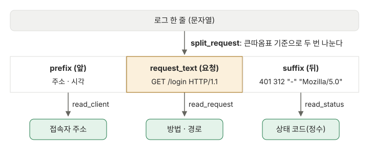

# 실습 1-1 · 접속 로그 한 줄 조각내기

## 목표: 로그 한 줄 파서

> **오늘 들어온 일**
>
> A사 웹서비스 담당이 보낸 메시지입니다(Module 3의 판정 서버가 아니라 게시판 웹서버가 남기는 접속 로그 이야기입니다):
> 「얼마 전 한 직원이 "게시판 로그인이 계속 안 된다"고 문의했습니다. 그 직원의 기록을 찾으려고 접속 로그 파일을 열어 눈으로 한 줄씩 읽었고, 오래 걸렸습니다. 접속 로그는 하루에 수만 줄이 쌓입니다.
>
> 로그 한 줄은 주소 · 시각 · 요청 · 결과가 나뉘지 않은 하나의 문자열이라 프로그램이 값을 꺼내 쓰지 못합니다. 한 줄을 접속자 주소 · 요청 방법 · 경로 · 상태 코드로 나눠 주세요. 끝이 잘리거나 깨진 줄은 읽지 않고 넘어가되, 읽기에 성공한 줄과 읽기에 실패한 줄이 몇 줄씩인지 알려 주세요.」
> - **왜 중요한가**: <mark>부분으로 나누지 못하면 「상태 코드가 401 인 줄이 몇 개인가」 같은 질문에 사람이 한 줄씩 읽어서 답해야 합니다.</mark> 나눠 두면 세고 비교하는 일을 코드가 합니다. 읽기 실패한 줄 수는 로그가 잘 쌓이고 있는지 보는 기준이 됩니다. 이 함수가 Module 4 내내 모든 탐지의 첫 단계가 됩니다.

## Module 4는 무엇을 하고, SIEM(심)은 무엇인가

**1. Module 4에서 하는 일**

Module 3은 요청이 들어오는 순간 「허용할까」를 정했습니다. Module 4는 반대로 **이미 쌓인 로그를 읽고, 평소와 다른 일을 찾습니다.**

| 물음 | Module 3 접근통제 | Module 4 이상탐지 |
|---|---|---|
| 무엇을 보나 | 요청 1개 | 쌓인 로그 전체 |
| 언제 보나 | 요청이 들어오는 순간 | 일이 일어난 뒤 |
| 하는 일 | 허용인지 거부인지 정함 | 공격이 의심되는 일을 찾아 담당자에게 알림 |
| 로그 모양 | 우리가 만든 판정 서버의 로그. 허용인지 거부인지가 이미 적혀 있음 | 웹 서버 같은 곳이 남긴 로그. 모양이 제각각이고 허용 · 거부가 적혀 있지 않음 |
| 결과 | 허용 또는 거부 | 먼저 살펴볼 곳 |

같은 사건으로 비교해 봅니다. 203.0.113.50 이라는 주소의 컴퓨터가 로그인을 5번 실패하고, 6번째에 로그인에 성공합니다.

- Module 3 방식: 요청이 올 때마다 하나씩 「허용할까?」를 판정합니다.
  - 틀린 5번은 5번 모두 거부하고 끝입니다.
  - 6번째에 비밀번호가 맞으면 그 요청은 허용합니다.
  - <mark>판정은 요청 1개만 보기 때문에 「방금 5번 틀렸다」는 것을 모릅니다.</mark>
- Module 4 방식: 이미 쌓인 로그 여러 줄을 묶어서 봅니다.
  - <mark>「같은 주소가 5번 틀린 뒤 성공했다」는 흐름을 찾아</mark> 담당자에게 알립니다.
  - Module 3이 허용한 요청 중에도 수상한 것이 있는지 봅니다.
- 이 Module의 이야기에 나오는 A사는 Module 3과 같은 회사지만 다루는 시스템이 다릅니다.
  - Module 3은 A사의 권한 판정 서버였고, Module 4는 A사의 게시판 웹서버와 클라우드 서비스가 남기는 로그입니다.

**2. SIEM(심)이 무엇인가**

회사에는 웹 서버, 방화벽, 클라우드 서비스처럼 로그를 남기는 곳이 여러 개 있습니다. 공격 하나의 흔적은 이 여러 곳에 나뉘어 남습니다. 아래는 이해를 위해 가정한 상황입니다. 회사 게시판(웹 서비스)에 직원이 아닌 사람이 접속을 시도합니다.

- 203.0.113.50 이라는 주소의 컴퓨터가 게시판 로그인 창에서 직원 seoyeon 의 비밀번호를 5번 연달아 틀립니다.
  - 웹 서버가 이 5번을 자기 로그에 5줄로 적습니다.
- 6번째 시도에서 비밀번호가 맞아 seoyeon 계정으로 로그인에 성공합니다.
  - 웹 서버 로그에 1줄이 더 적힙니다.
- 곧바로 그 계정으로 클라우드 저장소(회사가 파일을 보관하려고 빌려 쓰는 서비스)에서 파일을 수십 개 내려받습니다.
  - 이 기록은 웹 서버가 아니라 클라우드 서비스가 자기 로그에 적습니다.
- 웹 서버 로그만 보면 「로그인을 여러 번 틀렸다가 성공함」이어서 직원이 비밀번호를 잘못 친 것처럼 보입니다.
- 클라우드 로그만 보면 「직원이 파일을 내려받음」이어서 평범해 보입니다.
- 두 로그는 서로 다른 시스템에 있고 모양도 달라서, <mark>사람이 둘을 열어 같은 계정의 일로 이어 붙이기는 어렵습니다.</mark>

**SIEM(심, Security Information and Event Management)** 은 이 흩어진 로그를 **한곳에 모으고, 같은 모양으로 맞춘 뒤, 규칙으로 공격이 의심되는 일을 찾아 담당자에게 알려 주는 보안 관제 도구**입니다. <mark>위 상황이라면 「같은 계정이 로그인에 여러 번 실패한 뒤 성공하고, 곧 파일을 많이 내려받음」이라는 규칙으로 찾습니다.</mark>

- 읽는 법: 이 수업에서는 SIEM 을 「심」이라고 읽습니다. 사람에 따라 「씸」이나 「시엠」이라고도 읽습니다.
- SIEM(심)이 하는 일은 네 단계입니다.

| 단계 | 하는 일 | 위 상황에서는 | Module 4에서 |
|---|---|---|---|
| 수집 | 여러 곳의 로그를 한곳으로 모음 | 웹 서버 로그와 클라우드 서비스 로그를 가져옴 | Unit 1(샘플 로그 읽기) |
| 정규화 | 서로 다른 모양을 같은 키(시각 · 주소 · 계정 · 결과 등)로 맞춤 | 두 로그의 시각과 계정을 같은 모양으로 맞춤 | Unit 2 |
| 탐지 | 규칙과 기준으로 공격이 의심되는 일을 찾음. 여러 로그를 함께 보는 것이 상관분석 | 실패 뒤 성공, 곧 대량 내려받기를 한 계정을 찾음 | Unit 4 ~ Unit 7 |
| 알림 · 조사 | 담당자에게 알리고, 근거 로그를 찾아볼 수 있게 보관 | 담당자에게 경고하고, 근거가 된 로그 줄을 보여 줌 | Unit 8 오탐 · 미탐 평가, Unit 10 AI 요약 |

- 이름의 역사: SIEM(심)이라는 이름은 2005년에 시장조사 회사 Gartner(가트너)가 만들었습니다.
  - 그전에는 둘이 따로 있었습니다. **SIM(보안 정보 관리)** 은 로그를 오래 저장하고 분석 · 보고하고, **SEM(보안 이벤트 관리)** 은 실시간으로 감시하고 함께 비교하고 알립니다. SIEM(심)은 이 둘을 합친 도구입니다.
- SIEM(심)은 기본적으로 **찾아서 알리는 도구**입니다. <mark>막는 일은 보통 방화벽이나 자동 대응 도구 SOAR(쏘아)가 하고,</mark> Microsoft Sentinel 처럼 자동 대응 기능을 함께 주는 제품도 있습니다.

## 현업에서 SIEM(심)을 쓰는 방식 여섯 가지

회사가 SIEM(심)을 쓰려면 두 가지를 정해야 합니다.

- **제품과 로그를 어디에 두나**: 회사 안 서버, 또는 클라우드
- **운영을 누가 하나**: 우리 직원, 또는 외부 업체

이 선택을 조합해 이 수업에서는 아래 여섯 가지로 나눕니다. <mark>업계에서 정한 공식 분류가 아니라, 이해하기 쉽게 나눈 구분입니다.</mark>

| 방식 | 어떻게 쓰나 | 잘 맞는 곳 | 주의할 점 |
|---|---|---|---|
| ① 설치형(온프레미스, on-premises: 회사 안에 직접 설치해 쓰는 방식) | 회사 안 서버에 제품을 설치하고 직원이 직접 운영 | 법이나 규정 때문에 로그를 밖으로 내보낼 수 없는 곳(금융 · 공공 기관 등) | 장비를 사야 하고 처음 투자가 큼. 용량이 정해져 있음 |
| ② 클라우드(SaaS, 사스: 인터넷으로 빌려 쓰는 소프트웨어) | 제품사가 운영하는 서비스를 구독해서 사용 | 빨리 도입하고 운영 인력이 적은 곳 | 로그를 클라우드로 보냄. 로그 양에 따라 요금이 늘어남 |
| ③ 하이브리드(hybrid, 하이브리드: 둘을 섞은 방식) | 민감한 데이터는 회사 안에, 클라우드 데이터는 클라우드에 두고 분석은 한곳에서 | 회사 안 시스템과 클라우드를 둘 다 가진 곳 | 구조가 복잡함 |
| ④ 관리형 — Managed SIEM(매니지드 심, 업체가 운영해 주는 SIEM) | 외부 보안 업체가 자기 플랫폼으로 수집 · 규칙 조정 · 조사까지 서비스로 제공 | 보안 전담 인력이 없는 곳 | 우리 회사 사정을 업체가 얼마나 아는지가 품질을 좌우 |
| ⑤ 오픈소스 직접 구축 | Wazuh(와주) · ELK(엘크, Elasticsearch(일래스틱서치) · Logstash(로그스태시) · Kibana(키바나) 세 제품을 묶어 부르는 이름) 같은 무료 제품을 직접 설치 · 운영 | 비용을 줄이고 싶고 기술 인력이 있는 곳 | 로그를 보관하는 저장 장치 등을 따로 붙여야 하고 운영이 전부 우리 일 |
| ⑥ 제품 + 외부 관제 | 회사가 제품을 직접 사서 소유하고, 운영만 외부 업체에 맡김 | 제품은 직접 갖고 싶지만 운영할 사람이 부족한 곳 | 제품 계약과 서비스 계약이 따로 있음 |

- 이런 회사라면 이 방식이 어울립니다(가정한 예이고 실제 회사가 아닙니다).
  - ① 고객 정보가 든 로그를 회사 밖으로 보내면 안 되는 은행
  - ② 직원 50명쯤이고 보안 담당이 1~2명인데 빨리 시작하려는 IT 서비스 회사
  - ③ 공장 안 서버와 클라우드 업무 프로그램을 같이 쓰는 제조 회사
  - ④ 보안 담당이 따로 없어서 로그 감시를 통째로 맡기려는 작은 회사
  - ⑤ 보안 인력은 있고 제품 비용을 아끼고 싶은 회사
  - ⑥ 제품은 직접 갖고 싶지만 밤새 로그를 볼 사람이 없는 회사
- ④와 ⑥의 외부 업체를 **MSSP(관리형 보안 서비스 사업자, 엠에스에스피)** 라고 부릅니다. <mark>④는 업체의 플랫폼을 빌려 쓰는 것이고, ⑥은 우리가 산 제품을 업체가 대신 운영하는 것이 다릅니다.</mark>
- 제품 이름의 예
  - Splunk(스플렁크): 로그 검색 · 분석으로 유명한 제품. Cisco(시스코)가 인수했습니다.
  - Microsoft Sentinel(센티널): 클라우드에서 쓰는 SIEM(심)이고 자동 대응 기능 SOAR(쏘아)도 함께 제공합니다.
  - Elastic Security: 검색 엔진 Elasticsearch 를 바탕으로 한 SIEM(심)입니다.
  - Wazuh(와주): 무료 오픈소스 SIEM(심) · XDR(엑스디알)입니다.
  - 국내 제품의 예: SPiDER TM(스파이더 티엠, 이글루코퍼레이션)
- 무엇으로 고르나
  - **로그 양**: 요금과 장비 규모에 영향을 줍니다.
  - **규제와 데이터 위치**: 로그를 밖으로 보낼 수 있는지가 설치형이냐 클라우드냐를 가릅니다.
  - **보안 인력**: 운영과 규칙 조정을 맡을 사람이 충분하면 ①⑤, 적으면 ②, 아예 없으면 ④나 ⑥.
  - **쓰는 환경**: Microsoft 클라우드를 많이 쓰면 Sentinel 처럼 같은 계열이 편합니다.
  - **요금 방식**: 제품마다 다릅니다. 하루에 받아들이는 로그 양(GB)으로 매기는 곳, 초당 이벤트 수(EPS, 이벤트 퍼 세컨드)로 매기는 곳, 사용자나 단말 수로 매기는 곳이 있습니다. 금액은 자주 바뀌어서 여기서는 다루지 않습니다.
- 취업 후에는 직접 SIEM(심)을 만드는 사람보다 제품을 쓰거나 관제 서비스 안에서 일하는 사람이 대부분입니다. 그래서 Module 4는 제품 사용법이 아니라 **어느 제품에서든 통하는 원리**(모으고, 정리하고, 규칙으로 찾는 일)를 직접 만들어 봅니다.

## 왜 로그를 조각으로 나누는가

1. Module 3에서 만든 판정 서버(`access_server.py`)도 요청마다 로그를 한 줄씩 남겼습니다. <mark>Module 4에서는 이런 서버 로그에서 **평소와 다른 접속**을 찾습니다.</mark>
   - 평소와 다른 접속의 예: 같은 주소에서 로그인을 연달아 실패함, 관리자 페이지를 반복해서 요청함, 짧은 시간에 요청이 몰림
2. <mark>찾으려면 로그를 **읽을 수 있는 값**으로 바꿔야 합니다.</mark>
   - 로그 한 줄은 하나의 긴 문자열이라 <mark>그대로는 「상태 코드가 401 인 줄」을 셀 수 없습니다.</mark>
   - 이번 Unit의 실습 1-1에서는 한 줄을 접속자 주소 · 방법 · 경로 · 상태 코드로 나눕니다. 실습 1-2에서는 나눈 값으로 줄을 가릅니다.

## 1.1 Module 4의 흐름

| Unit | 하는 일 | 만드는 것 |
|---|---|---|
| Unit 1 | 로그 한 줄 읽기, 이상 징후 가르기 | `log_parse.py` · `log_classify.py` |
| Unit 2 ~ 3 | 서로 다른 모양의 로그를 같은 키로 정리(정규화) | `normalize.py` |
| Unit 4 ~ 5 | 정상 기준을 세우고 로그인 실패 · 요청 급증 찾기 | `login_detection.py` · `traffic_detection.py` |
| Unit 6 ~ 7 | 비인가 접근 · SaaS 이상 사용 · 악성 행위 찾기, 여러 로그를 함께 보기 | `advanced_detection.py` · `correlation.py` |
| Unit 8 ~ 9 | 테스트 로그로 탐지 규칙의 오탐 · 미탐 세기 | `evaluation.py` |
| Unit 10 | AI 로 요약하고 한 번에 돌리기 | `pipeline.py` |

- 이 Unit 구성은 예정안이어서, 진행하면서 조금 바뀔 수 있습니다.

## 1.2 로그 · 이벤트 · 알림

| 말 | 뜻 | 예 |
|---|---|---|
| 로그(log, 로그) | 시스템이 일어난 일을 한 줄씩 적은 기록. 의미를 판단하지 않은 원재료 | `203.0.113.50 … "POST /login" 401` |
| 이벤트(event, 이벤트) | 로그 중에서 보안에서 의미가 있다고 볼 수 있는 일 | 같은 주소에서 로그인 실패 5번 |
| 알림(alert, 얼럿) | 이벤트 중에서 사람이 봐야 한다고 판단해 알려 주는 것 | 담당자에게 가는 경고 메시지 |

- 로그가 가장 많고, 이벤트는 그보다 적고, 알림은 더 적습니다. <mark>걸러질수록 사람이 볼 양이 줄어듭니다.</mark>
- 알림은 「먼저 살펴볼 곳」이라는 뜻이고 <mark>**공격이 확정됐다는 뜻이 아닙니다.**</mark>

## 1.3 접속 로그 한 줄의 여섯 부분

웹서버 **nginx(엔진엑스)** 는 요청이 들어올 때마다 로그를 한 줄씩 남깁니다. 한 줄은 이렇게 생겼습니다.

```
203.0.113.50 - - [02/Nov/2026:09:12:03 +0900] "POST /login HTTP/1.1" 401 312 "-" "python-requests/2.31.0"
```

| 부분 | 값의 예 | 뜻 |
|---|---|---|
| 접속자 주소 | `203.0.113.50` | 요청을 보낸 쪽의 IP 주소 |
| 시각 | `[02/Nov/2026:09:12:03 +0900]` | 서버가 요청을 받은 때(+0900 은 한국 시간대) |
| 요청 | `"POST /login HTTP/1.1"` | 방법(POST) · 경로(/login) · 통신 규칙의 버전(HTTP/1.1) |
| 상태 코드 | `401` | 요청이 어떻게 끝났는지를 나타내는 세 자리 숫자 |
| 응답 크기 | `312` | 서버가 응답으로 보낸 데이터의 크기(바이트) |
| 요청 프로그램 | `"python-requests/2.31.0"` | 요청을 보낸 프로그램의 이름. 브라우저가 보냈으면 `Mozilla/5.0` 같은 이름이, 파이썬 프로그램이 보냈으면 `python-requests` 가, 명령 도구가 보냈으면 `curl`(컬)이 적힙니다 |

- 맨 앞 주소 뒤의 `- -` 두 개는 쓰지 않는 칸이고, 요청 뒤의 `"-"` 는 어디서 왔는지(참조 주소)가 없다는 뜻입니다.
- <mark>이 로그에 들어 있는 것은 위 여섯 부분이 전부입니다.</mark>
- 요청 방법 `GET` 은 페이지를 읽어 오는 요청이고, `POST` 는 로그인 정보처럼 데이터를 보내는 요청입니다.
- 경로의 `?` 뒤는 요청에 덧붙인 값입니다. 예를 들어 `/board?page=2` 는 게시판의 2쪽을 달라는 뜻입니다.

상태 코드는 약속된 숫자이고 공식 이름이 있습니다.

| 상태 코드 | 공식 이름 | 뜻 |
|---|---|---|
| 200 | OK | 정상 처리 |
| 301 · 302 | Moved Permanently · Found | 다른 주소로 이동하라는 응답(로그인에 성공하면 302 가 자주 나옵니다) |
| 401 | Unauthorized | 로그인이 필요하거나 로그인 정보가 틀림 |
| 403 | Forbidden | 로그인했어도 그 주소를 볼 권한이 없음 |
| 404 | Not Found | 그 경로가 없음 |
| 500 | Internal Server Error | 서버 안에서 오류가 남 |

- <mark>숫자의 첫 자리가 큰 구분입니다</mark>: 2 는 성공, 3 은 이동, 4 는 요청한 쪽 문제, 5 는 서버 문제입니다.

**문법 상자 — 큰따옴표로 두 번만 나누기**

**<mark>`split`</mark> 에 나눌 횟수를 주면 앞에서부터 그만큼만 나눕니다**

① 횟수를 주지 않고 모두 나누면 몇 조각이 되는지 봅니다.

```python
line = 'a "GET /login HTTP/1.1" 401 312 "-" "Mozilla/5.0"'  # 큰따옴표가 여섯 개 들어 있는 줄
parts = line.split('"')                                     # 큰따옴표를 기준으로 모두 나눈다
count = len(parts)                                          # 나뉜 조각의 개수를 센다
print(count)                                                # 조각의 개수를 출력한다
```

실행 결과:

```
7
```

② 횟수 2 를 주고 나누면 어떻게 달라지는지 봅니다.

```python
line = 'a "GET /login HTTP/1.1" 401 312 "-" "Mozilla/5.0"'  # 큰따옴표가 여섯 개 들어 있는 줄
prefix, request_text, suffix = line.split('"', 2)           # 앞의 큰따옴표 두 개에서만 나눠 세 조각에 담는다
print(request_text)                                         # 가운데 조각(요청)을 출력한다
print(suffix)                                               # 뒤 조각을 출력한다
```

실행 결과:

```
GET /login HTTP/1.1
 401 312 "-" "Mozilla/5.0"
```

- <mark>큰따옴표로 모두 나누면 7조각이 됩니다.</mark> 이 줄에는 큰따옴표가 여섯 개 있기 때문입니다.
- `split('"', 2)` 는 <mark>앞의 큰따옴표 두 개에서만 나눠 **앞 · 요청 · 뒤** 세 조각이 됩니다.</mark> 요청은 첫 번째 큰따옴표 안의 문자열입니다.
- 세 조각을 세 이름에 한꺼번에 담을 수 있습니다(`prefix, request_text, suffix = …`).
- 함수가 `return method, path` 처럼 값 여러 개를 리턴하면 받는 쪽도 `method, path = read_request(…)` 로 한꺼번에 받습니다.
- `parse`(파스)는 글을 읽어 부분으로 나눈다는 뜻이고, 변수 `entry`(엔트리)는 읽은 요청 한 개를 가리킵니다.

<figure class="page-figure"></figure>

**한 장 정리**

| 함수 | 받는 것 | 리턴하는 것 |
|---|---|---|
| `split_request` | 로그 한 줄(문자열) | 앞 · 요청 · 뒤 세 조각 |
| `read_request` | 요청 조각 | 방법과 경로 |
| `read_status` | 뒤 조각 | 상태 코드(정수) |
| `read_client` | 앞 조각 | 접속자 주소 |
| `parse_line` | 로그 한 줄 | `{"ip", "method", "path", "status"}` 딕셔너리. 깨진 줄이면 `None` (8번만 직접 쓰고 나머지는 미리 채움) |

- **직접 쓰는 곳은 다섯 함수**(번호 1 ~ 8)입니다. 판단이 필요한 함수마다 1 ~ 3줄만 쓰고, 나머지는 미리 채웠습니다.
  - `split_request`(1번): 큰따옴표로 세 조각으로 나눕니다.
  - `read_request`(2번): 요청 조각에서 방법과 경로를 꺼냅니다.
  - `read_status`(3 ~ 5번): 뒤 조각에서 상태 코드를 꺼내 숫자로 바꿉니다.
  - `read_client`(6 · 7번): 앞 조각에서 접속자 주소를 꺼냅니다.
  - `parse_line`(8번): 큰따옴표가 두 개보다 적은 깨진 줄은 읽기에 실패한 줄이라서 `None` 을 리턴합니다.
- **미리 채운 것**: 세 조각을 꺼내 딕셔너리로 묶는 `parse_line` 의 나머지와 실행 파일입니다.

## 실습 1-1 · 로그 한 줄에서 네 값 꺼내기

**이런 상황이 있습니다**

- **지금은**: 로그 30줄이 모두 긴 문자열이라, 상태 코드가 401 인 요청이 몇 개인지 세려면 사람이 한 줄씩 읽어야 합니다. 잘리거나 깨진 줄도 섞여 있습니다.
- **그래서 만드는 것**: `log_parse.py` 입니다.
  - 한 줄을 접속자 주소 · 방법 · 경로 · 상태 코드로 나눠 딕셔너리로 만듭니다.
  - <mark>깨진 줄은 읽기 실패로 세고 넘어갑니다.</mark>
- **실행하면**: 단계 1: 전체 줄 수와 읽기 성공 · 읽기 실패 줄 수, 단계 2: 로그 첫 3줄을 읽은 결과(딕셔너리), 단계 3: 값이 덧붙은 요청(경로에 `?` 포함)이 나옵니다.
- **현업에서는**: 로그 분석은 한 줄을 부분으로 나누는 일부터 시작합니다. 깨진 줄 수는 로그가 잘 쌓이고 있는지 확인하는 데 씁니다.

**할 일**

1. <mark>`log_parse.py` · `exercise1-1_run.py` 두 파일</mark>을 만들고, `log_parse.py` 의 `split_request` · `read_request` · `read_status` · `read_client` · `parse_line` 에서 **직접 쓰는 곳 다섯 군데**를 씁니다.
2. 실행해서 <mark>읽기 성공 · 읽기 실패 줄 수</mark>(단계 1: 읽기), <mark>로그 첫 3줄을 읽은 결과</mark>(단계 2), <mark>값이 덧붙은 요청</mark>(단계 3)을 읽습니다.

**`log_parse.py`**

```python
def split_request(line):                                # 로그 한 줄(문자열)을 받는 함수
    """로그 한 줄을 큰따옴표 기준으로 앞 · 요청 · 뒤 세 조각으로 나눈다.
    나뉘지 않은 하나의 문자열인 로그에서 값을 꺼내기 시작할 때 쓴다.
    """
    # ← 아래를 직접 씁니다 (주석은 두고 각 주석 바로 아래 줄에 씁니다)
    # 1. line 을 큰따옴표(")로 두 번만 나눠 prefix, request_text, suffix 세 이름에 담는다 (line.split('"', 2))
    return prefix, request_text, suffix                 # 세 조각을 리턴한다


def read_request(request_text):                         # 요청 조각(예: GET /login HTTP/1.1)을 받는 함수
    """요청 조각에서 방법(method)과 경로(path)를 꺼낸다.
    무엇을 요청했는지 알고 싶을 때 쓴다.
    """
    # ← 아래를 직접 씁니다 (주석은 두고 각 주석 바로 아래 줄에 씁니다)
    # 2. request_text 를 공백 기준으로 나눠 method, path, protocol 세 이름에 담는다 (request_text.split())
    return method, path                                 # 방법과 경로를 리턴한다


def read_status(suffix):                                # 요청 뒤 조각(예:  401 312 "-" "Mozilla/5.0")을 받는 함수
    """요청 뒤 조각에서 상태 코드를 꺼내 정수로 리턴한다.
    요청이 성공했는지 실패했는지 가를 때 쓴다.
    """
    # ← 아래를 직접 씁니다 (주석은 두고 각 주석 바로 아래 줄에 씁니다)
    # 3. suffix 를 공백 기준으로 나눠 parts 에 담는다 (suffix.split())
    # 4. parts 의 첫 값을 status_text 에 담는다 (parts[0])
    # 5. status_text 를 int 로 바꿔 status 에 담는다
    return status                                       # 상태 코드(정수)를 리턴한다


def read_client(prefix):                                # 요청 앞 조각(예: 203.0.113.50 - - [02/Nov/2026:09:12:03 +0900] )을 받는 함수
    """요청 앞 조각에서 접속자 주소를 꺼낸다.
    어느 주소가 요청했는지 알고 싶을 때 쓴다.
    """
    # ← 아래를 직접 씁니다 (주석은 두고 각 주석 바로 아래 줄에 씁니다)
    # 6. prefix 를 공백 기준으로 나눠 parts 에 담는다 (prefix.split())
    # 7. parts 의 첫 값을 client_ip 에 담는다 (parts[0])
    return client_ip                                    # 접속자 주소를 리턴한다


def parse_line(line):                                   # 로그 한 줄을 받는 함수
    """로그 한 줄을 ip · method · path · status 딕셔너리로 바꾼다.
    깨진 줄이면 None 을 리턴한다.
    접속 로그를 분석하기 전에 한 줄을 값으로 나눌 때 쓴다.
    """
    # ← 아래를 직접 씁니다 (주석은 두고 각 주석 바로 아래 줄에 씁니다)
    # 8. 큰따옴표가 두 개보다 적으면 (if line.count('"') < 2:)
        return None                                     # 읽을 수 없으니 None 을 리턴한다
    prefix, request_text, suffix = split_request(line)  # 세 조각으로 나눈다
    method, path = read_request(request_text)           # 요청 조각에서 방법과 경로를 꺼낸다
    status = read_status(suffix)                        # 뒤 조각에서 상태 코드를 꺼낸다
    client_ip = read_client(prefix)                     # 앞 조각에서 접속자 주소를 꺼낸다
    entry = {                                           # 꺼낸 값을 딕셔너리로 묶는다
        "ip": client_ip,                                # 접속자 주소
        "method": method,                               # 요청 방법
        "path": path,                                   # 요청 경로
        "status": status,                               # 상태 코드(정수)
    }
    return entry                                        # 딕셔너리를 리턴한다
```

- <mark>들여쓰기는 미리 채운 줄에 맞춥니다.</mark> 번호 주석이 연달아 붙어 있어도 주석 사이마다 줄을 끼워 넣어 <mark>각 주석 바로 아래 줄에 그 번호의 코드를 하나씩 씁니다.</mark> `if` 아래의 `return` 처럼 안쪽 줄은 `if` 보다 한 단계 안쪽으로 씁니다.
  - 1 ~ 7번: 함수 안이라 앞에 공백 4개입니다.
  - 8번: `parse_line` 안의 `if` 줄 하나만 쓰고, 그 아래 미리 채운 `return None` 이 `if` 안쪽이 됩니다.
- 3 ~ 5번을 `suffix.split()[0]` 한 줄로 쓰지 않고 세 줄로 나눈 이유는, <mark>한 줄에 한 가지 일만 하면 어디서 틀렸는지 바로 보이기 때문입니다.</mark>
- 8번의 `line.count('"')` 는 줄 안의 큰따옴표 개수를 셉니다. 정상 줄에는 여섯 개가 있고, 깨진 줄은 두 개보다 적습니다.
- 채우기 전에 실행하면 먼저 **`IndentationError: unexpected indent` 오류가 납니다.** 8번을 아직 안 썼기 때문입니다. 8번을 쓴 뒤 1 ~ 7번 중 하나를 비워 두면 `NameError` 오류가 납니다(예: 1번을 비우면 `name 'prefix' is not defined`).

**`exercise1-1_run.py`** — <mark>그대로 붙여 넣습니다.</mark> 학생이 쓰는 줄은 없습니다. 샘플 로그를 한 줄씩 읽어 세 단계로 출력합니다.

```python
from log_parse import parse_line                                       # 방금 만든 로그 한 줄 읽기 함수를 불러온다

LOG_PATH = "access_sample.log"                                         # 읽을 샘플 로그 파일 이름
entries = []                                                           # 읽은 요청을 모을 리스트
fail_count = 0                                                         # 읽기 실패한 줄 수를 0 으로 시작한다
total = 0                                                              # 전체 줄 수를 0 으로 시작한다
with open(LOG_PATH, encoding="utf-8") as log_file:                     # 로그 파일을 연다
    for line in log_file:                                              # 파일에서 한 줄씩 꺼낸다
        total = total + 1                                              # 전체 줄 수를 1 늘린다
        entry = parse_line(line)                                       # 한 줄을 읽어 딕셔너리로 바꾼다
        if entry is None:                                              # 깨진 줄이라 읽지 못했으면
            fail_count = fail_count + 1                                # 읽기 실패한 줄 수를 1 늘린다
        else:                                                          # 읽었으면
            entries.append(entry)                                      # 요청 리스트에 추가한다

success_count = len(entries)                                           # 읽기 성공한 줄 수를 센다
print("--- 단계 1: 로그 파일 읽기 - 전체", total, "줄")                # 단계 1 시작을 알리는 줄
print("읽기 성공", success_count, "줄 · 읽기 실패", fail_count, "줄")  # 읽기 성공과 읽기 실패한 줄 수를 출력한다
print("--- 단계 2: 로그 첫 3줄을 읽은 결과")                           # 단계 2 시작을 알리는 줄
print(entries[0])                                                      # 첫째 줄에서 읽은 딕셔너리를 출력한다
print(entries[1])                                                      # 둘째 줄에서 읽은 딕셔너리를 출력한다
print(entries[2])                                                      # 셋째 줄에서 읽은 딕셔너리를 출력한다
print("--- 단계 3: 값이 덧붙은 요청 (경로에 ? 포함)")                  # 단계 3 시작을 알리는 줄
for entry in entries:                                                  # 읽은 요청을 하나씩 꺼낸다
    if "?" in entry["path"]:                                           # 경로 안에 ? 가 들어 있으면
        print(entry["ip"], entry["path"])                              # 접속자 주소와 경로를 출력한다
```

**순서**

1. **[VS Code]** 파일 `log_parse.py` · `exercise1-1_run.py` 를 만들어 위 코드를 붙여 넣습니다.
2. **[VS Code]** `log_parse.py` 에서 직접 쓰는 곳 다섯 군데를 씁니다. 1.3 의 표와 그림, 문법 상자를 보고 씁니다.
3. **[터미널]** <mark>`pwd` 의 결과가 `anomaly_detection` 으로 끝나는지 확인하고</mark> 실행합니다(맥북은 `python3`).
   ```bash
   pwd
   python exercise1-1_run.py
   ```
   - 명령 풀이: `pwd` 지금 있는 폴더의 위치 확인 · `python exercise1-1_run.py` 파이썬으로 실행 파일 실행
4. 출력은 세 단계입니다. `--- 단계` 제목 줄은 세지 않고, <mark>단계 1은 한 줄, 단계 2는 딕셔너리 세 줄, 단계 3은 두 줄입니다.</mark> 읽기 실패한 줄은 붙여 넣은 `access_sample.log` 에서 큰따옴표가 두 개보다 적은 줄을 찾습니다.
5. **[실습 기록]** `report_u1.md` 의 `## 실습 1-1` 아래를 채웁니다(기록 파일은 앞의 「실습 결과 기록 준비」Lesson에서 만듭니다).
   - (가) 실행한 출력 전체를 붙여 넣고, 읽기 성공한 줄과 읽기 실패한 줄이 각각 몇 줄인지, 읽기 실패한 줄이 어떤 줄인지 적어 주세요.
   - (나) [핵심 질문] 로그 한 줄만 보고 알 수 있는 것과 알 수 없는 것을 구분해 적어 주세요. 예를 들어 203.0.113.50 의 요청에서 접속자가 누구인지, 로그인에 성공했는지는 알 수 있나요?
   - (다) [핵심 질문] 404 가 한 번 난 요청과, 같은 주소에서 `/.env` · `/wp-login.php` · `/phpmyadmin` 이 연달아 404 가 난 요청은 같은 일일까요? 샘플 로그에서 두 경우를 찾아 어떻게 다른지, 왜 한 줄만 봐서는 판단하기 어려운지 적어 주세요.

<!-- answer: 04|실습 1-1 정답 -->

## 실습 1-1 정리

| 하려는 일 | 코드 · 말 |
|---|---|
| 한 줄을 세 조각으로 | `prefix, request_text, suffix = line.split('"', 2)` (`split_request`) |
| 요청에서 방법 · 경로 | `method, path, protocol = request_text.split()` (`read_request`) |
| 상태 코드를 숫자로 | `parts = suffix.split()` → `status_text = parts[0]` → `status = int(status_text)` (`read_status`) |
| 접속자 주소 | `parts = prefix.split()` → `client_ip = parts[0]` (`read_client`) |
| 깨진 줄은 읽기 실패 | `if line.count('"') < 2:` → `return None` (`parse_line`) |
| 상태 코드 큰 구분 | 2 성공 · 3 이동 · 4 요청한 쪽 문제 · 5 서버 문제 |

---
