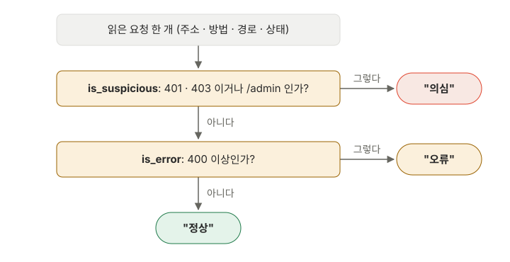

# 응용 1-1 · 로그 줄 가르기와 SIEM 고르기

## 목표: 줄 분류 규칙

> **여유가 되면 해 보세요.** 핵심 실습 1-1 · 1-2와 글쓰기를 먼저 마칩니다. 실습 1-1의 `log_parse.py` 가 있어야 하고, 하지 않아도 다음 Unit을 따라가는 데 문제가 없습니다.

> **오늘 들어온 일**
>
> A사 보안 팀장이 보낸 메시지입니다:
> 「얼마 전에 한 주소에서 로그인 실패가 몰렸는데 하루가 지나서야 알았습니다. 로그는 있었지만 수만 줄 속에서 눈에 띄지 않았습니다.
>
> 줄마다 정상인지, 오류인지, 먼저 살펴볼 줄인지 나누고, 살펴볼 줄만 따로 보여 주세요. 상태 코드와 경로만 보는 단순한 규칙으로 시작해도 됩니다. SIEM(심)이라는 도구를 사자는 이야기도 있어서, 다른 회사는 어떻게 쓰는지와 우리 규모에는 어떤 방식이 맞는지도 알고 싶습니다.」
> - **왜 중요한가**: <mark>하루 수만 줄을 사람이 다 볼 수는 없습니다.</mark> 줄을 정상 · 오류 · 의심으로 나누면 의심만 먼저 볼 수 있습니다. 이 일을 대규모로 해 주는 도구가 SIEM(심)입니다. 도구를 고르려면 규칙이 무엇을 놓치는지부터 알아야 해서, 이번 응용에서는 가장 단순한 규칙을 직접 만들어 한계를 확인합니다.

## 왜 줄을 세 갈래로 가르는가

1. 실습 1-1에서는 로그 한 줄을 읽어 값을 꺼냈습니다. 이제 **그 값으로 줄을 가릅니다.**
2. 가르는 기준을 **규칙(rule, 룰)** 이라고 합니다. 이번 응용의 규칙은 가장 단순한 것입니다.

   | 확인 순서 | 조건 | 분류 |
   |---|---|---|
   | 1 | 상태 코드가 401 · 403 이거나 경로에 `/admin` 이 있음 | **의심** |
   | 2 | 그 밖에 상태 코드가 400 이상 | **오류** |
   | 3 | 나머지 | **정상** |

3. <mark>이런 단순한 규칙은 놓치는 것도 많습니다.</mark> 어떤 것을 놓치는지 이번 Unit의 샘플 로그에서 직접 확인합니다.

## 이상 징후 다섯 유형

이 수업에서는 관제에서 찾는 이상 징후를 다섯 유형으로 나눕니다.

| 유형 | 로그에서 보이는 모양 | 이번 Unit 샘플 로그의 예 |
|---|---|---|
| 비정상 로그인 | 같은 주소에서 로그인 실패(401)가 연달아 나옴 | 203.0.113.50 의 `POST /login` 401 이 5번 |
| 트래픽 급증 | 짧은 시간에 요청이 몰림 | 샘플은 30줄이라 없음. Unit 3 실습 3-1이 다룹니다 |
| 비인가 접근 | 권한이 없는 주소를 요청해 403 이 나옴 | `/admin` · `/admin/users` 403 |
| SaaS(사스) 이상 사용 | 평소와 다른 서비스 사용(대량 내려받기, 낯선 위치) | 접속 로그 샘플에는 없음. Unit 3 응용 3-2가 다룹니다 |
| 악성 행위 징후 | 서버에 무엇이 있는지 없는 주소까지 차례로 확인하는 탐색 | 198.51.100.90 의 `/.env` · `/wp-login.php` · `/phpmyadmin` 404 |

- SaaS(사스)는 인터넷으로 빌려 쓰는 소프트웨어입니다(예: Google Docs).
- 한 줄만 보면 평범해 보여도 **여러 줄을 묶어 보면** 공격이 의심되는 일이 드러납니다.
  - 예를 들어 로그인 실패가 연달아 난 뒤의 성공 한 줄은 그 줄만 보면 평범합니다. <mark>이번 응용의 규칙은 줄을 하나씩만 보기 때문에 이런 것을 놓칩니다.</mark>

규칙이 틀리는 방향은 두 가지입니다.

| 말 | 뜻 |
|---|---|
| **미탐(false negative, 폴스 네거티브)** | 공격이 의심되는 일을 놓치는 것 |
| **오탐(false positive, 폴스 포지티브)** | 정상인데 의심으로 가르는 것 |

- <mark>오탐이 많으면 경고를 아무도 보지 않게 됩니다.</mark>
- 경고는 「살펴볼 곳」이지 **공격이 확정된 것이 아닙니다.**

## SIEM(심) · XDR(엑스디알) · SOAR(쏘아)는 무엇이 다른가

SIEM(심)이 무엇인지와 현업에서 쓰는 방식은 시작하기 레슨에서 읽었습니다. 이름이 비슷해서 헷갈리는 XDR(엑스디알), SOAR(쏘아)와 비교합니다.

| 이름 | 해결하려는 문제 | 하는 일 |
|---|---|---|
| SIEM(심) | 로그가 흩어져 조사하기 어렵다 | 모으고, 같은 형식으로 정리하고, 조회하고, 탐지해서 알린다 |
| XDR(엑스디알) | 보안 도구의 탐지가 따로 보인다 | 메일 · PC · 서버 등 여러 영역의 탐지를 연결해 사건으로 조사하고 대응한다 |
| SOAR(쏘아) | 대응할 때마다 같은 작업을 반복한다 | 사건 등록 · 알림 · 승인 · 조치 같은 절차를 자동화한다 |

- <mark>세 가지는 반드시 순서대로 거치는 단계가 아닙니다.</mark> Module 4는 SIEM(심)의 수집 · 정규화 · 탐지 · 알림을 만들고, Module 5에서 SOAR(쏘아)를 다룹니다.

## 이번 응용에서 만드는 규칙

<figure class="page-figure"></figure>

- 의심을 오류보다 **먼저** 확인합니다. <mark>401 은 400 이상이기도 해서, 순서가 바뀌면 로그인 실패가 모두 오류에 섞여 구분되지 않습니다.</mark>
- `SUSPICIOUS_STATUS = (401, 403)` 의 괄호 묶음은 **튜플(tuple, 튜플)** 입니다. 리스트처럼 값 여러 개를 담지만 <mark>만든 뒤에 바꿀 수 없어서, 바뀌지 않는 기준에 씁니다.</mark> 안에 들어 있는지 `in` 으로 묻는 것은 리스트와 같습니다.

**한 장 정리**

| 함수 | 받는 것 | 리턴하는 것 | 직접 쓰는 번호 |
|---|---|---|---|
| `is_suspicious` | 읽은 요청 딕셔너리 | 401 · 403 이거나 경로에 `/admin` 이 있으면 `True` | 1 ~ 3번 |
| `is_error` | 읽은 요청 딕셔너리 | 상태 코드가 400 이상이면 `True` | 4번 |
| `classify_line` | 읽은 요청 딕셔너리 | `"의심"` · `"오류"` · `"정상"` 중 하나 | 5 ~ 8번 |
| `label_entries` | 읽은 요청 리스트 | 분류(`group`)를 적은 복사본 리스트 | 미리 채움 |
| `count_groups` | 분류를 적은 리스트 | 분류별로 센 `{분류: 횟수}` 딕셔너리 | 미리 채움 |

- **직접 쓰는 곳은 세 함수**(번호 1 ~ 8)입니다. 판단이 필요한 함수마다 1 ~ 4줄만 쓰고, 나머지는 미리 채웠습니다.
  - `classify_line` 은 의심 → 오류 → 정상 순서로 가릅니다.

## 응용 1-1 · 로그 줄을 세 갈래로 가르기

**이런 상황이 있습니다**

- **지금은**: 요청 28개 중 어느 것부터 봐야 하는지 사람이 하나씩 판단해야 합니다.
- **그래서 만드는 것**: `log_classify.py` 입니다.
  - 요청마다 상태 코드와 경로로 정상 · 오류 · 의심 중 하나를 정합니다.
  - 분류별 개수를 세고, 의심과 오류 요청을 보여 줍니다.
- **실행하면**: 단계 1: 분류별 요청 수, 단계 2: 의심 요청, 단계 3: 오류 요청이 나옵니다.
- **현업에서는**: 관제 담당자도 단순한 규칙으로 먼저 나눈 뒤 의심 요청만 조사합니다. 규칙은 쓰면서 계속 고칩니다.

**할 일**

1. <mark>`log_classify.py` · `apply1-1_run.py` 두 파일</mark>을 만들고, `log_classify.py` 의 `is_suspicious` · `is_error` · `classify_line` 에서 **직접 쓰는 곳 세 군데**를 씁니다.
2. 실행해서 <mark>분류별 요청 수</mark>(단계 1), <mark>의심으로 분류한 요청</mark>(단계 2), <mark>오류로 분류한 요청</mark>(단계 3)을 읽습니다.

**`log_classify.py`**

```python
SUSPICIOUS_STATUS = (401, 403)                                         # 의심으로 보는 상태 코드(로그인 실패 · 접근 거부)


def is_suspicious(entry):                                              # 읽은 요청 딕셔너리를 받는 함수
    """상태 코드가 401 · 403 이거나 경로에 /admin 이 있으면 True, 아니면 False 를 리턴한다.
    먼저 살펴볼 만한 요청을 가려낼 때 쓴다.
    """
    # ← 아래를 직접 씁니다 (주석은 두고 각 주석 바로 아래 줄에 씁니다)
    # 1. entry["status"] 가 SUSPICIOUS_STATUS 안에 있는지(in)의 결과를 bad_status 에 담는다
    # 2. entry["path"] 안에 "/admin" 이 들어 있는지(in)의 결과를 admin_path 에 담는다
    # 3. bad_status 또는 admin_path 가 참인지(or)의 결과를 리턴한다


def is_error(entry):                                                   # 읽은 요청 딕셔너리를 받는 함수
    """상태 코드가 400 이상이면 True, 아니면 False 를 리턴한다.
    오류로 끝난 요청을 가려낼 때 쓴다.
    """
    # ← 아래를 직접 씁니다 (주석은 두고 각 주석 바로 아래 줄에 씁니다)
    # 4. entry["status"] 가 400 이상인지의 결과(True 또는 False)를 리턴한다


def classify_line(entry):                                              # 읽은 요청 딕셔너리를 받는 함수
    """요청을 「의심」 · 「오류」 · 「정상」 중 하나로 가른다.
    로그를 훑어 먼저 살펴볼 줄을 고를 때 쓰며, 의심을 먼저 확인한다.
    """
    # ← 아래를 직접 씁니다 (주석은 두고 각 주석 바로 아래 줄에 씁니다)
    # 5. is_suspicious(entry) 가 참이면 (if)
    # 6.   "의심" 을 리턴한다
    # 7. is_error(entry) 가 참이면 (if)
    # 8.   "오류" 를 리턴한다
    return "정상"                                                      # 어느 조건에도 안 맞으면 정상이다


def label_entries(entries):                                            # 읽은 요청 리스트를 받는 함수
    """요청마다 "group" 키(정상 · 오류 · 의심)를 적은 복사본 리스트를 리턴한다.
    읽은 로그에 분류 이름표를 붙일 때 쓴다.
    """
    labeled = []                                                       # 결과를 담을 빈 리스트
    for entry in entries:                                              # 요청을 하나씩 꺼낸다
        item = entry.copy()                                            # 원래 요청은 바꾸지 않고 복사한다
        item["group"] = classify_line(entry)                           # 분류를 복사본에 적는다
        labeled.append(item)                                           # 복사본을 결과 리스트에 추가한다
    return labeled                                                     # 분류를 적은 리스트를 리턴한다


def count_groups(labeled):                                             # 분류를 적은 요청 리스트를 받는 함수
    """분류별 요청 수를 {분류: 횟수} 딕셔너리로 센다.
    정상 · 오류 · 의심이 각각 몇 개인지 볼 때 쓴다.
    """
    group_request_counts = {"정상": 0, "오류": 0, "의심": 0}           # 세 분류를 0 으로 시작한다
    for item in labeled:                                               # 요청을 하나씩 꺼낸다
        group = item["group"]                                          # 그 요청의 분류
        group_request_counts[group] = group_request_counts[group] + 1  # 그 분류의 횟수를 1 늘린다
    return group_request_counts                                        # 분류별 횟수를 리턴한다
```

- <mark>들여쓰기는 미리 채운 줄에 맞춥니다.</mark> 번호 주석이 연달아 붙어 있어도 주석 사이마다 줄을 끼워 넣어 <mark>각 주석 바로 아래 줄에 그 번호의 코드를 하나씩 씁니다.</mark> `if` 아래의 `return` 처럼 안쪽 줄은 `if` 보다 한 단계 안쪽으로 씁니다.
  - 1 ~ 4번: 함수 안이라 앞에 공백 4개입니다.
  - 5 ~ 8번: `classify_line` 안이라 `if` 줄은 공백 4개이고, `if` 안쪽 `return`(6번 · 8번)은 8개입니다.
- 1 · 2번의 `in` 은 들어 있는지 묻습니다. <mark>둘 다 결과가 `True` 또는 `False` 입니다.</mark>

  | 번호 | 코드 | 묻는 것 |
  |---|---|---|
  | 1번 | `in SUSPICIOUS_STATUS` | 상태 코드가 그 튜플에 들어 있는지 |
  | 2번 | `"/admin" in entry["path"]` | 경로 문자열 안에 `/admin` 이 들어 있는지 |

- 채우기 전에 실행하면 <mark>오류는 나지 않고, 단계 1에서 모든 요청이 「정상」으로 나오고 단계 2 · 3이 비어 있습니다.</mark>

**`apply1-1_run.py`** — <mark>그대로 붙여 넣습니다.</mark> 학생이 쓰는 줄은 없습니다. 실습 1-1의 `parse_line` 으로 로그를 읽고, 방금 만든 함수로 가른 뒤 세 단계로 출력합니다.

```python
from log_parse import parse_line                                                # 실습 1-1에서 만든 로그 한 줄 읽기 함수를 불러온다
from log_classify import label_entries, count_groups                            # 방금 만든 분류 함수를 불러온다


def show_request(item):                                                         # 분류를 적은 요청 한 개를 받는 함수
    """분류를 적은 요청 한 개의 주소 · 방법 · 경로 · 상태 코드를 출력한다.
    의심 · 오류로 분류한 요청을 한 줄씩 보여 줄 때 쓴다.
    """
    ip_address = item["ip"]                                                     # 접속자 주소를 꺼낸다
    method = item["method"]                                                     # 요청 방법을 꺼낸다
    path = item["path"]                                                         # 요청 경로를 꺼낸다
    status = item["status"]                                                     # 상태 코드를 꺼낸다
    print(ip_address, method, path, status)                                     # 주소 · 방법 · 경로 · 상태 코드를 출력한다


entries = []                                                                    # 읽은 요청을 모을 리스트
with open("access_sample.log", encoding="utf-8") as log_file:                   # 샘플 로그 파일을 연다
    for line in log_file:                                                       # 파일에서 한 줄씩 꺼낸다
        entry = parse_line(line)                                                # 한 줄을 읽어 딕셔너리로 바꾼다
        if entry is not None:                                                   # 읽을 수 있는 줄이면
            entries.append(entry)                                               # 요청 리스트에 추가한다

labeled = label_entries(entries)                                                # 요청마다 분류를 적는다
group_request_counts = count_groups(labeled)                                    # 분류별 요청 수를 센다
total = len(labeled)                                                            # 전체 요청 수를 센다
normal_count = group_request_counts["정상"]                                     # 정상 요청 수를 꺼낸다
error_count = group_request_counts["오류"]                                      # 오류 요청 수를 꺼낸다
suspicious_count = group_request_counts["의심"]                                 # 의심 요청 수를 꺼낸다
print("--- 단계 1: 분류별 요청 수 - 전체", total, "개")                         # 단계 1 시작을 알리는 줄
print("정상", normal_count, "· 오류", error_count, "· 의심", suspicious_count)  # 분류별 요청 수를 출력한다
print("--- 단계 2: 의심으로 분류한 요청")                                       # 단계 2 시작을 알리는 줄
for item in labeled:                                                            # 분류를 적은 요청을 하나씩 꺼낸다
    if item["group"] == "의심":                                                 # 의심으로 분류한 요청이면
        show_request(item)                                                      # 주소 · 방법 · 경로 · 상태 코드를 출력한다
print("--- 단계 3: 오류로 분류한 요청")                                         # 단계 3 시작을 알리는 줄
for item in labeled:                                                            # 분류를 적은 요청을 하나씩 꺼낸다
    if item["group"] == "오류":                                                 # 오류로 분류한 요청이면
        show_request(item)                                                      # 주소 · 방법 · 경로 · 상태 코드를 출력한다
```

**순서**

1. **[VS Code]** `anomaly_detection` 폴더에 `log_classify.py` · `apply1-1_run.py` 두 파일을 만들어, 위의 같은 이름 코드 상자 내용을 각각 붙여 넣고 저장합니다. 같은 폴더에 있는 실습 1-1의 `log_parse.py` 를 불러오므로 <mark>없으면 실습 1-1 레슨에서 먼저 만듭니다</mark>(채우다 막히면 정답 레슨의 「실습 1-1 정답」을 봅니다).

<!-- checklist optional -->
- [ ] `anomaly_detection` 폴더에 `log_classify.py` 를 만들고 코드 상자 내용을 붙여 넣은 뒤 저장했다
- [ ] `anomaly_detection` 폴더에 `apply1-1_run.py` 를 만들고 코드 상자 내용을 붙여 넣은 뒤 저장했다
<!-- /checklist -->

2. **[VS Code]** `log_classify.py` 에서 직접 쓰는 곳 세 군데를 씁니다. 「이번 응용에서 만드는 규칙」 쪽의 그림을 보고 씁니다.

<!-- checklist optional -->
- [ ] `log_classify.py` 의 직접 쓰는 곳 세 군데를 채우고 저장했다
<!-- /checklist -->

3. **[터미널]** <mark>`pwd` 의 결과가 `anomaly_detection` 으로 끝나는지 확인하고</mark> 실행합니다.
   ```bash
   pwd
   python apply1-1_run.py
   ```
   - 명령 풀이: `pwd` 지금 있는 폴더의 위치 확인 · `python apply1-1_run.py` 파이썬으로 실행 파일 실행
4. 출력은 세 단계입니다. <mark>단계 1은 한 줄, 단계 2는 의심 요청 여덟 줄, 단계 3은 오류 요청 다섯 줄입니다.</mark>

<!-- checklist optional -->
- [ ] `python apply1-1_run.py` 를 실행해 단계 1 에 `정상 15 · 오류 5 · 의심 8` 이 나왔다
<!-- /checklist -->

5. **[보고서]** `report_u1.md` 의 `## 응용 1-1` 아래를 채웁니다. 응용 안의 [핵심 질문]은 이 응용을 했을 때 꼭 답할 질문이라는 뜻이고, 응용을 하지 않았다면 비워 둡니다.
   - (가) 실행한 출력 전체를 붙여 넣고, 분류별 요청 수와, 의심으로 분류한 요청 중 같은 주소에서 반복된 것을 적어 주세요.
   - (나) [핵심 질문] 상태 코드와 경로만으로 분류를 정하면 놓치는 것이 있습니다. 샘플 로그에서 놓친 예를 두 가지 찾아(정상이나 오류로 분류됐지만 살펴볼 만한 요청) 왜 놓쳤는지 적어 주세요.
   - (다) [핵심 질문] 시작하기 레슨 「현업에서 SIEM(심)을 쓰는 방식 여섯 가지」 표의 방식 중에서, 보안 전담 직원이 1명뿐이고 쓰는 서비스 대부분이 클라우드에 있는 작은 회사라면 어느 방식을 고를지 이유와 함께 적어 주세요. 고르지 않은 방식 하나가 왜 맞지 않는지도 적어 주세요.

## 응용 1-1 정리

| 하려는 일 | 코드 · 말 |
|---|---|
| 상태 코드가 401 이나 403 인지 | `bad_status = entry["status"] in SUSPICIOUS_STATUS` (`is_suspicious`) |
| 경로에 /admin 이 있는지 | `admin_path = "/admin" in entry["path"]` |
| 둘 중 하나라도 맞으면 의심 | `return bad_status or admin_path` |
| 오류인지 | `return entry["status"] >= 400` (`is_error`) |
| 가르는 순서 | `if is_suspicious(entry):` → `return "의심"` → `if is_error(entry):` → `return "오류"` → 나머지는 `"정상"` |
| SIEM(심)이 하는 일 | 수집 → 정규화 → 탐지 → 알림 · 조사 |

---
