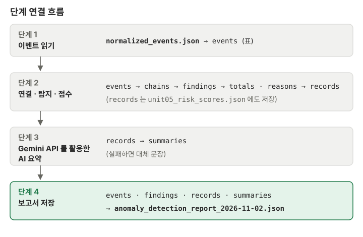

# 응용 5-3 · pipeline.py 로 탐지부터 보고서까지

## 목표: 한 번에 도는 pipeline.py

> **여유가 되면 해 보세요.** 핵심 실습 5-1 · 5-2와 글쓰기를 먼저 마칩니다. 이 응용은 Unit 3 · 4의 파일을 모두 불러 쓰므로, 「2.1 단계 연결 흐름과 앞에서 만든 파일의 자리」 페이지의 표에 있는 파일이 `anomaly_detection` 폴더에 있어야 합니다. 하지 않아도 이번 Unit을 마무리하고 Module 5를 따라가는 데 문제가 없습니다.

> **이번 실습에 들어온 일**
>
> A사 보안 팀장이 보낸 메시지입니다:
> 「Unit 3 · 4에서 만든 탐지를 확인하려면 지금은 파일을 하나씩 따로 실행해야 합니다. 순서를 하나 빠뜨리면 점수가 틀리게 나오는데, 틀린 줄도 모르고 보고하게 됩니다.
>
> 명령 한 번으로 읽기부터 점수 저장, 요약, 보고서 저장까지 끝나게 해 주세요. 그리고 AI 가 응답하지 않는 날에도 점수와 등급이 담긴 보고서는 나와야 합니다.」
> - **왜 중요한가**: <mark>단계를 따로 실행하면 순서를 빠뜨리거나 앞 단계의 결과를 잘못 넘길 수 있고, AI 호출 하나가 실패해서 보고서 전체가 만들어지지 않으면 담당자가 아침에 아무것도 볼 수 없습니다.</mark>

## 왜 단계 결과를 이어 붙이는가

1. 파이프라인은 <mark>앞 단계의 리턴값을 다음 단계에 전달해 이어 가는 구조</mark>입니다. 어느 함수에 무엇을 전달하는지가 이번 실습의 핵심입니다.
2. 이번 실습의 질문은 하나입니다. <mark>**각 단계의 결과를 다음 단계에 어떻게 넘기고, 한 단계가 실패해도 나머지 결과를 어떻게 남기는가?**</mark>

## 2.1 단계 연결 흐름과 앞에서 만든 파일의 자리

<figure class="page-figure"></figure>

앞에서 만든 파일 가운데 파이프라인에 들어가는 것과 아직 들어가지 않은 것은 다음과 같습니다.

| 만든 곳 | 파일 | 파이프라인에서 |
|---|---|---|
| Unit 3 「시작하기」 | `normalized_events.json` · `rbac.py` · `config/users.json` · `config/roles.json` | 단계 1 의 입력 |
| Unit 3 실습 3-2 | `access_detection.py` | 단계 1 · 2 |
| Unit 4 응용 4-1 및 Unit 3 응용 3-2·3-3 | `saas_detection.py` · `malicious_detection.py` · `correlation.py` | 단계 2 |
| Unit 4 실습 4-1 | `risk_scores.py` | 단계 2 |
| 이 Unit 실습 5-1 | `event_summary.py` · `llm_client.py` | 단계 3 |
| Unit 2 · 3 | `login_detection.py` · `traffic_detection.py` · `alerts.py` | **넣지 않음** |
| Unit 4 | `evaluation.py` · `tuning.py` · `final_check.py` | **넣지 않음** |

- **없는 파일이 있으면** 표의 「만든 곳」 레슨에서 만듭니다. 선택 응용의 탐지 파일은 각각 그 응용 레슨에서 만듭니다. 핵심 실습 3-2 · 4-1 · 5-1에서 만든 파일은 해당 레슨에 있는 완성 코드를 사용합니다. `llm_client.py` 는 이 Unit 시작하기 4번에 있습니다.
- 표에서 **넣지 않음** 으로 적은 파일은 이런 이유로 뺐습니다.

| 넣지 않은 것 | 만든 곳 | 넣지 않은 이유 |
|---|---|---|
| 로그인 · 트래픽 규칙 | Unit 2 실습 2-3, Unit 3 실습 3-1 · 응용 3-1 | 알림을 `alerts.json` 에 따로 모으는 방식이라 점수 기록과 모양이 다름 |
| 평가 · 튜닝 | Unit 4 실습 4-2, 응용 4-2 · 4-3 | 입력이 사람이 조사한 결과가 붙은 파일(`review_alerts.json`)이라 이벤트 표가 아님 |

- 이번 파이프라인은 점수 기록 쪽만 이어 붙였습니다. 알림이나 평가를 더하려면 입력과 출력의 모양을 맞추는 단계가 필요하고, 현업에서도 이 단계를 따로 만들어 이어 붙입니다.
- 보고서 파일 `anomaly_detection_report_2026-11-02.json` 에 들어가는 키는 다음과 같습니다. 파일 이름의 날짜 `2026-11-02` 는 샘플 이벤트의 날짜입니다.

| 키 | 값 |
|---|---|
| `date` | 샘플 이벤트의 날짜 |
| `event_count` | 읽은 이벤트 수 |
| `source_event_counts` | 로그 종류(`web` · `server` · `saas`)마다 이벤트 수 |
| `finding_count` | 탐지된 규칙 건수 |
| `records` | 대상별 점수 · 등급 · 이유 기록 |
| `summaries` | 대상별 Gemini API 를 활용한 AI 요약(실패하면 대체 문장) |

- 단계 3 이 실패해도 단계 4 가 이어지도록 <mark>요약 함수는 오류를 내지 않고 `FAIL_TEXT` 를 리턴</mark>합니다. 그래서 점수와 등급은 항상 보고서에 들어갑니다.

<h2>판다스 문법 상자 — 시리즈를 딕셔너리로 바꾸기 <code>시리즈.to_dict()</code></h2>

**<mark>`시리즈.to_dict()`</mark> 는 시리즈의 이름(인덱스)을 키로, 값을 값으로 하는 딕셔너리를 만듭니다**

보고서는 JSON 파일로 저장하는데, 판다스의 시리즈는 JSON 으로 바로 저장되지 않습니다. 센 결과(`value_counts()`)를 딕셔너리로 바꿔야 합니다. 과일 이름 다섯 개를 센 예로 익힙니다.

```python
import pandas as pd                                       # 판다스를 pd 라는 짧은 이름으로 불러온다

fruits = pd.Series(["사과", "사과", "배", "사과", "귤"])  # 과일 이름 다섯 개로 시리즈를 만든다
fruit_counts = fruits.value_counts()                      # 이름마다 몇 개인지 센다
print(fruit_counts)                                       # 센 결과를 출력한다
```

실행 결과:

```
사과    3
배     1
귤     1
Name: count, dtype: int64
```

위 코드에 이어서 실행하는 다음 코드입니다.

```python
fruit_count_dict = fruit_counts.to_dict()  # 시리즈를 딕셔너리로 바꾼다
print(fruit_count_dict)                    # 딕셔너리를 출력한다
```

실행 결과:

```
{'사과': 3, '배': 1, '귤': 1}
```

- **읽는 법**:
  - <mark style="background:#bde3ff">`사과` · `배` · `귤` 이 키이고 3 · 1 · 1 이 값</mark>인 딕셔너리가 됩니다.
  - 이 딕셔너리는 `json.dump` 로 저장할 수 있습니다.
- **이번 실습에서는**:
  - 과일 이름 대신 로그 종류(`web` · `server` · `saas`)마다 센 이벤트 수에 씁니다.
- **주의**:
  - <mark style="background:#ffc4d6">`json.dump` 에 시리즈를 그대로 전달하면 `TypeError` 오류가 납니다.</mark>
  - `.to_dict()` 는 괄호까지 써야 합니다.

<h2>한 장 정리</h2>

| 함수 | 받는 것 | 리턴하는 것 |
|---|---|---|
| `analyze_events` | 이벤트 표 | 탐지된 규칙 리스트 · 점수 기록 리스트 |
| `summarize_records` | 점수 기록 리스트 | 요약 리스트(미리 채움) |
| `count_failed` | 요약 리스트 | 실패한 요약 수(미리 채움) |
| `build_report` | 이벤트 표 · 탐지된 규칙 · 점수 기록 · 요약 | 보고서 딕셔너리 |
| `save_report` | 보고서 · 파일 경로 | 없음(파일에 저장, 미리 채움) |
| `run_pipeline` | 없음 | 없음(단계마다 결과를 출력, 미리 채움) |

**직접 쓰는 곳은 일곱 군데**(번호 1 ~ 7)이고, 함수 두 개 안에 나뉘어 있습니다.

| 함수 | 번호 | 직접 쓰는 것 |
|---|---|---|
| `analyze_events` | 1 ~ 4 | 함수 네 개를 차례로 호출하며 앞 함수의 리턴값을 다음 함수에 전달 |
| `build_report` | 5 ~ 7 | 로그 종류마다 이벤트 수 세기(`value_counts`) → 딕셔너리로 바꾸기(`to_dict`) → 보고서 딕셔너리로 모으기 |

## 응용 5-3 · pipeline.py 로 탐지부터 보고서까지

<h2>이런 상황이 있습니다</h2>

- **지금은**: <mark>탐지를 확인하려면 파일을 따로따로 실행해야 하고, AI 호출이 실패하면 결과를 한 번에 남길 방법이 없습니다</mark>.
- **그래서 만드는 것**: `pipeline.py` 입니다.
  - 이벤트를 읽고 연결 · 탐지 · 점수까지 한 함수에서 이어 실행합니다.
  - 점수 기록을 파일에 저장하고, 대상마다 Gemini API 를 활용한 AI 요약을 받습니다.
  - 모든 결과를 보고서 파일 하나로 저장합니다.
- **실행하면**: <mark>단계 1: 읽은 이벤트 수, 단계 2: 탐지된 규칙과 점수 기록 수, 단계 3: Gemini API 를 활용한 AI 요약, 단계 4: 보고서 저장, 단계 5: 확인할 순서가 나옵니다.</mark>
- **현업에서는**: 파이프라인을 정해진 시각에 자동으로 실행하고 보고서 파일을 담당자에게 보냅니다. 자동 실행은 AI 가 없는 날에도 멈추지 않아야 해서 실패한 단계를 대체 값으로 넘깁니다.

<h2>할 일</h2>

1. `pipeline.py` · `apply5-3_run.py` 두 파일을 만들고, `pipeline.py` 의 두 함수에서 직접 쓰는 곳을 씁니다.
2. 실행해서 <mark>읽은 이벤트 수</mark>(단계 1), <mark>탐지된 규칙과 점수 기록 수</mark>(단계 2), <mark>Gemini API 를 활용한 AI 요약</mark>(단계 3), <mark>보고서 저장</mark>(단계 4), <mark>확인할 순서</mark>(단계 5)를 읽고, 새로 생긴 `anomaly_detection_report_2026-11-02.json` 을 VS Code 에서 열어 봅니다.

`summarize_records` · `count_failed` · `save_report` · `run_pipeline` 은 읽기만 하는 미리 채운 함수입니다. 실습 5-1에서 쓴 방식과 같아서 직접 쓰는 곳이 없습니다.

<h3><code>pipeline.py</code></h3>

```python
import json                                                                                # 보고서를 JSON 파일로 저장하기 위해 json 을 불러온다
from access_detection import load_events, EVENTS_PATH                                      # Unit 3 실습 3-2 : 이벤트 파일을 읽는 함수를 불러온다
from correlation import find_chains_in_events                                              # Unit 4 응용 4-1 : 서로 다른 로그를 연결하는 함수를 불러온다
from risk_scores import collect_findings, score_findings, collect_reasons, make_records, save_records, RISK_PATH  # Unit 4 실습 4-1 : 탐지 · 점수 함수를 불러온다
from event_summary import pick_records_to_summarize, summarize_record, FAIL_TEXT           # 실습 5-1 : Gemini API 를 활용한 AI 요약 함수를 불러온다

REPORT_DATE = "2026-11-02"                                                                 # 샘플 이벤트의 날짜
REPORT_PATH = "anomaly_detection_report_" + REPORT_DATE + ".json"                          # 보고서를 저장할 파일 이름


def analyze_events(events):                                                                # 이벤트 표를 받는 함수
    """이벤트에서 연결된 사건을 찾고, 탐지된 규칙을 모아 대상별 점수 기록을 만든다.
    Unit 4 실습 4-1 에서 하나씩 실행한 단계를 한 함수에서 이어 쓸 때 쓴다.
    """
    # ← 아래를 직접 씁니다 (주석은 두고 각 주석 바로 아래 줄에 씁니다)
    # 1. events 를 find_chains_in_events 에 전달해 연결된 사건을 구해 chains 에 담는다
    # 2. events 와 chains 를 collect_findings 에 전달해 탐지된 규칙 리스트를 구해 findings 에 담는다
    # 3. findings 를 score_findings 에 전달해 대상별 점수를 구해 totals 에 담는다
    # 4. findings 를 collect_reasons 에 전달해 대상별 규칙 이름을 구해 reasons 에 담는다
    records = make_records(totals, reasons)                                                # 점수 · 등급 · 이유 기록을 만든다 — 미리 채운 줄
    return findings, records                                                               # 탐지된 규칙 리스트와 기록을 리턴한다


def summarize_records(records):                                                            # 점수 기록 리스트를 받는 함수
    """요약할 대상을 고르고 대상마다 Gemini API 를 활용한 AI 요약을 받아 리스트로 모은다.
    요약에 실패한 대상은 FAIL_TEXT 가 들어가서 나머지 결과가 그대로 이어지게 할 때 쓴다.
    """
    picked = pick_records_to_summarize(records)                                            # 요약할 대상을 고른다
    summaries = []                                                                         # 요약을 담을 빈 리스트
    for record in picked:                                                                  # 대상을 하나씩 꺼낸다
        summary = summarize_record(record)                                                 # AI 에게 요약을 시킨다
        item = {"entity": record["entity"], "grade": record["grade"], "summary": summary}  # 대상 · 등급 · 요약을 딕셔너리로 만든다
        summaries.append(item)                                                             # 요약 리스트에 추가한다
    return summaries                                                                       # 요약 리스트를 리턴한다


def count_failed(summaries):                                                               # 요약 리스트를 받는 함수
    """요약 가운데 AI 호출이 실패한 것이 몇 개인지 센다.
    실패가 있으면 담당자가 그 대상은 점수와 이유를 직접 읽어야 하므로 알릴 때 쓴다.
    """
    failed = 0                                                                             # 실패한 개수를 0 으로 시작한다
    for item in summaries:                                                                 # 요약을 하나씩 꺼낸다
        if item["summary"] == FAIL_TEXT:                                                   # 실패 문장이면
            failed = failed + 1                                                            # 실패 개수를 1 늘린다
    return failed                                                                          # 실패한 개수를 리턴한다


def build_report(events, findings, records, summaries):                                    # 이벤트 표 · 탐지된 규칙 · 점수 기록 · 요약을 받는 함수
    """분석 결과를 담당자가 읽는 보고서 딕셔너리 하나로 모은다.
    분석 결과를 파일 하나로 전달할 때 쓴다.
    """
    # ← 아래를 직접 씁니다 (주석은 두고 각 주석 바로 아래 줄에 씁니다)
    # 5. events 의 "source" 열을 꺼내 .value_counts() 를 붙여 로그 종류마다 이벤트 수를 구해 source_event_counts 에 담는다
    # 6. source_event_counts 에 .to_dict() 를 붙여 JSON 에 저장할 수 있는 딕셔너리로 바꿔 source_count_dict 에 담는다
    # 7. 키 "date" 에 REPORT_DATE, "event_count" 에 len(events), "source_event_counts" 에 source_count_dict, "finding_count" 에 len(findings), "records" 에 records, "summaries" 에 summaries 를 담은 딕셔너리를 report 에 담는다
    return report                                                                          # 보고서 딕셔너리를 리턴한다


def save_report(report, path):                                                             # 보고서 딕셔너리와 파일 경로를 받는 함수
    """보고서를 JSON 파일로 저장한다.
    담당자와 다른 프로그램이 같은 파일을 읽게 할 때 쓴다.
    """
    with open(path, "w", encoding="utf-8") as file:                                        # path 파일을 쓰기 모드로 연다
        json.dump(report, file, ensure_ascii=False, indent=2)                              # 한글은 그대로, 줄을 나눠 저장한다


def run_pipeline():                                                                        # 인자가 없는 함수
    """읽기 → 분석 → 점수 저장 → Gemini API 를 활용한 AI 요약 → 보고서 저장을 차례로 실행하고 단계마다 결과를 출력한다.
    탐지부터 보고서까지 한 번에 돌릴 때 쓴다.
    """
    events = load_events(EVENTS_PATH)                                                      # 이벤트 파일을 표로 읽는다
    print("--- 단계 1: 읽은 이벤트", len(events), "개")                                    # 단계 1 : 읽은 이벤트 수

    findings, records = analyze_events(events)                                             # 연결 · 탐지 · 점수를 한 번에 실행한다
    saved_count = save_records(records, RISK_PATH)                                         # 점수 기록을 파일에 저장한다
    print("--- 단계 2: 탐지된 규칙", len(findings), "건 → 점수 기록", saved_count, "건을", RISK_PATH, "에 저장")  # 단계 2 : 탐지 · 점수

    summaries = summarize_records(records)                                                 # 대상마다 Gemini API 를 활용한 AI 요약을 받는다
    failed_count = count_failed(summaries)                                                 # 요약에 실패한 것이 몇 개인지 센다
    print("--- 단계 3: Gemini API 를 활용한 AI 요약", len(summaries), "건 (실패", failed_count, "건)")  # 단계 3 : Gemini API 를 활용한 AI 요약
    for item in summaries:                                                                 # 요약을 하나씩 꺼낸다
        print(item["entity"], ":", item["summary"])                                        # 대상과 요약 문장을 출력한다

    report = build_report(events, findings, records, summaries)                            # 보고서 딕셔너리를 만든다
    save_report(report, REPORT_PATH)                                                       # 보고서를 파일에 저장한다
    print("--- 단계 4: 보고서를", REPORT_PATH, "에 저장")                                  # 단계 4 : 보고서 저장

    print("--- 단계 5: 확인할 순서")                                                       # 단계 5 : 담당자가 볼 순서
    for record in records:                                                                 # 점수 기록을 하나씩 꺼낸다
        print(record["grade"], record["entity"], record["score"])                          # 등급 · 대상 · 점수를 출력한다
```

- 들여쓰기는 **미리 채운 줄에 맞춥니다.** 1 ~ 7번은 모두 함수 안이라 앞에 공백 4개입니다.
- 각 번호 주석 바로 아래에 새 줄을 만들어 그 번호의 코드를 한 줄 씁니다. **주석은 지우지 않습니다.** 7번의 딕셔너리는 한 줄이 길어서 중괄호 안에서 줄을 나눠도 됩니다.
- 함수에 전달하는 순서는 주석에 적힌 순서입니다. <mark>2번은 `events` 다음에 `chains` 입니다.</mark>
- 채우기 전에 실행하면 `NameError: name 'totals' is not defined` 오류가 납니다. `totals` 를 만드는 3번을 아직 안 썼기 때문입니다.

<h3><code>apply5-3_run.py</code></h3>

그대로 붙여 넣습니다. 직접 쓰는 줄은 없습니다.

```python
from pipeline import run_pipeline  # 방금 만든 파이프라인 함수를 불러온다

run_pipeline()                     # 읽기부터 보고서 저장까지 한 번에 실행한다
```

<h2>순서</h2>

0. **[터미널]** 앞 Unit의 파일이 모두 있는지 먼저 확인합니다. <mark>두 줄 모두 아무것도 나오지 않으면</mark> 됩니다. `ModuleNotFoundError` 나 `ImportError` 가 나오면 그 이름의 파일이 없거나 덜 만든 것이니 2.1 의 표에 적힌 레슨에서 만든 뒤 다시 칩니다. 단, <mark>`No module named 'pandas'` 이면 파일 문제가 아니라 판다스가 없는 것</mark>입니다. 가상환경을 쓰는 사람은 `network-study-notes` 폴더에서 `source .venv/Scripts/activate` 로 켜고, 쓰지 않는 사람은 `python -m pip install pandas` 로 설치한 뒤 다시 칩니다.
   ```bash
   python - <<'PY'
   from access_detection import load_events, EVENTS_PATH
   from saas_detection import pick_saas
   from malicious_detection import pick_web_failures
   from correlation import find_chains_in_events
   from risk_scores import collect_findings, save_records
   from event_summary import summarize_record

   print("pipeline imports ready")
   PY
   ```

<!-- checklist optional -->
- [ ] 0번 확인 명령 두 줄이 오류 없이 끝났다(없던 앞 Unit 파일은 만들었다)
<!-- /checklist -->

1. **[VS Code]** `anomaly_detection` 폴더 바로 아래에 `pipeline.py` · `apply5-3_run.py` 두 파일을 만들어, 각 파일에 위의 같은 이름 코드 상자(**`pipeline.py`** · **`apply5-3_run.py`**)를 붙여 넣습니다. `anomaly_detection` 폴더를 오른쪽 클릭 › **New File** 로 만듭니다.
2. **[VS Code]** `pipeline.py` 에서 <mark>직접 쓰는 곳 일곱 군데를 씁니다</mark>. 위 판다스 문법 상자와 2.1 의 그림을 참고해 씁니다. 막히면 아래 「응용 5-3 정리」를 봅니다.

<!-- checklist optional -->
- [ ] `anomaly_detection` 폴더에 `pipeline.py` 를 만들어 코드 상자 내용을 붙여 넣고 1 ~ 7번을 채워 저장했다
- [ ] `anomaly_detection` 폴더에 `apply5-3_run.py` 를 만들어 코드 상자 내용을 붙여 넣고 저장했다
<!-- /checklist -->

3. **[터미널]** <mark>`pwd` 의 결과가 `anomaly_detection` 으로 끝나는지</mark> 확인하고 실행합니다. Gemini API 를 3번 호출합니다. 키가 없어도 끝까지 실행됩니다.
   ```bash
   pwd
   python apply5-3_run.py
   ```
   - 명령 풀이: `pwd` 지금 있는 폴더의 위치 확인 · `python apply5-3_run.py` 파이썬으로 실행 파일 실행
4. 출력은 **다섯 단계**입니다. 제목 줄(`--- 단계 …`)은 줄 수에 넣지 않습니다.

   | 단계 | 제목 줄 아래에 나오는 것 | 줄 수 |
   |---|---|---|
   | 1 · 2 · 4 | 없음(숫자나 파일 이름이 제목 줄에 함께 나옴) | 0 |
   | 3 | 대상마다 요약 1줄 | 3 |
   | 5 | 대상마다 등급 · 대상 · 점수 1줄 | 5 |

   <mark>AI 호출이 실패하면 `[LLM 호출 실패] …` 줄이 단계 3 제목 줄 위에 나오고, 요약은 대체 문장이 됩니다.</mark> 키가 없으면 `[LLM 호출 실패] API 키 없음` 이 세 줄 나오고 단계 3 제목 줄이 `(실패 3 건)` 으로 끝납니다. 이때 출력은 응용 5-3 정답 펼침의 「키가 없을 때」와 같습니다.
5. **[VS Code]** 새로 생긴 `anomaly_detection_report_2026-11-02.json` 을 열어 `event_count` · `records` · `summaries` 를 확인합니다.

<!-- checklist optional -->
- [ ] `python apply5-3_run.py` 를 실행해 다섯 단계가 나오고 `anomaly_detection_report_2026-11-02.json` 이 생겼다
<!-- /checklist -->

## 응용 5-3 정리

| 하려는 일 | 코드 · 말 |
|---|---|
| 앞 결과를 다음 함수에 전달 | `findings = collect_findings(events)` |
| 점수 합계 | `totals = score_findings(findings)` |
| 로그 종류마다 개수 | `source_event_counts = events["source"].value_counts()` |
| 시리즈를 딕셔너리로 | `source_count_dict = source_event_counts.to_dict()` |
| 보고서 딕셔너리 | `report = {"date": REPORT_DATE, … "summaries": summaries}` |

---
<!-- answer: 07|응용 5-3 정답 -->
