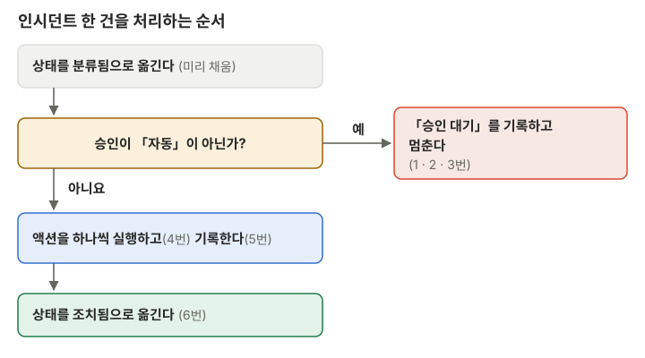
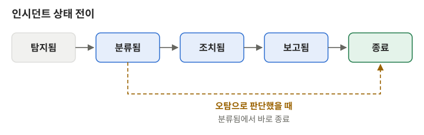

# 실습 1-2 · 알림 5건 일괄 처리와 감사 기록

## 이번 의뢰: 알림 5건 한 번에 처리

> **오늘 들어온 일**
>
> A사 보안 팀장이 보낸 메시지입니다:
> 「실습 1-1처럼 파일을 직접 열어 고치면 알림 두 건만 처리해도 여러 곳을 고쳐야 하고, 하나라도 빠뜨리면 아무도 모릅니다. 알림 5건을 한 번 실행으로 처리해 주세요.
>
> 단, 담당자가 허락하기 전에 실행하면 안 되는 대응이 있습니다. 예를 들어 IP `198.51.100.90` 을 차단하면 그 IP 를 함께 쓰는 정상 사용자도 접속하지 못할 수 있습니다. 허락이 필요한 알림은 실행하지 않고 멈춰 주세요. 그리고 나중에 「누가 무엇을 언제 했는지」 물으면 답할 수 있게, 한 일과 하지 않은 일을 모두 기록해 주세요.」
> - **왜 중요한가**: <mark>자동으로 실행하는 만큼 잘못 실행했을 때의 피해도 큽니다. 그래서 허락이 필요한 건은 멈추게 하고, 한 일은 모두 기록으로 남겨야 합니다.</mark> 기록이 없으면 「안 한 일」도 증명할 수 없습니다.

## 2.1 이번에 쓰는 파일과 프로그램이 처리하는 순서

실습 1-1에서는 사람이 `system_state.json` 을 열어 값을 직접 고쳤습니다. 실습 1-2에서는 <mark>같은 일을 프로그램이 합니다.</mark> `incident.py` 는 완성본을 그대로 붙여 넣고, `playbook_runner.py` 의 핵심 6곳만 직접 씁니다.

**① 오늘 쓰는 파일 네 개**

| 파일 | 들어 있는 것 | 오늘 |
|---|---|---|
| `incident.py` | 상태 바꾸기 · 맞는 플레이북 찾기 · 액션 실행하기 · 감사 기록 만들기, 이 네 가지를 하는 함수 | 완성본을 붙여 넣는다 |
| `playbook_runner.py` | 인시던트 한 건에 플레이북을 실행하는 함수 `run_playbook` 과, 인시던트 5건을 하나씩 처리하는 함수 `process_incidents` | **`run_playbook` 의 핵심 6곳을 직접 쓴다** |
| `exercise1-2_run.py` | 파일을 읽어 `process_incidents` 를 호출하고, 결과를 출력하고 저장하는 시작 파일 | 그대로 붙여 넣고 터미널에서 실행한다 |
| `action_log.json` | 프로그램이 실행한 일을 한 건씩 적은 감사 기록 파일 | 실행하면 자동으로 생긴다 |

**② 인시던트 한 건을 처리하는 순서** — `run_playbook` 이 한 번 실행되면 아래 순서로 한 건을 처리합니다. 직접 쓰는 6곳이 이 순서입니다.

<figure class="page-figure"></figure>

- 승인이 `자동` 이 아니면 액션을 하나도 실행하지 않습니다. 사람이 허락해야 하는 일이기 때문입니다.
- 이때 「승인 대기」라고 적은 기록 한 건만 남기고 멈춥니다. 실습 1-1에서 PB-003 의 승인 값을 어떻게 정했는지에 따라 이 부분의 결과가 달라집니다.

**③ 알아 둘 말 세 가지**

**연습용 시스템** — 실제 서버 대신 프로그램 안의 딕셔너리 `state` 로 서버의 상태를 흉내 낸 것입니다.

- `state` 에는 키 네 개(`locked_users` · `blocked_ips` · `tickets` · `notifications`)가 있고, 실습 1-1의 `system_state.json` 과 같습니다.
- 액션을 실행하면 `state` 에 값이 들어갑니다. 예를 들어 `계정 잠금` 을 실행하면 `locked_users` 에 `"dami"` 가 추가됩니다.
- `run_action` 은 대상과 맞지 않는 액션(IP 에 계정 잠금, 사용자에게 IP 차단)을 <mark>실행하지 않고, 「건너뜀」과 그 이유를 결과로 리턴합니다.</mark> 잘못 고른 액션이 연습용 시스템에 반영되지 않게 막는 확인입니다.

**상태** — 인시던트가 지금 처리의 어느 단계에 있는지를 나타내는 글자입니다(status, 스테이터스). 상태가 바뀌는 것을 **상태 전이**(state transition, 스테이트 트랜지션)라고 합니다.

<figure class="page-figure"></figure>

- 그림에 화살표가 없는 이동은 거절합니다. 예를 들어 `탐지됨` 에서 `조치됨` 으로 바로 가는 것은 거절합니다. 분류하지 않은 인시던트에 조치하는 것을 막기 위해서입니다.
- 오늘 `playbook_runner.py` 는 실행을 시작할 때 `분류됨` 으로, 모든 액션이 끝나면 `조치됨` 으로 옮깁니다. 승인 대기로 멈춘 건은 `분류됨` 에 남습니다.

**감사 기록**(audit log, 오딧 로그) — 프로그램이 한 일을 한 건씩 적은 기록입니다. 액션을 실행할 때마다, 그리고 승인 대기로 멈출 때도 한 건씩 남깁니다.

| 키 | 뜻 | 예 |
|---|---|---|
| `time` | 기록한 시각 | `"14:52:07"` |
| `incident` | 인시던트 번호 | `"INC-001"` |
| `playbook` | 실행한 플레이북 번호 | `"PB-001"` |
| `action` | 한 액션 (승인 대기로 멈추면 `"전체"`) | `"계정 잠금"` |
| `result` | 결과 문장 | `"계정 dami 잠금 완료"` |

- 현업에서는 이 기록으로 「그 계정을 누가 언제 왜 잠갔는지」를 설명합니다. <mark>실행하지 않은 건(승인 대기)도 남겨야</mark> 「왜 아직 조치하지 않았는지」를 설명할 수 있습니다.

**④ 맞는 플레이북 찾기** — `incident.py` 의 `match_playbooks` 가 아래 두 가지가 <mark>모두 맞는</mark> 플레이북을 찾습니다. 완성본으로 제공하므로 직접 쓰지 않습니다.

| 확인 | 맞는 때 |
|---|---|
| 트리거 | 플레이북의 `trigger_rule` 이 인시던트의 `reasons` 리스트 안에 있다 |
| 조건 | 인시던트의 등급이 플레이북의 `min_grade` 이상이다 (`low` 1 · `mid` 2 · `high` 3 으로 바꿔 비교) |

- 한 인시던트에 규칙이 여러 개이면 그중 하나만 트리거와 맞아도 됩니다. 예를 들어 INC-002 는 `평소와 다른 IP` 에 맞는 플레이북은 없지만 `대량 다운로드` 로 PB-002 와 맞습니다.

**⑤ 함수 한 장 정리**

| 함수 | 받는 것 | 리턴하는 것 |
|---|---|---|
| `change_status` | 인시던트 · 바꿀 상태 | 바꿨으면 `True`, 거절했으면 `False` (제공) |
| `match_playbooks` | 인시던트 · 플레이북 리스트 | 맞는 플레이북 리스트 (제공) |
| `run_action` | 액션 · 인시던트 · 연습용 시스템 | 결과 문장 (제공) |
| `make_log_entry` | 인시던트 · 플레이북 · 액션 · 결과 | 감사 기록 한 건 (제공) |
| `run_playbook` | 인시던트 · 플레이북 · 연습용 시스템 · 기록 리스트 | 실행했으면 `True`, 승인 대기면 `False` (**직접 쓴다**) |
| `process_incidents` | 인시던트 리스트 · 플레이북 리스트 · 연습용 시스템 · 기록 리스트 | 승인 대기 건의 리스트 (미리 채움) |

- **직접 쓰는 곳은 여섯 군데**(번호 1 ~ 6)이고, 함수 한 개(`run_playbook`) 안에 있습니다.


## 실습 1-2 · 실행기로 알림 5건 처리하기

**이런 상황이 있습니다**

- **지금은**: <mark>알림 5건이 모두 `탐지됨` 상태이고, 실습 1-1처럼 수동 처리하면 번거롭습니다. 또 승인이 필요한 건을 구별하기 어렵습니다</mark>.
- **그래서 만드는 것**: `playbook_runner.py` 의 `run_playbook` 입니다.
  - 승인이 필요한 플레이북은 실행하지 않고 승인 대기로 기록합니다.
  - 자동으로 해도 되는 플레이북은 액션을 차례로 실행하고 한 건씩 기록합니다.
- **실행하면**: <mark>단계 1: 불러온 인시던트와 플레이북 수, 단계 2: 실행 전 연습용 시스템 상태, 단계 3: 인시던트마다 실행 결과, 단계 4: 실행 후 상태, 단계 5: 승인 대기 건, 단계 6: 감사 기록이 나옵니다.</mark>

**할 일**

1. `incident.py` · `playbook_runner.py` · `exercise1-2_run.py` 세 파일을 만듭니다. `incident.py` 와 실행 파일은 그대로 붙여 넣고, `playbook_runner.py` 의 `run_playbook` 에서 직접 쓰는 곳을 씁니다.
2. 실행해서 <mark>인시던트마다 실행 결과</mark>(단계 3), <mark>실행 전후 상태</mark>(단계 2 · 4), <mark>승인 대기</mark>(단계 5), <mark>감사 기록</mark>(단계 6)를 읽습니다.

**`incident.py`** — 그대로 붙여 넣습니다. 학생이 쓰는 줄은 없습니다.

- **무엇인가**: 플레이북을 실행할 때 쓰는 **도구 모음**입니다. 상태 바꾸기, 맞는 플레이북 찾기, 액션 하나 실행하기, 기록 한 건 만들기 함수가 들어 있습니다.
- **어디에 쓰나**: `playbook_runner.py` 와 실행 파일이 이 파일의 함수를 불러다 씁니다. 오늘은 읽기만 하고 고치지 않습니다.

```python
import json                                                                       # JSON 파일을 읽고 쓰기 위해 json 을 불러온다
from datetime import datetime                                                     # 감사 기록에 시각을 적기 위해 datetime 을 불러온다

INCIDENTS_PATH = "incident_samples.json"                                          # 읽을 인시던트 파일 이름
REGISTRY_PATH = "config/playbook_registry.json"                                   # 읽을 플레이북 등록 파일 이름
STATE_PATH = "system_state.json"                                                  # 실행 결과 상태를 저장할 파일 이름
LOG_PATH = "action_log.json"                                                      # 감사 기록을 저장할 파일 이름
GRADE_ORDER = {"low": 1, "mid": 2, "high": 3}                                     # 등급을 크기를 비교할 수 있는 숫자로 바꾸는 딕셔너리
TRANSITIONS = {                                                                   # 상태마다 다음에 갈 수 있는 상태의 리스트
    "탐지됨": ["분류됨"],
    "분류됨": ["조치됨", "종료"],
    "조치됨": ["보고됨"],
    "보고됨": ["종료"],
    "종료": [],
}


def load_json(path):                                                              # 파일 경로를 받는 함수
    """JSON 파일을 읽어 리스트나 딕셔너리로 리턴한다.
    인시던트와 플레이북 등록 파일을 읽을 때 쓴다.
    """
    with open(path, encoding="utf-8") as file:                                    # 파일을 읽기 모드로 연다
        data = json.load(file)                                                    # JSON 글자를 파이썬 값으로 바꾼다
    return data                                                                   # 읽은 값을 리턴한다


def save_json(data, path):                                                        # 저장할 값과 파일 경로를 받는 함수
    """값을 JSON 파일로 저장한다.
    실행 결과 상태와 감사 기록을 남길 때 쓴다.
    """
    with open(path, "w", encoding="utf-8") as file:                               # 파일을 쓰기 모드로 연다
        json.dump(data, file, ensure_ascii=False, indent=2)                       # 한글은 그대로, 줄을 나눠 저장한다


def change_status(incident, new_status):                                          # 인시던트와 바꿀 상태를 받는 함수
    """허용된 이동이면 상태를 바꾸고 True, 아니면 바꾸지 않고 False 를 리턴한다.
    분류하지 않은 인시던트에 바로 조치하는 실수를 막을 때 쓴다.
    """
    current_status = incident["status"]                                           # 지금 상태
    allowed_statuses = TRANSITIONS[current_status]                                # 지금 상태에서 갈 수 있는 상태 리스트
    if new_status not in allowed_statuses:                                        # 갈 수 있는 상태 리스트에 없는 이동이면
        return False                                                              # 바꾸지 않고 False 를 리턴한다
    incident["status"] = new_status                                               # 허용된 이동이므로 상태를 바꾼다
    return True                                                                   # 상태를 바꿨으니 True 를 리턴한다


def is_grade_enough(incident_grade, min_grade):                                   # 인시던트 등급과 플레이북의 최소 등급을 받는 함수
    """인시던트 등급이 최소 등급 이상이면 True, 아니면 False 를 리턴한다.
    등급이 낮은 인시던트에 무거운 대응이 실행되지 않게 할 때 쓴다.
    """
    return GRADE_ORDER[incident_grade] >= GRADE_ORDER[min_grade]                  # 등급을 숫자로 바꿔 비교한 결과를 리턴한다


def match_playbooks(incident, registry):                                          # 인시던트와 플레이북 리스트를 받는 함수
    """트리거 규칙과 조건 등급이 모두 맞는 플레이북을 리스트로 리턴한다.
    알림이 올 때 어떤 대응 절차를 쓸지 찾을 때 쓴다.
    """
    matched = []                                                                  # 맞는 플레이북을 담을 빈 리스트
    for playbook in registry:                                                     # 플레이북을 하나씩 꺼낸다
        has_rule = playbook["trigger_rule"] in incident["reasons"]                # 트리거 규칙이 탐지된 규칙 리스트 안에 있는지 구한다
        grade_ok = is_grade_enough(incident["grade"], playbook["min_grade"])      # 인시던트 등급이 최소 등급 이상인지 구한다
        if has_rule and grade_ok:                                                 # 트리거와 조건이 모두 맞으면
            matched.append(playbook)                                              # 맞는 플레이북을 리스트에 추가한다
    return matched                                                                # 맞는 플레이북 리스트를 리턴한다


def run_action(action, incident, state):                                          # 액션 · 인시던트 · 시스템 상태를 받는 함수
    """액션 하나를 연습용 시스템(state)에서 실행하고 결과 문장을 리턴한다.
    대상 종류와 맞지 않는 액션은 실행하지 않고 건너뛴 이유를 리턴한다.
    """
    entity = incident["entity"]                                                   # 대응할 대상(사용자 이름 또는 IP)
    is_ip = "." in entity                                                         # 점이 있으면 IP 로 본다
    if action == "계정 잠금":                                                     # 계정 잠금이면
        if is_ip:                                                                 # 대상이 IP 이면
            return "건너뜀: 대상이 IP 라서 계정 잠금을 할 수 없습니다"            # 실행하지 않고 이유를 리턴한다
        state["locked_users"].append(entity)                                      # 잠긴 계정 리스트에 추가한다
        return "계정 " + entity + " 잠금 완료"                                    # 결과 문장을 리턴한다
    if action == "IP 차단":                                                       # IP 차단이면
        if not is_ip:                                                             # 대상이 사용자 계정이면
            return "건너뜀: 대상이 사용자라서 IP 차단을 할 수 없습니다"           # 실행하지 않고 이유를 리턴한다
        state["blocked_ips"].append(entity)                                       # 차단한 IP 리스트에 추가한다
        return "IP " + entity + " 차단 완료"                                      # 결과 문장을 리턴한다
    if action == "티켓 생성":                                                     # 티켓 생성이면
        ticket_id = "TCK-" + str(len(state["tickets"]) + 1)                       # 지금까지 만든 티켓 수에 1 을 더해 번호를 만든다
        ticket = {"id": ticket_id, "incident": incident["id"], "target": entity}  # 티켓 한 건을 딕셔너리로 만든다
        state["tickets"].append(ticket)                                           # 티켓 리스트에 추가한다
        return "티켓 " + ticket_id + " 생성"                                      # 결과 문장을 리턴한다
    if action == "담당자 알림":                                                   # 담당자 알림이면
        message = "인시던트 " + incident["id"] + " 확인 요청"                     # 알림 문장을 만든다
        state["notifications"].append(message)                                    # 알림 리스트에 추가한다
        return "담당자 알림 전송"                                                 # 결과 문장을 리턴한다
    return "알 수 없는 액션: " + action                                           # 어느 액션도 아니면 이유를 리턴한다


def make_log_entry(incident, playbook, action, result):                           # 인시던트 · 플레이북 · 액션 · 결과를 받는 함수
    """감사 기록 한 건을 딕셔너리로 만든다.
    어떤 인시던트에 어떤 플레이북이 무엇을 했는지 나중에 증명할 때 쓴다.
    """
    now_text = datetime.now().strftime("%H:%M:%S")                                # 지금 시각을 시:분:초 글자로 만든다
    entry = {"time": now_text, "incident": incident["id"], "playbook": playbook["id"], "action": action, "result": result}  # 기록 한 건
    return entry                                                                  # 기록을 리턴한다
```

**`playbook_runner.py`**

- **무엇인가**: 플레이북 하나를 실행하는 **프로그램의 핵심**입니다. 승인을 확인하고, 액션을 차례로 실행하고, 기록을 남깁니다. 여기서 직접 6곳을 씁니다.
- **어디에 쓰나**: 실행 파일이 인시던트 5건을 이 파일의 함수에 넘겨 처리합니다.

```python
from incident import change_status, match_playbooks, run_action, make_log_entry  # 제공받은 함수를 불러온다


def run_playbook(incident, playbook, state, action_log):                         # 인시던트 · 플레이북 · 시스템 상태 · 감사 기록 리스트를 받는 함수
    """플레이북의 액션을 차례로 실행하고 감사 기록을 남긴다. 승인이 필요하면 실행하지 않고 승인 대기로 기록한다.
    실행했으면 True, 승인 대기로 멈췄으면 False 를 리턴한다.
    """
    change_status(incident, "분류됨")                                            # 대응을 시작하기 전에 분류됨 상태로 옮긴다 — 미리 채운 줄
    # ← 아래를 직접 씁니다 (주석은 두고 각 주석 바로 아래 줄에 씁니다)
    # 1. playbook 의 "approval" 값이 "자동" 이 아니면 (if, !=)
    # 2.   make_log_entry(incident, playbook, "전체", "승인 대기") 의 결과를 action_log 에 추가한다 (append)
    # 3.   False 를 리턴한다 (실행하지 않았다)
    for action in playbook["actions"]:                                           # 액션을 하나씩 꺼낸다
        # 4. run_action(action, incident, state) 의 결과를 result 에 담는다
        # 5. make_log_entry(incident, playbook, action, result) 의 결과를 action_log 에 추가한다 (append)
    # 6. change_status(incident, "조치됨") 를 호출한다 (실행이 끝났으니 조치됨으로 옮긴다)
    return True                                                                  # 모두 실행했으니 True 를 리턴한다


def process_incidents(incidents, registry, state, action_log):                   # 인시던트 리스트 · 플레이북 리스트 · 시스템 상태 · 감사 기록을 받는 함수
    """인시던트마다 맞는 플레이북을 찾아 실행하고 결과를 한 줄씩 출력한다.
    승인 대기로 멈춘 건의 리스트를 리턴한다.
    """
    pending = []                                                                 # 승인 대기로 멈춘 건을 담을 빈 리스트
    for incident in incidents:                                                   # 인시던트를 하나씩 꺼낸다
        playbooks = match_playbooks(incident, registry)                          # 맞는 플레이북을 찾는다
        result_text = "맞는 플레이북 없음"                                       # 처음에는 없다고 적어 둔다
        for playbook in playbooks:                                               # 맞는 플레이북을 하나씩 꺼낸다
            done = run_playbook(incident, playbook, state, action_log)           # 플레이북을 실행한다
            if done:                                                             # 실행했으면
                result_text = playbook["id"] + " 실행 완료"                      # 실행 완료라고 적는다
            else:                                                                # 승인 대기로 멈췄으면
                result_text = playbook["id"] + " 승인 대기"                      # 승인 대기라고 적는다
                waiting = {"incident": incident["id"], "entity": incident["entity"], "playbook": playbook["id"], "approval": playbook["approval"]}  # 대기 건 한 건
                pending.append(waiting)                                          # 승인 대기 리스트에 추가한다
        status_text = "(상태: " + incident["status"] + ")"                       # 지금 상태를 괄호 글자로 만든다
        print(incident["id"], incident["entity"], incident["grade"], "->", result_text, status_text)  # 번호 · 대상 · 등급 · 결과 · 상태를 출력한다
    return pending                                                               # 승인 대기 리스트를 리턴한다
```

- 들여쓰기는 **미리 채운 줄에 맞춥니다.** 1 · 6번은 함수 안이라 앞에 공백 4개입니다. 2 · 3번은 `if` 안이라 공백 8개입니다. 4 · 5번은 `for` 안이라 공백 8개입니다.
- 각 번호 주석 바로 아래에 새 줄을 만들어 그 번호의 코드를 한 줄 씁니다. **주석은 지우지 않습니다.**
- 3번의 `return False` 는 「더 실행하지 않고 여기서 끝낸다」는 뜻입니다. 2번에서 기록을 남긴 뒤 바로 끝내야 `for` 문의 액션이 실행되지 않습니다.
- 채우기 전에 실행하면 `IndentationError: expected an indented block` 으로 시작하는 오류가 납니다(문구는 파이썬 버전마다 조금 다릅니다). `for` 안쪽의 4 · 5번이 비어 있기 때문입니다.

**`exercise1-2_run.py`** — 그대로 붙여 넣습니다. 학생이 쓰는 줄은 없습니다. `len(리스트)` 는 리스트의 개수입니다.

- **무엇인가**: 알림 5건 처리를 한 번에 실행하는 **시작 파일**입니다. 파일을 읽고, 실행기에 넘겨 처리하고, 결과를 출력하고 저장합니다.
- **어디에 쓰나**: 터미널에서 `python exercise1-2_run.py` 로 실행합니다. 실행하면 `system_state.json` 과 `action_log.json` 이 새로 저장됩니다.

```python
from incident import load_json, save_json, INCIDENTS_PATH, REGISTRY_PATH, STATE_PATH, LOG_PATH  # 제공받은 함수를 불러온다
from playbook_runner import process_incidents                                           # 방금 만든 함수를 불러온다

incidents = load_json(INCIDENTS_PATH)                                                   # 인시던트 파일을 리스트로 읽는다
registry = load_json(REGISTRY_PATH)                                                     # 플레이북 등록 파일을 리스트로 읽는다
incident_count = len(incidents)                                                         # 인시던트가 몇 건인지 센다
playbook_count = len(registry)                                                          # 등록된 플레이북이 몇 개인지 센다
print("--- 단계 1: 불러온 인시던트", incident_count, "건 · 등록된 플레이북", playbook_count, "개")  # 단계 1 시작을 알리는 줄

state = {"locked_users": [], "blocked_ips": [], "tickets": [], "notifications": []}     # 연습용 시스템의 처음 상태 : 아무것도 없다
action_log = []                                                                         # 감사 기록을 담을 빈 리스트
print("--- 단계 2: 실행 전 연습용 시스템 상태")                                         # 단계 2 시작을 알리는 줄
print("잠긴 계정:", state["locked_users"])                                              # 잠긴 계정을 출력한다
print("차단한 IP:", state["blocked_ips"])                                               # 차단한 IP 를 출력한다
print("티켓:", len(state["tickets"]), "건 · 담당자 알림:", len(state["notifications"]), "건")  # 티켓과 알림 수를 출력한다

print("--- 단계 3: 인시던트마다 플레이북 실행")                                         # 단계 3 시작을 알리는 줄
pending = process_incidents(incidents, registry, state, action_log)                     # 플레이북을 실행한다

print("--- 단계 4: 실행 후 연습용 시스템 상태")                                         # 단계 4 시작을 알리는 줄
print("잠긴 계정:", state["locked_users"])                                              # 잠긴 계정을 출력한다
print("차단한 IP:", state["blocked_ips"])                                               # 차단한 IP 를 출력한다
print("티켓:", len(state["tickets"]), "건 · 담당자 알림:", len(state["notifications"]), "건")  # 티켓과 알림 수를 출력한다

pending_count = len(pending)                                                            # 승인 대기가 몇 건인지 센다
print("--- 단계 5: 승인 대기", pending_count, "건")                                     # 단계 5 시작을 알리는 줄과 건수
for waiting in pending:                                                                 # 승인 대기 건을 하나씩 꺼낸다
    print(waiting["incident"], waiting["entity"], waiting["playbook"], "·", waiting["approval"])  # 번호 · 대상 · 플레이북 · 승인 값을 출력한다

save_json(state, STATE_PATH)                                                            # 연습용 시스템 상태를 파일에 저장한다
save_json(action_log, LOG_PATH)                                                         # 감사 기록을 파일에 저장한다
log_count = len(action_log)                                                             # 감사 기록이 몇 건인지 센다
print("--- 단계 6: 감사 기록", log_count, "건을", LOG_PATH, "에 저장")                  # 단계 6 시작을 알리는 줄과 건수
for entry in action_log:                                                                # 감사 기록을 하나씩 꺼낸다
    print(entry["incident"], entry["playbook"], entry["action"], ":", entry["result"])  # 번호 · 플레이북 · 액션 · 결과를 출력한다
```

**순서**

1. **[VS Code]** `soar_response` 폴더를 오른쪽 클릭 › **New File** 로 `incident.py` · `playbook_runner.py` · `exercise1-2_run.py` 세 파일을 하나씩 만들고(파일 이름 그대로), 위 코드를 붙여 넣어 저장합니다. <mark>`config/playbook_registry.json` 에 PB-001 ~ PB-003 이 있어야</mark> 합니다.
2. **[VS Code]** `playbook_runner.py` 에서 <mark>직접 쓰는 곳 여섯 군데를 씁니다</mark>. 위 2.1 의 그림과 표를 참고해 씁니다. 막히면 아래 「실습 1-2 정리」를 봅니다.
3. **[터미널]** <mark>`pwd` 의 결과가 `soar_response` 로 끝나는지</mark> 확인하고 실행합니다(맥북은 `python3`).
   ```bash
   pwd
   python exercise1-2_run.py
   ```
   - 명령 풀이: `pwd` 지금 있는 폴더의 위치 확인 · `python exercise1-2_run.py` 파이썬으로 실행 파일 실행
4. 출력은 **여섯 단계**입니다. 제목 줄(`--- 단계 …`)은 줄 수에 넣지 않습니다. 줄 수는 단계마다 다릅니다. 단계 1은 숫자가 제목 줄에 함께 나와 그 아래 줄이 없습니다. 단계 2와 4는 각각 3줄입니다. 단계 3은 인시던트마다 1줄이라 5줄입니다. 단계 5는 승인 대기 건수만큼, 단계 6은 감사 기록 건수만큼 줄이 나옵니다. <mark>승인 대기와 기록 수는 실습 1-1에서 내가 정한 PB-003 의 승인 값에 따라 달라집니다.</mark>
5. **[VS Code]** 새로 생긴 `action_log.json` 과 `system_state.json` 을 열어 봅니다.
   - `action_log.json`: 감사 기록입니다. 누가 무엇을 언제 했는지 남은 파일이고, 사고가 난 뒤 대응이 적절했는지 다시 확인할 때 읽습니다. 시각(`time`)이 있는지 확인합니다.
   - `system_state.json`: 실행 후 연습용 시스템의 상태입니다. 잠긴 계정과 티켓이 들어 있는지 확인합니다.
6. **[보고서]** `report_u1.md` 의 `## 실습 1-2` 아래를 채웁니다.
   - (가) 실행한 출력 전체를 붙여 넣고, 실행 후 잠긴 계정 · 차단한 IP · 티켓의 개수와 승인 대기 건수를 적어 주세요.
   - (나) [핵심 질문] 실습 1-1에서 INC-005 를 수동 처리할 때와 달리, 실행기는 INC-005 를 어떻게 처리했는지 적어 주세요. 근거는 단계 3 · 4 · 5 의 출력으로 쓰고, 그렇게 처리한 이유도 적어 주세요.
   - (다) [핵심 질문] 감사 기록(단계 6)에서 INC-002 의 한 줄을 읽고, 그 인시던트에 실제로 무엇이 일어났고 무엇이 일어나지 않았는지 적어 주세요. 이런 기록이 현업에서 필요한 이유도 적어 주세요.

## 실습 1-2 정리

| 하려는 일 | 코드 · 말 |
|---|---|
| 값이 다르면 | `if playbook["approval"] != "자동":` |
| 리스트에 추가 | `action_log.append(make_log_entry(incident, playbook, "전체", "승인 대기"))` |
| 여기서 끝내기 | `return False` |
| 액션 실행하고 결과 받기 | `result = run_action(action, incident, state)` |
| 상태 옮기기 | `change_status(incident, "조치됨")` |

## 마무리 · 이번 Unit에서 만든 것을 깃허브에 올리기

<mark>문제가 아니라 오늘 한 일을 저장소에 올리는 마무리입니다.</mark> 실습 1-2 마지막 약 10분에 합니다. Module 5 폴더를 처음 올리는 날이므로 올라가는 파일 목록을 꼭 확인합니다. 어느 터미널을 써도 됩니다. `pwd` 로 위치를 먼저 확인하고, 그 결과가 `soar_response` 로 끝나면 아래 1번의 `cd ..` 를 칩니다.

**이런 상황이 있습니다**

- **지금은**: <mark>팀장이 「Module 5 첫날에 만든 플레이북과 실행 코드, 감사 기록을 저장소에 남겨 달라」고 합니다</mark>.
- **그래서 하는 것**: `git status` 로 올라갈 파일을 확인한 뒤(`.env` 같은 비밀 키 파일이 섞이면 안 됩니다) `git add` → `git commit` → `git push` 순서로 올립니다.
- **끝나면**: 깃허브 저장소에 `soar_response` 폴더가 생기고 `config` 폴더와 `incident.py` · `playbook_runner.py` · `action_log.json` 이 보입니다.

**순서**

0. **[터미널]** 오늘 만든 파일이 있는지 `soar_response` 폴더에서 확인합니다. 두 명령을 하나씩 칩니다. Unit 1 의 실습 1-1 · 실습 1-2 칸에서 비어 있는 칸이 없는지도 봅니다. 질문마다 `답:` 뒤와 코드 상자를 채웠는지 확인합니다(마무리 (가)는 3번에서 채웁니다).

   ① 지금 위치를 확인합니다.

   ```bash
   pwd
   ```

   - 하는 일: 지금 있는 폴더의 위치를 보여 줍니다.
   - 나오는 것: <mark>`soar_response` 로 끝나야</mark> 합니다.

   ② 폴더 안의 파일을 봅니다.

   ```bash
   ls
   ```

   - 하는 일: 폴더 안의 파일 이름을 보여 줍니다.
   - 나오는 것: `config` · `incident.py` · `playbook_runner.py` · `incident_samples.json` · `system_state.json` · `action_log.json` · `exercise1-2_run.py` 가 보이면 됩니다.

1. **[터미널]** `security-agent-toolkit` 폴더로 옮깁니다. 0번의 `pwd` 결과가 `soar_response` 로 끝날 때만 `cd ..` 를 칩니다. 이미 `…/security-agent-toolkit` 으로 끝나면 `cd ..` 는 건너뛰고 `pwd` 만 칩니다.

   ① 한 단계 위 폴더로 이동합니다.

   ```bash
   cd ..
   ```

   - 하는 일: 한 단계 위 폴더로 이동합니다.
   - 나오는 것: 아무것도 나오지 않습니다.

   ② 지금 위치를 확인합니다.

   ```bash
   pwd
   ```

   - 하는 일: 지금 있는 폴더의 위치를 보여 줍니다.
   - 나오는 것: <mark>`…/security-agent-toolkit` 으로 끝나면</mark> 됩니다. 결과가 다르면 VS Code 왼쪽 목록에서 `security-agent-toolkit` 폴더를 오른쪽 클릭 › **Open in Integrated Terminal** 로 터미널을 새로 엽니다.

2. **[터미널]** 무엇이 바뀌었는지 먼저 봅니다. <mark>빨간 글씨 줄에 `.env` 나 `.venv` 가 보이면 올리지 말고,</mark> 아래 안내대로 `.gitignore`(깃에 올리지 않을 파일 이름을 적어 두는 파일)를 고친 뒤 `git status` 를 다시 봅니다.

   ① 올릴 파일의 상태를 봅니다.

   ```bash
   git status
   ```

   - 하는 일: 올릴 파일의 상태를 보여 줍니다.
   - 나오는 것: 바뀐 파일의 이름이 나옵니다. <mark>`soar_response/` 가 새 폴더로 보이면</mark> 됩니다.

   - `.env` 가 보이면: VS Code 왼쪽 목록에서 `security-agent-toolkit` 바로 아래의 `.gitignore` 를 열어 맨 아래에 `.env` 한 줄을 적고 저장한 뒤 `git status` 를 다시 칩니다.
     - `.venv` 는 `.venv/` 한 줄을 같은 방법으로 적습니다.
   - `soar_response/__pycache__/` (파이썬이 실행하면서 자동으로 만드는 임시 폴더)가 보이면 `.gitignore` 맨 아래에 `__pycache__/` 한 줄을 적고 저장한 뒤 `git status` 를 다시 봅니다.

3. **[보고서]** `report_u1.md` 의 `## 마무리` 아래를 채웁니다. <mark>올리기 전에 채워야</mark> 깃허브에 빈칸 없이 올라갑니다.
   - (가) `git status` 를 쳤을 때 `.env` 나 `.venv` 가 보였는지, 보였다면 어떻게 했는지 적어 주세요.
   - <mark>앞의 실습 1-1, 1-2에서 못 적은 보고서 칸이 있으면 `모름 — 막힌 곳: …` 으로 적고 올립니다.</mark> 올린 뒤에 이어서 적어 다시 올려도 됩니다.
4. **[터미널]** 바뀐 파일을 올릴 목록에 추가하고(`add`), 기록으로 저장하고(`commit`), 깃허브로 올립니다(`push`). 세 명령을 순서대로 하나씩 칩니다.

   ① 바뀐 파일을 모두 추가합니다.

   ```bash
   git add .
   ```

   - 하는 일: 바뀐 파일을 올릴 목록에 추가합니다.
   - 나오는 것: 아무것도 나오지 않습니다.

   ② 기록으로 저장합니다.

   ```bash
   git commit -m "Add SOAR playbook runner with approval and audit log"
   ```

   - 하는 일: 따옴표 안의 설명을 붙여 기록으로 저장합니다.
   - 나오는 것: 바뀐 파일 수가 적힌 줄이 나옵니다.

   ③ 깃허브로 올립니다.

   ```bash
   git push
   ```

   - 하는 일: 저장한 기록을 깃허브로 올립니다.
   - 나오는 것: 올라간 내용이 몇 줄 나옵니다.

   - <mark>`git push` 가 거절(`rejected`)되면 깃허브에 내 PC 에 없는 기록이 있다는 뜻입니다.</mark> `git pull --no-rebase`(깃허브의 새 기록을 내 PC 로 받아 와 합치는 명령)를 입력한 뒤 `git push` 를 다시 합니다.
   - 편집기 화면이 뜨면 `Esc` → `:wq`(저장하고 나가기) → `Enter` 를 합니다.
   - `git pull` 만 입력했을 때 `fatal: Need to specify how to reconcile divergent branches` 가 나오면, 내 기록과 깃허브 기록이 갈라졌다는 뜻이므로 `git pull --no-rebase` 를 입력합니다.

5. **[브라우저]** 깃허브의 내 저장소를 새로 고쳐 `soar_response` 폴더를 열고, VS Code 왼쪽 목록의 `soar_response` 폴더에 있는 파일들이 깃허브에도 보이는지 확인합니다. <mark>`__pycache__` 폴더는 없어도 됩니다</mark>.
   - 빠진 이름이 있으면 VS Code 왼쪽 목록의 `soar_response` 폴더에 내 PC 에도 있는지 봅니다.
     - 없으면 다른 폴더에 만든 것이니 `soar_response` 안으로 옮기고, `pwd` 로 위치를 확인한 뒤 2번의 `git status` 부터 다시 합니다.

## 마무리 정리

| 하려는 일 | 코드 · 말 |
|---|---|
| 올릴 파일 확인 | `git status` (`.env` · `.venv` 가 보이면 멈춤) |
| 올리기 | `git add .` → `git commit -m "…"` → `git push` |
| 올린 뒤 | 브라우저에서 `soar_response` 폴더와 파일이 있는지 확인 |

---

## 이번 Unit 마무리

| 확인 | 문제 |
|---|---|
| 플레이북을 쓰고, 알림 두 건을 수동 처리해 보며 번거로움을 겪었다 | 실습 1-1 |
| 플레이북 실행기로 알림 5건을 처리하고, 승인이 필요한 건은 멈추고, 감사 기록을 읽었다 | 실습 1-2 |
| Module 5 첫날 파일과 보고서를 깃허브에 올렸다 | 마무리 |

오늘은 연습용 시스템에서 실행했습니다. <mark>Unit 2부터 연습용 시스템 대신 실제로 동작하는 대응(계정 잠금 · 접근 차단 등)을 연결하고, 승인과 기록 기능을 더 추가합니다.</mark> 오늘 정한 승인 값과 감사 기록의 모양은 그때도 그대로 쓰입니다.

---

<!-- learn:answers -->
