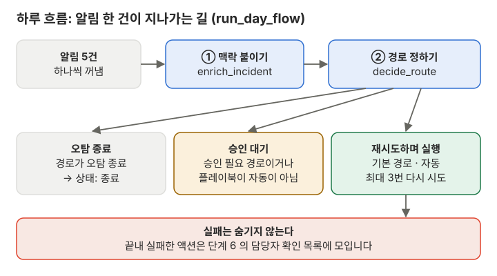

# 응용 2-2 · 연결 오류 재시도와 실패 목록

## 이번 의뢰: 티켓 서비스 장애

> **여유가 되면 해 보세요.** 핵심 실습 2-1 · 2-2와 글쓰기를 먼저 마칩니다. 이 응용은 Unit 1 파일과 제공 파일 `audit.py` · `approvals.py`, 응용 2-1 레슨의 `decisions.json` 을 씁니다. 응용 2-1 을 건너뛰었다면 응용 2-1 레슨의 「응용 2-1 · 권한 확인 후 담당자 결정 적용」 페이지에서 `decisions.json` 만 만들고 옵니다. 하지 않아도 Unit 3 을 따라가는 데 문제가 없습니다.

> **오늘 들어온 일**
>
> - **상황**: 어젯밤 티켓 서비스가 3분 동안 응답하지 않았습니다. 그 사이 들어온 알림 4건은 계정을 막는 데까지는 됐지만 티켓 생성은 오류로 끝났습니다.
> - **문제**: 프로그램은 알림 한 건을 처리하다 오류가 나면 그 건의 처리가 그대로 멈췄고, 실패했다는 기록도 남기지 않았습니다. 그래서 티켓이 없다는 사실을 다음 날 아침 담당자가 직접 찾기 전까지 아무도 몰랐습니다.
> - **부탁**: 잠깐의 오류는 자동으로 최대 3번까지 다시 시도하고, 그래도 안 되면 「실패」로 기록해서 담당자가 확인할 목록에 올려 주세요.
> - **바뀌는 점**: 요청 한두 번만 연결되지 않는 순간적인 오류는 사람이 처리하지 않아도 자동 재시도로 해결되고, 계속되는 장애만 담당자 확인 목록에 올라옵니다. 오늘 수업은 기다림 없이 3번 시도하고, 실제 제품은 시도 사이에 잠시 기다립니다. 오늘 샘플에서는 `INC-001` 의 티켓 생성이 3번 모두 실패해서 담당자 확인 목록에 올라갑니다. 상황과 숫자는 설명을 위한 예시입니다.

## 2.1 실패 처리는 「다시 시도 → 안 되면 기록하고 사람에게 넘기기」다

티켓 서비스 같은 외부 서비스는 가끔 잠깐 응답하지 않습니다. 이럴 때 바로 포기하지 않고 몇 번 다시 해 보는 것이 재시도입니다. 다만 지킬 규칙이 네 가지 있습니다.

| 규칙 | 이유 | 오늘 수업에서 |
|---|---|---|
| 잠깐 생긴 오류만 다시 시도한다 | 권한이 없다는 오류는 몇 번을 해도 같은 결과다 | 연결 오류(`ConnectionError`)가 날 때만 다시 시도한다 |
| 최대 횟수를 정한다 | 서비스가 계속 멈춰 있어도 끝없이 반복하지 않는다 | 처음 시도를 포함해 `MAX_TRIES` 3번 |
| 다시 해도 안전해야 한다 | 같은 계정을 두 번 잠그면 안 된다 | `safe_run_action`(Unit 1 제공 파일 `safe_runner.py`, 응용 1-2 에서 다룸)이 이미 잠긴 계정은 건너뛴다 |
| 끝내 실패하면 숨기지 않는다 | — | 실패를 기록하고 담당자 확인 목록에 올린다 |

- 오늘 수업은 <mark>서비스가 요청을 받기 전에 실패하는 경우만 흉내 냅니다.</mark> 실제로는 서비스가 티켓을 이미 만들었는데 「만들었다」는 응답만 우리 프로그램에 도착하지 않는 일도 있습니다. 프로그램은 실패로 알고 같은 요청을 다시 보내므로 티켓이 두 개 만들어질 수 있습니다. 이를 막으려면 같은 요청인지 알아보는 장치가 따로 필요합니다.
- **`fail_plan`**: 수업에서 일부러 실패를 일으키려고, 어떤 알림의 어떤 액션이 몇 번 실패할지 미리 적어 둔 딕셔너리입니다. 예: `{"INC-001|티켓 생성": 2}` 는 INC-001 의 티켓 생성이 2번 실패한다는 뜻입니다.
- **`MAX_TRIES`**: 한 액션을 시도하는 최대 횟수이고 값은 3입니다. 처음 시도도 한 번으로 셉니다.

**문법 상자 — `try` / `except` 는 오류가 나도 정해 둔 줄을 실행해 프로그램이 멈추지 않게 한다**

```python
try:
    raise ConnectionError("티켓 서비스가 응답하지 않음")
except ConnectionError as error:
    print("실패:", error)
print("다음 줄도 실행됨")
```

| 코드 | 뜻 |
|---|---|
| `try:` | 오류가 날 수 있는 부분을 시작한다 |
| `raise ConnectionError(문장)` | 일부러 연결 오류를 일으킨다. 오늘은 장애를 흉내 낼 때만 쓰고 직접 쓰지 않는다 |
| `except ConnectionError as error:` | 그 오류가 나면 여기로 오고, 오류 내용이 `error` 에 저장된다 |
| 위 코드의 출력 | `실패: 티켓 서비스가 응답하지 않음` 다음에 `다음 줄도 실행됨` |

- 오류가 나도 `except` 가 같은 종류의 오류를 받으면 프로그램이 멈추지 않고 다음 줄을 계속 실행합니다.
- `str(error)` 는 오류 내용을 문자열(글자로 된 값)로 바꿉니다.

함수는 파일 네 곳에 나뉘어 있고, 직접 쓰는 곳은 **아홉 군데**입니다.

| 파일 | 직접 쓰는 곳 |
|---|---|
| `retry_runner.py` | 1 ~ 3번 |
| `flow.py` | 4 · 5번 |
| `failure_report.py` | 6 · 7번 |
| 실행 파일 | 8 · 9번 |

`try:` 와 `except …:` 줄은 미리 채워져 있고, 그 아래에 들여쓴 줄만 씁니다. 처음 보는 모양 두 가지입니다.

| 코드 | 뜻 |
|---|---|
| `range(1, max_tries + 1)` | 1 부터 `max_tries` 까지의 번호를 차례로 만든다(`max_tries` 가 3 이면 1 · 2 · 3) |
| `문자열.startswith("실패")` | 문자열이 「실패」로 시작하면 `True`, 아니면 `False` |

- `range` 는 끝 숫자를 포함하지 않아서 `+ 1` 을 붙입니다.
- `startswith` 는 Unit 1 응용 1-2 의 문법 상자에서 처음 나왔고, 응용 1-2 를 건너뛰었어도 이 한 줄 뜻만 알면 됩니다.

```
retry_runner.py     run_with_retry          : 실행해 보고(1번), 성공하면 시도 횟수를 붙여 리턴한다(2번) / 연결 오류면 오류 문장을 기억한다(3번)
flow.py             run_playbook_with_retry : 결과가 「실패」로 시작하면 실패 표시를 한다 (4 · 5번)
failure_report.py   collect_failures        : 기록에서 「실패」로 시작하는 것만 모은다 (6 · 7번)
실행 파일           apply2-2_run.py     : 실패 목록을 받고(8번) 출력한다(9번)
```

`flow.py` 의 `run_day_flow`(미리 채움)는 **하루 흐름**입니다. 알림 하나가 맥락 붙이기 → 경로 정하기를 거친 뒤, 경로에 따라 셋 중 하나로 처리됩니다.

<figure class="page-figure"></figure>

## 응용 2-2 · 최대 3번 재시도하고 실패 목록 만들기

**이런 상황이 있습니다**

- **지금은**: <mark>티켓 서비스가 잠깐 멈추면 프로그램이 그대로 멈추고, 실패한 일이 어디에도 남지 않습니다</mark>.
- **만드는 것**: 재시도(`retry_runner.py`), 실패 표시(`flow.py`), 실패 목록(`failure_report.py`), 목록 출력(`apply2-2_run.py`).
- **실행하면**: <mark>단계 1: 일시 장애, 단계 2: 서비스 중단, 단계 3: 하루 흐름, 단계 4: 담당자 결정 처리, 단계 5: 하루가 끝난 뒤 연습용 시스템 상태, 단계 6: 담당자 확인이 필요한 건의 목록이 나옵니다.</mark>

**할 일**: 준비할 파일을 확인하고, 파일 네 개를 만들어 붙여 넣고 번호 주석 바로 아래에 직접 코드를 씁니다. 실행해서 단계 1 · 2 와 단계 6 을 읽습니다.

**준비** — 이 응용은 앞 파일을 많이 씁니다. 작업 폴더 `network-study-notes/soar_response` 에 아래 파일이 있어야 합니다(`config/` 는 `soar_response` 안의 `config` 폴더).

| 만든 곳 | 파일 |
|---|---|
| Unit 1 실습 1-2 | `incident.py` · `playbook_runner.py` |
| Unit 1 실습 1-3 | `enrichment.py` |
| Unit 1 「제공 파일」 레슨 | `routing.py` · `safe_runner.py` |
| Unit 1 시작하기 | `incident_samples.json` · `users_info.json` · `source_ips.json` · `trusted_ips.json` |
| Unit 1 실습 1-1 | `config/playbook_registry.json` |
| 이번 Unit 「제공 파일」 레슨 또는 응용 2-1 | `audit.py` · `approvals.py` |
| 이번 Unit 응용 2-1 레슨 | `decisions.json` |

**[터미널]** 아래 명령으로 확인합니다. <mark>`준비 완료 ['PB-001', 'PB-002', 'PB-003'] 3`</mark> 이 나오면 됩니다. `ModuleNotFoundError` 나 `FileNotFoundError` 가 나오면 오류 끝에 적힌 이름의 파일을 위 표의 레슨에서 만듭니다.

```bash
python -c "import json; from safe_runner import safe_run_action; from enrichment import enrich_incident; from routing import decide_route, apply_route; from approvals import apply_decision; print('준비 완료', [p['id'] for p in json.load(open('config/playbook_registry.json', encoding='utf-8'))], len(json.load(open('decisions.json', encoding='utf-8'))))"
```

<!-- checklist optional -->
- [ ] 준비 명령을 쳐 `준비 완료 ['PB-001', 'PB-002', 'PB-003'] 3` 이 나왔다
<!-- /checklist -->

**`retry_runner.py`** — 실패를 흉내 내고 다시 시도합니다. 직접 쓰는 곳은 1 ~ 3번입니다.

```python
from safe_runner import safe_run_action                                            # Unit 1 제공 파일의 안전한 액션 실행 함수를 불러온다

MAX_TRIES = 3                                                                      # 한 액션을 시도하는 최대 횟수


def flaky_run_action(action, incident, state, fail_plan):                          # 액션 · 인시던트 · 연습용 시스템 · 실패 계획을 받는 함수
    """실패 계획에 이 액션이 앞으로 실패할 횟수가 남아 있으면 연결 오류를 일으키고, 없으면 safe_run_action(Unit 1 제공 파일)으로 실행한다.
    외부 서비스가 잠깐 응답하지 않는 상황을 흉내 낼 때 쓴다.
    """
    key = incident["id"] + "|" + action                                            # 실패 계획에서 찾을 이름 (인시던트 번호 | 액션)
    remaining = fail_plan.get(key, 0)                                              # 이 액션이 앞으로 실패해야 하는 횟수 (없으면 0)
    if remaining > 0:                                                              # 아직 실패해야 하면
        fail_plan[key] = remaining - 1                                             # 남은 실패 횟수를 1 줄이고
        raise ConnectionError("연결 실패: " + action + " 서비스가 응답하지 않음")  # 연결 오류를 일으킨다
    return safe_run_action(action, incident, state)                                # 실패 계획에 없으면 정상으로 실행한다


def run_with_retry(action, incident, state, fail_plan, max_tries):                 # 액션 · 인시던트 · 연습용 시스템 · 실패 계획 · 최대 시도 횟수를 받는 함수
    """액션을 실행해 보고, 연결 오류가 나면 최대 횟수까지 다시 시도한다. 성공하면 결과를, 모두 실패하면 실패 문장을 리턴한다.
    외부 서비스가 잠깐 멈춰도 자동 대응이 끝까지 가게 할 때 쓴다.
    """
    last_error = ""                                                                # 마지막 오류 문장 : 처음에는 비어 있다
    for attempt in range(1, max_tries + 1):                                        # 1 번부터 최대 횟수까지 시도 번호를 하나씩 꺼낸다
        try:                                                                       # 오류가 날 수 있는 부분을 시작한다 — 미리 채운 줄
            # ← 아래를 직접 씁니다 (주석은 두고 각 주석 바로 아래 줄에 씁니다)
            # 1. flaky_run_action(action, incident, state, fail_plan) 의 결과를 result 에 담는다
            # 2. result + " (시도 " + str(attempt) + "회)" 를 리턴한다 (성공하면 여기서 끝난다)
        except ConnectionError as error:                                           # 연결 오류가 나면 — 미리 채운 줄
            # ← 아래를 직접 씁니다 (주석은 두고 각 주석 바로 아래 줄에 씁니다)
            # 3. str(error) 를 last_error 에 담는다 (오류 문장을 기억해 두고 다음 시도로 간다)
    return "실패: " + last_error + " (" + str(max_tries) + "회 모두 실패)"         # 모든 시도가 실패했으면 실패 문장을 리턴한다 — 미리 채운 줄
```

**`flow.py`** — 하루 흐름 파일입니다. 줄 끝의 `[Unit 1 실습 1-3]` 같은 표시로 어느 실습에서 만든 함수인지 알 수 있습니다. 직접 쓰는 곳은 4 · 5번입니다.

```python
from incident import change_status, match_playbooks                             # Unit 1 파일의 함수를 불러온다
from enrichment import enrich_incident                                          # Unit 1 실습 1-3 : 맥락 붙이기
from routing import decide_route, apply_route                                   # Unit 1 제공 파일 : 경로 정하기
from approvals import hold_for_approval                                         # 제공 파일 : 승인 대기로 멈추기
from audit import log_line                                                      # 제공 파일 : 감사 기록 한 건 만들기
from retry_runner import run_with_retry, MAX_TRIES                              # 응용 2-2 : 재시도하며 실행하기

VIP_REVIEW_ACTIONS = ["담당자 알림", "티켓 생성"]                               # VIP 계정 알림을 담당자가 승인하면 실행할 액션


def run_playbook_with_retry(incident, playbook, state, action_log, fail_plan):  # 인시던트 · 플레이북 · 연습용 시스템 · 기록 · 실패 계획을 받는 함수
    """자동으로 해도 되는 플레이북의 액션을 하나씩, 실패하면 다시 시도하며 실행하고 기록한다.
    모두 성공하면 조치됨으로 바꾸고 「실행 완료」를, 하나라도 끝내 실패하면 상태를 그대로 두고 「일부 실패」를 리턴한다.
    """
    incident["playbook"] = playbook["id"]                                       # 기록에 남길 플레이북 번호를 적고
    change_status(incident, "분류됨")                                           # 대응을 시작하기 전에 분류됨으로 옮긴다
    failed = False                                                              # 실패한 액션이 있는지 : 처음에는 없다
    for action in playbook["actions"]:                                          # 액션을 하나씩 꺼낸다
        result = run_with_retry(action, incident, state, fail_plan, MAX_TRIES)  # 재시도하며 실행한다
        # ← 아래를 직접 씁니다 (주석은 두고 각 주석 바로 아래 줄에 씁니다)
        # 4. result 가 "실패" 로 시작하면 (if, startswith)
        # 5.   failed 에 True 를 담는다 (실패한 액션이 있다고 적는다)
        action_log.append(log_line(incident, action, result))                   # 결과를 기록에 추가한다 — 미리 채운 줄
    if failed:                                                                  # 실패한 액션이 있으면
        return "일부 실패"                                                      # 조치됨으로 옮기지 않고 일부 실패를 리턴한다
    change_status(incident, "조치됨")                                           # 모두 성공했으니 조치됨으로 옮긴다
    return "실행 완료"                                                          # 실행 완료를 리턴한다


def run_day_flow(incidents, registry, users_info, source_ips, trusted_ips, state, action_log, fail_plan):  # 하루 흐름 전체를 받는 함수
    """알림마다 맥락 붙이기 → 경로 정하기 → 경로에 따라 처리하기(오탐 종료 · 승인 대기 · 재시도하며 실행)를 차례로 한다.
    알림마다 결과를 한 줄씩 출력하고, 승인 대기 건의 리스트를 리턴한다.
    """
    pending = []                                                                # 승인 대기 건을 담을 빈 리스트
    route_log = []                                                              # 경로 기록을 담을 빈 리스트
    for incident in incidents:                                                  # 인시던트를 하나씩 꺼낸다
        enrich_incident(incident, users_info, source_ips, trusted_ips)          # [Unit 1 실습 1-3] 맥락을 붙인다
        route, reason = decide_route(incident)                                  # [Unit 1 routing.py] 처리 경로와 이유를 정한다
        apply_route(incident, route, reason, route_log)                         # [Unit 1 routing.py] 경로를 적용한다 (오탐 종료이면 여기서 닫힌다)
        result_text = "맞는 플레이북 없음"                                      # 처음에는 없다고 적어 둔다
        if route == "오탐 종료":                                                # 오탐으로 닫았으면
            result_text = "오탐 종료"                                           # 오탐 종료라고 적는다
        elif route == "승인 필요":                                              # VIP 계정이라 담당자 승인이 필요하면
            pending.append(hold_for_approval(incident, "VIP 확인", VIP_REVIEW_ACTIONS, "VIP 계정이라 경로가 승인 필요", action_log))  # [응용 2-1] 승인 대기로 멈춘다
            result_text = "승인 대기"                                           # 승인 대기라고 적는다
        else:                                                                   # 기본 경로이면
            for playbook in match_playbooks(incident, registry):                # 맞는 플레이북을 하나씩 꺼낸다
                if playbook["approval"] != "자동":                              # 플레이북이 승인을 요구하면
                    pending.append(hold_for_approval(incident, playbook["id"], playbook["actions"], "플레이북 승인 값이 " + playbook["approval"], action_log))  # [응용 2-1] 승인 대기로 멈춘다
                    result_text = "승인 대기"                                   # 승인 대기라고 적는다
                else:                                                           # 자동이면
                    result_text = run_playbook_with_retry(incident, playbook, state, action_log, fail_plan)  # [응용 2-2] 재시도하며 실행한다
        print(incident["id"], incident["entity"], "->", result_text, "(상태: " + incident["status"] + ")")  # 한 줄로 출력한다
    return pending                                                              # 승인 대기 리스트를 리턴한다
```

**`failure_report.py`** — 실패한 기록만 모읍니다. 직접 쓰는 곳은 6 · 7번입니다.

```python
def collect_failures(action_log):  # 감사 기록 리스트를 받는 함수
    """감사 기록에서 결과가 「실패」로 시작하는 기록만 골라 리스트로 리턴한다.
    담당자가 아침에 가장 먼저 볼 「확인이 필요한 건」 목록을 만들 때 쓴다.
    """
    failures = []                  # 실패한 기록을 담을 빈 리스트
    for entry in action_log:       # 기록을 하나씩 꺼낸다
        # ← 아래를 직접 씁니다 (주석은 두고 각 주석 바로 아래 줄에 씁니다)
        # 6. entry["result"] 가 "실패" 로 시작하면 (if, startswith)
        # 7.   failures 에 entry 를 추가한다 (append)
    return failures                # 실패한 기록 리스트를 리턴한다
```

**`apply2-2_run.py`** — 8 · 9번만 직접 쓰고 나머지는 그대로 붙여 넣습니다.

```python
from incident import load_json, INCIDENTS_PATH                                              # Unit 1 파일의 함수를 불러온다
from approvals import apply_decision                                                        # 제공 파일의 결정 적용 함수를 불러온다
from retry_runner import run_with_retry, MAX_TRIES                                          # 방금 만든 재시도 함수를 불러온다
from flow import run_day_flow                                                               # 하루 흐름 함수를 불러온다
from failure_report import collect_failures                                                 # 실패한 기록을 모으는 함수를 불러온다


def new_state():                                                                            # 인자가 없는 함수
    """잠긴 계정 · 차단한 IP · 티켓이 모두 비어 있는 연습용 시스템 상태를 새로 만들어 리턴한다.
    실험마다 깨끗한 상태에서 시작하고 싶을 때 쓴다.
    """
    state = {"locked_users": [], "blocked_ips": [], "tickets": [], "notifications": []}     # 비어 있는 상태 딕셔너리
    return state                                                                            # 상태를 리턴한다


incidents = load_json(INCIDENTS_PATH)                                                       # 인시던트 파일을 리스트로 읽는다
users_info = load_json("users_info.json")                                                   # 계정 정보 파일을 읽는다
source_ips = load_json("source_ips.json")                                                   # 접속 IP 파일을 읽는다
trusted_ips = load_json("trusted_ips.json")                                                 # 신뢰 IP 파일을 읽는다
registry = load_json("config/playbook_registry.json")                                       # 플레이북 세 건을 읽는다
decisions = load_json("decisions.json")                                                     # 담당자 결정을 읽는다

print("--- 단계 1: 일시 장애 — 티켓 서비스가 2번 실패한 뒤 복구")                           # 단계 1 시작을 알리는 줄
state = new_state()                                                                         # 깨끗한 상태로 시작한다
fail_plan = {"INC-001|티켓 생성": 2}                                                        # INC-001 의 티켓 생성이 2번 실패하게 한다
result = run_with_retry("티켓 생성", incidents[0], state, fail_plan, MAX_TRIES)             # 재시도하며 실행한다
print(result)                                                                               # 결과 문장을 출력한다
print("만든 티켓:", len(state["tickets"]), "건")                                            # 만든 티켓 수를 출력한다

print("--- 단계 2: 서비스 중단 — 티켓 서비스가 계속 실패")                                  # 단계 2 시작을 알리는 줄
state = new_state()                                                                         # 깨끗한 상태로 시작한다
fail_plan = {"INC-001|티켓 생성": 99}                                                       # INC-001 의 티켓 생성이 계속 실패하게 한다
result = run_with_retry("티켓 생성", incidents[0], state, fail_plan, MAX_TRIES)             # 재시도하며 실행한다
print(result)                                                                               # 결과 문장을 출력한다
print("만든 티켓:", len(state["tickets"]), "건")                                            # 만든 티켓 수를 출력한다

print("--- 단계 3: 하루 흐름 — 티켓 서비스가 계속 실패하는 상황")                           # 단계 3 시작을 알리는 줄
state = new_state()                                                                         # 깨끗한 상태로 시작한다
action_log = []                                                                             # 감사 기록을 담을 빈 리스트
fail_plan = {"INC-001|티켓 생성": 99}                                                       # INC-001 의 티켓 생성이 계속 실패하게 한다
pending = run_day_flow(incidents, registry, users_info, source_ips, trusted_ips, state, action_log, fail_plan)  # 하루 흐름을 실행한다

print("--- 단계 4: 담당자 결정 처리")                                                       # 단계 4 시작을 알리는 줄
for item in pending:                                                                        # 승인 대기 건을 하나씩 꺼낸다
    result_text = apply_decision(item, decisions[item["id"]], state, action_log)            # 담당자 결정을 적용한다
    print(item["id"], item["entity"], "->", result_text, "(상태: " + item["status"] + ")")  # 한 줄로 출력한다

print("--- 단계 5: 하루가 끝난 뒤 연습용 시스템 상태")                                      # 단계 5 시작을 알리는 줄
print("잠긴 계정:", state["locked_users"])                                                  # 잠긴 계정을 출력한다
print("차단한 IP:", state["blocked_ips"])                                                   # 차단한 IP 를 출력한다
print("티켓:", len(state["tickets"]), "건 · 담당자 알림:", len(state["notifications"]), "건")  # 티켓과 알림 수를 출력한다

print("--- 단계 6: 담당자 확인이 필요한 건")                                                # 단계 6 시작을 알리는 줄
# ← 아래를 직접 씁니다 (주석은 두고 각 주석 바로 아래 줄에 씁니다)
# 8. collect_failures(action_log) 의 결과를 failures 에 담는다
for entry in failures:                                                                      # 실패한 기록을 하나씩 꺼낸다
    incident_id = entry["incident"]                                                         # 실패한 인시던트 번호
    # ← 아래를 직접 씁니다 (주석은 두고 각 주석 바로 아래 줄에 씁니다)
    # 9. incident_id · entry["action"] · ":" · entry["result"] 를 출력한다 (print)
for item in pending:                                                                        # 승인 대기 건을 하나씩 꺼낸다
    if item["status"] == "분류됨":                                                          # 아직 처리되지 않았으면
        print(item["id"], "승인 대기 :", item["why"])                                       # 승인 대기 건과 이유를 출력한다
```

**순서**

1. **[VS Code]** `soar_response` 폴더를 오른쪽 클릭 › **New File** 로 `retry_runner.py` · `flow.py` · `failure_report.py` · `apply2-2_run.py` 네 파일을 하나씩 만들고(파일 이름 그대로), 코드를 붙여 넣어 저장합니다. <mark>`audit.py` · `approvals.py` 가 완성돼 있어야(`flow.py` 가 이 두 파일을 불러오기 때문)</mark> 합니다.
2. **[VS Code]** `retry_runner.py` 1 ~ 3번, `flow.py` 4 · 5번, `failure_report.py` 6 · 7번, `apply2-2_run.py` 8 · 9번을 씁니다. 막히면 아래 「응용 2-2 정리」를 봅니다.
   - 들여쓰기: 1 · 2 · 3번은 `try:` · `except …:` 안쪽이라 12칸, 4 · 6번은 8칸, 5 · 7번은 바로 위 `if` 의 안쪽이라 12칸, 8번은 맨 앞(0칸), 9번은 `for` 안쪽이라 4칸에서 시작합니다.

<!-- checklist optional -->
- [ ] `retry_runner.py` 를 만들어 붙여 넣고 1 ~ 3번을 채운 뒤 저장했다
- [ ] `flow.py` 를 만들어 붙여 넣고 4 · 5번을 채운 뒤 저장했다
- [ ] `failure_report.py` 를 만들어 붙여 넣고 6 · 7번을 채운 뒤 저장했다
<!-- /checklist -->

3. **[터미널]** 실행합니다.
   ```bash
   python apply2-2_run.py
   ```
4. 출력은 여섯 단계입니다. 제목 줄은 줄 수에 넣지 않습니다. 단계 1 은 2줄, 단계 2 도 2줄, 단계 3 은 5줄, 단계 4 는 3줄, 단계 5 는 3줄, 단계 6 은 2줄입니다. 정답의 출력은 Unit 1 실습 1-1 에서 PB-003 의 승인 값을 `담당자 승인 필요` 로 쓴 경우입니다. `자동` 으로 썼다면 INC-005 가 승인 대기 대신 바로 실행되어 단계 3 ~ 6 이 조금 다릅니다.

<!-- checklist optional -->
- [ ] `apply2-2_run.py` 를 만들어 8 · 9번을 채우고, `python apply2-2_run.py` 로 여섯 단계 출력이 나왔다
<!-- /checklist -->

5. **[보고서]** `report_u2.md` 의 `## 응용 2-2` 아래를 채웁니다.
   - (가) 실행한 출력 전체를 붙여 넣고, 단계 3 에서 `일부 실패` · `승인 대기` · `오탐 종료`(오탐: 위험하지 않은데 위험하다고 잘못 알린 경우) 인 알림의 번호를 각각 적어 주세요.
   - (나) [핵심 질문] 단계 1 과 2 는 같은 `run_with_retry` 인데 결과가 다릅니다. 두 단계의 `fail_plan` 값을 근거로 이유를 적어 주세요. 그리고 최대 횟수가 없으면 서비스가 계속 멈춰 있을 때 어떤 문제가 생기는지도 적어 주세요.
   - (다) [핵심 질문] 단계 3 에서 INC-001 은 계정은 잠겼는데 상태가 `조치됨` 이 아닙니다. 그 이유를 적어 주세요. 또 단계 6 의 출력이 담당자에게 무엇을 알려 주는지 적어 주세요. 마지막으로, 같은 `state` 로 다시 처리해도 `dami` 가 두 번 잠기지 않는 이유를 Unit 1 제공 파일 `safe_runner.py`(응용 1-2 에서 다룸)의 안전장치와 연결해 적어 주세요.

<!-- checklist optional -->
- [ ] `report_u2.md` 의 `## 응용 2-2` 에 답을 썼다
<!-- /checklist -->

## 응용 2-2 정리

| 하려는 일 | 코드 · 말 |
|---|---|
| 함수 결과를 변수에 담기 | `result = flaky_run_action(action, incident, state, fail_plan)` |
| 숫자를 글자로 바꿔 이어 붙이기 | `result + " (시도 " + str(attempt) + "회)"` |
| 오류 내용을 문자열로 바꿔 저장하기 | `last_error = str(error)` |
| 글자가 어떤 말로 시작하면 | `if result.startswith("실패"):` |
| 리스트에 추가 | `failures.append(entry)` |

---
