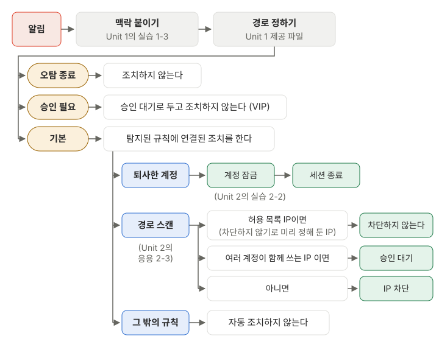

# 응용 3-1 · 알림 8건 처리와 확인 목록 만들기

## 목표: 알림 8건 일괄 처리

> **여유가 되면 해 보세요.** 핵심 실습 3-1 · 3-2와 글쓰기를 먼저 마칩니다. 이 응용은 Unit 1 · Unit 2 파일을 여럿 불러 쓰므로, 응용 3-1 페이지의 「먼저 확인할 파일」부터 봅니다. 하지 않아도 다음 Unit을 따라가는 데 문제가 없습니다.

> **오늘 들어온 일**
>
> - **상황**: 교대 직전에 알림 8건이 한꺼번에 들어왔습니다. Unit 1 파일의 판단(맥락 붙이기 · 경로 정하기)과 Unit 2 파일의 조치(계정 잠금 · 세션 종료 · IP 차단)를 이어서 한 번에 처리해야 합니다.
> - `INC-001`: 퇴사한 `dami` 의 계정
> - `INC-002`: `seoyeon` 의 알림. 자동 조치를 연결해 둔 규칙이 아니라서 조치하지 않는 건
> - `INC-003` · `INC-010`: 계정 관리자 `gaeun`(VIP 계정: 잠기면 업무 영향이 큰 중요한 계정)의 알림 2건. `INC-010` 은 인사 시스템 입력 실수로 퇴사자로 표시된 알림이고, `INC-003` 은 서버가 요청을 거절한 알림입니다
> - `INC-004`: 협력사 `jiwoo` 의 정상 접속(오탐)
> - `INC-005` · `INC-008` · `INC-009`: 경로 스캔(서버의 여러 주소에 차례로 요청을 보내 약점을 찾는 일) 세 건. `INC-005` 는 외부 IP, `INC-008` 은 여러 계정이 함께 쓰는 IP, `INC-009` 는 회사 점검 서버에서 온 것입니다
> - **문제**:
> - 건마다 사람이 판단해 조치하면 시간이 걸립니다. 또 교대할 때 「무엇을 했고 무엇을 사람이 봐야 하는지」를 따로 정리해야 합니다.
> - `INC-005` 는 차단하려는 순간 방화벽 연결이 끊겨 차단되지 않았습니다. 이 건이 보고에서 「조치함」으로 보고되면 공격 IP 가 차단되지 않은 채 그대로 남습니다.
> - **부탁**: 알림 8건을 판단하고 조치하는 일을 한 번에 실행하고, 기록을 종류별로 요약해서 사람이 확인할 건 목록을 만들어 주세요.
> - **바뀌는 점**: 교대하는 사람은 기록 요약(변경됨 2 · 변경 없음 2 · 확인 실패 1)과 담당자 확인 목록 4건을 함께 보면 됩니다. 상황과 숫자는 설명을 위한 예시입니다.

## 3.1 알림 한 건은 「판단 → 조치 → 기록」을 거치고, 근무가 끝나면 기록을 종류별로 센다

<figure class="page-figure"></figure>

근무 보고(교대할 때 다음 사람에게 넘기는 요약)는 조치 기록을 세 종류로 셉니다. 예를 들어 `INC-005` 는 방화벽 연결이 끊겨 차단되지 않았으므로 「확인 실패」로 셉니다.

| 종류 | 기준 | 사람이 볼 것 |
|---|---|---|
| 변경됨 | 조치 전과 후가 다르고 확인 실패가 아니다 | 필요하면 오탐일 때 되돌리기 |
| 변경 없음 | 조치 전과 후가 같다 | 보류한 이유(승인 필요 등)가 있으면 확인 |
| 확인 실패 | 조치 후 상태에 `확인 실패` 가 있다 | 반드시 사람이 확인 |

**직접 쓰는 곳은 아홉 군데**이고, 함수는 두 파일에 나뉘어 있습니다.

| 파일 | 함수 | 번호 | 하는 일 |
|---|---|---|---|
| `drill.py` | `choose_containment` | 1 ~ 3번 | 탐지된 규칙에 연결된 조치 이름을 고른다 |
| `drill.py` | `handle_incident` | 4 · 5번 | 승인 필요(VIP)이면 승인 대기로 둔다 |
| `shift_report.py` | `is_failure` | 6번 | 조치 후 상태에 확인 실패가 있는지 구한다 |
| `shift_report.py` | `is_unchanged` | 7번 | 조치 전과 후가 같은지 구한다 |
| `shift_report.py` | `summarize` | 8번 | 기록을 종류별로 센다 |
| `apply3-1_run.py` | (실행 파일) | 9번 | 알림마다 처리 결과를 두 값으로 나눠 받는다 |

- `handle_incident` 의 나머지 줄은 미리 채워져 있습니다. 경로가 오탐 종료이면 종료하고, 나머지는 규칙에 맞는 조치를 합니다. 여러 계정이 함께 쓰는 IP 의 차단도 승인 대기로 둡니다.
- 9번처럼 받는 것을 언패킹(unpacking)이라고 합니다. 함께 리턴된 두 값을 변수 두 개에 하나씩 나눠 담는 일입니다.

## 응용 3-1 · 알림 8건 처리와 확인 목록 만들기

**이런 상황이 있습니다**

- **지금은**: <mark>알림 8건을 판단하는 함수와 조치하는 함수가 따로 있을 뿐, 한 번에 처리하고 근무 보고로 요약하는 흐름이 없습니다</mark>.
- **만드는 것**: 규칙에 맞는 조치 고르기와 VIP 승인 대기(`drill.py`), 기록 종류 나누기와 세기(`shift_report.py`), 처리 결과 받기(`apply3-1_run.py`).
- **실행하면**: <mark>단계 1: 알림 8건의 처리 결과, 단계 2: 조치 기록, 단계 3: 근무 보고 요약과 최종 상태, 단계 4: 담당자 확인이 필요한 건이 나옵니다.</mark>

**할 일**: 먼저 앞 Unit 파일을 확인하고, `soar_response` 폴더에 `drill.py` · `shift_report.py` · `apply3-1_run.py` 세 파일을 만들어 붙여 넣고 번호 주석 바로 아래에 직접 코드를 씁니다. 실행해서 단계 1 ~ 4 를 읽습니다.

**먼저 확인할 파일** — 이 응용은 앞 Unit 파일을 많이 씁니다. 없는 파일은 그 레슨의 코드 상자로 만들고, 빈칸은 그 Unit 정답 레슨의 채운 코드로 채웁니다.

| Unit | 파일 | 만드는 레슨 |
|---|---|---|
| Unit 1 | `incident.py` 전체(`INCIDENTS_PATH` 가 있어야 함) | 실습 1-2 |
| Unit 1 | `enrichment.py` | 실습 1-3 |
| Unit 1 | `routing.py` | 「제공 파일」 레슨 |
| Unit 1 | `incident_samples.json` · `users_info.json` · `source_ips.json` · `trusted_ips.json` | 시작하기 레슨 |
| Unit 2 | `containment_store.py` · `account_actions.py` | 실습 2-1 |
| Unit 2 | `session_actions.py` · `containment.py` | 실습 2-2 |
| Unit 2 | `ip_actions.py` | 「제공 파일」 레슨 |
| Unit 2 | `config/vip_accounts.json` · `config/allowlist_ips.json` · `ip_users.json` | 시작하기 레슨 |

**[터미널]** 아래 명령으로 확인합니다(맥북은 `python3`). `앞 Unit 파일 정상` 이 나오면 됩니다. 시작하기 레슨의 두 함수짜리 `incident.py` 를 쓰고 있다면 `cannot import name 'INCIDENTS_PATH'` 가 나오니, Unit 1 실습 1-2의 `incident.py` 전체로 바꿉니다.

```bash
python -c "from incident import load_json, save_json, INCIDENTS_PATH; from enrichment import enrich_incident; from routing import decide_route; from containment import contain_account; from containment_store import new_state; from ip_actions import check_ip_policy, block_ip; print('앞 Unit 파일 정상')"
```

**`drill.py`** — 알림 한 건을 처리합니다. Unit 1 `enrichment.py` · `routing.py` 와 Unit 2 파일을 불러옵니다(import). 직접 쓰는 곳은 1 ~ 5번입니다. `FIREWALL_DOWN_FOR` 는 방화벽 연결이 끊긴 상황을 흉내 내려고 수업에서만 쓰는 목록입니다.

```python
from enrichment import enrich_incident                                                      # Unit 1 실습 1-3 : 맥락 붙이기
from routing import decide_route                                                            # Unit 1 제공 파일 : 경로 정하기
from containment_store import make_record                                                   # 기록 한 건을 만드는 함수를 불러온다
from containment import contain_account                                                     # Unit 2 실습 2-2 : 잠금 → 세션 종료
from ip_actions import check_ip_policy, block_ip, DEFAULT_TTL                               # Unit 2 제공 파일 : IP 차단

CONTAINMENT_BY_RULE = {"퇴사한 계정": "계정 조치", "경로 스캔": "IP 차단"}                  # 탐지된 규칙에 따라 할 조치 : 이 표에 없는 규칙은 조치하지 않는다
FIREWALL_DOWN_FOR = ["INC-005"]                                                             # 방화벽 연결이 끊긴 상황을 흉내 낼 인시던트 번호 : 이 인시던트의 IP 차단은 실패한다


def choose_containment(incident):                                                           # 인시던트 하나를 받는 함수
    """탐지된 규칙을 하나씩 보고, 조치 표(CONTAINMENT_BY_RULE)에 있는 규칙이면 그 조치 이름을, 하나도 없으면 「없음」을 리턴한다.
    규칙마다 어떤 자동 조치를 할지 연결해 둘 때 쓴다.
    """
    # ← 아래를 직접 씁니다 (주석은 두고 각 주석 바로 아래 줄에 씁니다)
    # 1. incident["reasons"] 의 규칙을 하나씩 꺼낸다 (for, rule)
    # 2.   rule 이 CONTAINMENT_BY_RULE 안에 있으면 (if, in)
    # 3.     CONTAINMENT_BY_RULE[rule] 을 리턴한다
    return "없음"                                                                           # 조치 표에 있는 규칙이 없으면 「없음」을 리턴한다 — 미리 채운 줄


def handle_incident(incident, state, refs):                                                 # 인시던트 · 연습용 시스템 상태 · 참고 데이터 딕셔너리를 받는 함수
    """알림 한 건에 맥락을 붙이고 경로를 정한 뒤, 오탐은 종료하고 VIP 는 승인 대기로 두고, 나머지는 규칙에 맞는 조치를 실행한다.
    알림 한 건을 처음부터 끝까지 처리할 때 쓰고, 처리 결과 문장과 조치 기록 리스트를 함께 리턴한다.
    """
    enrich_incident(incident, refs["users_info"], refs["source_ips"], refs["trusted_ips"])  # Unit 1 : 맥락을 붙인다 — 미리 채운 줄
    route, reason = decide_route(incident)                                                  # Unit 1 : 처리 경로와 이유를 정한다 — 미리 채운 줄
    if route == "오탐 종료":                                                                # 오탐으로 닫을 알림이면 — 미리 채운 줄
        return "오탐 종료", []                                                              # 조치하지 않고 끝낸다 — 미리 채운 줄
    # ← 아래를 직접 씁니다 (주석은 두고 각 주석 바로 아래 줄에 씁니다)
    # 4. route 가 "승인 필요" 이면 (if, ==)
    # 5.   "승인 대기" 와 빈 리스트 [] 를 쉼표로 이어 함께 리턴한다 (담당자가 허락하기 전에는 조치하지 않는다)
    kind = choose_containment(incident)                                                     # 할 조치 종류를 구한다 — 미리 채운 줄
    entity = incident["entity"]                                                             # 대응할 대상 — 미리 채운 줄
    if kind == "계정 조치":                                                                 # 계정 조치이면 — 미리 채운 줄
        records = contain_account(entity, state, refs["vip_accounts"], incident["id"], incident["reasons"][0])  # 잠금 → 세션 종료 — 미리 채운 줄
        return "조치함", records                                                            # 조치 결과를 리턴한다 — 미리 채운 줄
    if kind == "IP 차단":                                                                   # IP 차단이면 — 미리 채운 줄
        if incident["id"] in FIREWALL_DOWN_FOR:                                             # 방화벽 연결이 끊긴 상황이면 — 미리 채운 줄
            return "조치 실패", [make_record("IP 차단", entity, incident["id"], "차단되지 않음", "차단되지 않음 (확인 실패)", "방화벽 연결 실패")]  # 차단되지 않았다고 기록한다 — 미리 채운 줄
        refusal = check_ip_policy(entity, refs["allowlist_ips"], refs["ip_users"])          # 차단을 막을 이유를 구하고 — 미리 채운 줄
        if refusal != "":                                                                   # 막을 이유가 있으면 — 미리 채운 줄
            status = "조치하지 않음"                                                        # 기본은 조치하지 않음이고 — 미리 채운 줄
            if "승인 필요" in refusal:                                                      # 담당자 승인이 필요한 이유이면 — 미리 채운 줄
                status = "승인 대기"                                                        # 승인 대기로 바꾼다 — 미리 채운 줄
            return status, [make_record("IP 차단", entity, incident["id"], "변경 없음", "변경 없음", refusal)]  # 이유만 기록한다 — 미리 채운 줄
        return "조치함", [block_ip(entity, state, incident["id"], incident["reasons"][0], DEFAULT_TTL)]  # 차단하고 기록한다 — 미리 채운 줄
    return "조치하지 않음", []                                                              # 자동 조치 대상이 아니면 조치하지 않는다 — 미리 채운 줄
```

**`shift_report.py`** — 기록을 종류별로 셉니다. 직접 쓰는 곳은 6 ~ 8번입니다.

```python
def is_failure(record):                                     # 기록 한 건을 받는 함수
    """기록의 조치 후 상태에 「확인 실패」가 들어 있으면 True, 아니면 False 를 리턴한다.
    조치했다고 했지만 실제로 바뀌지 않은 건을 찾아낼 때 쓴다.
    """
    # ← 아래를 직접 씁니다 (주석은 두고 각 주석 바로 아래 줄에 씁니다)
    # 6. "확인 실패" 가 record 의 "after" 안에 있는지(in)의 결과를 리턴한다


def is_unchanged(record):                                   # 기록 한 건을 받는 함수
    """조치 전과 후 상태가 같으면 True, 다르면 False 를 리턴한다.
    실제로 바뀐 것이 없는 기록을 찾아낼 때 쓴다.
    """
    # ← 아래를 직접 씁니다 (주석은 두고 각 주석 바로 아래 줄에 씁니다)
    # 7. record 의 "before" 와 "after" 가 같은지(==)의 결과를 리턴한다


def classify_record(record):                                # 기록 한 건을 받는 함수
    """기록을 「확인 실패」 · 「변경 없음」 · 「변경됨」 중 하나로 나눠 리턴한다.
    근무 보고에서 조치 결과를 종류별로 셀 때 쓴다.
    """
    if is_failure(record):                                  # 확인에 실패한 기록이면 — 미리 채운 줄
        return "확인 실패"                                  # 확인 실패로 나눈다 — 미리 채운 줄
    if is_unchanged(record):                                # 바뀐 것이 없으면 — 미리 채운 줄
        return "변경 없음"                                  # 변경 없음으로 나눈다 — 미리 채운 줄
    return "변경됨"                                         # 그 밖에는 실제로 바뀐 기록이다 — 미리 채운 줄


def summarize(log):                                         # 기록 리스트를 받는 함수
    """기록을 종류별로 몇 건인지 세어 딕셔너리로 리턴한다.
    근무를 넘길 때 오늘 조치가 어떻게 끝났는지 한눈에 보여 줄 때 쓴다.
    """
    counts = {"변경됨": 0, "변경 없음": 0, "확인 실패": 0}  # 종류별 건수를 셀 딕셔너리
    for record in log:                                      # 기록을 하나씩 꺼낸다
        kind = classify_record(record)                      # 기록의 종류를 구한다 — 미리 채운 줄
        # ← 아래를 직접 씁니다 (주석은 두고 각 주석 바로 아래 줄에 씁니다)
        # 8. counts[kind] 에 counts[kind] + 1 을 담는다 (그 종류의 건수를 1 늘린다)
    return counts                                           # 종류별 건수를 리턴한다
```

**`apply3-1_run.py`** — 9번만 직접 쓰고 나머지는 그대로 붙여 넣습니다. 이번 근무의 기록은 `shift_log.json` 에 따로 저장하고, 실습 2-2가 저장한 파일은 건드리지 않습니다.

```python
from incident import load_json, save_json, INCIDENTS_PATH                                 # Unit 1 파일의 함수를 불러온다
from containment_store import new_state                                                   # Unit 2 실습 2-1 의 처음 상태 함수를 불러온다
from drill import handle_incident                                                         # 방금 만든 사건 처리 함수를 불러온다
from shift_report import summarize, is_failure                                            # 방금 만든 근무 보고 함수를 불러온다

extra_incidents = [{"id": "INC-008", "entity": "192.0.2.41", "grade": "low", "score": 30, "reasons": ["경로 스캔"], "status": "탐지됨"}, {"id": "INC-009", "entity": "192.0.2.10", "grade": "low", "score": 30, "reasons": ["경로 스캔"], "status": "탐지됨"}, {"id": "INC-010", "entity": "gaeun", "grade": "high", "score": 60, "reasons": ["퇴사한 계정"], "status": "탐지됨"}]  # 오늘 추가로 들어온 알림 3건 : 인사 오류로 퇴사자로 잘못 표시된 VIP, 함께 쓰는 IP, 점검 서버
incidents = load_json(INCIDENTS_PATH) + extra_incidents                                   # Unit 1 알림 5건에 오늘 알림 3건을 이어 붙인다
refs = {"users_info": load_json("users_info.json"), "source_ips": load_json("source_ips.json"), "trusted_ips": load_json("trusted_ips.json"), "vip_accounts": load_json("config/vip_accounts.json"), "allowlist_ips": load_json("config/allowlist_ips.json"), "ip_users": load_json("ip_users.json")}  # 판단에 쓰는 참고 데이터를 한 딕셔너리로 모은다
state = new_state()                                                                       # 처음 상태에서 시작한다
log = []                                                                                  # 이번 실행의 조치 기록을 모을 빈 리스트
statuses = {}                                                                             # 인시던트별 처리 결과를 모을 딕셔너리

print("--- 단계 1: 알림 8건 처리")                                                        # 단계 1 시작을 알리는 줄
for incident in incidents:                                                                # 알림을 하나씩 꺼낸다
    # ← 아래를 직접 씁니다 (주석은 두고 각 주석 바로 아래 줄에 씁니다)
    # 9. handle_incident(incident, state, refs) 가 리턴한 두 값을 status 와 records 에 한 번에 받는다
    statuses[incident["id"]] = status                                                     # 처리 결과를 모아 둔다
    for record in records:                                                                # 조치 기록을 하나씩 꺼낸다
        log.append(record)                                                                # 이번 근무의 기록에 모은다
    print(incident["id"], incident["entity"], "->", status, "(조치 기록 " + str(len(records)) + "건)")  # 한 줄로 출력한다

save_json(log, "shift_log.json")                                                          # 이번 근무의 기록을 따로 저장한다 (실습 2-2가 저장한 기록 파일은 건드리지 않는다)
print("--- 단계 2: 조치 기록")                                                            # 단계 2 시작을 알리는 줄
for record in log:                                                                        # 기록을 하나씩 꺼낸다
    print(record["incident"], record["target"], "·", record["action"], "·", record["before"], "→", record["after"], "·", record["reason"])  # 기록 한 건을 출력한다

print("--- 단계 3: 근무 보고 요약")                                                       # 단계 3 시작을 알리는 줄
print(summarize(log))                                                                     # 조치 결과를 종류별로 센 요약을 출력한다
print("잠긴 계정:", state["locked_users"])                                                # 잠긴 계정을 출력한다
print("차단한 IP:", state["blocked_ips"])                                                 # 차단한 IP 를 출력한다

print("--- 단계 4: 담당자 확인이 필요한 건")                                              # 단계 4 시작을 알리는 줄
for incident in incidents:                                                                # 알림을 하나씩 꺼낸다
    if statuses[incident["id"]] == "승인 대기" and incident["context"]["vip"]:            # 승인 대기이고 VIP 계정이면
        print(incident["id"], incident["entity"], ": VIP 계정이라 담당자 승인이 필요함")  # 이유와 함께 출력한다
for record in log:                                                                        # 기록을 하나씩 꺼낸다
    if "승인 필요" in record["reason"]:                                                   # 이유에 「승인 필요」가 들어 있으면
        print(record["incident"], record["target"], ":", record["reason"])                # 이유와 함께 출력한다
    if is_failure(record):                                                                # 조치 후 확인에 실패한 기록이면
        print(record["incident"], record["target"], ": 조치 후 확인 실패 —", record["reason"])  # 이유와 함께 출력한다
```

**순서**

1. **[VS Code]** 왼쪽 목록에서 `soar_response` 폴더를 오른쪽 클릭 › **New File** 을 누르고, 파일 이름 `drill.py` · `shift_report.py` · `apply3-1_run.py` 를 하나씩 그대로 적어 세 개의 파일을 만듭니다. 각 파일에 이 페이지의 코드 상자를 복사해 붙여 넣고 저장합니다(`Ctrl + S`, 맥북은 `Cmd + S`).
2. **[VS Code]** `drill.py` 1 ~ 5번, `shift_report.py` 6 ~ 8번, `apply3-1_run.py` 9번을 씁니다. 막히면 아래 「응용 3-1 정리」를 봅니다.
3. **[터미널]** 실행합니다(맥북은 `python3`).
   ```bash
   python apply3-1_run.py
   ```
4. 출력은 네 단계입니다. 제목 줄은 줄 수에 넣지 않습니다. 단계 1 은 8줄, 단계 2 는 5줄, 단계 3 은 3줄, 단계 4 는 4줄입니다.
5. **[보고서]** `report_u3.md` 의 `## 응용 3-1` 아래를 채웁니다.
   - (가) 실행한 출력 전체를 붙여 넣어 주세요. 그리고 단계 3 의 요약과 단계 4 의 건수를 적어 주세요.
   - (나) [핵심 질문] INC-005 는 `조치 실패` 로 나왔고 요약의 `확인 실패` 가 1 입니다. 단계 2 의 줄을 근거로 이유를 적고, 6번(`is_failure`, 확인 실패인지 구하는 함수)이 없다면 이 건이 근무 보고에서 어떻게 보일지 적어 주세요.
   - (다) [핵심 질문] INC-008 과 INC-009 는 모두 차단되지 않았습니다. INC-008 은 승인 대기이고 INC-009 는 조치하지 않음입니다. INC-003 과 INC-010 도 승인 대기입니다. INC-003 · INC-008 · INC-009 · INC-010 네 건이 왜 그렇게 나왔는지 단계 2 와 단계 4 의 줄을 근거로 적어 주세요. 또 이 네 건을 그대로 자동 처리했다면 누가 어떤 영향을 받았을지 적어 주세요.
6. 만든 파일은 응용 3-3 끝의 「응용 파일 올리기」를 따라 깃허브에 올립니다. 응용 3-3을 하지 않아도 그 페이지의 순서만 따라 하면 됩니다.

<!-- checklist optional -->
- [ ] `soar_response` 폴더에서 「먼저 확인할 파일」 명령을 실행해 `앞 Unit 파일 정상` 이 나왔다
- [ ] `drill.py` 를 만들고 코드 상자 내용을 붙여 넣은 뒤 1 ~ 5번을 썼다
- [ ] `shift_report.py` 를 만들고 코드 상자 내용을 붙여 넣은 뒤 6 ~ 8번을 썼다
- [ ] `apply3-1_run.py` 를 만들고 9번을 쓴 뒤 `python apply3-1_run.py` 를 실행해 단계 1 ~ 4 가 나왔다
- [ ] `report_u3.md` 의 `## 응용 3-1` 을 채웠다
<!-- /checklist -->

## 응용 3-1 정리

| 하려는 일 | 코드 · 말 |
|---|---|
| 하나씩 읽기 | `for rule in incident["reasons"]:` |
| 딕셔너리 키가 있으면 | `if rule in CONTAINMENT_BY_RULE:` |
| 값 두 개를 함께 리턴 | `return "승인 대기", []` |
| 안에 있는지 확인한 결과 리턴 | `return "확인 실패" in record["after"]` |
| 같은지의 결과 리턴 | `return record["before"] == record["after"]` |
| 1 늘려 다시 저장 | `counts[kind] = counts[kind] + 1` |
| 리턴된 값 두 개를 한 번에 받기(언패킹, unpacking: 값 두 개를 변수 두 개에 하나씩 저장) | `status, records = handle_incident(incident, state, refs)` |

---
