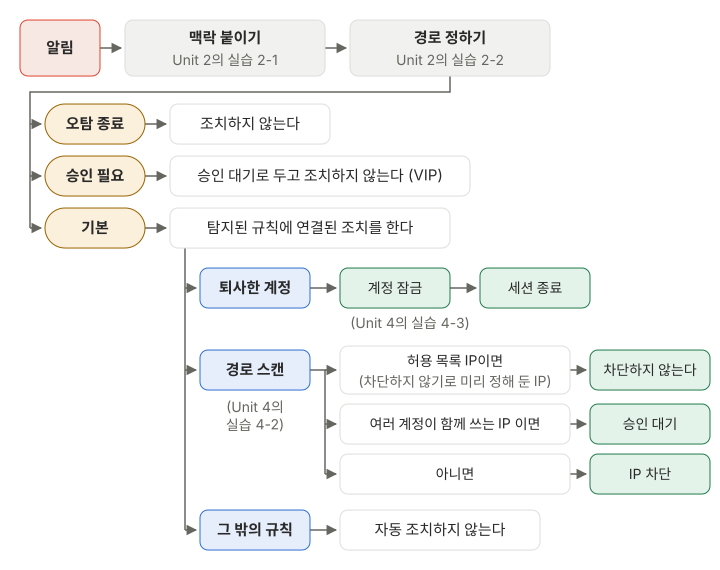

# 실습 5-2 · 알림 8건 처리와 확인 목록 만들기

## 목표: 알림 8건 일괄 처리

> **오늘 들어온 일**
>
> - **상황**: 교대 직전에 알림 8건이 한꺼번에 들어왔습니다. Unit 2에서 만든 판단(맥락 붙이기 · 경로 정하기)과 오늘 만든 조치를 이어서 한 번에 처리해야 합니다.
> - `INC-001`: 퇴사한 `dami` 의 계정
> - `INC-002`: `seoyeon` 의 알림. 자동 조치를 연결해 둔 규칙이 아니라서 조치하지 않는 건
> - `INC-003` · `INC-010`: 계정 관리자 `gaeun`(VIP 계정: 잠기면 업무 영향이 큰 중요한 계정)의 알림 2건. `INC-010` 은 인사 시스템 입력 실수로 퇴사자로 표시된 알림이고, `INC-003` 은 서버가 요청을 거절한 알림입니다
> - `INC-004`: 협력사 `jiwoo` 의 정상 접속(오탐)
> - `INC-005` · `INC-008` · `INC-009`: 경로 스캔(서버의 여러 주소에 차례로 요청을 보내 약점을 찾는 일) 세 건. `INC-005` 는 외부 IP, `INC-008` 은 여러 계정이 함께 쓰는 IP, `INC-009` 는 회사 점검 서버에서 온 것입니다
> - **문제**:
> - 건마다 사람이 판단해 조치하면 시간이 걸립니다. 또 교대할 때 「무엇을 했고 무엇을 사람이 봐야 하는지」를 따로 정리해야 합니다.
> - `INC-005` 는 차단하려는 순간 방화벽 연결이 끊겨 차단되지 않았습니다. 이 건이 보고에서 「조치함」으로 보고되면 공격 IP 가 차단되지 않은 채 그대로 남습니다.
> - **부탁**: 알림 8건을 판단하고 조치하는 일을 한 번에 실행하고, 기록을 종류별로 요약해서 사람이 확인할 건 목록을 만들어 주세요.
> - **바뀌는 점**: 교대하는 사람은 기록 요약(변경됨 2 · 변경 없음 2 · 확인 실패 1)과 담당자 확인 목록 4건을 함께 보면 됩니다. 상황과 숫자는 설명을 위한 예시입니다.

## 3.1 알림 한 건은 「판단 → 조치 → 기록」을 거치고, 근무가 끝나면 기록을 종류별로 센다

<figure class="page-figure"></figure>

근무 보고(교대할 때 다음 사람에게 넘기는 요약)는 조치 기록을 세 종류로 셉니다. 예를 들어 `INC-005` 는 방화벽 연결이 끊겨 차단되지 않았으므로 「확인 실패」로 셉니다.

| 종류 | 기준 | 사람이 볼 것 |
|---|---|---|
| 변경됨 | 조치 전과 후가 다르고 확인 실패가 아니다 | 필요하면 오탐일 때 되돌리기 |
| 변경 없음 | 조치 전과 후가 같다 | 보류한 이유(승인 필요 등)가 있으면 확인 |
| 확인 실패 | 조치 후 상태에 `확인 실패` 가 있다 | 반드시 사람이 확인 |

함수는 두 파일에 나뉘어 있고, 직접 쓰는 곳은 **아홉 군데**입니다.

```
drill.py          choose_containment : 탐지된 규칙에 연결된 조치 이름을 고른다 (1 ~ 3번)
                  handle_incident    : 경로가 오탐 종료이면 종료하고, 승인 필요(VIP)이면 승인 대기로 두고 (4 · 5번), 나머지는 규칙에 맞는 조치를 한다 (미리 채움). 여러 계정이 함께 쓰는 IP 의 차단도 승인 대기로 둔다
shift_report.py   is_failure         : 조치 후 상태에 확인 실패가 있는지 구한다 (6번)
                  is_unchanged       : 조치 전과 후가 같은지 구한다 (7번)
                  summarize          : 기록을 종류별로 센다 (8번)
실행 파일         exercise5-2_run.py   : 알림마다 처리 결과를 두 값으로 나눠 받는다(언패킹) (9번)
```

## 실습 5-2 · 알림 8건 처리와 확인 목록 만들기

<h2>이런 상황이 있습니다</h2>

- **지금은**: <mark>알림 8건을 판단하는 함수와 조치하는 함수가 따로 있을 뿐, 한 번에 처리하고 근무 보고로 요약하는 흐름이 없습니다</mark>.
- **만드는 것**: 규칙에 맞는 조치 고르기와 VIP 승인 대기(`drill.py`), 기록 종류 나누기와 세기(`shift_report.py`), 처리 결과 받기(`exercise5-2_run.py`).
- **실행하면**: <mark>단계 1: 알림 8건의 처리 결과, 단계 2: 조치 기록, 단계 3: 근무 보고 요약과 최종 상태, 단계 4: 담당자 확인이 필요한 건이 나옵니다.</mark>

**할 일**: 파일 세 개를 만들어 붙여 넣고 번호 주석 바로 아래에 직접 코드를 씁니다. 실행해서 단계 1 ~ 4 를 읽습니다.

<h3><code>drill.py</code></h3>

알림 한 건을 처리합니다. Unit 2의 `enrichment.py` · `routing.py` 와 Unit 4 파일을 불러옵니다(import). 직접 쓰는 곳은 1 ~ 5번입니다. `FIREWALL_DOWN_FOR` 는 방화벽 연결이 끊긴 상황을 흉내 내려고 수업에서만 쓰는 목록입니다.

```python
from enrichment import enrich_incident                                                      # Unit 2의 실습 2-1 : 맥락 붙이기
from routing import decide_route                                                            # Unit 2의 실습 2-2 : 경로 정하기
from containment_store import make_record                                                   # 기록 한 건을 만드는 함수를 불러온다
from containment import contain_account                                                     # Unit 4의 실습 4-3 : 잠금 → 세션 종료
from ip_actions import check_ip_policy, block_ip, DEFAULT_TTL                               # Unit 4의 실습 4-2 : IP 차단

CONTAINMENT_BY_RULE = {"퇴사한 계정": "계정 조치", "경로 스캔": "IP 차단"}                  # 탐지된 규칙에 따라 할 조치 : 이 표에 없는 규칙은 조치하지 않는다
FIREWALL_DOWN_FOR = ["INC-005"]                                                             # 방화벽 연결이 끊긴 상황을 흉내 낼 인시던트 번호 : 이 인시던트의 IP 차단은 실패한다


def choose_containment(incident):                                                           # 인시던트 하나를 받는 함수
    """탐지된 규칙을 하나씩 보고, 조치 표(CONTAINMENT_BY_RULE)에 있는 규칙이면 그 조치 이름을, 하나도 없으면 「없음」을 리턴한다.
    규칙마다 어떤 자동 조치를 할지 연결해 둘 때 쓴다.
    """
    # ← 아래를 직접 씁니다 (주석은 두고 각 주석 바로 아래 줄에 씁니다)
    # 1. incident["reasons"] 의 규칙을 하나씩 꺼낸다 (for, rule)
    # 2.   rule 이 CONTAINMENT_BY_RULE 안에 있으면 (if, in)
    # 3.     CONTAINMENT_BY_RULE[rule] 을 리턴한다
    return "없음"                                                                           # 조치 표에 있는 규칙이 없으면 「없음」을 리턴한다 — 미리 채운 줄


def handle_incident(incident, state, refs):                                                 # 인시던트 · 연습용 시스템 상태 · 참고 데이터 딕셔너리를 받는 함수
    """알림 한 건에 맥락을 붙이고 경로를 정한 뒤, 오탐은 종료하고 VIP 는 승인 대기로 두고, 나머지는 규칙에 맞는 조치를 실행한다.
    알림 한 건을 처음부터 끝까지 처리할 때 쓰고, 처리 결과 문장과 조치 기록 리스트를 함께 리턴한다.
    """
    enrich_incident(incident, refs["users_info"], refs["source_ips"], refs["trusted_ips"])  # Unit 2 : 맥락을 붙인다 — 미리 채운 줄
    route, reason = decide_route(incident)                                                  # Unit 2 : 처리 경로와 이유를 정한다 — 미리 채운 줄
    if route == "오탐 종료":                                                                # 오탐으로 닫을 알림이면 — 미리 채운 줄
        return "오탐 종료", []                                                              # 조치하지 않고 끝낸다 — 미리 채운 줄
    # ← 아래를 직접 씁니다 (주석은 두고 각 주석 바로 아래 줄에 씁니다)
    # 4. route 가 "승인 필요" 이면 (if, ==)
    # 5.   "승인 대기" 와 빈 리스트 [] 를 쉼표로 이어 함께 리턴한다 (담당자가 허락하기 전에는 조치하지 않는다)
    kind = choose_containment(incident)                                                     # 할 조치 종류를 구한다 — 미리 채운 줄
    entity = incident["entity"]                                                             # 대응할 대상 — 미리 채운 줄
    if kind == "계정 조치":                                                                 # 계정 조치이면 — 미리 채운 줄
        records = contain_account(entity, state, refs["vip_accounts"], incident["id"], incident["reasons"][0])  # 잠금 → 세션 종료 — 미리 채운 줄
        return "조치함", records                                                            # 조치 결과를 리턴한다 — 미리 채운 줄
    if kind == "IP 차단":                                                                   # IP 차단이면 — 미리 채운 줄
        if incident["id"] in FIREWALL_DOWN_FOR:                                             # 방화벽 연결이 끊긴 상황이면 — 미리 채운 줄
            return "조치 실패", [make_record("IP 차단", entity, incident["id"], "차단되지 않음", "차단되지 않음 (확인 실패)", "방화벽 연결 실패")]  # 차단되지 않았다고 기록한다 — 미리 채운 줄
        refusal = check_ip_policy(entity, refs["allowlist_ips"], refs["ip_users"])          # 차단을 막을 이유를 구하고 — 미리 채운 줄
        if refusal != "":                                                                   # 막을 이유가 있으면 — 미리 채운 줄
            status = "조치하지 않음"                                                        # 기본은 조치하지 않음이고 — 미리 채운 줄
            if "승인 필요" in refusal:                                                      # 담당자 승인이 필요한 이유이면 — 미리 채운 줄
                status = "승인 대기"                                                        # 승인 대기로 바꾼다 — 미리 채운 줄
            return status, [make_record("IP 차단", entity, incident["id"], "변경 없음", "변경 없음", refusal)]  # 이유만 기록한다 — 미리 채운 줄
        return "조치함", [block_ip(entity, state, incident["id"], incident["reasons"][0], DEFAULT_TTL)]  # 차단하고 기록한다 — 미리 채운 줄
    return "조치하지 않음", []                                                              # 자동 조치 대상이 아니면 조치하지 않는다 — 미리 채운 줄
```

<h3><code>shift_report.py</code></h3>

기록을 종류별로 셉니다. 직접 쓰는 곳은 6 ~ 8번입니다.

```python
def is_failure(record):                                     # 기록 한 건을 받는 함수
    """기록의 조치 후 상태에 「확인 실패」가 들어 있으면 True, 아니면 False 를 리턴한다.
    조치했다고 했지만 실제로 바뀌지 않은 건을 찾아낼 때 쓴다.
    """
    # ← 아래를 직접 씁니다 (주석은 두고 각 주석 바로 아래 줄에 씁니다)
    # 6. "확인 실패" 가 record 의 "after" 안에 있는지(in)의 결과를 리턴한다


def is_unchanged(record):                                   # 기록 한 건을 받는 함수
    """조치 전과 후 상태가 같으면 True, 다르면 False 를 리턴한다.
    실제로 바뀐 것이 없는 기록을 찾아낼 때 쓴다.
    """
    # ← 아래를 직접 씁니다 (주석은 두고 각 주석 바로 아래 줄에 씁니다)
    # 7. record 의 "before" 와 "after" 가 같은지(==)의 결과를 리턴한다


def classify_record(record):                                # 기록 한 건을 받는 함수
    """기록을 「확인 실패」 · 「변경 없음」 · 「변경됨」 중 하나로 나눠 리턴한다.
    근무 보고에서 조치 결과를 종류별로 셀 때 쓴다.
    """
    if is_failure(record):                                  # 확인에 실패한 기록이면 — 미리 채운 줄
        return "확인 실패"                                  # 확인 실패로 나눈다 — 미리 채운 줄
    if is_unchanged(record):                                # 바뀐 것이 없으면 — 미리 채운 줄
        return "변경 없음"                                  # 변경 없음으로 나눈다 — 미리 채운 줄
    return "변경됨"                                         # 그 밖에는 실제로 바뀐 기록이다 — 미리 채운 줄


def summarize(log):                                         # 기록 리스트를 받는 함수
    """기록을 종류별로 몇 건인지 세어 딕셔너리로 리턴한다.
    근무를 넘길 때 오늘 조치가 어떻게 끝났는지 한눈에 보여 줄 때 쓴다.
    """
    counts = {"변경됨": 0, "변경 없음": 0, "확인 실패": 0}  # 종류별 건수를 셀 딕셔너리
    for record in log:                                      # 기록을 하나씩 꺼낸다
        kind = classify_record(record)                      # 기록의 종류를 구한다 — 미리 채운 줄
        # ← 아래를 직접 씁니다 (주석은 두고 각 주석 바로 아래 줄에 씁니다)
        # 8. counts[kind] 에 counts[kind] + 1 을 담는다 (그 종류의 건수를 1 늘린다)
    return counts                                           # 종류별 건수를 리턴한다
```

<h3><code>exercise5-2_run.py</code></h3>

9번만 직접 쓰고 나머지는 그대로 붙여 넣습니다. 이번 근무의 기록은 `shift_log.json` 에 따로 저장하고, 실습 4-3이 저장한 파일은 건드리지 않습니다.

```python
from incident import load_json, save_json, INCIDENTS_PATH                                 # Unit 1 파일의 함수를 불러온다
from containment_store import new_state                                                   # Unit 4의 실습 4-1의 처음 상태 함수를 불러온다
from drill import handle_incident                                                         # 방금 만든 사건 처리 함수를 불러온다
from shift_report import summarize, is_failure                                            # 방금 만든 근무 보고 함수를 불러온다

extra_incidents = [  # 오늘 추가 알림: 함께 쓰는 IP, 점검 서버, 인사 입력이 잘못된 VIP
    {
        "id": "INC-008",
        "entity": "192.0.2.41",
        "grade": "low",
        "score": 30,
        "reasons": ["경로 스캔"],
        "status": "탐지됨",
    },
    {
        "id": "INC-009",
        "entity": "192.0.2.10",
        "grade": "low",
        "score": 30,
        "reasons": ["경로 스캔"],
        "status": "탐지됨",
    },
    {
        "id": "INC-010",
        "entity": "gaeun",
        "grade": "high",
        "score": 60,
        "reasons": ["퇴사한 계정"],
        "status": "탐지됨",
    },
]
incidents = load_json(INCIDENTS_PATH) + extra_incidents                                   # Unit 1에 만든 알림 5건에 오늘 알림 3건을 이어 붙인다
refs = {
    "users_info": load_json("users_info.json"),
    "source_ips": load_json("source_ips.json"),
    "trusted_ips": load_json("trusted_ips.json"),
    "vip_accounts": load_json("config/vip_accounts.json"),
    "allowlist_ips": load_json("config/allowlist_ips.json"),
    "ip_users": load_json("ip_users.json"),
}  # 판단에 쓰는 참고 데이터를 한 딕셔너리로 모은다
state = new_state()                                                                       # 처음 상태에서 시작한다
log = []                                                                                  # 이번 실행의 조치 기록을 모을 빈 리스트
statuses = {}                                                                             # 인시던트별 처리 결과를 모을 딕셔너리

print("--- 단계 1: 알림 8건 처리")                                                        # 단계 1 시작을 알리는 줄
for incident in incidents:                                                                # 알림을 하나씩 꺼낸다
    # ← 아래를 직접 씁니다 (주석은 두고 각 주석 바로 아래 줄에 씁니다)
    # 9. handle_incident(incident, state, refs) 가 리턴한 두 값을 status 와 records 에 한 번에 받는다
    statuses[incident["id"]] = status                                                     # 처리 결과를 모아 둔다
    for record in records:                                                                # 조치 기록을 하나씩 꺼낸다
        log.append(record)                                                                # 이번 근무의 기록에 모은다
    print(incident["id"], incident["entity"], "->", status, "(조치 기록 " + str(len(records)) + "건)")  # 한 줄로 출력한다

save_json(log, "shift_log.json")                                                          # 이번 근무의 기록을 따로 저장한다 (실습 4-3이 저장한 기록 파일은 건드리지 않는다)
print("--- 단계 2: 조치 기록")                                                            # 단계 2 시작을 알리는 줄
for record in log:                                                                        # 기록을 하나씩 꺼낸다
    print(record["incident"], record["target"], "·", record["action"], "·", record["before"], "→", record["after"], "·", record["reason"])  # 기록 한 건을 출력한다

print("--- 단계 3: 근무 보고 요약")                                                       # 단계 3 시작을 알리는 줄
print(summarize(log))                                                                     # 조치 결과를 종류별로 센 요약을 출력한다
print("잠긴 계정:", state["locked_users"])                                                # 잠긴 계정을 출력한다
print("차단한 IP:", state["blocked_ips"])                                                 # 차단한 IP 를 출력한다

print("--- 단계 4: 담당자 확인이 필요한 건")                                              # 단계 4 시작을 알리는 줄
for incident in incidents:                                                                # 알림을 하나씩 꺼낸다
    if statuses[incident["id"]] == "승인 대기" and incident["context"]["vip"]:            # 승인 대기이고 VIP 계정이면
        print(incident["id"], incident["entity"], ": VIP 계정이라 담당자 승인이 필요함")  # 이유와 함께 출력한다
for record in log:                                                                        # 기록을 하나씩 꺼낸다
    if "승인 필요" in record["reason"]:                                                   # 이유에 「승인 필요」가 들어 있으면
        print(record["incident"], record["target"], ":", record["reason"])                # 이유와 함께 출력한다
    if is_failure(record):                                                                # 조치 후 확인에 실패한 기록이면
        print(record["incident"], record["target"], ": 조치 후 확인 실패 —", record["reason"])  # 이유와 함께 출력한다
```

<h2>순서</h2>

1. **[VS Code]** 왼쪽 목록에서 `soar_response` 폴더를 오른쪽 클릭 › **New File** 을 누르고, 파일 이름 `drill.py` · `shift_report.py` · `exercise5-2_run.py` 을(를) 하나씩 그대로 적어 세 개의 파일을 만듭니다. 각 파일에 이 페이지의 코드 상자를 복사해 붙여 넣고 저장합니다(`Ctrl + S`, 맥북은 `Cmd + S`).
2. **[VS Code]** `drill.py` 1 ~ 5번, `shift_report.py` 6 ~ 8번, `exercise5-2_run.py` 9번을 씁니다. 막히면 아래 「실습 5-2 정리」를 봅니다.
3. **[터미널]** 실행합니다(맥북은 `python3`).
   ```bash
   python exercise5-2_run.py
   ```
4. 출력은 네 단계입니다. 제목 줄은 줄 수에 넣지 않습니다. 단계 1 은 8줄, 단계 2 는 5줄, 단계 3 은 3줄, 단계 4 는 4줄입니다.
5. **[실습 결과 기록]** `report_u5.md` 의 `## 실습 5-2` 아래를 채웁니다.
   - (가) 실행한 출력 전체를 붙여 넣어 주세요. 그리고 단계 3 의 요약과 단계 4 의 건수를 적어 주세요.
   - (나) [핵심 질문] INC-005 는 `조치 실패` 로 나왔고 요약의 `확인 실패` 가 1 입니다. 단계 2 의 줄을 근거로 이유를 적고, 6번(`is_failure`, 확인 실패인지 구하는 함수)이 없다면 이 건이 근무 보고에서 어떻게 보일지 적어 주세요.
   - (다) [핵심 질문] INC-008 과 INC-009 는 모두 차단되지 않았습니다. INC-008 은 승인 대기이고 INC-009 는 조치하지 않음입니다. INC-003 과 INC-010 도 승인 대기입니다. INC-003 · INC-008 · INC-009 · INC-010 네 건이 왜 그렇게 나왔는지 단계 2 와 단계 4 의 줄을 근거로 적어 주세요. 또 이 네 건을 그대로 자동 처리했다면 누가 어떤 영향을 받았을지 적어 주세요.

## 실습 5-2 정리

| 하려는 일 | 코드 · 말 |
|---|---|
| 하나씩 읽기 | `for rule in incident["reasons"]:` |
| 딕셔너리 키가 있으면 | `if rule in CONTAINMENT_BY_RULE:` |
| 값 두 개를 함께 리턴 | `return "승인 대기", []` |
| 안에 있는지 확인한 결과 리턴 | `return "확인 실패" in record["after"]` |
| 같은지의 결과 리턴 | `return record["before"] == record["after"]` |
| 1 늘려 다시 저장 | `counts[kind] = counts[kind] + 1` |
| 리턴된 값 두 개를 한 번에 받기(언패킹, unpacking: 값 두 개를 변수 두 개에 하나씩 저장) | `status, records = handle_incident(incident, state, refs)` |

<!-- answer: 04|실습 5-2 정답 -->


---

## 코드와 실습 결과 기록을 GitHub에 올리기

<mark>문제가 아니라 오늘 한 일을 저장소에 올리는 마무리입니다.</mark> 실습 5-2 마지막 약 10분에 합니다. 어느 터미널을 써도 됩니다. 먼저 `pwd` 로 위치를 확인하고, 결과가 `soar_response` 로 끝날 때만 아래 1번의 `cd ..` 를 칩니다.

<h2>이런 상황이 있습니다</h2>

- **지금은**: <mark>팀장이 「오늘 만든 계정 잠금 · IP 차단 · 세션 종료와 되돌리기 코드를 저장소에 남겨 달라」고 합니다</mark>.
- **그래서 하는 것**: 먼저 `git status` 로 올라갈 파일을 확인합니다(`.env` 같은 비밀 키 파일이 있으면 안 됩니다). 그다음 `git add` → `git commit` → `git push` 순서로 올립니다.
- **끝나면**: 깃허브 저장소의 `soar_response` 폴더에 `containment_store.py` · `account_actions.py` · `ip_actions.py` · `session_actions.py` · `containment.py` · `undo_actions.py` · `rollback.py` · `drill.py` · `shift_report.py` 가 보입니다.

<h2>순서</h2>

0. **[터미널]** 오늘 만든 파일이 있는지 `soar_response` 폴더에서 확인합니다. 두 명령을 하나씩 칩니다. Unit 4 와 Unit 5 의 질문과 코드 상자에 남은 빈 곳이 없는지도 확인합니다.

   ① 지금 위치를 확인합니다.

   ```bash
   pwd
   ```

   - 하는 일: 지금 있는 폴더의 위치를 보여 줍니다.
   - 나오는 것: <mark>`soar_response` 로 끝나야</mark> 합니다.

   ② 폴더 안의 파일을 봅니다.

   ```bash
   ls
   ```

   - 하는 일: 폴더 안의 파일 이름을 보여 줍니다.
   - 나오는 것: `containment_store.py` · `account_actions.py` · `ip_actions.py` · `session_actions.py` · `containment.py` · `undo_actions.py` · `rollback.py` · `drill.py` · `shift_report.py` · `config` 가 보이면 됩니다.

1. **[터미널]** `security-agent-toolkit` 폴더로 옮깁니다. 0번의 `pwd` 결과가 `soar_response` 로 끝날 때만 `cd ..` 를 칩니다. 이미 `…/security-agent-toolkit` 으로 끝나면 `cd ..` 는 건너뛰고 `pwd` 만 칩니다.

   ① 한 단계 위 폴더로 이동합니다.

   ```bash
   cd ..
   ```

   - 하는 일: 한 단계 위 폴더로 이동합니다.
   - 나오는 것: 아무것도 나오지 않습니다.

   ② 지금 위치를 확인합니다.

   ```bash
   pwd
   ```

   - 하는 일: 지금 있는 폴더의 위치를 보여 줍니다.
   - 나오는 것: <mark>`…/security-agent-toolkit` 으로 끝나면</mark> 됩니다. 결과가 다르면 VS Code 왼쪽 목록에서 `security-agent-toolkit` 폴더를 오른쪽 클릭 › **Open in Integrated Terminal** 로 터미널을 새로 엽니다.

2. **[터미널]** 무엇이 바뀌었는지 먼저 봅니다. <mark>빨간 글씨 줄에 `.env` 나 `.venv` 가 보이면 올리지 말고,</mark> 아래 안내대로 `.gitignore`(깃이 올리지 않을 파일 이름을 적어 두는 파일)에 그 이름을 적습니다. `.env` 에는 API 키가 있어서 올리면 다른 사람이 볼 수 있기 때문입니다. 적은 뒤 `git status` 를 다시 봅니다.

   ① 올릴 파일의 상태를 봅니다.

   ```bash
   git status
   ```

   - 하는 일: 올릴 파일의 상태를 보여 줍니다.
   - 나오는 것: 바뀐 파일의 이름이 나옵니다. `soar_response/` 아래의 새 파일들이 보이면 됩니다.

   - `.env` 가 보이면: VS Code 왼쪽 목록에서 `security-agent-toolkit` 바로 아래의 `.gitignore` 를 열어 맨 아래에 `.env` 한 줄을 적고 저장한 뒤 `git status` 를 다시 칩니다.
     - `.venv` 는 `.venv/` 한 줄을 같은 방법으로 적습니다.
   - `soar_response/__pycache__/` (파이썬이 실행하면서 자동으로 만드는 임시 폴더)가 보이면 `.gitignore` 맨 아래에 `__pycache__/` 한 줄을 적고 저장한 뒤 `git status` 를 다시 봅니다.

3. **[실습 결과 기록]** `report_u5.md` 의 `## GitHub 업로드 점검` 아래에 `.env` 나 `.venv` 를 제외했는지와 확인 방법을 적습니다. `report_u4.md` 와 `report_u5.md` 의 미완료 칸은 `모름 — 막힌 곳: …` 으로 남겨도 됩니다.
4. **[터미널]** 바뀐 파일을 모두 올릴 목록에 추가하고(`add`), 기록하고(`commit`), 올립니다(`push`). 세 명령을 순서대로 하나씩 칩니다.

   ① 바뀐 파일을 모두 올릴 목록에 추가합니다.

   ```bash
   git add .
   ```

   - 하는 일: 바뀐 파일을 올릴 대상에 추가합니다.
   - 나오는 것: 아무것도 나오지 않습니다.

   ② 기록으로 저장합니다.

   ```bash
   git commit -m "Add SOAR containment, post-checks, rollback and shift report"
   ```

   - 하는 일: 따옴표 안의 설명을 붙여 기록으로 저장합니다.
   - 나오는 것: 바뀐 파일 수가 적힌 줄이 나옵니다.

   ③ 깃허브로 올립니다.

   ```bash
   git push
   ```

   - 하는 일: 저장한 기록을 깃허브로 올립니다.
   - 나오는 것: 올라간 내용이 몇 줄 나옵니다.

   - <mark>`git push` 가 거절(`rejected`)되면 깃허브에 내 PC 에 없는 기록이 있다는 뜻입니다.</mark> `git pull --no-rebase`(깃허브의 새 기록을 내 PC 로 받아 와 합치는 명령)를 입력한 뒤 `git push` 를 다시 합니다.
   - 편집기 화면이 뜨면 `Esc` → `:wq`(저장하고 나가기) → `Enter` 를 합니다.
   - `git pull` 만 입력했을 때 `fatal: Need to specify how to reconcile divergent branches` 가 나오면, 내 기록과 깃허브 기록이 갈라졌다는 뜻이므로 `git pull --no-rebase` 를 입력합니다.

5. **[브라우저]** 깃허브의 내 저장소를 새로 고쳐 `soar_response` 폴더를 열고, VS Code 왼쪽 목록의 `soar_response` 폴더에 있는 파일들이 깃허브에도 보이는지 확인합니다. <mark>`__pycache__` 폴더는 없어도 됩니다</mark>.
   - 깃허브에 빠진 이름이 있으면, 그 파일이 내 PC 의 `soar_response` 폴더(VS Code 왼쪽 목록)에는 있는지 봅니다.
     - 없으면 다른 폴더에 만든 것이니 `soar_response` 안으로 옮기고, `pwd` 로 위치를 확인한 뒤 2번의 `git status` 부터 다시 합니다.

## 문제 해결 과정을 블로그에 기록하기

두 실습에서 실제로 판단한 문제 하나를 골라 GitHub 블로그에 기록합니다. 기술 결과인 `report_u5.md` 와 달리, 이 글에는 무엇이 문제였고 어떤 근거로 방법을 골랐는지, 직접 확인한 결과와 다음에 확인할 일을 남깁니다. 블로그 준비가 되어 있지 않다면 [M3 Unit 1 시작하기](__SITE__/exercises/module/3/unit/1/lesson/1/page/4)에서 GitHub Pages와 Jekyll 설정을 마친 뒤 돌아옵니다.

예를 들어 `before` 와 `after` 를 비교해 자동 대응이 바꾼 상태만 되돌린 이유, 되돌릴 수 없는 세션 종료를 기록으로 남긴 이유, 방화벽 확인 실패를 근무 요약에서 구분한 이유 중 하나를 고릅니다. 아래 항목을 내 실제 실습 결과로 채웁니다. 확인하지 않은 사실은 확인한 것처럼 쓰지 않습니다.

1. **문제 상황**: 어떤 상태나 출력이 문제였나요?
2. **시도와 선택**: 어떤 조건이나 처리 방법을 골랐고, 그 이유는 무엇인가요?
3. **확인한 결과**: 어떤 입력을 실행했고 어떤 결과를 직접 봤나요?
4. **배운 점과 다음 행동**: 무엇을 배웠고, 다음에 무엇을 확인해야 하나요?
5. **AI 도움**: 사용했다면 무엇을 물었고 어떤 답을 직접 검증했나요? 사용하지 않았다면 생략합니다.

저장소 `network-study-notes` 의 `_posts` 폴더에 오늘 날짜를 넣은 글을 만듭니다. 날짜와 Module·Unit 정보를 고치고, 제목과 본문을 내 경험으로 작성합니다.

<pre class="copyable"><code>---
layout: post
title: "자동 대응을 되돌릴 때 상태 기록을 비교한 이유"
date: YYYY-MM-DD
module: 5
unit: 5
---

# 문제 상황

# 시도와 선택

# 확인한 결과

# 배운 점과 다음 행동

# AI 도움 (사용했다면)
</code></pre>

실습 결과 기록의 숫자나 출력은 필요한 부분만 인용합니다. 실습 파일과 글에 비밀번호, 토큰, 개인 이메일·전화번호, 실제 다른 사람의 이름이 없는지 확인합니다. 작성한 글과 코드는 M3 Unit 1의 [문제 해결 과정을 블로그에 기록하기](__SITE__/exercises/module/3/unit/1/lesson/15/page/1)에서 안내한 공개 전 확인과 GitHub 업로드 순서에 따라 올리고, GitHub Pages에서 새 글이 보이는지 확인합니다.

<!-- checklist -->
- [ ] 실제 실습의 문제·선택 이유·확인 결과·배운 점을 블로그 글에 기록했다
- [ ] 공개 전 민감 정보를 확인하고 GitHub Pages에서 글을 확인했다
<!-- /checklist -->

---

<!-- learn:answers -->
