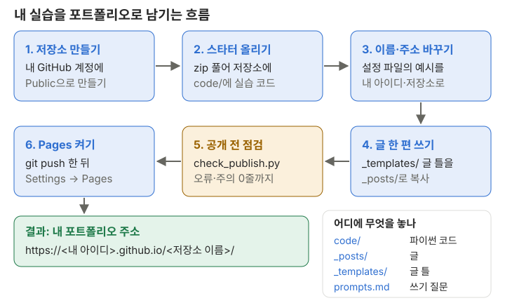

# 내 실습을 포트폴리오로 남기기

## 이게 뭔가요

Module 3~5 실습에서 쓴 파이썬 코드와, 그 코드를 쓰며 한 고민(무엇을 골랐고 왜 골랐는지)을 내 GitHub 계정의 공개 페이지로 남기는 활동입니다. 이렇게 남긴 페이지를 포트폴리오로 씁니다.

내 말로 설명해 본 기록이 남는다는 점이 가장 좋습니다. 글로 풀어 쓰다 보면 어디까지 이해했는지도 스스로 확인됩니다. 면접이나 지원 때는 링크 하나만 보내면 코드와 생각을 함께 보여 줄 수 있습니다.

설치할 것은 없습니다. **GitHub 웹 화면에서 파일을 만들고 붙여 넣는 것만으로** 시작할 수 있습니다.

## 무엇을 남기나요

| 남길 것 | 놓는 곳 | 설명 |
|---|---|---|
| 코드 | `code/` | 실습에서 작성하고 고친 파이썬 파일 |
| 글 | `_posts/` | 고민을 내 말로 정리한 글 한 편 |
| 실행 결과 화면 | 글 안에 이미지로 | 코드를 돌린 터미널 출력이나 화면 캡처 |

글감은 실습의 "고민" 질문에서 고릅니다. 보고서의 (나)·(다)처럼 서술해서 답하는 질문이 좋은 글감입니다. 예를 들어 "왜 이 방식을 골랐는가", "다른 방법이었다면 무엇이 달라졌을까"에 대한 내 답을 글로 옮기면 됩니다.

## 전체 흐름

<figure class="page-figure"></figure>

1. 내 GitHub 계정에 저장소를 만듭니다.
2. [파일 모음](files/) 페이지에서 내용을 복사해, 같은 이름의 파일을 저장소에 만듭니다.
3. `_config.yml` 안의 이름과 주소를 내 것으로 바꿉니다.
4. 글 틀을 복사해 글 한 편을 씁니다.
5. 공개 전에 올리면 안 되는 것이 없는지 점검합니다.
6. GitHub Pages를 켜고 주소를 확인합니다.

## 따라 하기

### 1단계. 저장소 만들기

1. [github.com](https://github.com)에 로그인합니다.
2. 화면 오른쪽 위의 `+` 아이콘을 누르고 **New repository**를 고릅니다.
3. **Repository name**에 `network-study-notes`처럼 알아보기 쉬운 영문 이름을 적습니다.
4. 공개 범위는 **Public**을 고릅니다. Private이면 Pages 주소로 다른 사람이 볼 수 없습니다.
5. **Add a README file**은 체크하지 않습니다. 비어 있는 저장소가 파일을 만들기 더 편합니다.
6. 맨 아래 **Create repository** 버튼을 누릅니다.

### 2단계. 파일 만들기

[파일 모음](files/) 페이지에는 만들 파일이 순서대로 나와 있습니다. 각 상자 오른쪽 위의 **복사** 버튼으로 내용을 복사할 수 있습니다. 먼저 아래 네 개를 만드세요(필수 표시가 붙은 파일입니다).

1. [`_config.yml`](files/#config-yml)
2. [`index.md`](files/#index-md)
3. [`about.md`](files/#about-md)
4. [`_posts/2026-01-01-hello.md`](files/#posts-2026-01-01-hello-md)

파일 하나를 만드는 방법은 같습니다.

1. 방금 만든 빈 저장소 화면에서 **creating a new file** 링크를 누릅니다. 파일이 이미 있는 저장소라면 **Add file → Create new file**을 누릅니다.
2. 위쪽 이름 칸에 파일 이름을 그대로 적습니다. `_posts/2026-01-01-hello.md`처럼 `/`가 들어간 이름은 폴더도 함께 만들어집니다.
3. [파일 모음](files/)에서 같은 이름의 상자를 찾아 **복사**를 누르고, 아래 편집 칸에 붙여 넣습니다.
4. 오른쪽 위 **Commit changes…**를 누르고 한 번 더 **Commit changes**를 누릅니다.

나머지(`.gitignore`, `_templates/`의 글 틀, `code/`, `check_publish.py`)도 같은 방법으로 만들면 됩니다. 필수가 아닌 파일은 나중에 만들어도 됩니다.

내 파이썬 실습 코드는 `code/` 폴더에 둡니다. 저장소에서 `code` 폴더로 들어간 뒤 **Add file → Upload files**를 눌러, 컴퓨터의 `.py` 파일을 끌어다 놓고 **Commit changes**를 누르면 됩니다.

### 3단계. 이름과 주소 바꾸기

저장소에서 `_config.yml`을 열고 오른쪽 위 연필 아이콘(**Edit this file**)을 누릅니다. `# ← 내 것으로 바꾸기`가 붙은 줄을 내 것으로 고칩니다.

| 줄 | 바꿀 내용 |
|---|---|
| `title` | 사이트 이름 |
| `description` | 한 줄 소개 |
| `author` | 내 이름 |
| `url` | `https://내 아이디.github.io` (내 GitHub 아이디) |
| `baseurl` | `/저장소 이름` (슬래시를 앞에 붙입니다) |

최종 주소는 아래 모양이 됩니다.

```
https://<내 아이디>.github.io/<저장소 이름>/
```

`about.md`도 열어 빈칸 안내 문구를 내 소개로 바꿉니다.

### 4단계. 글 한 편 쓰기

1. [파일 모음](files/)에서 글 틀(`_templates/post-practice.md`, 짧게 쓰려면 `post-short.md`)을 복사합니다.
2. **Add file → Create new file**로 `_posts/2026-01-15-first-post.md`처럼 `날짜-영문제목.md` 이름의 새 파일을 만들고 붙여 넣습니다. 날짜는 오늘 날짜로, 제목은 영문과 `-`로 쓰는 것을 권합니다.
3. 틀의 빈칸을 채웁니다. 어떤 실습이었는지, 무엇을 골랐는지, 왜 그렇게 골랐는지 순서로 씁니다.
4. 실행 결과 화면은 이미지로 저장해 `assets/images/` 폴더에 올리고 글에 연결합니다. 방법은 샘플 글에 적혀 있습니다.

글감이 떠오르지 않으면 [쓰기 프롬프트](prompts/)에서 이번 Unit의 질문을 골라 답부터 적어 보세요.

### 5단계. 공개 전 점검

공개하면 누구나 볼 수 있으므로 올리기 전에 점검합니다. 아래 "공개해도 되는 것, 안 되는 것"을 눈으로 한 번 훑어보세요. 내 컴퓨터에서 저장소를 내려받아 쓰는 사람은 점검 스크립트도 돌릴 수 있습니다.

1. [파일 모음](files/#check-publish-py)에서 `check_publish.py`를 복사해 저장소에 같은 이름으로 만듭니다.
2. 터미널에서 저장소를 내려받고 점검합니다. `<내 아이디>`는 내 GitHub 아이디로 바꿉니다.

```
git clone https://github.com/<내 아이디>/network-study-notes.git
cd network-study-notes
python check_publish.py
```

`[오류]`와 `[주의]` 줄이 하나도 나오지 않을 때까지 고친 뒤 다시 돌립니다.

### 6단계. Pages 켜기

1. 저장소 화면에서 **Settings** 탭을 누릅니다.
2. 왼쪽 메뉴에서 **Pages**를 누릅니다.
3. **Build and deployment**의 **Source**는 **Deploy from a branch**로 둡니다.
4. **Branch**에서 `main`과 `/ (root)`를 고르고 **Save**를 누릅니다.
5. 1~2분 기다린 뒤 Pages 화면 위쪽에 나오는 `https://<내 아이디>.github.io/<저장소 이름>/` 주소를 열어 봅니다.

## 공개해도 되는 것, 안 되는 것

| 구분 | 예 |
|---|---|
| 공개해도 됩니다 | 내가 직접 쓴 실습 코드, 내가 쓴 글, 실습 결과 화면(개인 정보가 안 보이는 것) |
| 공개하면 안 됩니다 | `.env` 파일, API 키·토큰, 개인 이메일·전화번호, 다른 사람 이름, 회사 내부 자료 |

한 번 올린 비밀 값은 지워도 기록에 남습니다. 올리기 전에 꼭 확인하세요.

## 쓰기가 막힐 때

[쓰기 프롬프트](prompts/)에 Unit별 질문과, 글을 다듬을 때 쓰는 AI 도우미용 프롬프트가 있습니다. 글이 막히면 질문 하나를 골라 답부터 적어 보세요. 구조가 막히면 글 틀을 그대로 따라 쓰면 됩니다.

짧게 시작하는 요령 세 가지입니다.

1. 세 문장만 씁니다. 무엇을 했는지, 무엇을 골랐는지, 왜 골랐는지입니다.
2. 완벽하게 쓰려 하지 말고 먼저 올립니다. 글은 나중에 고쳐도 됩니다.
3. 막힌 부분은 막혔다고 그대로 씁니다. 어디서 막혔고 어떻게 풀었는지가 가장 좋은 글감입니다.
